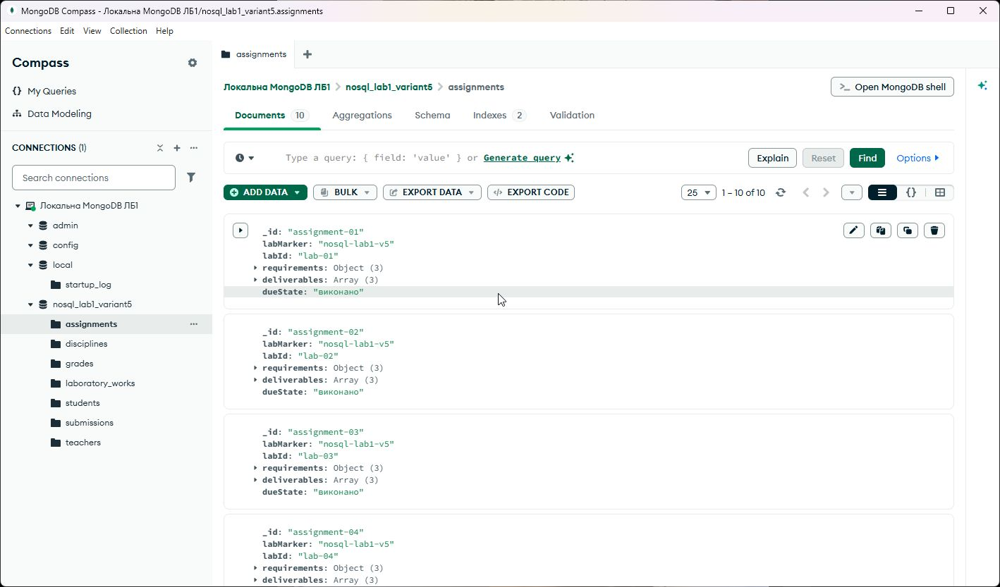
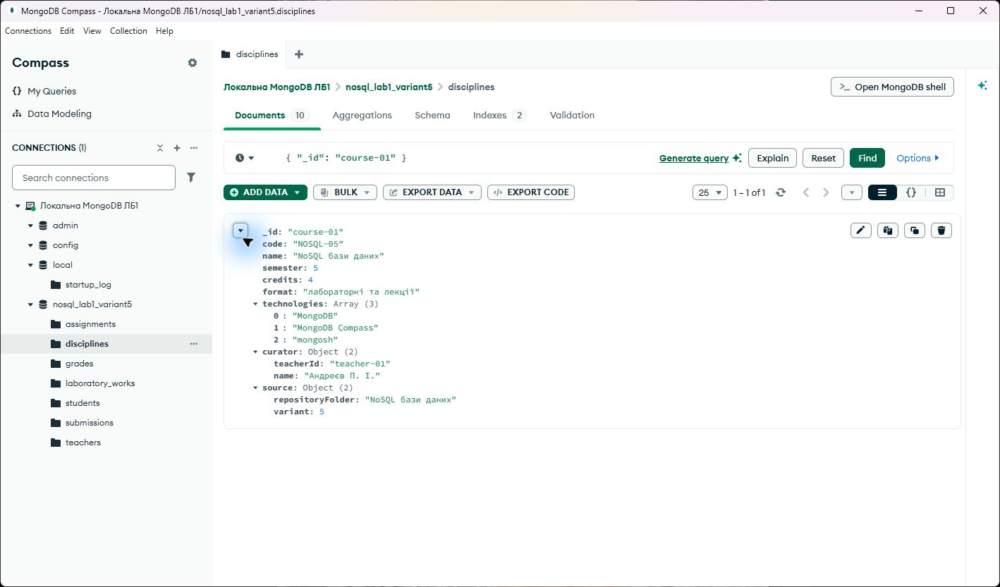
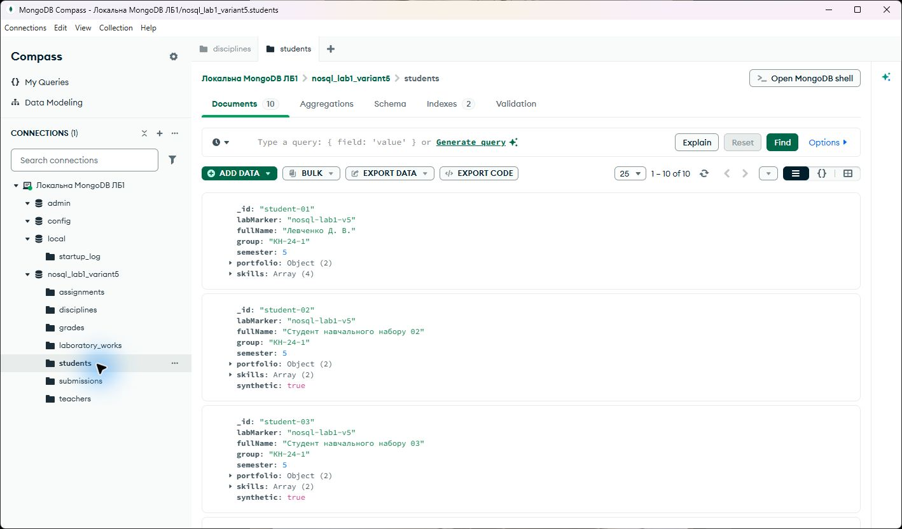
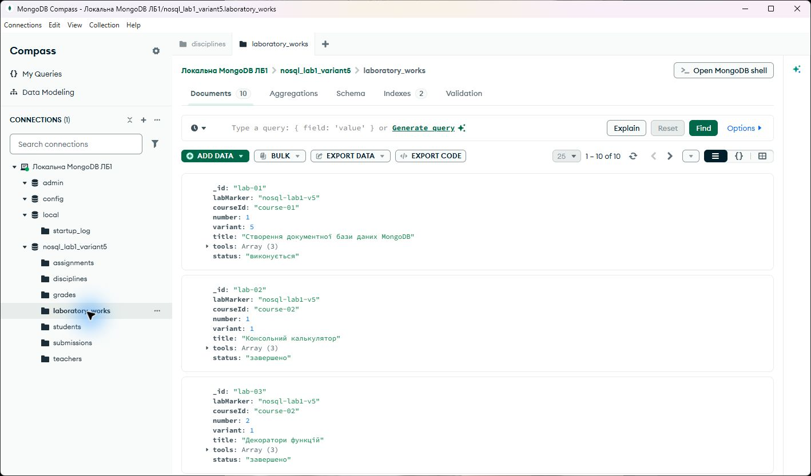

<div align="center">

**ЗВІТ**  
до лабораторної роботи № 1  
з дисципліни **«NoSQL бази даних»**

**Тема:** «Створення документної бази даних MongoDB та завантаження документів»

</div>

| Відомості | Дані |
|---|---|
| Виконав | студент групи КН-24-1 Левченко Д. В. |
| Варіант | 5 |
| Перевірив | Андреєв П. І. |
| Рік виконання | 2026 |

## Мета роботи

Набути практичних навичок створення бази даних і колекцій у MongoDB, імпортування зовнішніх JSON-даних за допомогою `mongoimport`, додавання документів методами `insertOne()` та `insertMany()`, а також дослідити поля, типи даних, вкладені об'єкти й масиви у MongoDB Compass.

## Постановка завдання

Для варіанта № 5 створити документну базу даних навчального портфоліо. База повинна містити не менше 7 колекцій, а кожна колекція - не менше 10 документів. Дані потрібно додати трьома способами: за допомогою `mongoimport`, `insertOne()` та `insertMany()`. Результат необхідно перевірити у графічному застосунку MongoDB Compass.

## Короткі теоретичні відомості

MongoDB зберігає дані у BSON-документах. Документи об'єднуються в колекції, а колекції належать базі даних. На відміну від таблиці реляційної бази, документи однієї колекції можуть мати різний набір полів. Поле `_id` є унікальним ідентифікатором документа.

Формат BSON підтримує прості типи, дати, масиви та вкладені об'єкти. У цій роботі масиви використано для переліку технологій, навичок і файлів, а вкладені об'єкти - для відомостей про викладача, репозиторій, вимоги та критерії оцінювання.

Утиліта `mongoimport` завантажує дані із зовнішнього JSON-файлу. Метод `insertOne()` додає один документ, а `insertMany()` - масив документів за один виклик.

## Проєктування бази даних

База даних має назву `nosql_lab1_variant5`. Предметна область - електронне навчальне портфоліо студента. Назви дисциплін, лабораторних робіт і технологій узято з матеріалів інших предметів цього репозиторію.

| Колекція | Документів | Основні дані |
|---|---:|---|
| `disciplines` | 10 | код, назва, семестр, кредити, технології, куратор |
| `students` | 10 | ПІБ, група, портфоліо, навички |
| `teachers` | 10 | ПІБ, посада, кафедра, дисципліни |
| `laboratory_works` | 10 | дисципліна, номер, варіант, тема, інструменти, стан |
| `assignments` | 10 | вимоги, результати, стан виконання |
| `submissions` | 10 | студент, репозиторій, файли, дата подання |
| `grades` | 10 | перевіряльник, критерії, бал, відгук, стан |

У кожній колекції створено по 10 документів, тобто база містить 70 навчальних документів.

## Хід роботи

### Імпортування JSON-файлу

Колекцію `disciplines` створено з файлу `data/disciplines.json` командою:

```powershell
mongoimport --uri "mongodb://127.0.0.1:27017" --db "nosql_lab1_variant5" --collection "disciplines" --file ".\data\disciplines.json" --jsonArray
```

Файл містить 10 документів. Кожен документ має масив `technologies` та вкладені об'єкти `curator` і `source`.

### Додавання одного документа

Перший документ колекції `students` додано методом `insertOne()`:

```javascript
db.students.insertOne({
  _id: "student-01",
  fullName: "Левченко Д. В.",
  group: "КН-24-1",
  semester: 5,
  portfolio: { repository: "dirana21/5_Semestr", owner: true },
  skills: ["Python", "C#", "MongoDB", "Git"]
});
```

### Додавання масиву документів

Ще 9 документів колекції `students`, а також документи колекцій `teachers`, `laboratory_works`, `assignments`, `submissions` і `grades` додано методом `insertMany()`. Усі операції зібрано у сценарії `scripts/init_portfolio.js`.

```javascript
db.students.insertMany(studentDocuments);
db.teachers.insertMany(teacherDocuments);
db.laboratory_works.insertMany(laboratoryDocuments);
```

Після наповнення створено індекси за кодом дисципліни, групою, посиланням на лабораторну роботу, студентом і датою подання.

## Результати у MongoDB Compass

У лівій частині MongoDB Compass видно базу `nosql_lab1_variant5` та всі 7 колекцій. Для відкритої колекції `assignments` застосунок показує 10 документів.



<p align="center"><em>Рисунок 1 - База даних із сімома колекціями</em></p>

У колекції `disciplines`, завантаженій за допомогою `mongoimport`, виконано фільтр за `_id: "course-01"`. Розкритий документ містить масив технологій, вкладений об'єкт куратора, назву папки-джерела та номер варіанта 5.



<p align="center"><em>Рисунок 2 - Структура документа з масивом і вкладеними об'єктами</em></p>

Колекція `students` містить 10 документів. Перший документ із даними виконавця створено через `insertOne()`, решту дев'ять - через `insertMany()`.



<p align="center"><em>Рисунок 3 - Результат використання insertOne та insertMany</em></p>

Колекція `laboratory_works` демонструє використання даних з інших дисциплін репозиторію. Документи містять номер роботи, варіант, тему, інструменти та стан виконання.



<p align="center"><em>Рисунок 4 - Документи навчального портфоліо</em></p>

## Перевірка

Сценарій `scripts/verify_portfolio.js` перевіряє наявність семи потрібних колекцій і кількість документів у кожній. Отримано такі результати:

| Колекція | Результат |
|---|---:|
| `assignments` | 10 |
| `disciplines` | 10 |
| `grades` | 10 |
| `laboratory_works` | 10 |
| `students` | 10 |
| `submissions` | 10 |
| `teachers` | 10 |

Умову лабораторної роботи виконано: база має 7 колекцій і 70 документів, усі колекції містять не менше 10 документів.

## Відповіді на контрольні питання

### 1 Якою командою в mongosh переключитися на базу даних test

Потрібно виконати команду `use test`.

### 2 Чи потрібно заздалегідь створювати колекцію перед вставленням даних у MongoDB

Ні. Якщо колекції ще немає, MongoDB створить її автоматично під час першого вставлення документа. За потреби колекцію можна створити явно методом `db.createCollection()`.

### 3 Для чого використовується команда insertMany

Метод `insertMany()` додає до колекції декілька документів за один виклик. Аргументом є масив документів.

### 4 Чи можна в одній колекції зберігати документи з різними полями

Так. MongoDB має гнучку схему, тому документи однієї колекції можуть відрізнятися набором і типами полів. Для керованого контролю структури можна додати правила валідації.

### 5 Який метод використовується для вставлення одного документа в колекцію

Для одного документа використовується метод `insertOne()`.

## Висновки

У лабораторній роботі створено базу даних `nosql_lab1_variant5` для навчального портфоліо. Сформовано 7 колекцій по 10 документів і використано всі передбачені способи завантаження: `mongoimport`, `insertOne()` та `insertMany()`.

У MongoDB Compass перевірено структуру бази, кількість документів, масиви та вкладені об'єкти. Дані дисциплін і лабораторних робіт пов'язані з матеріалами інших предметів репозиторію. Умову про мінімум 7 колекцій і 10 документів у кожній виконано повністю.

