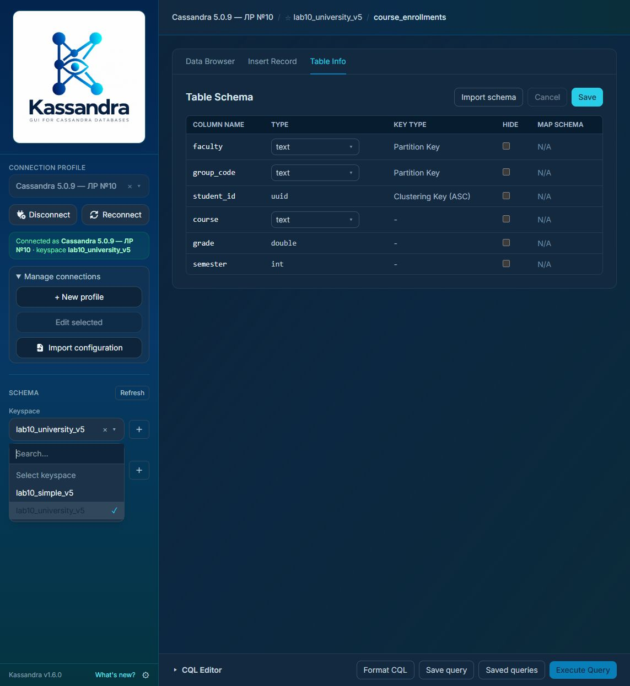
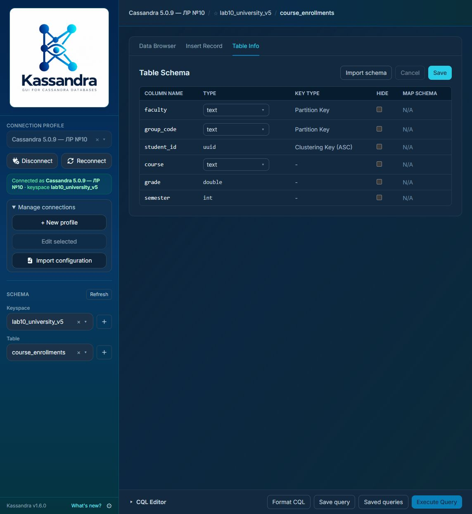

# Лабораторна робота №10

**Дисципліна:** NoSQL бази даних  
**Тема:** Створення keyspace, таблиць та завантаження даних у Cassandra  
**Варіант:** 5  
**Виконав:** Левченко Д. В.  
**Перевірив:** Андреєв П. І.

## Мета роботи

Опанувати проєктування схеми даних Apache Cassandra: створити keyspace з різними стратегіями реплікації, реалізувати таблиці з простим, складеним і композитним ключами, імпортувати CSV-дані та перевірити одержаний результат.

## Використане середовище

- Apache Cassandra 5.0.9, CQL 3.4.7;
- локальний вузол `127.0.0.1:9042`, дата-центр `datacenter1`;
- CQLSH для виконання сценаріїв і команди `COPY FROM`;
- Kassandra 1.6.0 як графічний клієнт Cassandra;
- Python 3.10 та `cassandra-driver` для автоматизованої перевірки.

## Хід роботи

### 1. Створення keyspace

Для демонстрації відмінностей створено два keyspace:

```sql
CREATE KEYSPACE lab10_simple_v5
WITH replication = {
  'class': 'SimpleStrategy',
  'replication_factor': 1
};

CREATE KEYSPACE lab10_university_v5
WITH replication = {
  'class': 'NetworkTopologyStrategy',
  'datacenter1': 1
};
```

`SimpleStrategy` розподіляє репліки без урахування топології дата-центрів і придатна лише для навчальних або тестових інсталяцій. `NetworkTopologyStrategy` дає змогу задати фактор реплікації окремо для кожного дата-центру та є рекомендованою для робочих кластерів.



### 2. Створення таблиць і первинних ключів

У `lab10_university_v5` створено три таблиці.

Простий первинний ключ:

```sql
CREATE TABLE students (
  student_id uuid PRIMARY KEY,
  full_name text,
  email text,
  variant int,
  city text
);
```

Складений ключ, у якому `sensor_id` є partition key, а `recorded_at` — clustering key:

```sql
CREATE TABLE sensor_readings (
  sensor_id text,
  recorded_at timestamp,
  temperature double,
  room text,
  PRIMARY KEY (sensor_id, recorded_at)
) WITH CLUSTERING ORDER BY (recorded_at DESC);
```

Композитний partition key `(faculty, group_code)` та clustering key `student_id`:

```sql
CREATE TABLE course_enrollments (
  faculty text,
  group_code text,
  student_id uuid,
  course text,
  semester int,
  grade double,
  PRIMARY KEY ((faculty, group_code), student_id)
);
```



### 3. Завантаження CSV-даних

Файл `data/students.csv` містить заголовок і п’ять записів варіанта 5. Імпорт виконано командою:

```sql
COPY lab10_university_v5.students
  (student_id, full_name, email, variant, city)
FROM 'data/students.csv'
WITH HEADER = TRUE;
```

Після імпорту в таблиці `students` отримано 5 записів, і для кожного значення `variant` дорівнює 5.

### 4. Перевірка результатів

Скрипт `scripts/validate_lab10.py` підключається до Cassandra, читає системну схему та дані й формує `results/lab10_results.json`.

| Перевірка | Результат |
|---|---:|
| Підключення до Cassandra 5.0.9 | виконано |
| Keyspace із `SimpleStrategy` | створено |
| Keyspace із `NetworkTopologyStrategy` | створено |
| Таблиці `students`, `sensor_readings`, `course_enrollments` | 3 |
| Імпортовані студенти | 5 |
| Показники сенсора | 3 |
| Записи про навчання | 2 |
| Автоматизовані перевірки | 12 із 12 успішно |

## Відповіді на контрольні питання

1. **Чим відрізняються `SimpleStrategy` і `NetworkTopologyStrategy`?**  
   `SimpleStrategy` не враховує дата-центри та стійки. `NetworkTopologyStrategy` розподіляє репліки з урахуванням топології та дозволяє задати фактор реплікації для кожного дата-центру.

2. **Що таке clustering key?**  
   Це частина первинного ключа після partition key. Вона визначає порядок рядків усередині однієї партиції та підтримує ефективні діапазонні запити в межах цієї партиції.

3. **Як правильно обрати primary key?**  
   Його обирають відповідно до майбутніх запитів. Partition key має рівномірно розподіляти дані й не створювати надмірно великі партиції, а clustering columns — забезпечувати потрібний порядок і фільтрацію всередині партиції.

4. **Які обмеження має `COPY FROM`?**  
   Це клієнтська команда CQLSH, зручна для невеликих CSV-файлів, але її швидкість і стійкість обмежені одним клієнтським процесом. Для великих обсягів доцільніше використовувати спеціалізовані завантажувачі або ETL-процеси; також CSV має відповідати типам і порядку вказаних колонок.

5. **Чому `SimpleStrategy` не рекомендують для production?**  
   Вона не враховує фізичну топологію кластера, тому репліки можуть опинитися в одному дата-центрі або стійці, що знижує відмовостійкість.

## Висновок

У роботі розгорнуто та перевірено Apache Cassandra 5.0.9, створено два keyspace з різними стратегіями реплікації й три таблиці з різними моделями первинного ключа. CSV-файл із п’ятьма записами успішно імпортовано. Автоматизована перевірка підтвердила структуру схеми, варіант 5 і кількість даних: усі 12 перевірок пройдено успішно.
