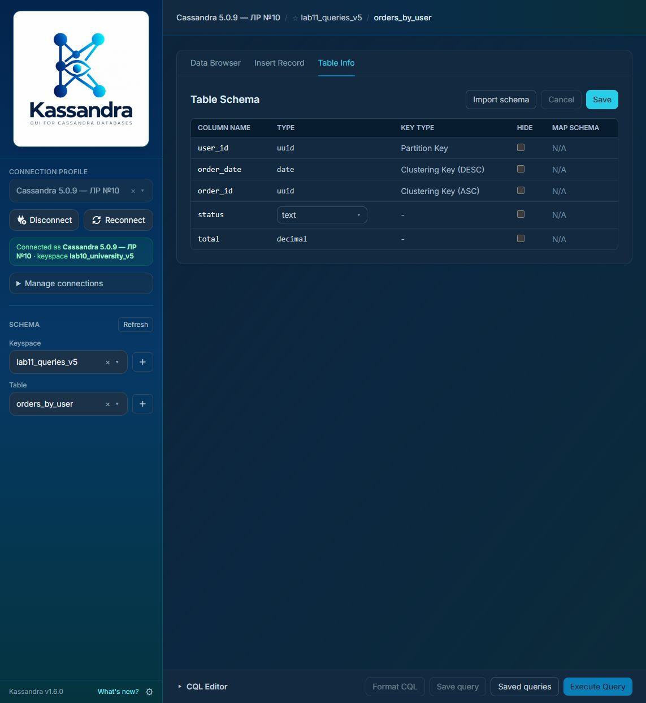
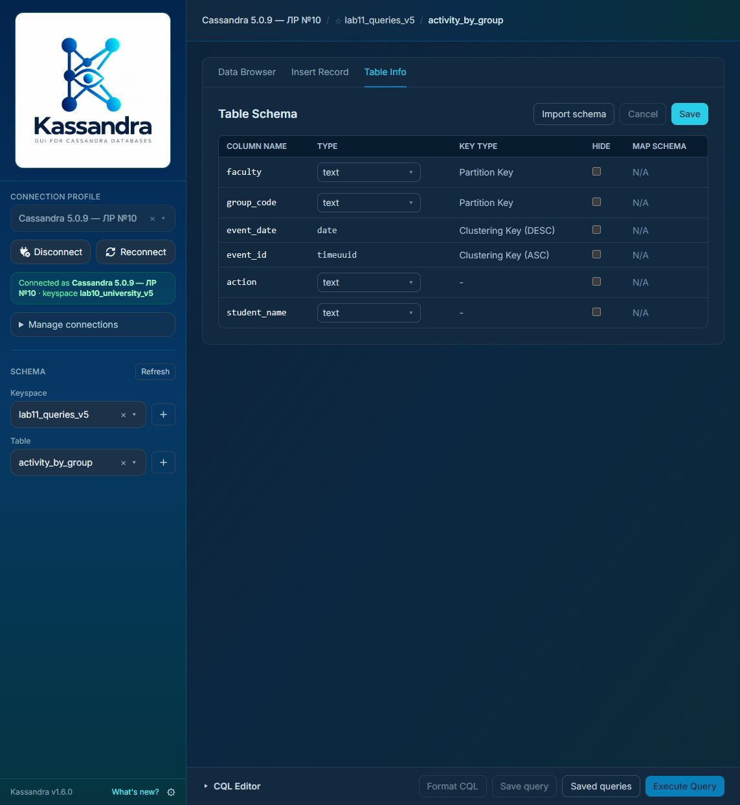
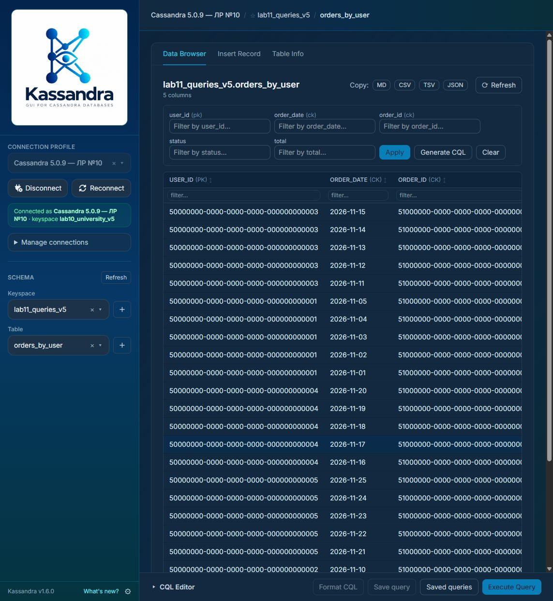

# Лабораторна робота №11

**Дисципліна:** NoSQL бази даних  
**Тема:** Виконання запитів до таблиць Cassandra мовою CQL  
**Варіант:** 5  
**Виконав:** Левченко Д. В.  
**Перевірив:** Андреєв П. І.

## Мета роботи

Навчитися виконувати запити читання в Apache Cassandra з урахуванням partition key, сортувати дані за clustering columns, застосовувати `ALLOW FILTERING`, вторинний індекс і трасування запитів.

## Середовище

- Apache Cassandra 5.0.9, CQL 3.4.7;
- локальний вузол `127.0.0.1:9042`, дата-центр `datacenter1`;
- Kassandra 1.6.0 для графічного перегляду схеми та даних;
- Python 3.10 і `cassandra-driver` для створення тестових даних та перевірки.

## Хід роботи

### 1. Створення keyspace і таблиць

Створено keyspace `lab11_queries_v5` зі стратегією `NetworkTopologyStrategy`. У ньому підготовлено три таблиці по 25 записів.

```sql
CREATE TABLE users_by_id (
  user_id uuid PRIMARY KEY,
  full_name text,
  city text,
  age int,
  variant int
);
```

Таблиця з partition key та двома clustering columns, які мають різний напрямок сортування:

```sql
CREATE TABLE orders_by_user (
  user_id uuid,
  order_date date,
  order_id uuid,
  total decimal,
  status text,
  PRIMARY KEY (user_id, order_date, order_id)
) WITH CLUSTERING ORDER BY (order_date DESC, order_id ASC);
```



Таблиця з композитним partition key:

```sql
CREATE TABLE activity_by_group (
  faculty text,
  group_code text,
  event_date date,
  event_id timeuuid,
  student_name text,
  action text,
  PRIMARY KEY ((faculty, group_code), event_date, event_id)
) WITH CLUSTERING ORDER BY (event_date DESC, event_id ASC);
```



### 2. Запити за ключем партиціювання

Запит із повним простим partition key повернув 5 замовлень користувача:

```sql
SELECT * FROM orders_by_user
WHERE user_id = 50000000-0000-0000-0000-000000000001;
```

Запит із повним композитним ключем `(faculty, group_code)` повернув 10 подій:

```sql
SELECT * FROM activity_by_group
WHERE faculty = 'FKS' AND group_code = 'KN-31';
```

Для часткового композитного ключа та запиту без partition key використано `ALLOW FILTERING`:

```sql
SELECT * FROM activity_by_group
WHERE faculty = 'FKS' ALLOW FILTERING;

SELECT * FROM users_by_id
WHERE city = 'Кременчук' ALLOW FILTERING;
```

Одержано відповідно 15 і 5 записів. Такі запити виконують сканування даних і використовуються лише для невеликих або тестових наборів.

### 3. Сортування за clustering columns

```sql
SELECT order_date, order_id, status, total
FROM orders_by_user
WHERE user_id = 50000000-0000-0000-0000-000000000001
ORDER BY order_date DESC, order_id ASC;
```

Результат упорядковано за датою: `2026-11-05`, `2026-11-04`, `2026-11-03`, `2026-11-02`, `2026-11-01`. `ORDER BY` працює в межах однієї партиції та відповідно до оголошеного порядку clustering columns.



### 4. Вторинний індекс

```sql
CREATE INDEX idx_order_status_v5 ON orders_by_user (status);

SELECT * FROM orders_by_user WHERE status = 'completed';
```

Індекс `idx_order_status_v5` створено успішно. Запит за статусом `completed` без явного partition key повернув 10 записів.

### 5. Трасування запиту

Для SELECT за повним partition key увімкнено трасування:

```sql
TRACING ON;
SELECT * FROM orders_by_user
WHERE user_id = 50000000-0000-0000-0000-000000000001
LIMIT 5;
TRACING OFF;
```

Координатором був `127.0.0.1`, тривалість трасування — 1367 мкс, зафіксовано 7 подій. Cassandra виконала single-partition query, прочитала 5 активних рядків і 0 tombstone cells.

## Результати перевірки

| Перевірка | Результат |
|---|---:|
| Записи в `users_by_id` | 25 |
| Записи в `orders_by_user` | 25 |
| Записи в `activity_by_group` | 25 |
| Запит за повним простим ключем | 5 рядків |
| Запит за повним композитним ключем | 10 рядків |
| Частковий ключ із `ALLOW FILTERING` | 15 рядків |
| Запит без ключа з `ALLOW FILTERING` | 5 рядків |
| Запит через вторинний індекс | 10 рядків |
| Події трасування | 7 |
| Автоматизовані перевірки | 12 із 12 успішно |

## Відповіді на контрольні питання

1. **Які обмеження накладаються на запити `SELECT` у Cassandra?**  
   Ефективний запит повинен задавати повний partition key. Умови за clustering columns застосовуються після вибору партиції та мають дотримуватися порядку колонок ключа. Довільні фільтри без відповідного ключа або індексу часто потребують `ALLOW FILTERING`.

2. **Як виконується сортування за допомогою `ORDER BY`?**  
   Сортування можливе лише в межах вибраної партиції та тільки за clustering columns. Напрямки мають відповідати порядку, заданому в `CLUSTERING ORDER BY`, або бути одночасно оберненими для всіх clustering columns.

3. **Для чого використовується `ALLOW FILTERING`?**  
   Воно дозволяє виконати запит, який Cassandra вважає потенційно неефективним через відсутність повного partition key чи індексу. Сервер може переглянути значно більше рядків, ніж повернути, тому це рішення не слід використовувати для великих production-таблиць.

4. **Що таке трасування запитів у Cassandra?**  
   Це запис етапів проходження конкретного запиту через кластер: підготовки, маршрутизації, читання memtable/SSTable, об’єднання результатів і тривалості операцій. Трасування допомагає знаходити повільні етапи, але створює додаткове навантаження.

5. **Чому запити без ключа партиціювання вважаються неефективними?**  
   Координатор не може одразу визначити потрібну партицію та вузол, тому звертається до багатьох партицій або вузлів і фільтрує зайві дані. Зі збільшенням кластера обсяг роботи та мережевий обмін швидко зростають.

## Висновок

У лабораторній роботі створено три таблиці Cassandra з простим, складеним і композитним ключами та завантажено по 25 тестових записів варіанта 5. Перевірено запити за повним і частковим partition key, `ALLOW FILTERING`, сортування `ORDER BY`, вторинний індекс і трасування. Усі 12 автоматизованих перевірок виконано успішно.
