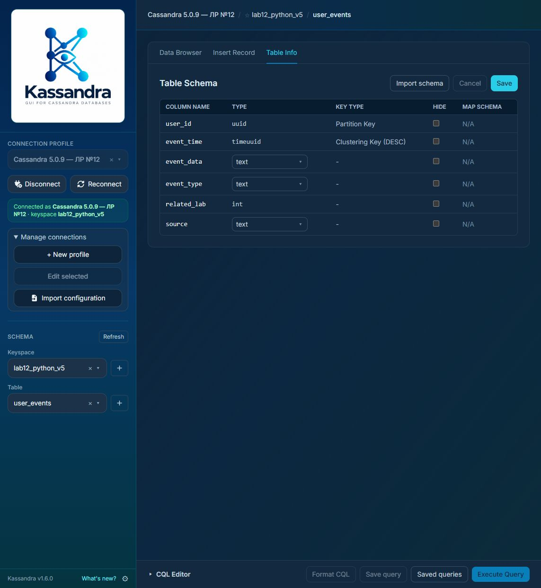
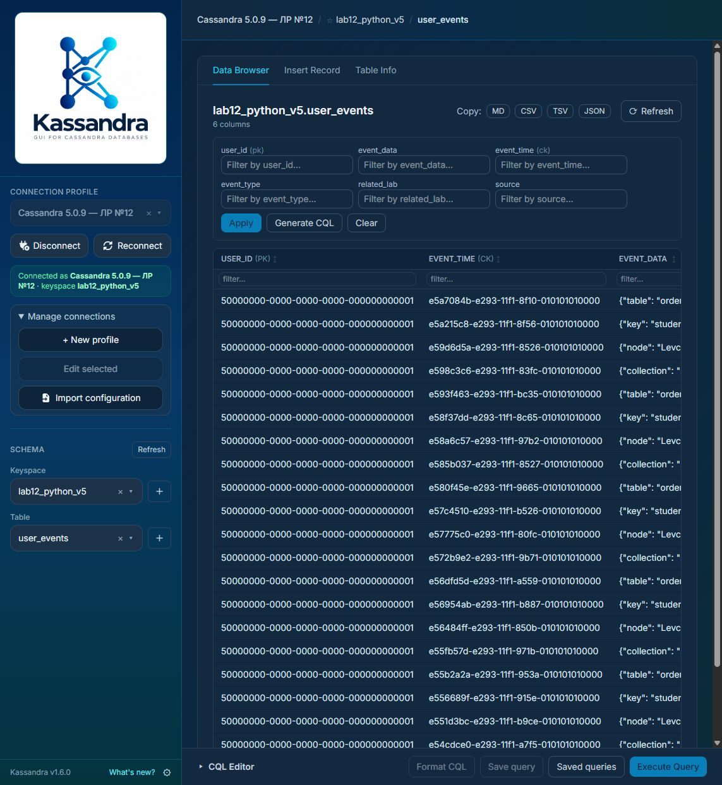
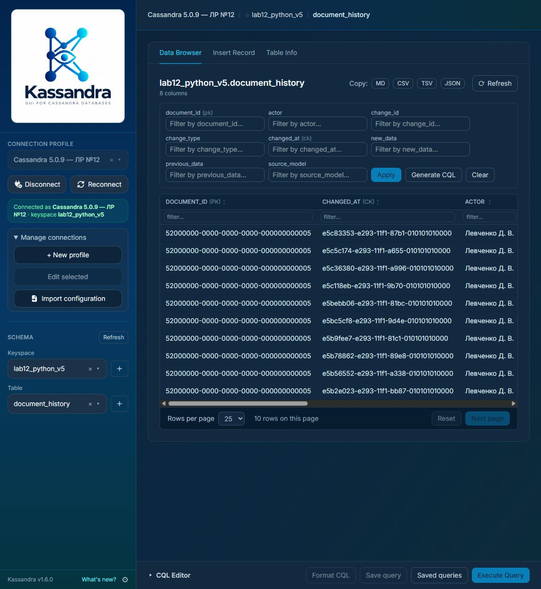

# Лабораторна робота №12

**Дисципліна:** NoSQL бази даних  
**Тема:** Взаємодія з Apache Cassandra засобами Python  
**Варіант:** 5  
**Виконав:** Левченко Д. В.  
**Перевірив:** Андреєв П. І.

## Мета роботи

Навчитися підключатися до Cassandra з Python, виконувати CRUD-операції через `cassandra-driver` і проєктувати сховище подій та історії змін на основі моделей MongoDB, Neo4j і Redis із попередніх лабораторних робіт.

## Середовище

- Apache Cassandra 5.0.9, CQL 3.4.7;
- локальний вузол `127.0.0.1:9042`;
- Python 3.10 і `cassandra-driver` 3.30.1;
- Kassandra 1.6.0 для графічної перевірки схеми та даних.

## Хід роботи

### 1. Проєктування сховища

Створено keyspace `lab12_python_v5` зі стратегією `NetworkTopologyStrategy`. Події користувача зберігаються в одній партиції за `user_id` та впорядковуються за `event_time DESC`.

```sql
CREATE TABLE user_events (
  user_id uuid,
  event_time timeuuid,
  event_type text,
  event_data text,
  source text,
  related_lab int,
  PRIMARY KEY (user_id, event_time)
) WITH CLUSTERING ORDER BY (event_time DESC);
```



Для аудиту змін документів створено окрему таблицю:

```sql
CREATE TABLE document_history (
  document_id uuid,
  changed_at timeuuid,
  change_id uuid,
  actor text,
  change_type text,
  previous_data text,
  new_data text,
  source_model text,
  PRIMARY KEY (document_id, changed_at)
) WITH CLUSTERING ORDER BY (changed_at DESC);
```

### 2. Підключення з Python

```python
from cassandra.cluster import Cluster
from cassandra.query import dict_factory

cluster = Cluster(["127.0.0.1"], port=9042)
session = cluster.connect("lab12_python_v5")
session.row_factory = dict_factory
```

`dict_factory` перетворює кожний рядок результату на словник, тому доступ до значень здійснюється за іменами колонок.

### 3. CREATE — вставка події

Для параметризованих операцій використано підготовлені запити.

```python
statement = session.prepare("""
    INSERT INTO user_events
    (user_id, event_time, event_type, event_data, source, related_lab)
    VALUES (?, ?, ?, ?, ?, ?)
""")
session.execute(statement, values)
```

Створено 21 подію. Поле `source` пов’язує їх із моделями попередніх робіт: MongoDB, Neo4j, Redis і Cassandra. JSON-рядок `event_data` містить номер варіанта 5 та дані відповідної моделі.

### 4. READ — читання за partition key

```python
statement = session.prepare("""
    SELECT user_id, event_time, event_type, event_data, source, related_lab
    FROM user_events WHERE user_id = ? LIMIT ?
""")
events = list(session.execute(statement, (user_id, 100)))
```

Читання виконується ефективно за повним partition key. Перевірка підтвердила, що результат представлений списком словників.



### 5. UPDATE — оновлення окремого поля

```python
statement = session.prepare("""
    UPDATE user_events SET source = ?
    WHERE user_id = ? AND event_time = ?
""")
session.execute(statement, ("Python CRUD v5", user_id, event_time))
```

Джерело першої події успішно змінено на `Python CRUD v5`. В Cassandra `UPDATE` має семантику upsert: якщо рядка з таким ключем немає, він буде створений.

### 6. DELETE — видалення події

```python
statement = session.prepare("""
    DELETE FROM user_events
    WHERE user_id = ? AND event_time = ?
""")
session.execute(statement, (user_id, event_time))
```

Одну з 21 подій видалено. Повторний SELECT за повним ключем повернув `None`, а в партиції залишилося 20 подій.

### 7. Історія змін

До `document_history` записано 10 переходів версій документа. Кожний запис містить попередні та нові JSON-дані, автора, тип операції й джерело моделі.



### 8. Закриття з’єднання

З’єднання закривається в блоці `finally`, тому ресурси звільняються навіть у випадку помилки:

```python
cluster = Cluster(["127.0.0.1"], port=9042)
try:
    session = cluster.connect()
    # CRUD-операції
finally:
    cluster.shutdown()
```

## Результати перевірки

| Перевірка | Результат |
|---|---:|
| Cassandra 5.0.9 доступна | виконано |
| Таблиці `user_events` і `document_history` | створено |
| CREATE | 21 подія |
| READ | словники Python |
| UPDATE | `source = Python CRUD v5` |
| DELETE | видалення підтверджено |
| Події після видалення | 20 |
| Записи історії | 10 |
| Використані попередні моделі | MongoDB, Neo4j, Redis |
| Автоматизовані перевірки | 12 із 12 успішно |

## Відповіді на контрольні питання

1. **Як підключитися до Cassandra з Python?**  
   Потрібно встановити `cassandra-driver`, створити `Cluster` зі списком contact points і портом, викликати `cluster.connect()`, а потім вибрати keyspace методом `set_keyspace()` або передати його в `connect()`.

2. **Як виконати запит до Cassandra через Python-драйвер?**  
   CQL передають у `session.execute()`. Для повторюваних або параметризованих операцій слід створити prepared statement через `session.prepare()` і передавати значення окремим кортежем.

3. **Як виконати вставку даних у Cassandra через Python-драйвер?**  
   Готують CQL `INSERT`, у якому значення замінено маркерами `?`, а потім виконують підготовлений запит із параметрами потрібних Python-типів, наприклад `UUID`, `datetime`, `str` та `int`.

4. **Як отримати результати запиту у вигляді словників замість кортежів?**  
   Слід імпортувати `dict_factory` з `cassandra.query` та присвоїти `session.row_factory = dict_factory`. Після цього рядки підтримують доступ за іменами колонок.

5. **Як закрити з’єднання з Cassandra після роботи?**  
   Потрібно викликати `cluster.shutdown()`. Найнадійніше робити це в `finally`, щоб з’єднання було закрито і після винятку.

## Висновок

У лабораторній роботі для варіанта 5 створено Cassandra-сховище подій та історії змін, пов’язане з даними MongoDB, Neo4j і Redis. Через Python-драйвер виконано CREATE, READ, UPDATE і DELETE, налаштовано повернення словників та гарантоване закриття з’єднання. Після видалення збережено 20 подій і 10 записів історії; усі 12 автоматизованих перевірок пройдено успішно.
