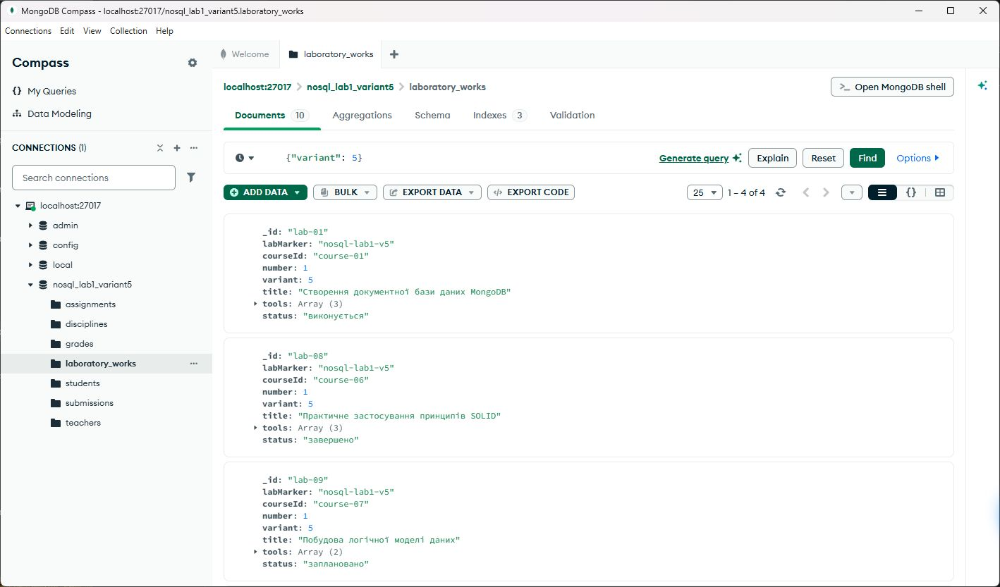
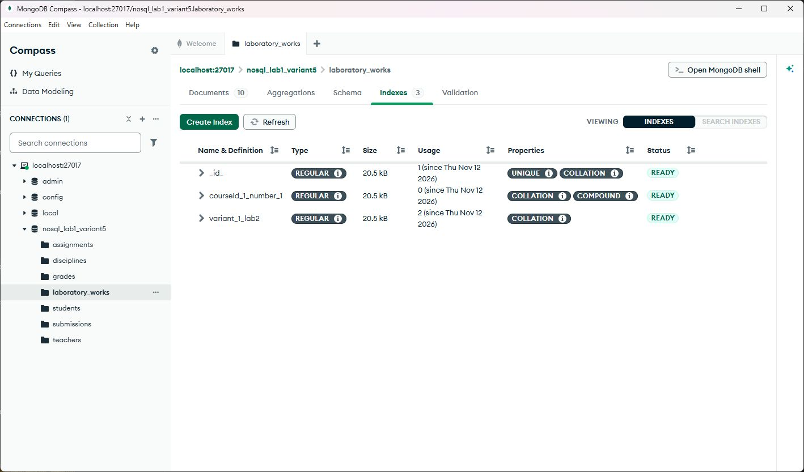
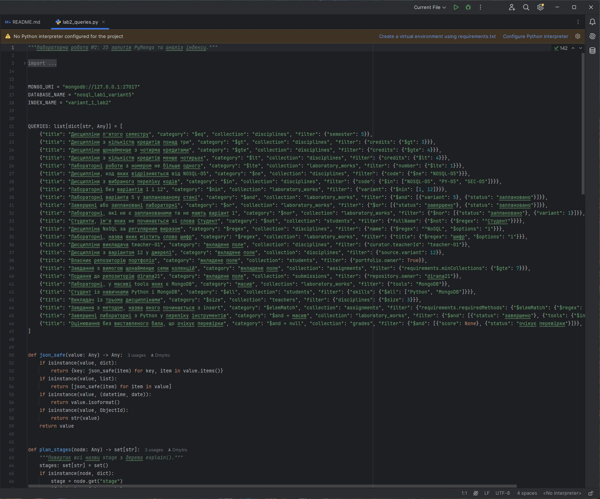
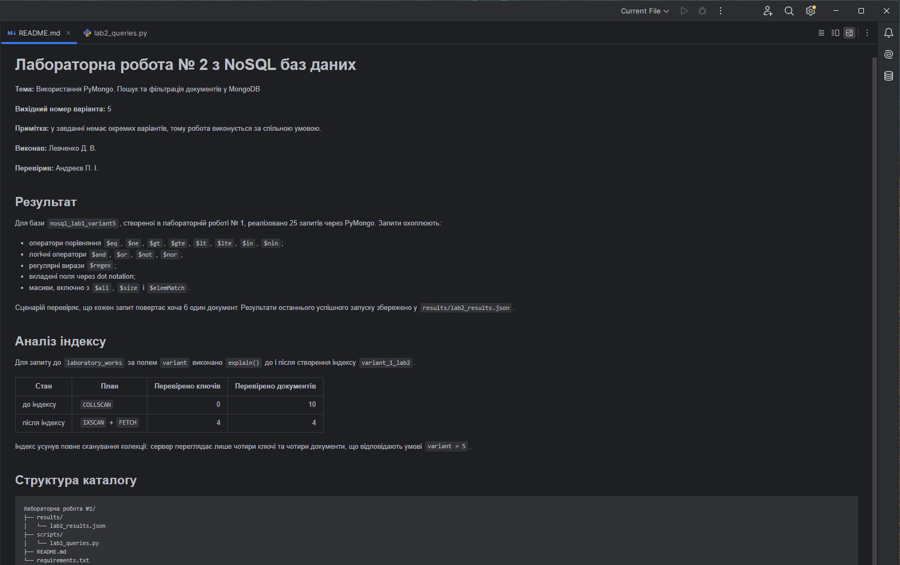

<div align="center">

**ЗВІТ**  
до лабораторної роботи № 2  
з дисципліни **«NoSQL бази даних»**

**Тема:** «Використання PyMongo. Пошук та фільтрація документів у MongoDB»

</div>

| Відомості | Дані |
|---|---|
| Виконав | Левченко Д. В. |
| Варіант | 5 |
| Перевірив | Андреєв П. І. |
| Рік виконання | 2026 |

## Мета роботи

Навчитися підключатися до MongoDB з Python за допомогою PyMongo, виконувати пошук документів операторами порівняння, логічними операторами та регулярними виразами, працювати з вкладеними полями й масивами, а також оцінювати вплив індексу на план виконання запиту.

## Постановка завдання

На основі бази `nosql_lab1_variant5` реалізувати запити з операторами `$eq`, `$ne`, `$gt`, `$gte`, `$lt`, `$lte`, `$in`, `$nin`, `$and`, `$or`, `$not`, `$nor` і `$regex`. Додатково перевірити dot notation, `$all`, `$size`, `$elemMatch` та порівняти `explain()` до і після створення індексу.

## Короткі теоретичні відомості

PyMongo є офіційним Python-драйвером MongoDB. Метод `find()` повертає курсор з усіма документами, що відповідають фільтру, а `find_one()` - один документ. Умови записуються як BSON-сумісні словники Python.

Індекс зберігає впорядковані значення властивості та посилання на документи. Без індексу MongoDB часто виконує `COLLSCAN`, тобто переглядає всю колекцію. За наявності відповідного індексу план може використовувати `IXSCAN` і перевіряти лише потрібні ключі.

## Хід роботи

Сценарій [`scripts/lab2_queries.py`](./scripts/lab2_queries.py) підключається до бази `nosql_lab1_variant5` і послідовно виконує 25 запитів. Кожен запит має назву, колекцію, фільтр та перевірку, що результат не порожній.

Приклад фільтра лабораторних робіт варіанта 5:

```python
documents = list(
    database["laboratory_works"].find({"variant": {"$eq": 5}})
)
```



<p align="center"><em>Рисунок 1 - Документи, знайдені за полем variant</em></p>

Для вкладених полів використано крапкову нотацію, наприклад `curator.teacherId`. Масиви перевірено операторами `$all`, `$size` і `$elemMatch`.



<p align="center"><em>Рисунок 2 - Індекс variant_1_lab2</em></p>

Повний набір запитів виконано у PyCharm. У результаті отримано ознаку `ok: true` та підтверджено успіх усіх 25 перевірок.



<p align="center"><em>Рисунок 3 - Реалізація запитів через PyMongo</em></p>



<p align="center"><em>Рисунок 4 - Успішне виконання 25 запитів</em></p>

## Аналіз індексу

| Стан | План | Перевірено ключів | Перевірено документів | Повернуто |
|---|---|---:|---:|---:|
| До індексу | `COLLSCAN` | 0 | 10 | 4 |
| Після індексу | `IXSCAN` + `FETCH` | 4 | 4 | 4 |

Індекс усунув повне сканування колекції: замість 10 документів сервер перевірив 4 ключі та 4 документи.

## Відповіді на контрольні питання

### 1 Що таке PyMongo

PyMongo - офіційний драйвер Python для підключення до MongoDB, виконання CRUD-операцій, агрегацій та адміністративних запитів.

### 2 Який оператор перевіряє, чи значення більше за вказане

Оператор `$gt`. Для умови «більше або дорівнює» використовується `$gte`.

### 3 Для чого використовується `$regex`

Для пошуку рядків за регулярним виразом, наприклад за початком слова або фрагментом без урахування регістру.

### 4 Як звернутися до вкладеного поля

Через dot notation: `curator.teacherId`, `repository.owner` тощо.

### 5 Навіщо створювати індекси

Індекси зменшують кількість документів, які сервер повинен переглянути, та прискорюють пошук і сортування. Вони потребують додаткової пам'яті й трохи уповільнюють запис.

## Висновок

У роботі реалізовано 25 запитів PyMongo до бази варіанта 5. Перевірено оператори порівняння, логічні умови, регулярні вирази, вкладені поля та масиви. Порівняння планів показало перехід від `COLLSCAN` до `IXSCAN`: кількість перевірених документів зменшилася з 10 до 4. Усі автоматичні перевірки завершилися успішно.

