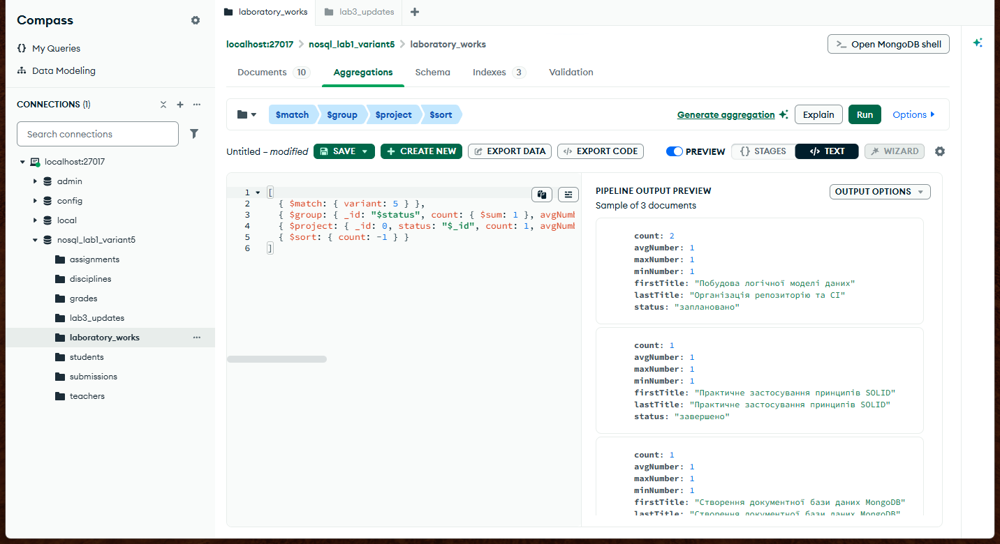
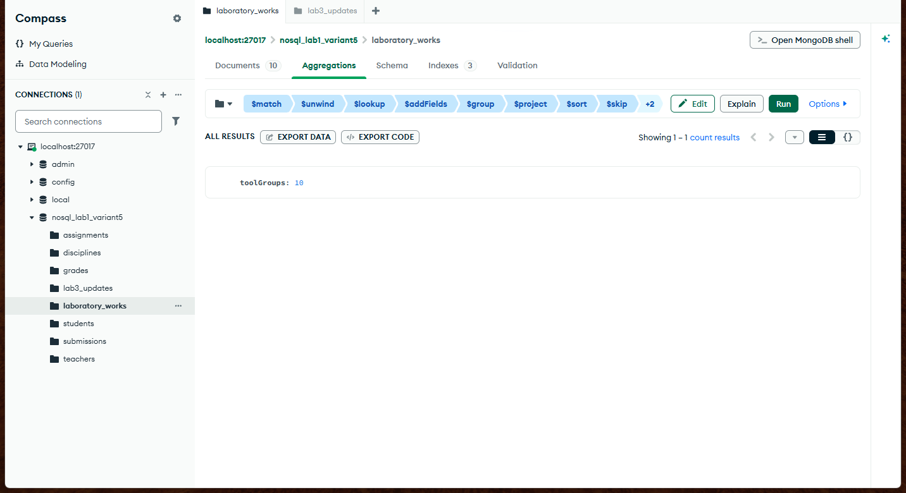
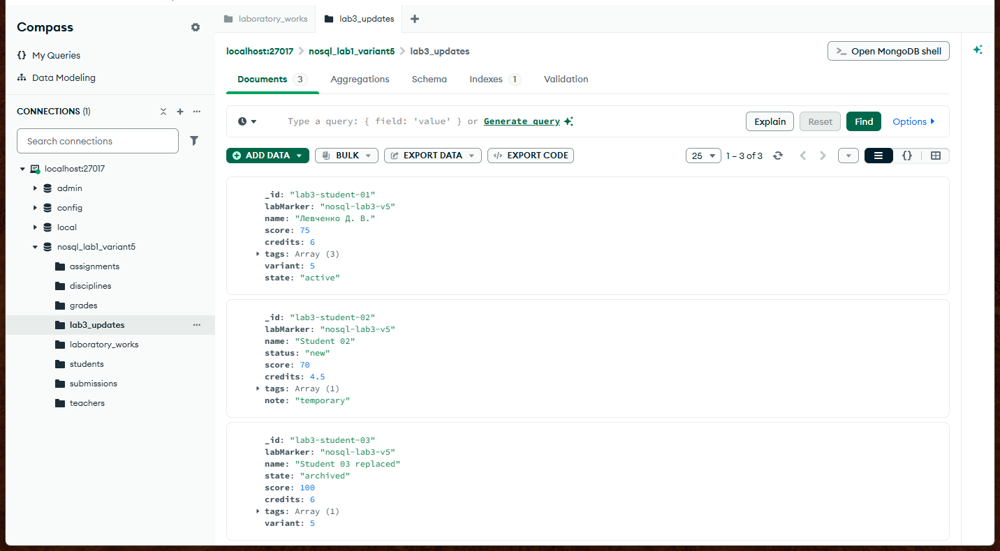
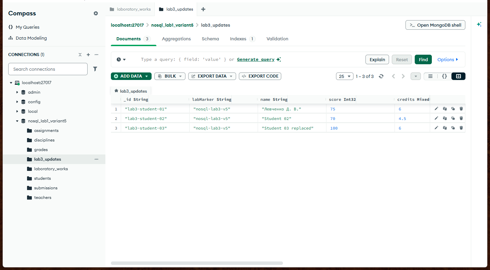

<div align="center">

**ЗВІТ**  
до лабораторної роботи № 3  
з дисципліни **«NoSQL бази даних»**

**Тема:** «Агрегація та модифікація документів у MongoDB»

</div>

| Відомості | Дані |
|---|---|
| Виконав | Левченко Д. В. |
| Варіант | 5 |
| Перевірив | Андреєв П. І. |
| Рік виконання | 2026 |

## Мета роботи

Опанувати агрегаційний конвеєр MongoDB для багатоступеневої обробки документів і навчитися безпечно змінювати дані методами `update_one()`, `update_many()` та `replace_one()`.

## Постановка завдання

Побудувати конвеєри з етапами `$match`, `$project`, `$group`, `$unwind`, `$lookup`, `$sort`, `$limit`, `$skip`, `$addFields`, `$count` і функціями `$sum`, `$avg`, `$max`, `$min`, `$first`, `$last`. Продемонструвати оператори оновлення `$set`, `$unset`, `$inc`, `$mul`, `$rename`, `$push`, `$pop`.

## Теоретичні відомості

Агрегаційний конвеєр передає документи через послідовність етапів. Кожен етап фільтрує, перетворює, групує або сортує потік. `$lookup` додає дані з іншої колекції, а `$unwind` перетворює елементи масиву на окремі записи.

Оператори оновлення змінюють лише потрібні поля документа. Це зменшує обсяг передачі даних і дозволяє MongoDB виконувати окремі зміни атомарно на рівні документа.

## Хід роботи

Сценарій [`scripts/lab3_aggregation_updates.py`](./scripts/lab3_aggregation_updates.py) працює з базою `nosql_lab1_variant5`. Для демонстрації змін створено окрему колекцію `lab3_updates`, тому дані попередніх робіт не пошкоджуються.

Реалізовано п'ять конвеєрів: статистику статусів, навантаження викладачів, популярність технологій, огляд дисциплін і підрахунок робіт варіанта 5.



<p align="center"><em>Рисунок 1 - Агрегація з групуванням і функціями</em></p>



<p align="center"><em>Рисунок 2 - Покриття обов'язкових етапів агрегації</em></p>

Виконано сім операцій модифікації. Перед кожним запуском навчальні документи відновлюються до початкового стану, тому сценарій є відтворюваним.

```python
collection.update_one({"_id": "update-01"}, {"$set": {"status": "completed"}})
collection.update_many({"variant": 5}, {"$inc": {"attempts": 1}})
collection.replace_one({"_id": "update-03"}, replacement)
```



<p align="center"><em>Рисунок 3 - Результат операторів оновлення</em></p>



<p align="center"><em>Рисунок 4 - Підсумкові документи lab3_updates</em></p>

## Перевірка

| Показник | Результат |
|---|---:|
| Агрегаційних конвеєрів | 5 |
| Покрито етапів | 10 |
| Покрито агрегатних функцій | 6 |
| Операцій оновлення | 7 |
| Загальний стан | `ok: true` |

## Відповіді на контрольні питання

### 1 Як називається механізм послідовної обробки даних у MongoDB

Агрегаційний конвеєр.

### 2 Для чого призначений `$group`

Для об'єднання документів за ключем і розрахунку агрегатних показників для кожної групи.

### 3 Який оператор збільшує числове поле

Оператор `$inc`.

### 4 Який метод оновлює перший документ, що відповідає фільтру

Метод `update_one()`.

### 5 Який оператор додає елемент у масив

Оператор `$push`; для видалення першого або останнього елемента використовується `$pop`.

## Висновок

У лабораторній роботі створено п'ять агрегаційних конвеєрів і виконано сім відтворюваних операцій оновлення. Перевірено всі передбачені етапи, агрегатні функції та оператори модифікації. Результат підтверджено в MongoDB Compass, а автоматична перевірка повернула `ok: true`.

