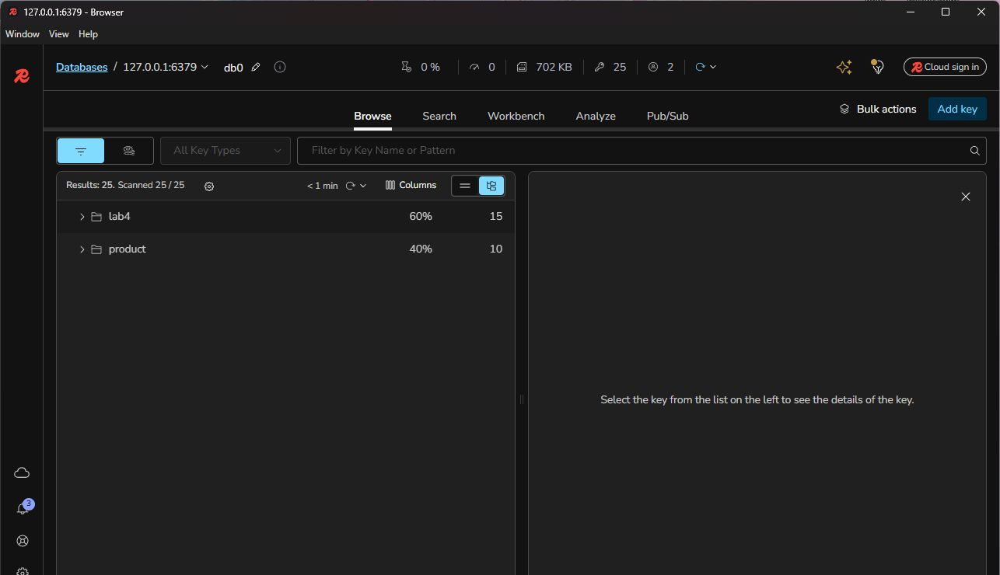
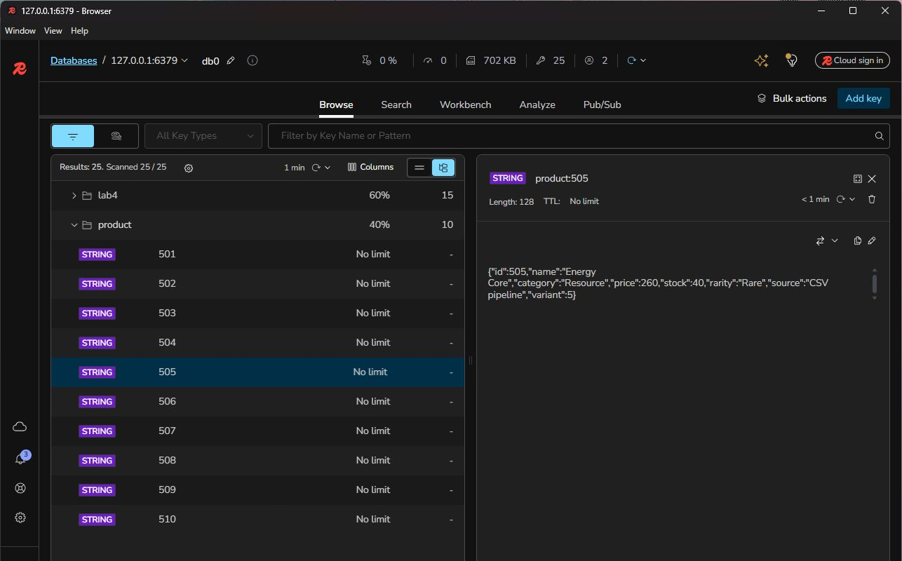
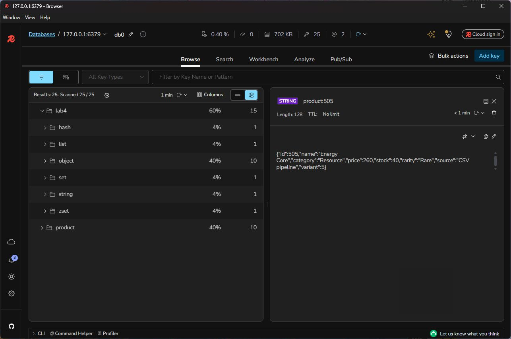

<div align="center">

**ЗВІТ**  
до лабораторної роботи № 4  
з дисципліни **«NoSQL бази даних»**

**Тема:** «Створення сховища ключів і початкове заповнення даними в Redis»

</div>

| Відомості | Дані |
|---|---|
| Виконав | Левченко Д. В. |
| Варіант | 5 |
| Перевірив | Андреєв П. І. |
| Рік виконання | 2026 |

## Мета роботи

Ознайомитися з моделлю «ключ-значення» Redis, навчитися використовувати основні структури даних, серіалізувати Python-об'єкти у JSON та завантажувати набір CSV пакетною операцією pipeline.

## Постановка завдання

Підключитися до локального Redis, створити ключі типів String, Hash, List, Set і Sorted Set, зберегти 10 Python-об'єктів як JSON, підготувати CSV-файл з 10 записами та завантажити його через pipeline. Результат перевірити у Redis Insight.

## Короткі теоретичні відомості

Redis зберігає значення за унікальними ключами й працює переважно в оперативній пам'яті. String підходить для тексту, чисел і JSON; Hash - для набору полів об'єкта; List - для впорядкованої послідовності; Set - для унікальних невпорядкованих значень; Sorted Set - для унікальних елементів з числовою оцінкою.

Pipeline групує декілька команд і надсилає їх серверу одним пакетом, зменшуючи мережеві затримки.

## Хід роботи

Сценарій [`scripts/lab4_redis_storage.py`](./scripts/lab4_redis_storage.py) підключився до Redis `localhost:6379` і створив службові ключі:

| Ключ | Тип |
|---|---|
| `lab4:string:status` | String |
| `lab4:hash:student` | Hash |
| `lab4:list:tasks` | List |
| `lab4:set:categories` | Set |
| `lab4:zset:price_rating` | Sorted Set |



<p align="center"><em>Рисунок 1 - Простори ключів у Redis Insight</em></p>

Десять Python-словників серіалізовано функцією `json.dumps()` і збережено у String-ключах. CSV-файл `data/products.csv` містить товари `product:501` - `product:510`; усі 10 команд pipeline виконано успішно.

```python
with redis_client.pipeline(transaction=False) as pipeline:
    for product in products:
        pipeline.set(f"product:{product['id']}", json.dumps(product, ensure_ascii=False))
    pipeline.execute()
```



<p align="center"><em>Рисунок 2 - Відновлений JSON-об'єкт product:505</em></p>



<p align="center"><em>Рисунок 3 - String, Hash, List, Set і Sorted Set</em></p>

## Перевірка

| Перевірка | Результат |
|---|---|
| З'єднання з Redis | Успішно |
| П'ять різних типів даних | Успішно |
| 10 Python-об'єктів | Збережено |
| 10 CSV-записів | Завантажено pipeline |
| Відновлення JSON | Успішно |
| Загальний стан | `ok: true` |

## Відповіді на контрольні питання

### 1 Що таке Redis

Redis - високопродуктивне сховище даних у пам'яті з моделлю «ключ-значення» та підтримкою спеціалізованих структур.

### 2 Які структури даних підтримує Redis

String, Hash, List, Set, Sorted Set, а також Streams, Bitmaps, HyperLogLog та інші структури.

### 3 Як зберегти Python-об'єкт у Redis

Його можна серіалізувати в JSON функцією `json.dumps()`, зберегти командою `SET`, а після читання відновити через `json.loads()`.

### 4 Для чого використовується pipeline

Для пакетного надсилання команд без очікування окремої відповіді після кожної, що зменшує кількість мережевих обмінів.

### 5 Чим List відрізняється від Set

List зберігає впорядковану послідовність і допускає повтори. Set зберігає лише унікальні елементи без фіксованого порядку.

## Висновок

У Redis створено ключі п'яти основних типів, збережено 10 JSON-об'єктів і завантажено 10 товарів із CSV через pipeline. Перевірка підтвердила правильність типів, серіалізації та відновлення даних. Усі результати продемонстровано в Redis Insight.

