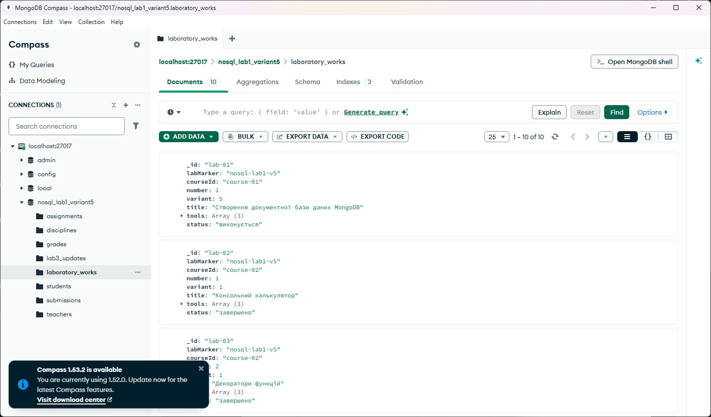
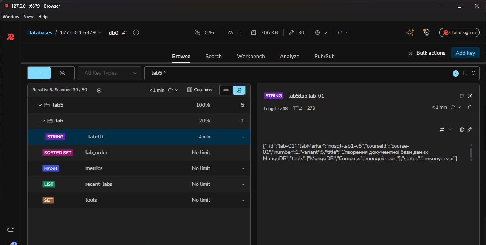
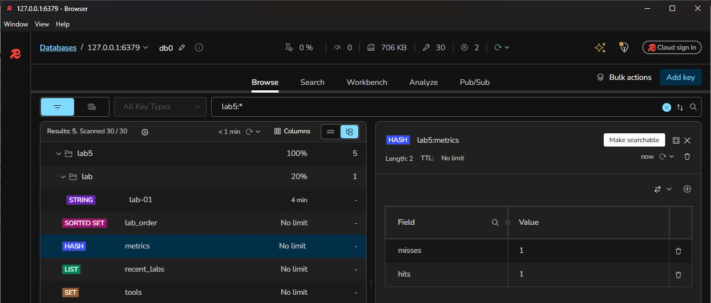

<div align="center">

**ЗВІТ**  
до лабораторної роботи № 5  
з дисципліни **«NoSQL бази даних»**

**Тема:** «Робота зі структурами даних Redis»

</div>

| Відомості | Дані |
|---|---|
| Виконав | Левченко Д. В. |
| Варіант | 5 |
| Перевірив | Андреєв П. І. |
| Рік виконання | 2026 |

## Мета роботи

Вивчити структури даних Redis, реалізувати швидкий шар кешування для MongoDB за шаблоном Cache-Aside та оцінити різницю часу читання з основної бази й кешу.

## Постановка завдання

На основі бази `nosql_lab1_variant5` реалізувати кеш документа MongoDB у Redis, продемонструвати промах і попадання кешу, встановити TTL, а також застосувати Hash, List, Set і Sorted Set для статистики та допоміжних даних.

## Теоретичні відомості

У шаблоні Cache-Aside застосунок спочатку виконує `GET` у Redis. Якщо ключ відсутній, документ читається з MongoDB, серіалізується у JSON і записується в кеш. Наступний запит повертає вже кешоване значення. TTL обмежує час зберігання копії та зменшує ризик застарілих даних.

## Хід роботи

Джерелом став документ `lab-01` колекції `laboratory_works`. У MongoDB Compass перевірено номер варіанта 5, тему, інструменти й статус.



<p align="center"><em>Рисунок 1 - Документ lab-01 у MongoDB Compass</em></p>

Основна логіка Cache-Aside:

```python
cached = redis_client.get(cache_key)
if cached is not None:
    redis_client.hincrby("lab5:metrics", "hits", 1)
    return json.loads(cached), "redis"

document = collection.find_one({"_id": "lab-01"})
redis_client.setex(cache_key, 300, json.dumps(document, ensure_ascii=False))
redis_client.hincrby("lab5:metrics", "misses", 1)
```

Перше читання виконано з MongoDB, друге - з Redis. Документи однакові, TTL після запису становив 300 секунд, а Hash метрик містив один `miss` і один `hit`.



<p align="center"><em>Рисунок 2 - JSON-документ у Redis з TTL</em></p>

Додатково використано:

- Hash `lab5:metrics` для `hits` і `misses`;
- List `lab5:recent_labs` для п'яти останніх ідентифікаторів;
- Set `lab5:tools` для 15 унікальних інструментів;
- Sorted Set `lab5:lab_order` для впорядкування 10 лабораторних робіт.



<p align="center"><em>Рисунок 3 - Hash, List, Set і Sorted Set</em></p>

## Вимірювання

| Показник | Результат |
|---|---:|
| Перше читання | MongoDB, 0,7038 мс |
| Друге читання | Redis, 0,1973 мс |
| Медіана 100 читань MongoDB | 0,2689 мс |
| Медіана 100 читань Redis | 0,0952 мс |
| Прискорення | 2,83 раза |
| Загальний стан | `ok: true` |

## Відповіді на контрольні питання

### 1 Для чого Redis використовують разом із MongoDB

MongoDB залишається основним довготривалим сховищем, а Redis зберігає часто запитувані результати в оперативній пам'яті та зменшує затримку читання.

### 2 Яка структура підходить для останніх записів

List. Нові елементи додаються командами `LPUSH` або `RPUSH`, а `LTRIM` обмежує довжину списку.

### 3 Як зберігати унікальні значення

У Set, який автоматично усуває дублікати.

### 4 Які операції підтримує Set

`SADD`, `SREM`, `SISMEMBER`, `SMEMBERS`, а також `SUNION`, `SINTER` і `SDIFF`.

### 5 Що швидше - Redis чи MongoDB

Для читання вже кешованого значення за ключем зазвичай швидший Redis, оскільки дані знаходяться в пам'яті. У цьому запуску медіана читання була меншою у 2,83 раза.

## Висновок

Реалізовано Cache-Aside шар Redis для MongoDB. Перше звернення отримало документ з MongoDB, повторне - рівнозначний JSON із Redis. TTL, метрики та допоміжні структури працюють правильно. Вимірювання 100 читань показало прискорення у 2,83 раза, усі автоматичні перевірки успішні.

