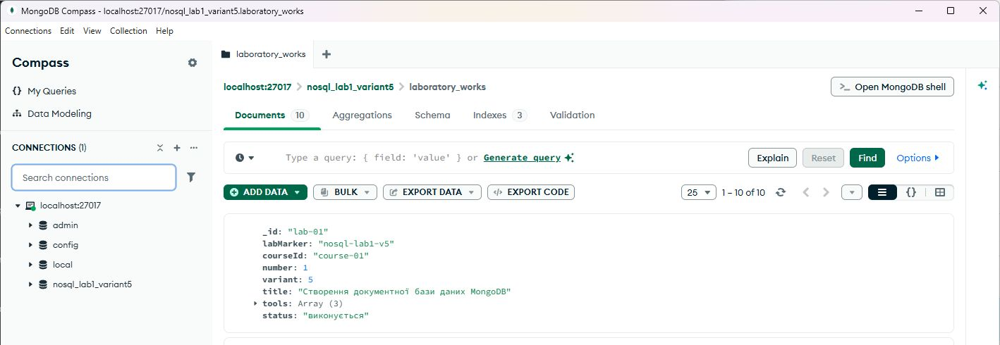
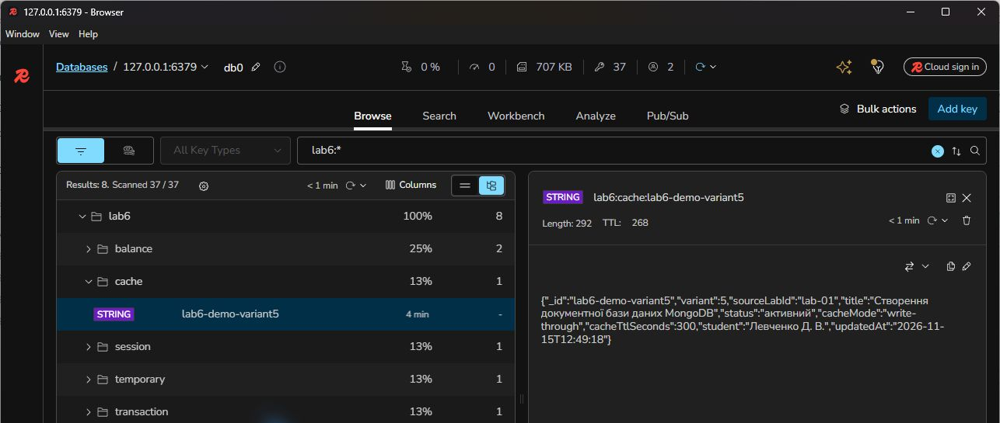

<div align="center">

**ЗВІТ**  
до лабораторної роботи № 6  
з дисципліни **«NoSQL бази даних»**

**Тема:** «Керування даними та кешування в Redis»

</div>

| Відомості | Дані |
|---|---|
| Виконав | Левченко Д. В. |
| Варіант | 5 |
| Перевірив | Андреєв П. І. |
| Рік виконання | 2026 |

## Мета роботи

Дослідити життєвий цикл кешованих даних, політики витіснення, атомарні операції та транзакції Redis; реалізувати Cache-Aside і Write-Through для MongoDB.

## Постановка завдання

Реалізувати керування TTL, перевірити автоматичне видалення тимчасового ключа, прочитати політику `maxmemory-policy`, синхронно оновити MongoDB і Redis, а також виконати транзакційне оновлення декількох ключів.

## Теоретичні відомості

TTL визначає час існування ключа. Команди `EXPIRE` та `SET ... EX` встановлюють строк у секундах, а після його завершення Redis видаляє ключ. Політика `noeviction` відхиляє нові записи, якщо пам'ять вичерпана; для виділеного кешу часто застосовують `allkeys-lru`.

Cache-Aside наповнює кеш після промаху під час читання. Write-Through синхронно записує зміни в основну базу й кеш. `WATCH/MULTI/EXEC` забезпечує оптимістичний контроль та атомарне виконання групи команд.

## Хід роботи

Джерелом є база `nosql_lab1_variant5`. На її основі створено демонстраційний документ `lab6-demo-variant5`.



<p align="center"><em>Рисунок 1 - Вихідний документ MongoDB</em></p>

Для ключа `lab6:cache:lab6-demo-variant5` перше читання стало промахом і виконалося з MongoDB, друге - попаданням Redis. Write-Through встановив поля `status = "активний"` і `cacheMode = "write-through"` в обох сховищах.



<p align="center"><em>Рисунок 2 - Актуальна JSON-копія з TTL 300 секунд</em></p>

| Ключ | TTL |
|---|---:|
| Кешований документ | 300 с |
| `lab6:session:variant5` | 300 с |
| `lab6:temporary:preview` | 180 с |
| Тестовий ключ | 1 с, після очікування видалено |

Поточну політику `noeviction` прочитано без зміни конфігурації сервера. Для окремого кеш-сервера рекомендовано `allkeys-lru`.

Транзакція переказала 200 одиниць між двома балансами. `account1` змінився з 1000 до 800, `account2` - з 500 до 700, а загальна сума залишилася 1500.

```python
pipe.watch(source_key, target_key)
pipe.multi()
pipe.decrby(source_key, 200)
pipe.incrby(target_key, 200)
pipe.execute()
```


<p align="center"><em>Рисунок 3 - Результат WATCH/MULTI/EXEC</em></p>

Команда `INCRBY 5` атомарно встановила лічильник переглядів у значення 5.

## Перевірка

| Перевірка | Стан |
|---|---|
| MongoDB і Redis доступні | Успішно |
| Cache-Aside повертає однакові дані | Успішно |
| Write-Through синхронізований | Успішно |
| TTL налаштовано | Успішно |
| Тимчасовий ключ видалено | Успішно |
| Транзакція атомарна | Успішно |
| Лічильник оновлено | Успішно |
| Загальний стан | `ok: true` |

## Відповіді на контрольні питання

### 1 Як встановити час життя ключа

Командою `EXPIRE key seconds` або під час запису: `SET key value EX seconds`. Залишок повертає `TTL key`.

### 2 Які стратегії витіснення підтримує Redis

`noeviction`, `allkeys-lru`, `volatile-lru`, `allkeys-lfu`, `volatile-lfu`, випадкове витіснення та `volatile-ttl`.

### 3 Що таке транзакція в Redis

Це група команд між `MULTI` і `EXEC`, що виконується послідовно без вклинювання команд інших клієнтів. `WATCH` скасовує транзакцію, якщо спостережуваний ключ змінився.

### 4 Чим Cache-Aside відрізняється від Write-Through

Cache-Aside наповнює кеш після промаху читання. Write-Through оновлює основне сховище та кеш у межах однієї операції застосунку.

### 5 Яка команда виконує атомарне збільшення

`INCR` збільшує на одиницю, `INCRBY` - на задане значення.

## Висновок

Реалізовано Cache-Aside, Write-Through, TTL, автоматичне видалення, транзакцію та атомарний лічильник. Баланси змінилися з 1000/500 на 800/700 без зміни загальної суми. Усі 12 програмних перевірок завершилися успішно.

