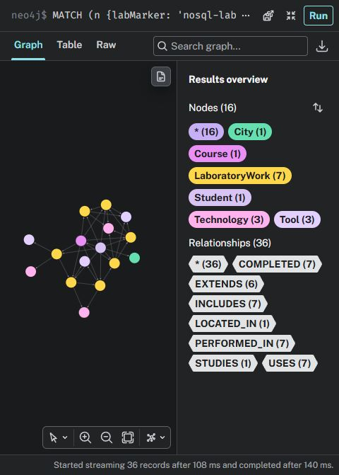
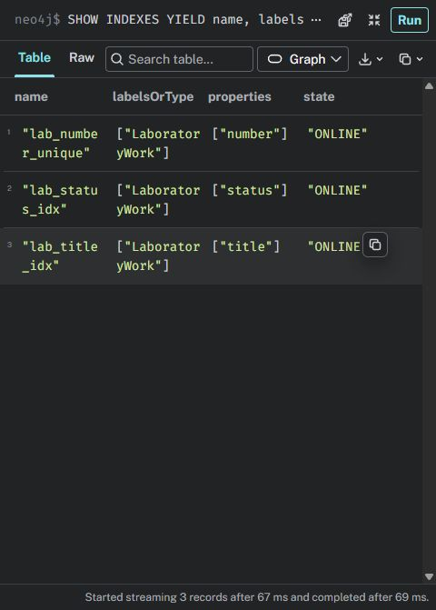
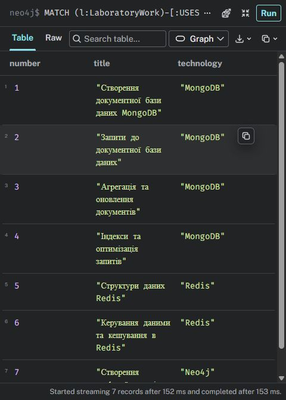

<div align="center">

**ЗВІТ**  
до лабораторної роботи № 7  
з дисципліни **«NoSQL бази даних»**

**Тема:** «Створення графової моделі та завантаження даних у Neo4j»

</div>

| Відомості | Дані |
|---|---|
| Виконав | Левченко Д. В. |
| Варіант | 5 |
| Перевірив | Андреєв П. І. |
| Рік виконання | 2026 |

## Мета роботи

Навчитися проєктувати графову модель, створювати обмеження унікальності та індекси, завантажувати дані з CSV-файлу й аналізувати взаємозв'язки у Neo4j.

## Постановка завдання

Спроєктувати граф для розширення системи MongoDB і Redis з попередніх робіт, створити схему цілісності, підготувати CSV з даними лабораторних робіт, виконати `LOAD CSV WITH HEADERS` та перевірити результат у Neo4j Browser.

## Теоретичні відомості

Neo4j використовує граф властивостей. Вузли представляють сутності, мітки класифікують вузли, напрямлені зв'язки описують відношення, а властивості зберігають атрибути у форматі ключ-значення.

Обмеження унікальності забороняє повтори ключової властивості та підтримує індекс. Звичайний індекс прискорює пошук, але не контролює дублікати. `LOAD CSV WITH HEADERS` читає стовпці за назвами, а `MERGE` дозволяє повторити імпорт без створення копій.

## Проєктування графа

Створено вузли з мітками `Student`, `Course`, `LaboratoryWork`, `Technology`, `Tool`, `City` і зв'язки `STUDIES`, `COMPLETED`, `INCLUDES`, `USES`, `PERFORMED_IN`, `LOCATED_IN`, `EXTENDS`.

| Мітка | Кількість |
|---|---:|
| City | 1 |
| Course | 1 |
| LaboratoryWork | 7 |
| Student | 1 |
| Technology | 3 |
| Tool | 3 |



<p align="center"><em>Рисунок 1 - 16 вузлів і 36 зв'язків</em></p>

## Обмеження та індекси

Створено п'ять обмежень унікальності: ідентифікатор студента, код дисципліни, номер лабораторної роботи, назва технології та назва інструмента. Для назви й статусу лабораторної роботи додано пошукові індекси.

```cypher
CREATE CONSTRAINT lab_number_unique IF NOT EXISTS
FOR (n:LaboratoryWork) REQUIRE n.number IS UNIQUE;

CREATE INDEX lab_title_idx IF NOT EXISTS
FOR (n:LaboratoryWork) ON (n.title);

CREATE INDEX lab_status_idx IF NOT EXISTS
FOR (n:LaboratoryWork) ON (n.status);
```



<p align="center"><em>Рисунок 2 - Індекси лабораторних робіт у стані ONLINE</em></p>

## Завантаження CSV

Файл [`data/lab7_labs.csv`](./data/lab7_labs.csv) містить сім лабораторних робіт. Для всіх вузлів застосовано варіант 5.

```cypher
LOAD CSV WITH HEADERS FROM 'file:///lab7_labs.csv' AS row
WITH row, toInteger(row.number) AS labNumber
MERGE (lab:LaboratoryWork {number: labNumber})
SET lab.title = row.title,
    lab.status = row.status,
    lab.variant = 5
MERGE (technology:Technology {name: row.technology})
MERGE (tool:Tool {name: row.tool})
MERGE (lab)-[:USES]->(technology)
MERGE (lab)-[:PERFORMED_IN]->(tool);
```



<p align="center"><em>Рисунок 3 - Сім лабораторних робіт після імпорту</em></p>

## Перевірка

| Показник | Результат |
|---|---:|
| Вузлів | 16 |
| Зв'язків | 36 |
| Лабораторних робіт | 7 |
| Обмежень унікальності | 5 |
| Індекси | Усі `ONLINE` |
| Маршрут EXTENDS | 7 → 6 → 5 → 4 → 3 → 2 → 1 |
| Загальний стан | `ok: true` |

## Відповіді на контрольні питання

### 1 Які основні елементи графової моделі Neo4j

Вузли, зв'язки, мітки, типи зв'язків і властивості.

### 2 Для чого використовуються обмеження унікальності

Вони гарантують відсутність повторів ключового значення й підтримують індекс для швидкого пошуку. Під час запису виникають додаткові витрати на перевірку.

### 3 Яка різниця між індексом і обмеженням унікальності

Індекс прискорює пошук і допускає дублікати. Обмеження забезпечує цілісність, забороняє дублікати та водночас створює індекс.

### 4 Як завантажити дані з CSV

Розмістити файл у каталозі `import` і виконати `LOAD CSV WITH HEADERS FROM 'file:///file.csv' AS row`, після чого використати `MERGE`, `CREATE` та `SET`.

### 5 Коли графова база доцільніша за реляційну

Коли головну цінність становлять взаємозв'язки та багатокрокові обходи: рекомендації, соціальні мережі, маршрути, графи знань, залежності та виявлення шахрайства.

## Висновок

Для варіанта 5 побудовано графову модель попередніх лабораторних робіт. CSV-імпорт створив сім вузлів робіт без дублікатів, усі індекси мають стан `ONLINE`. Підсумковий граф містить 16 вузлів і 36 зв'язків, а ланцюг `EXTENDS` охоплює роботи від 7 до 1. Усі автоматичні перевірки успішні.

