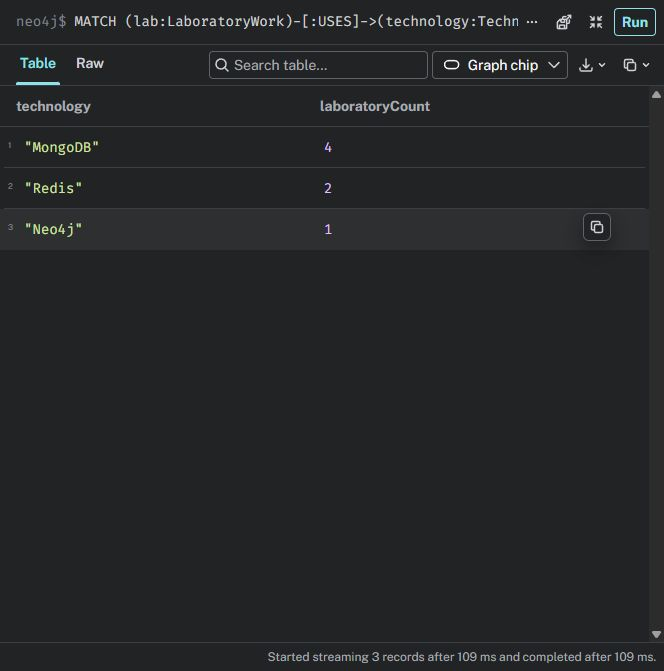
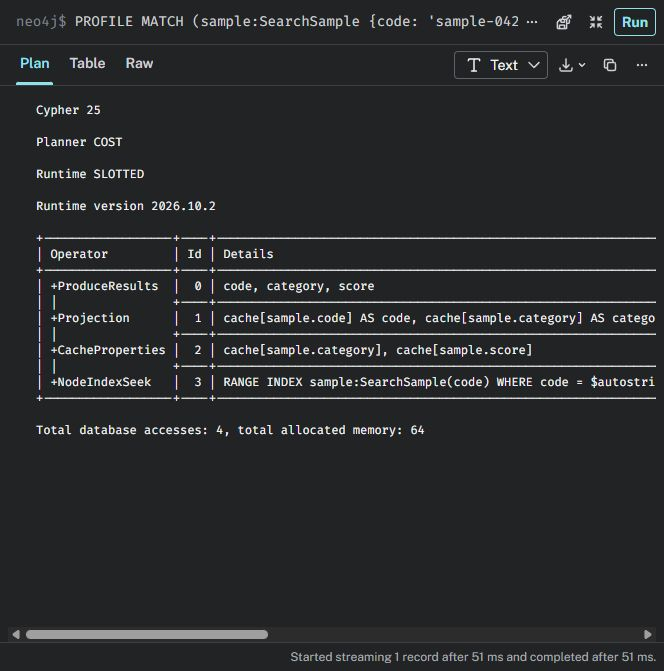
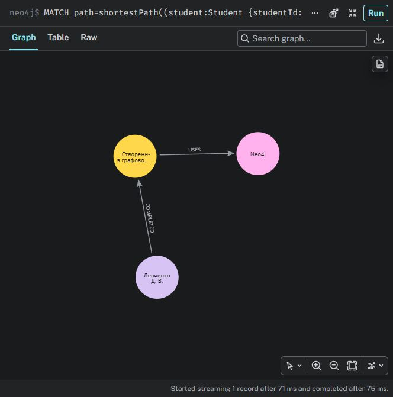

# Лабораторна робота №8

**Дисципліна:** NoSQL бази даних  
**Тема:** Пошук та аналіз вузлів і зв’язків у графовій базі даних Neo4j засобами Python  
**Варіант:** 5  
**Виконав:** Левченко Д. В.  
**Перевірив:** Андреєв П. І.

## Мета роботи

Навчитися підключатися до Neo4j із Python, виконувати пошукові та аналітичні Cypher-запити, досліджувати плани виконання за допомогою `EXPLAIN` і `PROFILE`, а також оцінювати вплив індексів на ефективність пошуку.

## Завдання

1. Опрацювати теоретичні відомості про пошук і аналіз графів у Neo4j.
2. Завантажити граф, створений у попередній лабораторній роботі.
3. Реалізувати засобами Python пошукові й аналітичні функції.
4. Проаналізувати плани виконання запитів за допомогою `EXPLAIN` і `PROFILE`.
5. Порівняти виконання пошуку до та після створення індексу.
6. Перевірити коректність отриманих результатів.

## Теоретичні відомості

Офіційний Python-драйвер `neo4j` встановлює Bolt-з’єднання з сервером. Запити виконуються через сесію драйвера, а значення передаються параметрами, що підвищує безпеку та дозволяє повторно використовувати план запиту.

Команда `EXPLAIN` формує план без виконання запиту. Команда `PROFILE` виконує запит і доповнює план фактичними показниками: кількістю рядків, звернень до бази даних та використаними індексами. Для пошуку за властивістю індекс дає змогу перейти від повного перегляду вузлів `NodeByLabelScan` до адресного пошуку `NodeIndexSeek`.

## Хід роботи

### 1. Підключення до Neo4j

У програмі створено драйвер для локального екземпляра Neo4j:

```python
from neo4j import GraphDatabase

driver = GraphDatabase.driver("bolt://127.0.0.1:7687", auth=None)
driver.verify_connectivity()
```

Програма перевіряє наявність графа з попередньої роботи та даних варіанта 5. У базі знайдено сім вузлів `LaboratoryWork`, пов’язаних зі студентом, курсом і технологіями.

### 2. Аналітичні запити

Для визначення частоти використання технологій виконано запит:

```cypher
MATCH (lab:LaboratoryWork)-[:USES]->(technology:Technology)
RETURN technology.name AS technology,
       count(lab) AS laboratoryCount
ORDER BY laboratoryCount DESC, technology
```

Результат: MongoDB — 4 лабораторні роботи, Redis — 2, Neo4j — 1.



Також програма обчислює ступінь кожного вузла `LaboratoryWork`, рахує типи зв’язків і знаходить найкоротший шлях від студента варіанта 5 до технології Neo4j.

### 3. Порівняння пошуку без індексу та з індексом

Для контрольованого експерименту створено 500 вузлів `SearchSample` і 500 зв’язків `REFERS_TO`. Пошук виконувався за унікальним кодом `sample-0420`:

```cypher
MATCH (sample:SearchSample {code: $code})
RETURN sample.code AS code,
       sample.category AS category,
       sample.score AS score
```

Перед створенням індексу план містив `NodeByLabelScan` і потребував **1003 звернення до БД**. Після виконання

```cypher
CREATE INDEX search_sample_code_idx IF NOT EXISTS
FOR (sample:SearchSample) ON (sample.code)
```

план використовує `NodeIndexSeek`, а кількість звернень зменшилася до **4**. Індекс має тип `RANGE` і стан `ONLINE`.



Для 120 повторень медіанний час на клієнті зменшився з 2,2561 мс до 2,0133 мс. Основним доказом оптимізації є зміна оператора плану та скорочення `DB Hits` у 250,75 раза.

### 4. Пошук найкоротшого шляху

```cypher
MATCH path = shortestPath(
  (:Student {studentId: 'student-variant-5'})-[*..6]-
  (:Technology {name: 'Neo4j'})
)
RETURN path
```

Знайдено шлях довжиною 2: студент → лабораторна робота → Neo4j. Використані типи зв’язків — `COMPLETED` і `USES`.



## Перевірка результатів

Автоматичні перевірки підтвердили:

- підключення до Neo4j і завантаження графа попередньої роботи;
- наявність даних варіанта 5;
- створення 500 тестових вузлів і 500 зв’язків;
- правильність пошуку вузла `sample-0420`;
- використання `NodeByLabelScan` до індексації;
- використання `NodeIndexSeek` після індексації;
- стан індексу `ONLINE` і зменшення кількості звернень до БД;
- знаходження найкоротшого шляху.

Повні машинні результати містяться у файлі [`results/lab8_results.json`](results/lab8_results.json), а реалізація — у [`scripts/lab8_neo4j_analysis.py`](scripts/lab8_neo4j_analysis.py).

## Відповіді на контрольні запитання

### 1. Як підключитися до Neo4j із Python?

Потрібно встановити пакет `neo4j`, створити об’єкт `GraphDatabase.driver()` з URI, обліковими даними та перевірити з’єднання методом `verify_connectivity()`. Запити виконуються в сесіях драйвера.

### 2. Як виконати пошуковий запит за допомогою Python-драйвера?

Cypher-запит передають до `session.run()` або `driver.execute_query()`. Значення слід передавати окремими параметрами, наприклад `code="sample-0420"`, а записи результату перетворити на словники або об’єкти прикладної моделі.

### 3. Для чого використовують EXPLAIN і PROFILE?

`EXPLAIN` показує прогнозований план без виконання запиту. `PROFILE` виконує запит і відображає фактичні рядки, `DB Hits`, використані індекси та інші показники, потрібні для пошуку вузьких місць.

### 4. Як індекси впливають на пошук у графовій базі даних?

Індекси прискорюють знаходження початкових вузлів за міткою та властивістю. Вони не замінюють обходу зв’язків, але зменшують множину стартових вузлів. У проведеному досліді індекс змінив `NodeByLabelScan` на `NodeIndexSeek` і зменшив кількість звернень до БД з 1003 до 4.

### 5. Як підрахувати кількість зв’язків для кожного вузла?

Можна зіставити вузол з усіма вхідними й вихідними зв’язками та застосувати `count`:

```cypher
MATCH (node)
OPTIONAL MATCH (node)-[relationship]-()
RETURN node, count(relationship) AS degree
```

## Висновок

У роботі реалізовано підключення Python до Neo4j, пошукові та аналітичні Cypher-запити, підрахунок зв’язків і пошук найкоротшого шляху. За допомогою `EXPLAIN` і `PROFILE` підтверджено вплив індексу: повне сканування 500 вузлів замінено індексним пошуком, а кількість звернень до бази даних зменшилася з 1003 до 4. Усі автоматичні перевірки пройдено успішно.
