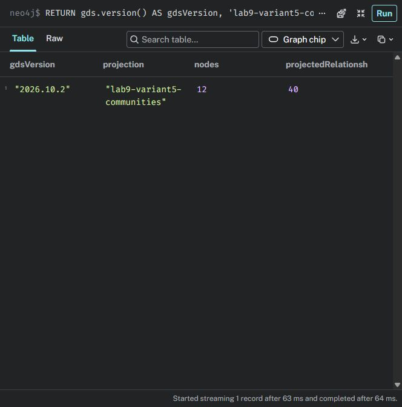
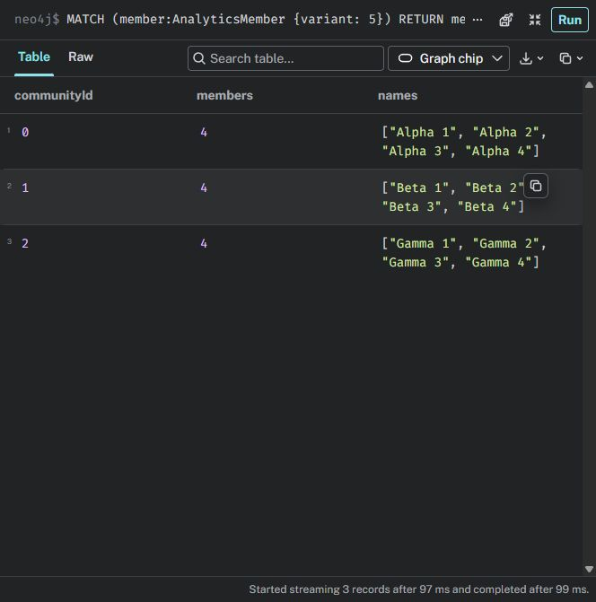
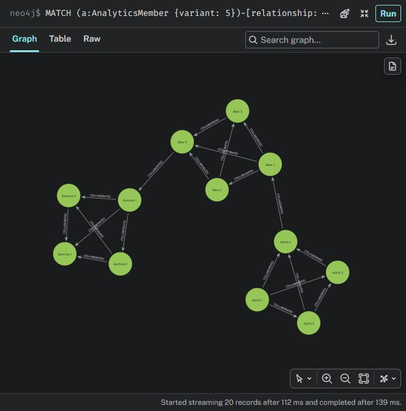

# Лабораторна робота №9

**Дисципліна:** NoSQL бази даних  
**Тема:** Аналіз графових даних за допомогою бібліотеки Graph Data Science у Neo4j засобами Python  
**Варіант:** 5  
**Виконав:** Левченко Д. В.  
**Перевірив:** Андреєв П. І.

## Мета роботи

Набути практичних навичок роботи з бібліотекою Graph Data Science засобами Python: створювати проєкції графа в оперативній пам’яті, застосовувати алгоритм Louvain для виявлення спільнот, отримувати та зберігати результати, а також керувати життєвим циклом проєкції.

## Завдання

1. Завантажити графову модель із попередньої лабораторної роботи.
2. Додати тестовий набір даних для аналізу спільнот.
3. Створити проєкцію графа в каталозі GDS.
4. Застосувати алгоритм Louvain.
5. Записати результати у властивості вузлів.
6. Видалити тимчасову проєкцію після аналізу.

## Теоретичні відомості

Graph Data Science (GDS) — бібліотека алгоритмів для Neo4j. Вона виконує обчислення над спеціалізованою проєкцією графа в оперативній пам’яті. Такий підхід відокремлює аналітичне представлення від основного графа та дає змогу явно визначати мітки вузлів, типи й орієнтацію зв’язків.

Алгоритм Louvain належить до методів виявлення спільнот. Він ітеративно об’єднує вузли у групи так, щоб максимізувати модульність — показник, який порівнює щільність зв’язків усередині спільнот з очікуваною щільністю у випадковому графі. Режим `stream` повертає результат без зміни бази, `stats` надає агреговані показники, а `write` записує ідентифікатор спільноти у властивість вузла.

## Хід роботи

### 1. Підготовка середовища

Використано Neo4j Community 2026.10.2, серверний плагін GDS 2026.10.2 та Python-клієнт `graphdatascience` 2.3. Підключення виконується через Bolt без автентифікації:

```python
from graphdatascience import GraphDataScience

gds = GraphDataScience("bolt://127.0.0.1:7687", auth=None)
version = gds.run_cypher("RETURN gds.version() AS version")
```



### 2. Формування тестового графа

Програма перевірила наявність семи лабораторних робіт варіанта 5 з попередньої роботи. Оскільки їхня структура не утворює кілька щільних спільнот, додано 12 вузлів `AnalyticsMember`: по чотири учасники в групах Alpha, Beta та Gamma.

Усередині кожної групи створено повний набір зв’язків `COLLABORATES`, а сусідні групи поєднано двома слабкими мостами з вагою `0.15`. У базі збережено 20 зв’язків. Після проєктування з орієнтацією `UNDIRECTED` GDS обробляє 40 напрямків зв’язків.

### 3. Створення проєкції

```cypher
CALL gds.graph.project(
  'lab9-variant5-communities',
  'AnalyticsMember',
  {
    COLLABORATES: {
      orientation: 'UNDIRECTED',
      properties: 'weight'
    }
  }
)
```

Проєкція містить 12 вузлів і 40 напрямків зв’язків.

### 4. Запуск Louvain

Для попереднього перегляду результатів використано режим `stream`:

```cypher
CALL gds.louvain.stream(
  'lab9-variant5-communities',
  {
    relationshipWeightProperty: 'weight',
    consecutiveIds: true
  }
)
YIELD nodeId, communityId
RETURN gds.util.asNode(nodeId).name AS name, communityId
```

Алгоритм знайшов три спільноти. Значення модульності становить **0,650262**, що підтверджує виражену кластерну структуру.

| Спільнота | Кількість | Учасники |
|---:|---:|---|
| 0 | 4 | Alpha 1, Alpha 2, Alpha 3, Alpha 4 |
| 1 | 4 | Beta 1, Beta 2, Beta 3, Beta 4 |
| 2 | 4 | Gamma 1, Gamma 2, Gamma 3, Gamma 4 |



Графічне подання демонструє три щільні групи та два слабкі міжгрупові зв’язки.



### 5. Збереження результатів і видалення проєкції

Результати записано до властивості `communityId` усіх 12 вузлів:

```cypher
CALL gds.louvain.write(
  'lab9-variant5-communities',
  {
    relationshipWeightProperty: 'weight',
    writeProperty: 'communityId',
    consecutiveIds: true
  }
)
```

Після перевірки тимчасову проєкцію видалено:

```cypher
CALL gds.graph.drop('lab9-variant5-communities', false)
```

Вузли та їхні властивості залишилися в основній базі Neo4j, тоді як оперативна пам’ять каталогу GDS була звільнена.

## Перевірка результатів

Автоматичні перевірки підтвердили:

- з’єднання з GDS 2026.10.2;
- наявність графа попередньої роботи та даних варіанта 5;
- створення 12 тестових вузлів і 20 збережених зв’язків;
- створення проєкції з 12 вузлів і 40 напрямків зв’язків;
- знаходження трьох спільнот без поділу початкових груп;
- отримання результатів для всіх 12 вузлів;
- запис 12 властивостей `communityId`;
- видалення проєкції після завершення аналізу.

Повні машинні результати: [`results/lab9_results.json`](results/lab9_results.json). Реалізація: [`scripts/lab9_gds_louvain.py`](scripts/lab9_gds_louvain.py).

## Відповіді на контрольні запитання

### 1. Що таке бібліотека Graph Data Science і для чого вона використовується в Neo4j?

GDS — бібліотека графових алгоритмів і засобів машинного навчання для Neo4j. Вона використовується для пошуку спільнот, оцінювання центральності, подібності, маршрутів, створення векторних представлень вузлів і прогнозування зв’язків.

### 2. Що таке проєкція графа GDS?

Проєкція — спеціалізоване представлення вибраних вузлів, зв’язків і властивостей у оперативній пам’яті. Алгоритми працюють із проєкцією, а не безпосередньо з усією базою, тому склад і напрямленість аналітичного графа можна налаштувати окремо.

### 3. Для чого призначений алгоритм Louvain?

Louvain виявляє спільноти вузлів шляхом максимізації модульності. Вузли однієї спільноти мають більше або вагоміші внутрішні зв’язки, ніж можна очікувати у випадковій структурі.

### 4. Що таке спільнота в графі?

Спільнота — група вузлів, які щільніше пов’язані між собою, ніж з іншими частинами графа. Залежно від предметної області це можуть бути групи користувачів, теми, організації або функціональні модулі.

### 5. Для чого використовується `gds.graph.drop()`?

Функція видаляє проєкцію з каталогу GDS і звільняє зайняту нею оперативну пам’ять. Вона не видаляє вузли та зв’язки з основної бази Neo4j і не скасовує раніше записані властивості.

## Висновок

У лабораторній роботі налаштовано GDS 2026.10.2, створено проєкцію графа варіанта 5 та застосовано алгоритм Louvain. Алгоритм правильно визначив три спільноти по чотири вузли з модульністю 0,650262. Результати записано у властивість `communityId`, а тимчасову проєкцію після аналізу видалено. Усі автоматичні перевірки пройдено успішно.
