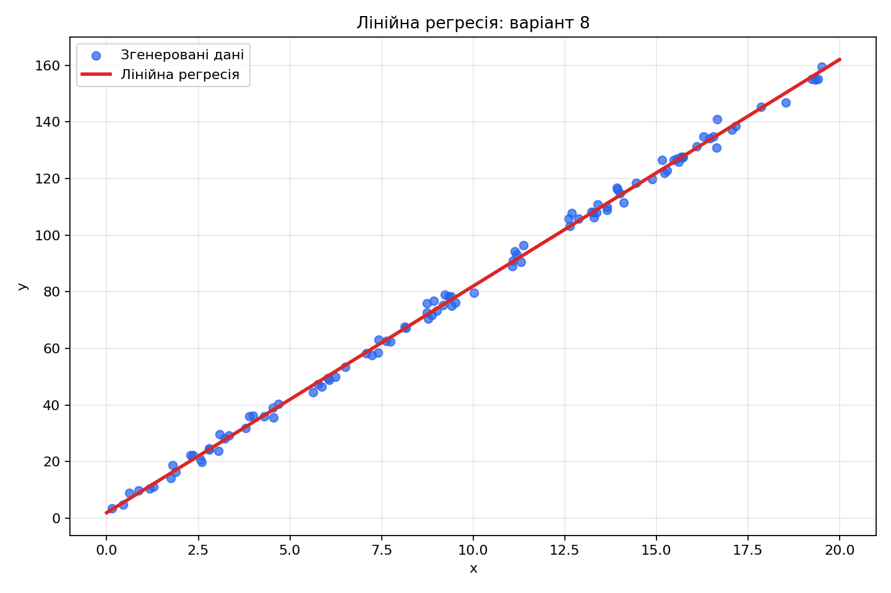
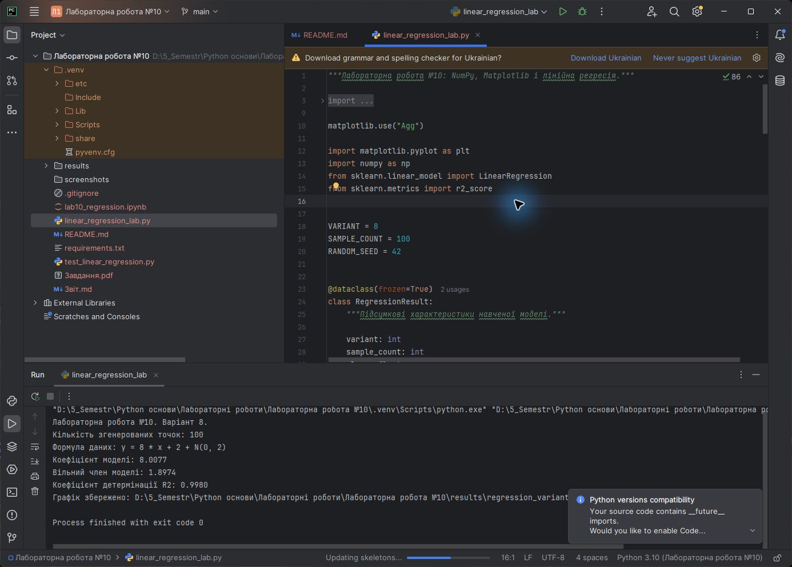
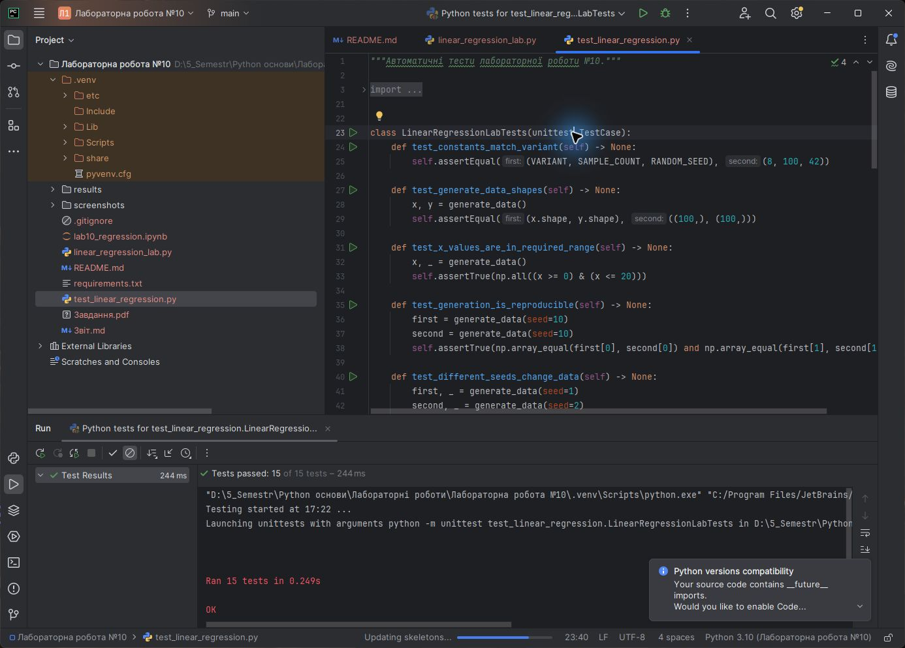

# ЗВІТ

## до лабораторної роботи №10

**Тема:** Ознайомлення з інструментами Python: середовище Jupyter Notebook та бібліотеки NumPy, Matplotlib і Scikit-learn

| Відомості | Значення |
|---|---|
| Дисципліна | Python основи |
| Виконав | Левченко Д. В. |
| Номер варіанта | 8 |
| Викладач | Андреєв П. І. |
| Рік виконання | 2026 |

## Мета роботи

Ознайомитися з Jupyter Notebook і набути практичних навичок генерації числових даних у NumPy, побудови графіків у Matplotlib та навчання моделі лінійної регресії засобами Scikit-learn.

## Постановка завдання

Для варіанта 8 згенерувати 100 випадкових значень `x` у межах від 0 до 20 та обчислити `y = 8 * x + 2 + np.random.normal(0, 2, 100)`. Побудувати діаграму розсіювання, навчити модель `LinearRegression` і відобразити лінію регресії на тому самому графіку.

## Короткі теоретичні відомості

Jupyter Notebook поєднує виконувані комірки Python, Markdown-текст, формули й візуалізації в одному документі. NumPy надає масив `ndarray` і векторизовані числові операції. Matplotlib використовується для побудови графіків, а Scikit-learn містить готові алгоритми машинного навчання, зокрема лінійну регресію.

Лінійна регресія шукає коефіцієнти прямої `ŷ = a * x + b`, що мінімізує суму квадратів похибок. Коефіцієнт детермінації `R²` показує частку варіації цільової змінної, яку пояснює модель.

## Хід виконання роботи

1. Створено Jupyter Notebook із Markdown- і Python-комірками.
2. Для відтворюваності використано генератор NumPy з початковим значенням `seed = 42`.
3. Згенеровано 100 випадкових значень `x` на відрізку `[0, 20]`.
4. За формулою варіанта створено масив `y` із нормальним шумом стандартного відхилення 2.
5. Модель `LinearRegression` навчено на масиві `x`, перетвореному до форми `(100, 1)`.
6. Обчислено коефіцієнт нахилу, вільний член і `R²`.
7. Побудовано діаграму розсіювання та червону лінію прогнозу моделі.
8. Notebook виконано повністю, а результати й графік збережено безпосередньо у файлі `.ipynb`.
9. Реалізовано 15 автоматичних тестів для генерації даних, навчання моделі та створення PNG.

## Результати

Фактичні параметри моделі після виконання програми:

- коефіцієнт нахилу: **8,0077**;
- вільний член: **1,8974**;
- коефіцієнт детермінації `R²`: **0,9980**.

## Запуск у PyCharm

На рисунку 2 показано виконання програми з параметрами моделі та шляхом до створеного графіка.

На рисунку 3 показано результат виконання 15 автоматичних тестів.

## Відповіді на контрольні питання

### 1. Що таке Jupyter Notebook і для чого він використовується?

Jupyter Notebook — інтерактивне середовище, у якому код, пояснення, формули й результати виконання зберігаються в одному документі. Воно зручне для аналізу даних, експериментів і навчальних робіт.

### 2. Яка функція Matplotlib будує лінійний графік?

Лінійний графік будує функція `matplotlib.pyplot.plot()`.

### 3. Для чого використовується Scikit-learn?

Scikit-learn використовується для підготовки даних, побудови, навчання й оцінювання моделей машинного навчання.

### 4. Як додати сітку на графік у Matplotlib?

Потрібно викликати `plt.grid(True)` або метод `axes.grid(True)`.

### 5. Яка функція NumPy створює масив із нульовими значеннями заданого розміру?

Для цього використовується функція `numpy.zeros(shape)`.

## Висновок

У лабораторній роботі створено й виконано Jupyter Notebook, засобами NumPy згенеровано дані варіанта 8, а Scikit-learn використано для відновлення лінійної залежності. Matplotlib забезпечив наочне порівняння випадкових спостережень із прогнозом моделі. Автоматичні тести підтвердили коректність обчислень і створення графіка.
