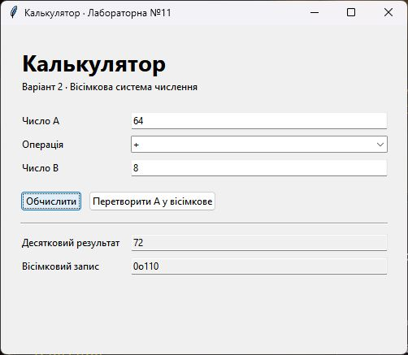
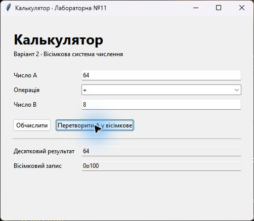

# ЗВІТ

## Лабораторна робота №11

**Тема:** Створення графічного інтерфейсу за допомогою Tkinter

| Відомості | Значення |
|---|---|
| Дисципліна | Python основи |
| Виконав | Левченко Д. В. |
| Викладач | Андреєв П. І. |
| Номер студента | 8 |
| Варіант | 2 (вісімкова система числення) |

## Мета роботи

Створити графічний калькулятор у Tkinter, підключити арифметичні функції з раніше зібраного wheel-пакета та навчитися обробляти дії користувача.

## Завдання

Для трьох варіантів циклічний відлік до номера 8 дає послідовність `1, 2, 3, 1, 2, 3, 1, 2`. Отже, обрано варіант 2. Калькулятор має виконувати арифметичні операції та показувати вісімкове представлення цілих чисел. У роботі використано [методичну вказівку](./Завдання.pdf).

## Хід виконання

1. У віртуальне середовище встановлено `levchenko-python-toolkit` версії 1.0.0 з wheel-файлу лабораторної №9. Функції `add`, `subtract`, `multiply`, `divide` і `square_root` імпортовано з модуля `levchenko_toolkit.calculator`.
2. Для введення операндів використано `ttk.Entry`, для вибору операції — `ttk.Combobox`. Елементи основної форми розміщено через `grid()`, а кнопки у вкладеному контейнері — через `pack()`.
3. Кнопки викликають обробники через параметр `command`. Клавіша Enter запускає обчислення через `bind()`. Для квадратного кореня використовується число A.
4. Цілий результат відображається у десятковому та вісімковому вигляді. Кнопка перетворення окремо приймає ціле десяткове число A і викликає `oct()`. Префікс `0o` позначає основу 8. Дробовий результат відображається в десятковому вигляді з поясненням про обмеження перетворення.
5. Повідомлення про некоректне введення, ділення на нуль або корінь із від’ємного числа виводиться у вікні калькулятора.

## Перевірка роботи

| Дія | Десятковий результат | Вісімковий запис |
|---|---:|---|
| Обчислити 64 + 8 | 72 | `0o110` |
| Перетворити число 64 | 64 | `0o100` |

*Рисунок 1 – Додавання 64 + 8 та вісімковий запис результату*

*Рисунок 2 – Вісімкове представлення числа 64*

Модуль `unittest` виконав 5 тестів. Перевірено п’ять арифметичних операцій, запис від’ємного числа й нуля, дробовий результат, некоректне введення та арифметичні помилки.

## Відповіді на контрольні питання

1. **Що таке Tkinter?** Це стандартний інтерфейс Python до бібліотеки Tk для створення графічних застосунків.
2. **Який метод запускає графічний інтерфейс і обробляє події?** Метод `root.mainloop()` запускає цикл подій.
3. **Як змінити заголовок вікна?** Передати потрібний текст методу `root.title("Калькулятор")`.
4. **Які є менеджери макетів?** `pack()` розміщує віджети послідовно, `grid()` — у рядках і стовпцях, `place()` — за заданими координатами.
5. **Як створити кнопку в Tkinter?** Створити віджет `ttk.Button(parent, text="Обчислити", command=compute)` та розмістити його за допомогою менеджера макета.

## Висновок

Створено графічний калькулятор із п’ятьма арифметичними операціями з wheel-пакета лабораторної №9. Для варіанта 2 реалізовано вісімкове представлення цілих чисел. Роботу підтверджено запуском застосунку та автоматичними тестами.
