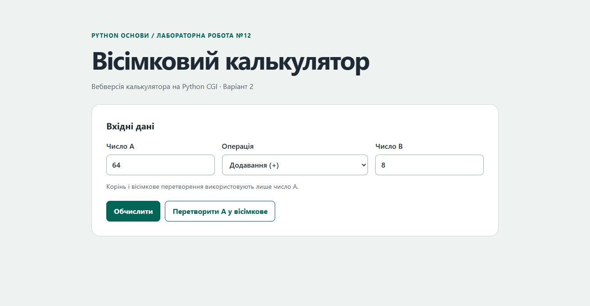
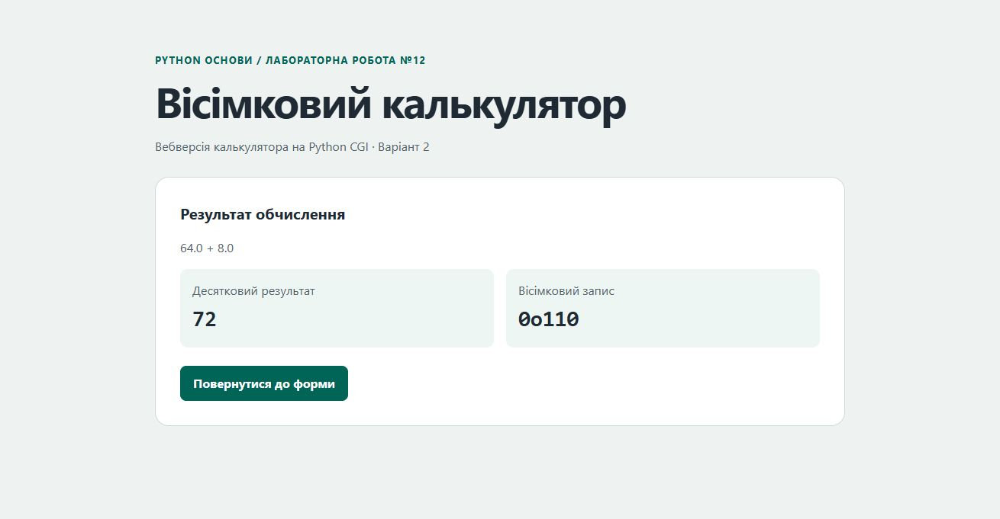
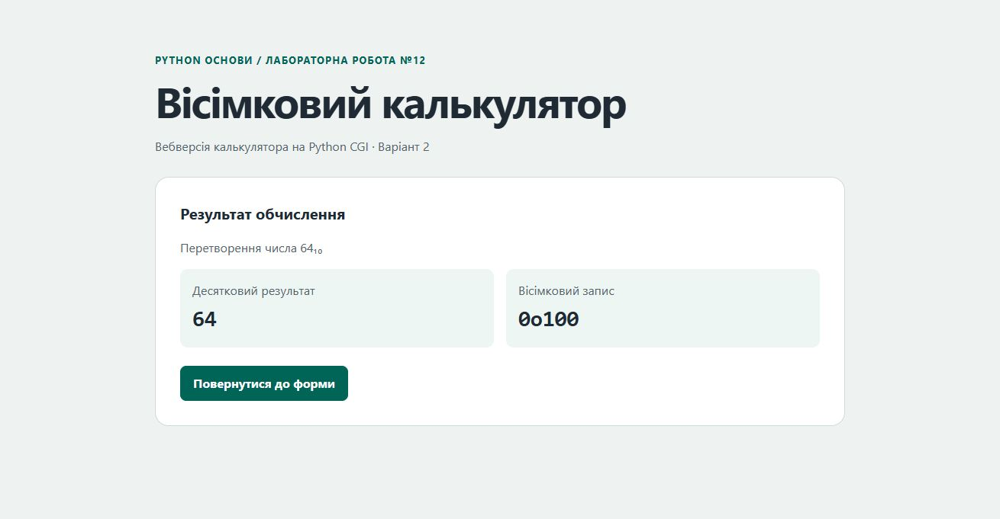

# ЗВІТ

## Лабораторна робота №12

**Тема:** Розробка CGI-скриптів на Python

| Відомості | Значення |
|---|---|
| Дисципліна | Python основи |
| Виконав | Левченко Д. В. |
| Викладач | Андреєв П. І. |
| Номер студента | 8 |
| Варіант | 2, вісімкова система числення |

## Мета роботи

Створити вебверсію калькулятора з лабораторної роботи №11. Навчитися передавати дані з HTML-форми в CGI-скрипт і формувати HTML-відповідь.

## Хід виконання

1. Створено HTML-форму з полями A і B, списком операцій та двома кнопками. Форма надсилає дані методом `GET` до `/cgi-bin/calculate.py`.
2. CGI-скрипт читає значення через `cgi.FieldStorage().getfirst()`. Для арифметики викликаються функції `add`, `subtract`, `multiply`, `divide` і `square_root` з wheel-пакета лабораторної №9.
3. Для номера 8 збережено варіант 2 з попередньої роботи, оскільки `(8 − 1) % 3 + 1 = 2`. Функція `oct()` формує вісімковий запис цілого результату. Окрема кнопка перетворює ціле число A.
4. Скрипт виводить заголовок `Content-Type: text/html; charset=utf-8`, порожній рядок і HTML. Динамічні значення та повідомлення екрануються за допомогою `html.escape()`.
5. Для перевірки застосунок запущено на локальному CGI-сервері під Python 3.10. Оформлення форми й відповіді задає спільний файл `style.css`.

## Результати перевірки

| Дія | Десятковий результат | Вісімковий запис |
|---|---:|---|
| Додати 64 і 8 | 72 | `0o110` |
| Перетворити 64 | 64 | `0o100` |
| Поділити 3 на 2 | 1,5 | — |

Перевірено 10 HTTP-запитів до CGI-скрипта. Вони охопили всі п’ять операцій, перетворення від’ємного числа, дробовий результат, ділення на нуль, некоректне введення та корінь із від’ємного числа.

*Рисунок 1 – HTML-форма з числами 64 і 8*

*Рисунок 2 – CGI-відповідь для додавання 64 і 8*

*Рисунок 3 – CGI-відповідь для перетворення числа 64*

## Відповіді на контрольні питання

1. **Що таке CGI?** Common Gateway Interface визначає, як вебсервер передає вхідні дані зовнішній програмі й отримує від неї відповідь.
2. **Як отримати дані з HTML-форми в CGI-скрипті?** У цій роботі `cgi.FieldStorage()` читає параметри запиту, а `getfirst("a")` повертає перше значення поля A.
3. **Для чого використовується модуль cgitb?** Він формує детальні звіти про винятки для налагодження CGI. Публічним користувачам слід показувати короткі повідомлення, оскільки звіт може містити внутрішні дані програми.
4. **Як запустити вбудований сервер для виконання CGI-скриптів?** Для Python 3.10–3.12 у робочому каталозі можна виконати `python -m http.server --cgi --bind 127.0.0.1 8000`. У проєкті також є `serve.py` з локальною адресою за замовчуванням. [Документація Python](https://docs.python.org/3.12/library/http.server.html)
5. **Як запобігти XSS у CGI-відповіді?** Перед вставленням даних у HTML потрібно екранувати спеціальні символи відповідно до контексту. Для тексту та значень атрибутів у лапках підходить `html.escape(value, quote=True)`.

## Висновок

Створено вебкалькулятор на Python CGI з арифметикою з wheel-пакета та вісімковим представленням цілих чисел. Перевірка через браузер і HTTP-запити підтвердила обробку форми, обчислення й відображення повідомлень про помилки.
