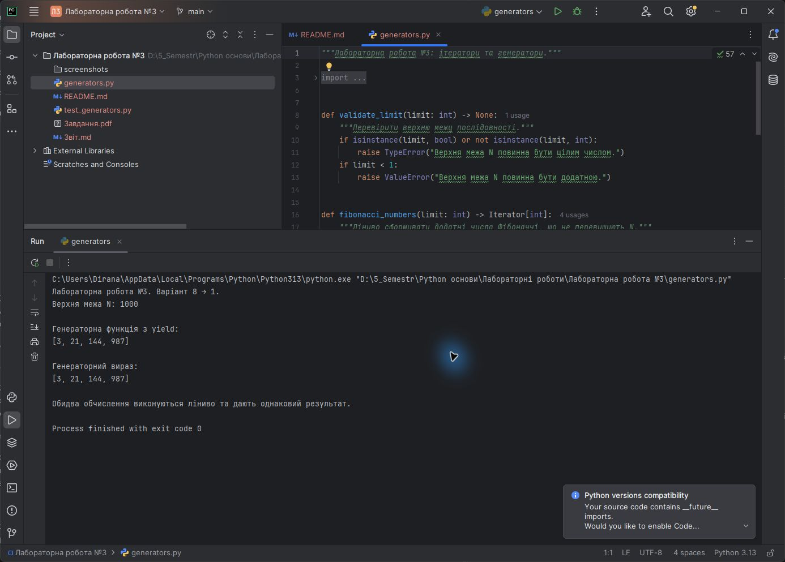
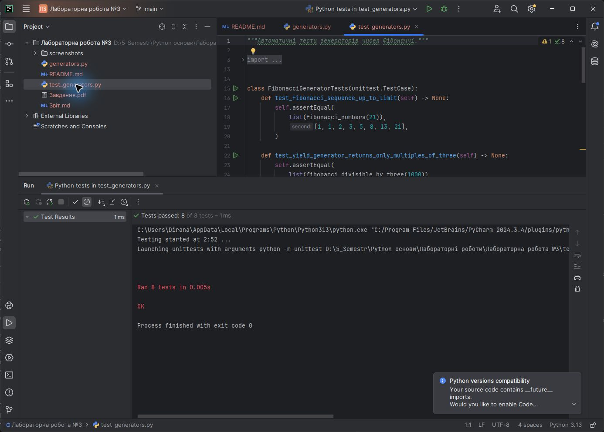

<div align="center">

**ЗВІТ**<br>
до лабораторної роботи №3<br>
з дисципліни **«Python основи»**

**Тема:** «Застосування ітераторів, генераторів для ефективного опрацювання даних»

</div>

| Відомості | Дані |
|---|---|
| Виконав | Левченко Д. В. |
| Номер студента | 8 |
| Варіант | 1 |
| Перевірив | Андреєв П. І. |
| Рік виконання | 2026 |

## Визначення варіанта

У методичній вказівці наведено 7 варіантів. За циклічним розподілом номер студента 8 відповідає першому варіанту:

```text
((8 - 1) mod 7) + 1 = 1
```

Завдання варіанта №1: створити генератори чисел Фібоначчі до `N`, які повертають лише числа, кратні 3.

## Мета роботи

Навчитися використовувати ітератори й генератори Python для лінивого та ефективного опрацювання послідовностей даних.

## Постановка завдання

1. Реалізувати генерацію додатних чисел Фібоначчі, що не перевищують задане `N`.
2. За допомогою генераторної функції з `yield` повернути лише числа, кратні 3.
3. Реалізувати аналогічне фільтрування за допомогою генераторного виразу.
4. Продемонструвати використання обох генераторів.
5. Перевірити коректність і ліниву природу реалізації автоматичними тестами.

## Використані засоби

- середовище розробки PyCharm;
- мова програмування Python 3;
- стандартні модулі `collections.abc`, `types` і `unittest`;
- система контролю версій Git.

## Теоретичні відомості

Ітератор - це об'єкт, який реалізує методи `__iter__()` і `__next__()` та послідовно повертає елементи. Генератор є спеціальним різновидом ітератора, який створює значення лише в момент запиту. Завдяки цьому не потрібно зберігати всю послідовність у пам'яті.

Генераторну функцію створюють за допомогою ключового слова `yield`. Після повернення чергового значення виконання функції призупиняється, а її локальний стан зберігається. Генераторний вираз має компактний синтаксис, подібний до спискового включення, але використовує круглі дужки й також виконує обчислення ліниво.

## Хід виконання роботи

1. Створено функцію `fibonacci_numbers(limit)`, яка за допомогою `yield` формує додатні числа Фібоначчі до `N`.
2. Створено генераторну функцію `fibonacci_divisible_by_three(limit)`, яка пропускає лише значення, кратні 3.
3. Створено функцію `fibonacci_divisible_expression(limit)`, яка повертає генераторний вираз з аналогічним фільтром.
4. Додано перевірку, що верхня межа є додатним цілим числом.
5. Для демонстрації використано `N = 1000`. Обидва способи повернули значення `3, 21, 144, 987`.
6. Створено 8 автоматичних тестів для перевірки послідовності, фільтрації, лінивості та некоректних вхідних даних.

Алгоритм генераторної функції:

```text
Перевірити значення N
Присвоїти current = 1, following = 1
Поки current <= N:
  якщо current кратне 3:
    повернути current через yield
  обчислити наступну пару чисел Фібоначчі
```

Повний код наведено у файлі [`generators.py`](./generators.py), тести - у файлі [`test_generators.py`](./test_generators.py).

## Результати виконання

На рисунку 1 наведено код і результат запуску програми в PyCharm. Генераторна функція та генераторний вираз сформували однакову послідовність.



<p align="center"><em>Рисунок 1 - Виконання програми з генераторами у PyCharm</em></p>

На рисунку 2 показано результат автоматичного тестування в PyCharm.



<p align="center"><em>Рисунок 2 - Успішне виконання автоматичних тестів у PyCharm</em></p>

## Відповіді на контрольні питання

### 1. Що таке ітератор у Python?

Ітератор - це об'єкт для послідовного перебору елементів, який реалізує методи `__iter__()` і `__next__()`. Метод `__next__()` повертає черговий елемент, а після завершення послідовності породжує виняток `StopIteration`.

### 2. Яка головна відмінність між генератором та звичайною функцією?

Звичайна функція завершує роботу після `return` і повертає готовий результат. Генератор використовує `yield`, призупиняє виконання, зберігає свій стан і продовжує роботу під час наступного запиту значення.

### 3. Назвіть два способи створення генератора

Генератор можна створити як функцію з ключовим словом `yield` або як генераторний вираз у круглих дужках.

### 4. Як отримати наступний елемент з генератора?

Наступний елемент отримують вбудованою функцією `next(generator)`. Також генератор можна перебирати циклом `for`, який автоматично викликає `next()` і обробляє `StopIteration`.

### 5. Що таке ітерований об'єкт і чим він відрізняється від ітератора?

Ітерований об'єкт можна передати функції `iter()` для отримання ітератора. Він зазвичай може створювати новий ітератор для кожного проходу. Ітератор додатково зберігає поточний стан перебору та повертає елементи методом `__next__()`.

## Висновок

У лабораторній роботі реалізовано два ліниві способи формування чисел Фібоначчі до заданої межі з відбором значень, кратних 3: генераторну функцію з `yield` і генераторний вираз. Обидві реалізації дали однаковий результат, а їх коректність та ліниву природу підтверджено автоматичними тестами в PyCharm.
