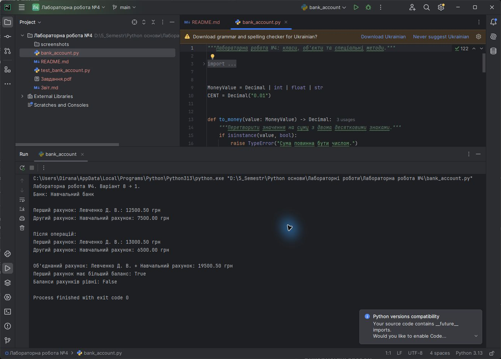
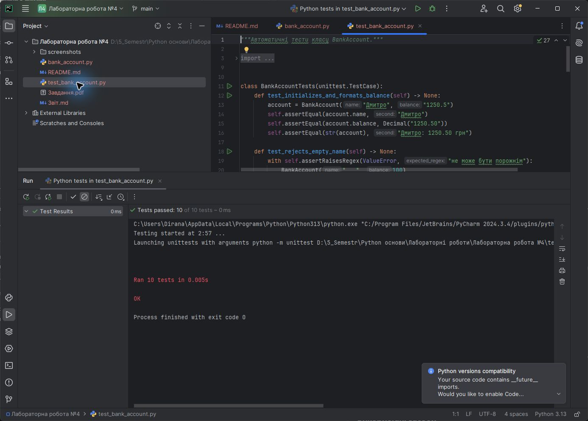

<div align="center">

**ЗВІТ**<br>
до лабораторної роботи №4<br>
з дисципліни **«Python основи»**

**Тема:** «Основи об'єктно-орієнтованого програмування: класи, об'єкти та спеціальні методи»

</div>

| Відомості | Дані |
|---|---|
| Виконав | Левченко Д. В. |
| Номер студента | 8 |
| Варіант | 1 |
| Перевірив | Андреєв П. І. |
| Рік виконання | 2026 |

## Визначення варіанта

У методичній вказівці наведено 7 варіантів. За циклічним розподілом номер студента 8 відповідає першому варіанту:

```text
((8 - 1) mod 7) + 1 = 1
```

Завдання варіанта №1: створити клас `BankAccount` з атрибутами імені та балансу, який підтримує злиття рахунків і порівняння за балансом.

## Мета роботи

Навчитися створювати класи та об'єкти мовою Python, працювати з атрибутами й методами, а також перевантажувати оператори за допомогою спеціальних методів.

## Постановка завдання

1. Створити клас `BankAccount` з атрибутами `name` і `balance`.
2. Реалізувати конструктор і зрозуміле текстове подання об'єкта.
3. Забезпечити поповнення рахунку та безпечне зняття коштів.
4. Перевантажити оператор `+` для злиття двох рахунків у новий об'єкт.
5. Реалізувати порівняння рахунків за балансом.
6. Перевірити роботу класу автоматичними тестами.

## Використані засоби

- середовище розробки PyCharm;
- мова програмування Python 3;
- стандартні модулі `decimal`, `functools`, `typing` і `unittest`;
- система контролю версій Git.

## Теоретичні відомості

Клас є шаблоном, який описує стан і поведінку об'єктів. Конкретний екземпляр класу називають об'єктом. Метод `__init__()` автоматично викликається під час створення об'єкта та встановлює його початковий стан. Параметр `self` посилається на поточний екземпляр.

Спеціальні методи дозволяють об'єктам взаємодіяти зі стандартними операторами Python. Метод `__add__()` визначає поведінку оператора `+`, `__eq__()` - перевірку рівності, `__lt__()` - порівняння «менше», а `__str__()` - текстове подання об'єкта. Декоратор `@total_ordering` доповнює решту операторів порівняння на основі `__eq__()` і `__lt__()`.

Для грошових сум використано `Decimal`, що усуває типові похибки двійкових чисел із рухомою крапкою.

## Хід виконання роботи

1. Створено клас `BankAccount` і класовий атрибут `bank_name`.
2. Конструктор перевіряє ім'я власника, перетворює баланс на `Decimal` і забороняє від'ємний початковий баланс.
3. Методи `deposit()` та `withdraw()` реалізують поповнення й зняття коштів із перевіркою значень.
4. Метод `__add__()` створює новий об'єднаний рахунок, не змінюючи початкові об'єкти.
5. Методи `__eq__()` і `__lt__()` порівнюють рахунки за балансом.
6. Методи `__str__()` і `__repr__()` формують користувацьке й технічне подання об'єкта.
7. Створено 10 автоматичних тестів для перевірки всіх основних сценаріїв.

Алгоритм злиття рахунків:

```text
Отримати два об'єкти BankAccount
Перевірити тип другого об'єкта
Сформувати ім'я об'єднаного рахунку
Додати баланси двох рахунків
Створити й повернути новий BankAccount
Початкові рахунки залишити без змін
```

Повний код наведено у файлі [`bank_account.py`](./bank_account.py), тести - у файлі [`test_bank_account.py`](./test_bank_account.py).

## Результати виконання

На рисунку 1 наведено код і результат запуску програми в PyCharm: створення рахунків, операції з коштами, злиття та порівняння за балансом.



<p align="center"><em>Рисунок 1 - Виконання програми з класом BankAccount у PyCharm</em></p>

На рисунку 2 показано результат автоматичного тестування в PyCharm.



<p align="center"><em>Рисунок 2 - Успішне виконання автоматичних тестів у PyCharm</em></p>

## Відповіді на контрольні питання

### 1. Поясніть різницю між класом та об'єктом

Клас - це опис структури й поведінки майбутніх екземплярів. Об'єкт - конкретний екземпляр класу з власними значеннями атрибутів.

### 2. Що таке `self` у методах класу?

`self` - це посилання на поточний екземпляр класу. Через нього метод отримує доступ до атрибутів та інших методів конкретного об'єкта.

### 3. Який спеціальний метод відповідає за ініціалізацію об'єкта і коли він викликається?

Метод `__init__()` відповідає за встановлення початкового стану об'єкта. Python автоматично викликає його одразу після створення нового екземпляра класу.

### 4. Чим відрізняються атрибути, визначені через `self` у конструкторі, від атрибутів, визначених безпосередньо всередині класу?

Атрибути через `self` належать окремому екземпляру, тому кожен об'єкт може мати власне значення. Атрибути класу оголошуються в тілі класу й спочатку є спільними для всіх екземплярів.

### 5. Для чого потрібен метод `__call__()`?

Метод `__call__()` дозволяє викликати екземпляр класу як звичайну функцію. Під час запису `object(...)` Python фактично викликає `object.__call__(...)`.

## Висновок

У лабораторній роботі створено клас `BankAccount`, який інкапсулює ім'я власника та баланс, підтримує безпечні операції з коштами, злиття рахунків і порівняння за балансом. Перевантаження операторів реалізовано спеціальними методами, а коректність усіх основних сценаріїв підтверджено автоматичними тестами в PyCharm.
