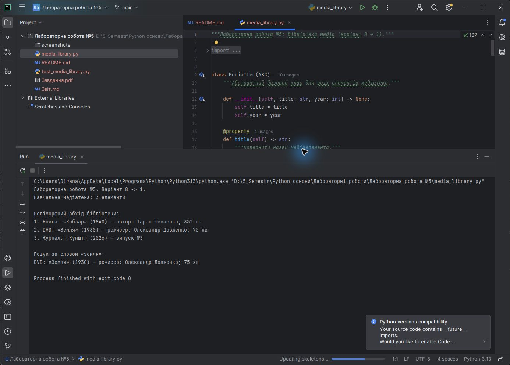
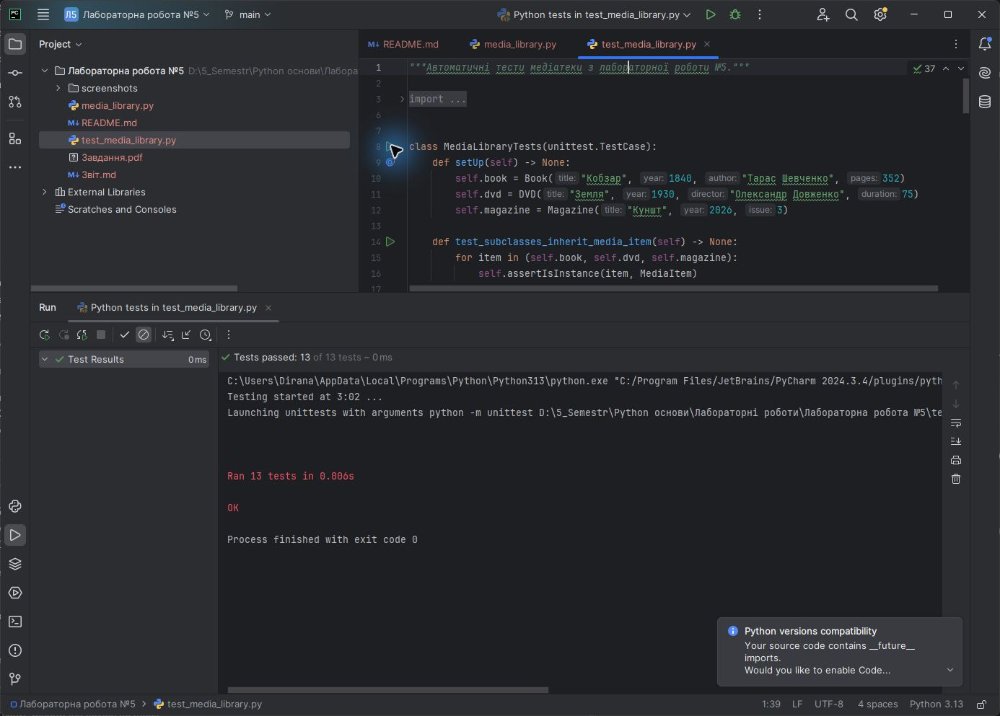

<div align="center">

**ЗВІТ**<br>
до лабораторної роботи №5<br>
з дисципліни **«Python основи»**

**Тема:** «Практичне використання успадкування, поліморфізму, інкапсуляції та механізмів ітерації в класах»

</div>

| Відомості | Дані |
|---|---|
| Виконав | Левченко Д. В. |
| Номер студента | 8 |
| Варіант | 1 |
| Перевірив | Андреєв П. І. |
| Рік виконання | 2026 |

## Визначення варіанта

У методичній вказівці наведено 7 варіантів. За циклічним розподілом номер студента 8 відповідає першому варіанту:

```text
((8 - 1) mod 7) + 1 = 1
```

Завдання варіанта №1: реалізувати тему «Бібліотека медіа», ієрархію класів `MediaItem → Book, DVD, Magazine` та ітерований клас `Library`.

## Мета роботи

Навчитися практично використовувати успадкування, поліморфізм, інкапсуляцію та механізми ітерації під час проєктування класів мовою Python.

## Постановка завдання

1. Створити абстрактний базовий клас `MediaItem` для спільних властивостей медіаелементів.
2. Реалізувати похідні класи `Book`, `DVD` і `Magazine` зі спеціалізованими атрибутами й поведінкою.
3. Інкапсулювати стан об'єктів та організувати перевірку вхідних даних.
4. Продемонструвати поліморфізм через однаковий метод опису різних типів медіа.
5. Створити ітерований клас `Library`, додавання елементів і пошук за назвою.
6. Перевірити програму автоматичними тестами.

## Використані засоби

- середовище розробки PyCharm;
- мова програмування Python 3;
- стандартні модулі `abc`, `collections.abc` і `unittest`;
- система контролю версій Git.

## Теоретичні відомості

**Успадкування** дозволяє створювати нові класи на основі наявного класу та повторно використовувати спільний код. У програмі класи `Book`, `DVD` і `Magazine` успадковують назву, рік видання та загальний алгоритм формування опису від `MediaItem`.

**Поліморфізм** дає змогу однаково звертатися до об'єктів різних класів. Метод `describe()` базового класу використовує перевизначені в підкласах властивість `media_type` і метод `details()`, тому кожний об'єкт формує власний опис через єдиний інтерфейс.

**Інкапсуляція** об'єднує дані та методи роботи з ними й обмежує прямий доступ до внутрішнього стану. Приватні атрибути позначено подвійним підкресленням, а керований доступ до назви та року реалізовано властивостями `@property`.

Ітерований об'єкт реалізує метод `__iter__()`. Клас `Library` повертає ітератор копії внутрішнього списку, завдяки чому бібліотеку можна обходити циклом `for`, а кілька створених ітераторів не залежать один від одного.

## Хід виконання роботи

1. Описано абстрактний клас `MediaItem` з властивостями `title`, `year` і абстрактним поліморфним інтерфейсом.
2. Створено класи `Book`, `DVD`, `Magazine`; у конструкторах перевіряються автор, режисер, кількість сторінок, тривалість і номер випуску.
3. Клас `Library` інкапсулює список елементів, перевіряє їх тип під час додавання та підтримує пошук без урахування регістру.
4. Метод `Library.__iter__()` забезпечує послідовний обхід елементів у порядку додавання.
5. У функції `main()` сформовано медіатеку з трьома різними типами об'єктів, виконано поліморфний обхід і пошук.
6. Створено 13 автоматичних тестів для перевірки ієрархії, описів, ітерації, пошуку, інкапсуляції та обробки некоректних даних.

Алгоритм обходу медіатеки:

```text
Створити об'єкт Library
Додати Book, DVD і Magazine
Викликати iter(library)
Послідовно отримувати MediaItem
Для кожного об'єкта викликати поліморфний describe()
Завершити цикл після вичерпання ітератора
```

Повний код наведено у файлі [`media_library.py`](./media_library.py), тести — у файлі [`test_media_library.py`](./test_media_library.py).

## Результати виконання

На рисунку 1 наведено код і результат запуску програми в PyCharm: створення медіатеки, поліморфний обхід елементів та пошук за назвою.



<p align="center"><em>Рисунок 1 — Виконання програми «Бібліотека медіа» у PyCharm</em></p>

На рисунку 2 показано результат автоматичного тестування в PyCharm.



<p align="center"><em>Рисунок 2 — Успішне виконання автоматичних тестів у PyCharm</em></p>

## Відповіді на контрольні питання

### 1. Що таке успадкування в ООП?

Успадкування — це механізм створення нового класу на основі наявного. Похідний клас отримує доступ до атрибутів і методів базового класу та може розширювати або перевизначати його поведінку.

### 2. Що таке поліморфізм?

Поліморфізм — це здатність об'єктів різних класів реагувати на однаковий інтерфейс відповідно до власної реалізації. Наприклад, для кожного `MediaItem` можна викликати `describe()`, але деталі залежать від конкретного підкласу.

### 3. Як зробити атрибут приватним у Python?

На початку імені атрибута ставлять подвійне підкреслення, наприклад `self.__items`. Python застосовує механізм name mangling і перетворює ім'я з урахуванням назви класу, що захищає атрибут від випадкового прямого доступу.

### 4. Для чого використовується `super()` у дочірньому класі?

Функція `super()` надає доступ до реалізації батьківського класу відповідно до порядку MRO. У конструкторах підкласів вона дає змогу викликати `MediaItem.__init__()` без прямого зазначення назви базового класу.

### 5. Який спеціальний метод робить клас ітерованим?

Метод `__iter__()` повертає об'єкт-ітератор. Після його реалізації екземпляр можна використовувати в циклі `for`, функції `iter()` та інших конструкціях, що працюють з ітерованими об'єктами.

## Висновок

У лабораторній роботі створено ієрархію медіаелементів та ітеровану бібліотеку. Успадкування усунуло дублювання спільної логіки, поліморфізм забезпечив єдиний інтерфейс опису різних об'єктів, інкапсуляція захистила стан і перевірку даних, а метод `__iter__()` зробив колекцію придатною для природного обходу. Коректність реалізації підтверджено автоматичними тестами в PyCharm.
