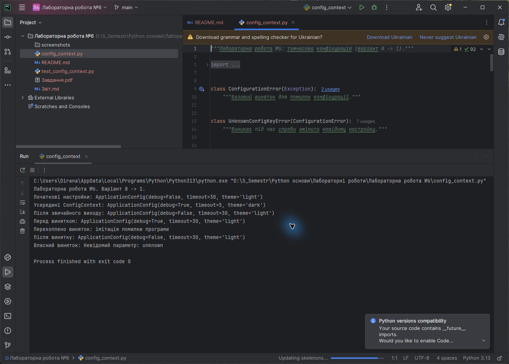
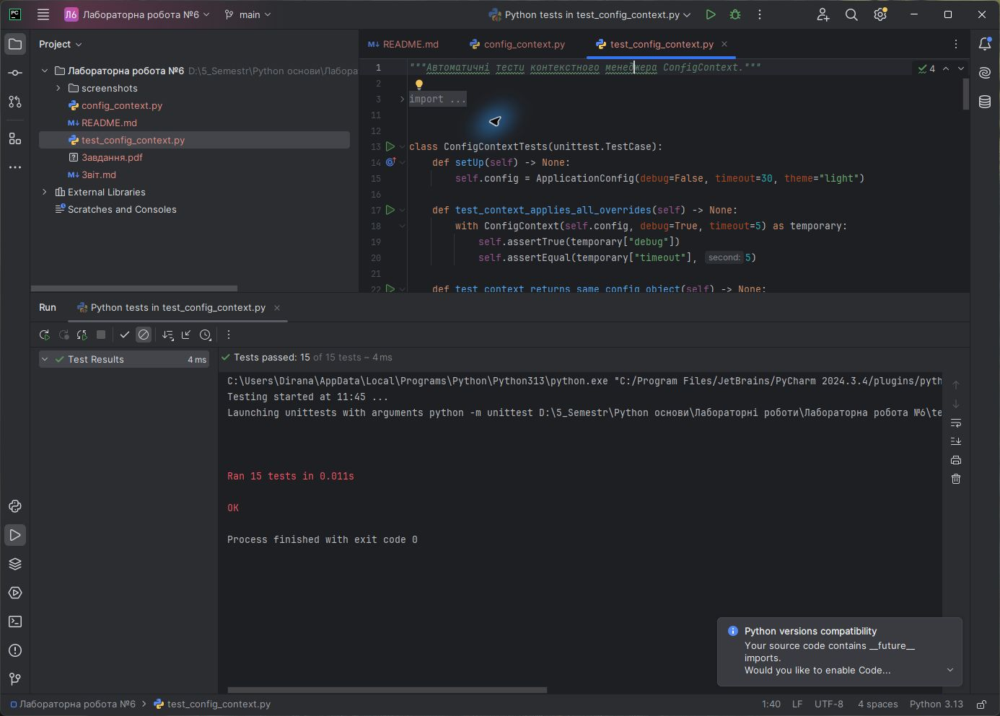

<div align="center">

**ЗВІТ**<br>
до лабораторної роботи №6<br>
з дисципліни **«Python основи»**

**Тема:** «Застосування оброблення винятків і контекстних менеджерів»

</div>

| Відомості | Дані |
|---|---|
| Виконав | Левченко Д. В. |
| Номер студента | 8 |
| Варіант | 1 |
| Перевірив | Андреєв П. І. |
| Рік виконання | 2026 |

## Визначення варіанта

У методичній вказівці наведено 7 варіантів. За циклічним розподілом номер студента 8 відповідає першому варіанту:

```text
((8 - 1) mod 7) + 1 = 1
```

Завдання варіанта №1: реалізувати контекстний менеджер тимчасової конфігурації `ConfigContext`.

## Мета роботи

Навчитися застосовувати механізми оброблення винятків, створювати власні класи винятків і реалізовувати контекстні менеджери мовою Python.

## Постановка завдання

1. Створити клас `ApplicationConfig` для зберігання параметрів програми.
2. Реалізувати контекстний менеджер `ConfigContext`, який тимчасово змінює вибрані параметри.
3. Забезпечити відновлення початкових значень після нормального завершення блоку `with` і після винятку.
4. Реалізувати власні винятки для невідомого параметра та неправильного типу значення.
5. Забезпечити атомарне застосування набору тимчасових параметрів.
6. Перевірити реалізацію автоматичними тестами.

## Використані засоби

- середовище розробки PyCharm;
- мова програмування Python 3;
- стандартні модулі `collections.abc`, `typing` і `unittest`;
- система контролю версій Git.

## Теоретичні відомості

Виняток сигналізує про помилкову або особливу ситуацію під час виконання програми. Блок `try` містить потенційно небезпечний код, `except` обробляє визначений тип винятку, `else` виконується за відсутності помилки, а `finally` — незалежно від результату. Оператор `raise` дає змогу штучно згенерувати виняток.

Власні винятки успадковуються від `Exception` або його підкласів. У програмі базовим класом є `ConfigurationError`, а `UnknownConfigKeyError` і `InvalidConfigValueError` уточнюють причину помилки. Це дозволяє обробляти помилки конфігурації окремо від інших помилок програми.

Контекстний менеджер визначає підготовку й гарантоване завершення операції. Метод `__enter__()` виконується перед входом у блок `with` і повертає об'єкт після `as`. Метод `__exit__()` викликається під час будь-якого виходу з блоку, зокрема після винятку. Якщо `__exit__()` повертає `False`, виняток не приховується.

## Хід виконання роботи

1. Створено клас `ApplicationConfig`, що інкапсулює словник параметрів і типи початкових значень.
2. Метод `update()` спочатку перевіряє весь набір змін, а потім застосовує його, тому помилка не залишає конфігурацію частково зміненою.
3. Клас `ConfigContext` отримує об'єкт конфігурації та тимчасові значення через іменовані аргументи.
4. У `__enter__()` зберігається незалежний знімок стану, після чого застосовуються перевірені зміни.
5. У `__exit__()` початковий стан відновлюється, а значення `False` дозволяє зовнішньому коду перехопити первинний виняток.
6. Продемонстровано нормальний вихід, відновлення після `RuntimeError` і оброблення власного `UnknownConfigKeyError`.
7. Створено 15 автоматичних тестів для перевірки контекстного менеджера, вкладених контекстів, власних винятків та валідації.

Алгоритм роботи `ConfigContext`:

```text
Отримати конфігурацію та тимчасові значення
Зберегти копію початкового стану
Перевірити всі передані параметри
Застосувати тимчасові значення
Виконати код усередині with
У __exit__ відновити початковий стан
Не приховувати виняток із блока with
```

Повний код наведено у файлі [`config_context.py`](./config_context.py), тести — у файлі [`test_config_context.py`](./test_config_context.py).

## Результати виконання

На рисунку 1 наведено код і результат запуску програми в PyCharm: тимчасову зміну параметрів, відновлення після звичайного виходу та після винятку, а також власний виняток конфігурації.



<p align="center"><em>Рисунок 1 — Виконання програми з контекстним менеджером ConfigContext у PyCharm</em></p>

На рисунку 2 показано результат автоматичного тестування в PyCharm.



<p align="center"><em>Рисунок 2 — Успішне виконання автоматичних тестів у PyCharm</em></p>

## Відповіді на контрольні питання

### 1. Яке основне призначення конструкції `with`?

Конструкція `with` організовує виконання коду в керованому контексті та гарантує завершальні дії після виходу з блока, навіть якщо виник виняток. Це зручно для звільнення ресурсів і тимчасової зміни стану.

### 2. Яке призначення методу `__enter__()`?

Метод `__enter__()` викликається перед виконанням тіла `with`. Він готує контекст і повертає значення, яке за потреби записується у змінну після ключового слова `as`.

### 3. Яке призначення методу `__exit__()`?

Метод `__exit__()` виконує завершальні дії під час виходу з контексту. Він отримує відомості про можливий виняток і може або пропустити його далі, повернувши `False`, або вважати обробленим, повернувши `True`.

### 4. Яке ключове слово використовується для штучного генерування винятку в коді?

Для генерування винятку використовується ключове слово `raise`, наприклад `raise ValueError("Некоректне значення")`.

### 5. Який вбудований виняток виникає під час спроби поділити число на нуль?

Під час ділення числа на нуль виникає виняток `ZeroDivisionError`.

## Висновок

У лабораторній роботі реалізовано контекстний менеджер `ConfigContext`, що безпечно застосовує тимчасові параметри та гарантовано відновлює конфігурацію. Власні класи винятків роблять помилки зрозумілими й придатними до точкового оброблення, а атомарна перевірка запобігає частковим змінам. Коректність нормальних, помилкових і вкладених сценаріїв підтверджено автоматичними тестами в PyCharm.
