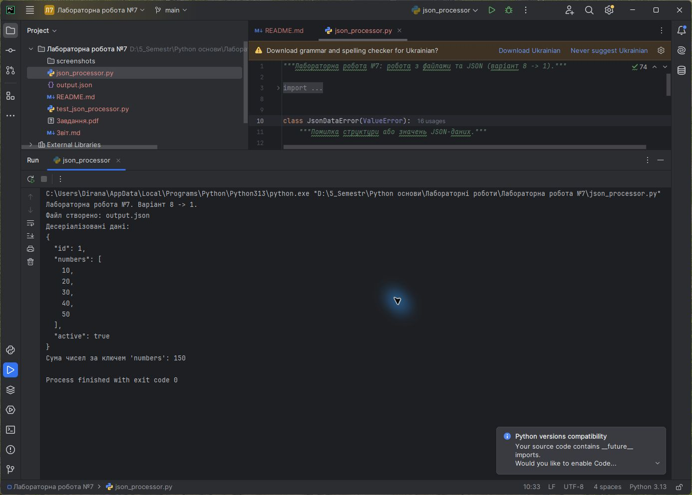
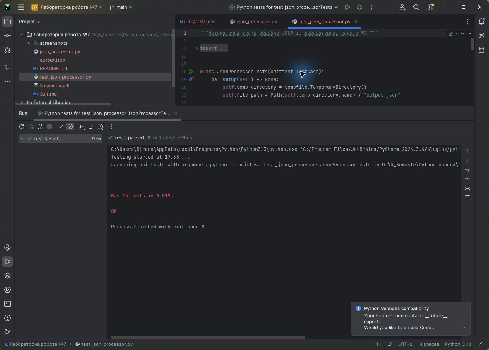

<div align="center">

**ЗВІТ**<br>
до лабораторної роботи №7<br>
з дисципліни **«Python основи»**

**Тема:** «Робота з файлами та форматом JSON»

</div>

| Відомості | Дані |
|---|---|
| Виконав | Левченко Д. В. |
| Номер студента | 8 |
| Варіант | 1 |
| Перевірив | Андреєв П. І. |
| Рік виконання | 2026 |

## Визначення варіанта

У методичній вказівці наведено 7 варіантів. За циклічним розподілом номер студента 8 відповідає першому варіанту:

```text
((8 - 1) mod 7) + 1 = 1
```

Завдання варіанта №1: серіалізувати заданий словник у `output.json`, виконати десеріалізацію та обчислити суму всіх чисел за ключем `numbers`.

## Мета роботи

Отримати практичні навички роботи з файлами, шляхами та форматом JSON; навчитися виконувати серіалізацію, десеріалізацію та подальше опрацювання даних.

## Постановка завдання

1. Сформувати словник `{"id": 1, "numbers": [10, 20, 30, 40, 50], "active": True}`.
2. Серіалізувати словник у файл `output.json` із кодуванням UTF-8.
3. Прочитати файл за допомогою класу `Path`.
4. Десеріалізувати JSON у словник Python.
5. Обчислити суму всіх чисел зі списку `numbers` і вивести результат.
6. Передбачити зрозумілу обробку помилкових даних.
7. Перевірити програму автоматичними тестами.

## Використані засоби

- середовище розробки PyCharm;
- мова програмування Python 3;
- стандартні модулі `json`, `pathlib`, `typing`, `tempfile` і `unittest`;
- система контролю версій Git.

## Теоретичні відомості

Модуль `pathlib` надає об'єктно-орієнтований інтерфейс для роботи зі шляхами. Клас `Path` дозволяє об'єднувати частини шляху, перевіряти наявність файлу та читати або записувати текст із заданим кодуванням.

JSON — текстовий формат обміну даними, що підтримує об'єкти, масиви, рядки, числа, логічні значення та `null`. У Python для роботи з ним використовується стандартний модуль `json`.

Серіалізація — це перетворення об'єкта Python у JSON-рядок. Функція `json.dumps()` повертає рядок, а параметри `ensure_ascii=False` та `indent=2` зберігають читабельні символи й форматування. Десеріалізація — зворотне перетворення JSON-рядка на об'єкт Python за допомогою `json.loads()`.

## Хід виконання роботи

1. Створено константу `VARIANT_DATA` з даними першого варіанта.
2. Функція `save_json()` перевіряє тип даних, створює потрібні каталоги та записує форматований JSON у UTF-8.
3. Функція `load_json()` читає файл через `Path.read_text()`, виконує десеріалізацію та перевіряє, що кореневим елементом є словник.
4. Функція `calculate_numbers_sum()` перевіряє наявність ключа `numbers`, тип і вміст списку, після чого обчислює суму.
5. Функція `process_variant()` об'єднує запис, читання й опрацювання в один повний цикл.
6. Для відсутнього файлу, некоректного JSON та неправильної структури використовується власний виняток `JsonDataError`.
7. Створено 15 автоматичних тестів для перевірки серіалізації, десеріалізації, результату `150` та помилкових сценаріїв.

Алгоритм виконання:

```text
Створити словник варіанта
Перетворити словник на форматований JSON-рядок
Записати рядок у output.json
Прочитати текст файлу
Десеріалізувати JSON у словник
Отримати список numbers
Перевірити його елементи та обчислити суму
Вивести результат 150
```

Повний код наведено у файлі [`json_processor.py`](./json_processor.py), результат серіалізації — у [`output.json`](./output.json), тести — у [`test_json_processor.py`](./test_json_processor.py).

## Результати виконання

На рисунку 1 наведено код і результат запуску програми в PyCharm: створення `output.json`, десеріалізовані дані та обчислена сума `150`.



<p align="center"><em>Рисунок 1 — Серіалізація, десеріалізація та обробка JSON у PyCharm</em></p>

На рисунку 2 показано результат автоматичного тестування в PyCharm.



<p align="center"><em>Рисунок 2 — Успішне виконання автоматичних тестів у PyCharm</em></p>

## Відповіді на контрольні питання

### 1. Який модуль використовується для роботи з форматом JSON?

Для роботи з форматом JSON у Python використовується стандартний модуль `json`.

### 2. Як називається процес перетворення об'єкта у рядок JSON?

Процес перетворення об'єкта у JSON-рядок називається серіалізацією.

### 3. Як називається зворотний процес — перетворення рядка JSON на об'єкт?

Зворотний процес називається десеріалізацією.

### 4. Який метод об'єкта `Path` дозволяє перевірити, чи існує файл або каталог за цим шляхом?

Для перевірки існування шляху використовується метод `Path.exists()`.

### 5. Який метод об'єкта `Path` використовується для читання всього тексту з файлу за один виклик?

Для читання всього тексту використовується метод `Path.read_text()`.

## Висновок

У лабораторній роботі реалізовано повний цикл роботи з JSON: словник серіалізовано у файл, прочитано через `Path`, десеріалізовано та опрацьовано. Сума елементів списку `numbers` становить `150`. Валідація та власний виняток забезпечують зрозумілу обробку помилок, а коректність реалізації підтверджено автоматичними тестами в PyCharm.
