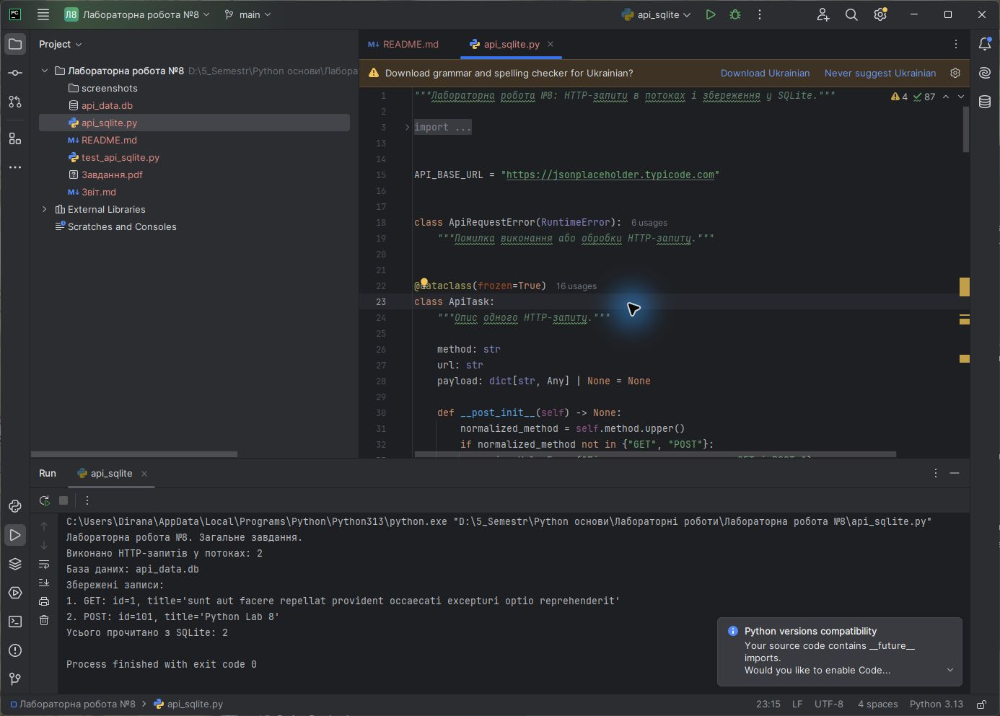
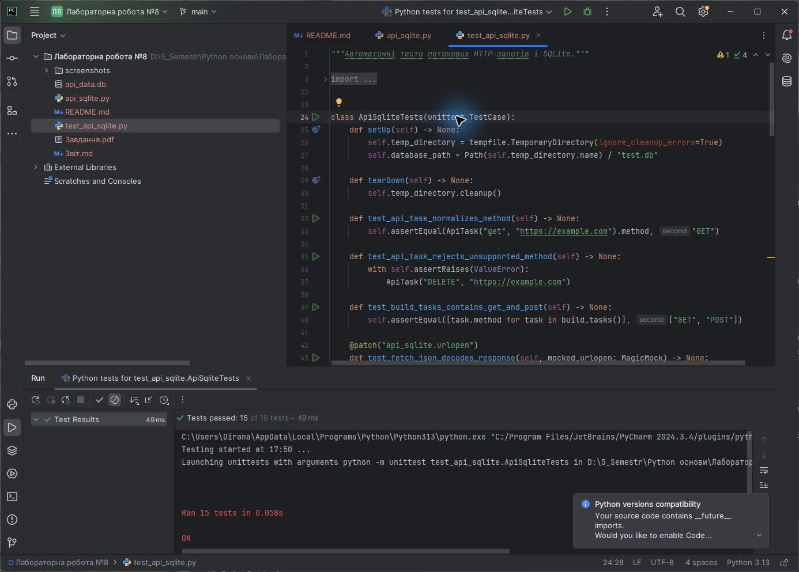

<div align="center">

**ЗВІТ**<br>
до лабораторної роботи №8<br>
з дисципліни **«Python основи»**

**Тема:** «Багатопотокове та багатопроцесне програмування. Асинхронна взаємодія, мережеві запити та робота з SQLite»

</div>

| Відомості | Дані |
|---|---|
| Виконав | Левченко Д. В. |
| Номер студента | 8 |
| Варіант | Загальне завдання |
| Перевірив | Андреєв П. І. |
| Рік виконання | 2026 |

## Визначення завдання

У методичній вказівці до лабораторної роботи №8 немає таблиці варіантів. Тому виконано загальне завдання: GET- і POST-запити до REST API в окремих потоках, збереження відповідей у SQLite та читання записів із бази даних.

## Мета роботи

Ознайомитися з принципами багатопотокового й багатопроцесного програмування, асинхронної взаємодії, виконання мережевих запитів та роботи з базою даних SQLite.

## Постановка завдання

1. Підготувати GET- і POST-запити до REST API JSONPlaceholder.
2. Виконати запити конкурентно в окремих потоках.
3. Опрацювати JSON-відповіді та нормалізувати потрібні поля.
4. Створити таблицю SQLite для результатів запитів.
5. Зберегти отримані дані в базі `api_data.db`.
6. Прочитати записи з бази та вивести їх у консоль.
7. Реалізувати обробку мережевих і структурних помилок.
8. Перевірити програму автоматичними тестами без залежності від мережі.

## Використані засоби

- середовище розробки PyCharm;
- мова програмування Python 3;
- стандартні модулі `concurrent.futures`, `urllib.request`, `json`, `sqlite3`, `dataclasses`, `pathlib` і `unittest`;
- REST API JSONPlaceholder;
- система контролю версій Git.

## Теоретичні відомості

Потік — найменша одиниця виконання всередині процесу. Потоки мають спільну пам'ять, тому зручні для задач очікування введення-виведення, зокрема мережевих запитів. `ThreadPoolExecutor` надає високорівневий інтерфейс пулу потоків і дозволяє виконувати декілька функцій конкурентно.

GIL у CPython дозволяє лише одному потоку виконувати байткод Python у певний момент. Для I/O-задач це не заважає отримати виграш, адже під час очікування мережі потік звільняє виконання. Для обчислювально складних задач доцільніше застосовувати процеси через `multiprocessing` або `ProcessPoolExecutor`.

HTTP GET використовується для отримання ресурсу, а POST — для надсилання даних і створення нового ресурсу. У роботі запити формуються класом `Request`, а `urlopen()` виконує їх і повертає відповідь.

SQLite — вбудована файлова реляційна база даних. Модуль `sqlite3` дозволяє створювати таблиці, виконувати параметризовані SQL-запити й керувати транзакціями без окремого сервера.

## Хід виконання роботи

1. Клас `ApiTask` описує метод, URL і необов'язкове тіло одного запиту.
2. Функція `fetch_json()` формує GET або POST, задає заголовки, виконує запит і десеріалізує JSON-відповідь.
3. Функція `run_in_threads()` використовує `ThreadPoolExecutor` із двома робочими потоками та зберігає порядок задач.
4. Функція `normalize_record()` перетворює відповідь API на об'єкт `ApiRecord`.
5. Функція `initialize_database()` створює таблицю `api_records` з обмеженнями для полів.
6. `replace_records()` атомарно очищує попередні результати й додає нові параметризованим запитом.
7. `read_records()` читає записи в порядку їх додавання.
8. Створено 15 автоматичних тестів. Мережеві відповіді в тестах імітуються, тому тести швидкі й стабільні.

Схема виконання програми:

```text
Підготувати GET і POST
Передати задачі пулу з двох потоків
Отримати й десеріалізувати JSON-відповіді
Нормалізувати поля id, title і body
Створити таблицю SQLite
Зберегти два записи в транзакції
Прочитати записи з бази
Вивести результат у консоль
```

Повний код наведено у файлі [`api_sqlite.py`](./api_sqlite.py), база — у [`api_data.db`](./api_data.db), тести — у [`test_api_sqlite.py`](./test_api_sqlite.py).

## Результати виконання

На рисунку 1 показано виконання GET і POST у потоках, створення бази та читання двох записів із SQLite.



<p align="center"><em>Рисунок 1 — Виконання мережевих запитів і робота з SQLite у PyCharm</em></p>

На рисунку 2 наведено результат автоматичного тестування.



<p align="center"><em>Рисунок 2 — Успішне виконання автоматичних тестів у PyCharm</em></p>

## Відповіді на контрольні питання

### 1. Що таке GIL?

GIL — це глобальне блокування інтерпретатора CPython, яке в один момент дозволяє виконувати байткод Python лише одному потоку в межах процесу.

### 2. Який модуль використовується для створення та управління потоками?

Низькорівневу роботу з потоками забезпечує стандартний модуль `threading`. Високорівневий пул потоків доступний через `concurrent.futures.ThreadPoolExecutor`.

### 3. Коли доцільно використовувати багатопотоковість, а коли багатопроцесність?

Багатопотоковість доцільна для I/O-задач: мережі, файлів і очікування зовнішніх ресурсів. Багатопроцесність краще підходить для CPU-задач, бо процеси мають окремі інтерпретатори та можуть виконуватися на різних ядрах.

### 4. Як називається центральний механізм керування корутинами в асинхронному програмуванні?

Центральний механізм називається циклом подій — `event loop`.

### 5. Який модуль дозволяє виконувати HTTP-запити?

У стандартній бібліотеці Python HTTP-запити можна виконувати модулем `urllib.request`.

### 6. Який метод фіксує зміни SQLite після INSERT, UPDATE або DELETE?

Зміни фіксує метод `connection.commit()`. Під час використання підключення як контекстного менеджера успішна транзакція також фіксується автоматично.

## Висновок

У лабораторній роботі GET- і POST-запити виконано конкурентно в пулі потоків, JSON-відповіді нормалізовано та збережено в SQLite. Реалізовано повторне читання записів, обробку помилок і транзакційне оновлення бази. Коректність мережевої логіки й операцій SQLite підтверджено 15 автоматичними тестами в PyCharm.
