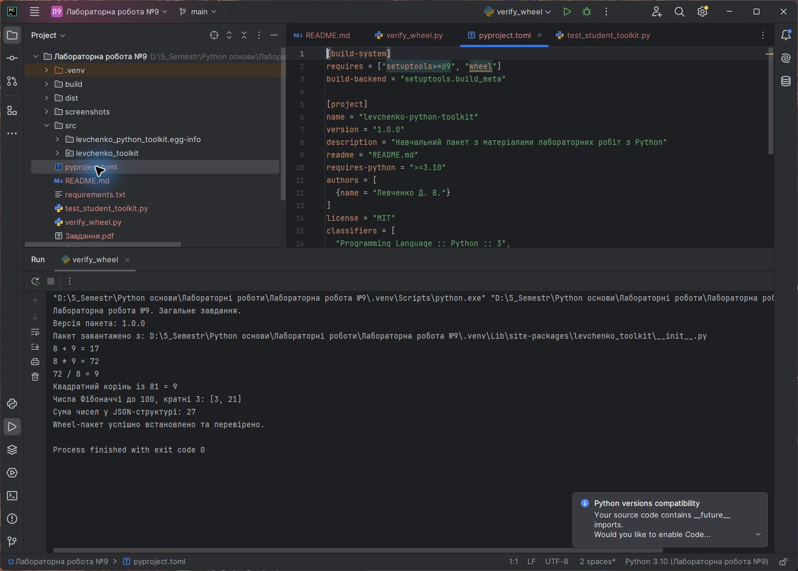
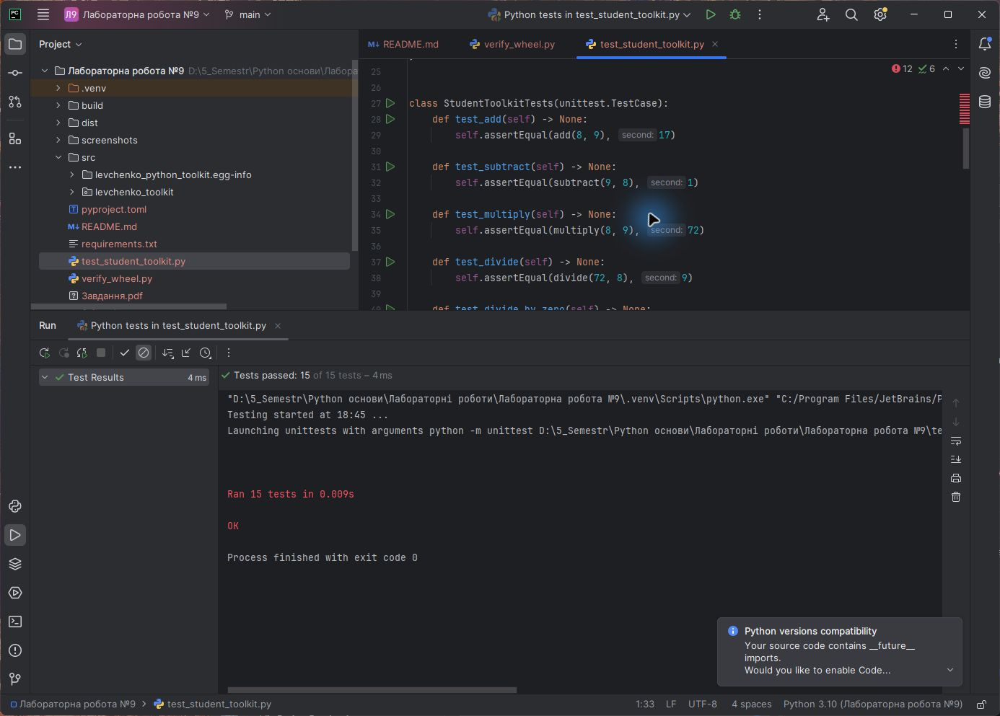

# ЗВІТ

## до лабораторної роботи №9

**Тема:** Модулі та пакети. Створення віртуальних оточень, керування залежностями за допомогою pip та створення власного wheel-пакета

| Відомості | Значення |
|---|---|
| Дисципліна | Python основи |
| Виконав | Левченко Д. В. |
| Номер студента | 8 |
| Варіант | Загальне завдання |
| Викладач | Андреєв П. І. |
| Рік виконання | 2026 |

## Постановка завдання

У методичній вказівці до лабораторної роботи №9 немає таблиці варіантів. Виконано загальне завдання: код попередніх лабораторних робіт організовано як Python-пакет, створено wheel, установлено його в нове віртуальне середовище та перевірено роботу встановлених модулів.

## Мета роботи

Набути практичних навичок створення модулів і пакетів, ізоляції залежностей у віртуальному середовищі, використання `pip`, опису проєкту в `pyproject.toml`, складання й установлення wheel-пакета.

## Короткі теоретичні відомості

Модуль — окремий файл `.py`, що містить функції, класи або змінні. Пакет — каталог модулів зі структурою імпорту та файлом `__init__.py`. Віртуальне середовище ізолює інтерпретатор і встановлені пакети конкретного проєкту. `pip` установлює та видаляє пакети, а `requirements.txt` фіксує потрібні залежності. Wheel (`.whl`) є готовим до встановлення архівом Python-пакета й не потребує повторного складання на комп'ютері користувача.

## Структура проєкту

```text
Лабораторна робота №9/
├── dist/
│   └── levchenko_python_toolkit-1.0.0-py3-none-any.whl
├── src/levchenko_toolkit/
│   ├── __init__.py
│   ├── calculator.py
│   ├── json_tools.py
│   └── sequences.py
├── pyproject.toml
├── requirements.txt
├── test_student_toolkit.py
└── verify_wheel.py
```

До пакета включено перевірені напрацювання з лабораторних робіт №1, №3 та №7: арифметичні функції, генератори Фібоначчі та засоби обробки JSON. Публічні об'єкти повторно експортовано у `levchenko_toolkit/__init__.py`.

## Хід виконання роботи

1. Створено структуру `src/levchenko_toolkit` і розподілено код між трьома тематичними модулями.
2. Додано `__init__.py`, який формує публічний інтерфейс пакета.
3. У `pyproject.toml` визначено назву `levchenko-python-toolkit`, версію `1.0.0`, автора, мінімальну версію Python і backend `setuptools`.
4. Створено нове середовище `.venv` та встановлено інструмент `build` із `requirements.txt`.
5. Командою `python -m build --wheel` створено wheel `levchenko_python_toolkit-1.0.0-py3-none-any.whl`.
6. Wheel установлено в чисте віртуальне середовище через `pip --force-reinstall`.
7. Скрипт `verify_wheel.py` перевірив версію, шлях до `site-packages` і роботу функцій усіх трьох модулів.
8. Створено та виконано 15 автоматичних тестів.

## Результат запуску встановленого пакета

На рисунку 1 показано запуск `verify_wheel.py` інтерпретатором нового віртуального середовища. Шлях `site-packages` підтверджує, що імпортовано саме встановлений wheel, а не вихідні файли з каталогу `src`.



## Перевірка тестами

Тести перевіряють арифметику, обробку помилок, генератори Фібоначчі, валідацію JSON і файловий цикл серіалізації.



## Відповіді на контрольні питання

### 1. Чим відрізняється модуль від пакета?

Модуль — один Python-файл, а пакет — каталог, що об'єднує модулі та підпакети в ієрархічний простір імен.

### 2. Для чого використовується файл requirements.txt?

Він містить перелік залежностей і, за потреби, їхні версії, щоб середовище проєкту можна було відтворити командою `pip install -r requirements.txt`.

### 3. Для чого потрібен wheel-пакет?

Wheel є стандартним готовим дистрибутивом Python. Він установлюється швидше за вихідний архів і не потребує виконання етапу складання на цільовому комп'ютері.

### 4. Для чого потрібен файл __init__.py у пакеті?

Файл позначає звичайний пакет, може виконувати його ініціалізацію та визначати зручний публічний інтерфейс через імпорти й `__all__`.

### 5. Яка команда створює віртуальне середовище?

Стандартна команда: `python -m venv .venv`.

## Висновок

У лабораторній роботі напрацювання попередніх завдань перетворено на структурований пакет `levchenko-python-toolkit`. Пакет описано в `pyproject.toml`, зібрано у форматі wheel, установлено в нове віртуальне середовище та успішно імпортовано із `site-packages`. Коректність функцій підтверджено 15 автоматичними тестами.
