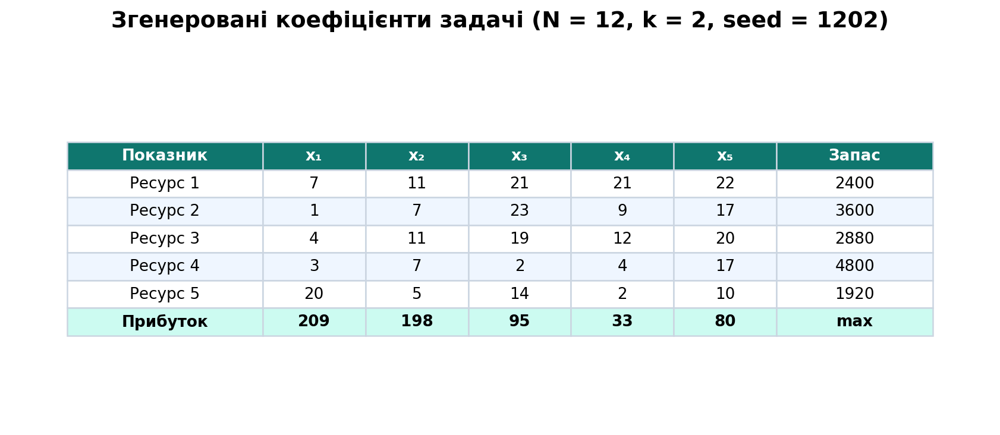
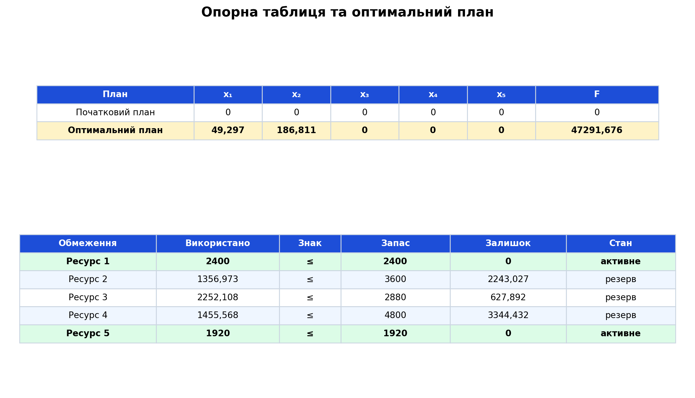
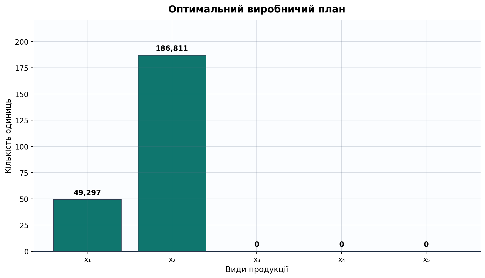
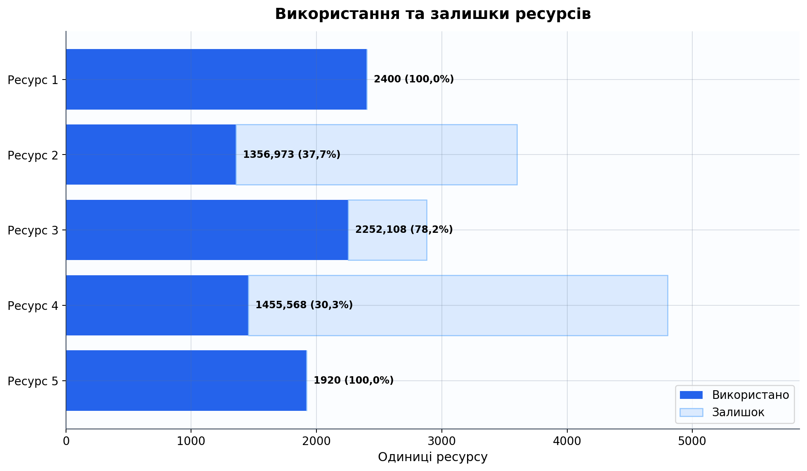
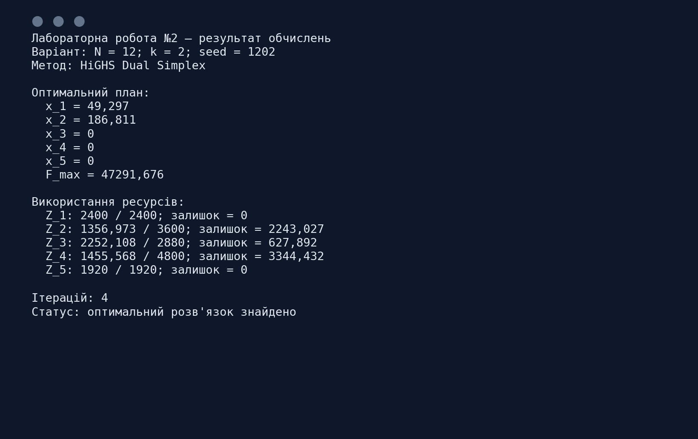

<div align="center">

МІНІСТЕРСТВО ОСВІТИ І НАУКИ УКРАЇНИ

КРЕМЕНЧУЦЬКИЙ НАЦІОНАЛЬНИЙ УНІВЕРСИТЕТ
ІМЕНІ МИХАЙЛА ОСТРОГРАДСЬКОГО

НАВЧАЛЬНО-НАУКОВИЙ ІНСТИТУТ ЕЛЕКТРИЧНОЇ ІНЖЕНЕРІЇ
ТА ІНФОРМАЦІЙНИХ ТЕХНОЛОГІЙ

КАФЕДРА АВТОМАТИЗАЦІЇ ТА ІНФОРМАЦІЙНИХ СИСТЕМ

<br>

ОСВІТНІЙ КОМПОНЕНТ

**«ДОСЛІДЖЕННЯ ОПЕРАЦІЙ»**

<br>

**ЗВІТ**
З ЛАБОРАТОРНОЇ РОБОТИ № 2

**«ЗАДАЧА ПЛАНУВАННЯ ОПТИМАЛЬНОГО ВИРОБНИЦТВА»**

</div>

<br>

<div align="right">

**Виконав:**
здобувач групи КН-24-1
Левченко Д. В.

**Перевірила:**
Бурдільна Є. В.

</div>

<br>

<p align="center">Кременчук 2026</p>

[← До переліку лабораторних](../README.md) · [Код програми](./src/solve_lab2.py) · [Автоматичні тести](./tests/test_solution.py) · [Усі ілюстрації](./assets/screenshots/)

## Зміст

1. [Тема та мета](#1-тема-та-мета)
2. [Постановка задачі](#2-постановка-задачі)
3. [Формування вихідних даних](#3-формування-вихідних-даних)
4. [Математична модель](#4-математична-модель)
5. [Налаштування розв'язувача](#5-налаштування-розвязувача)
6. [Оптимальний виробничий план](#6-оптимальний-виробничий-план)
7. [Використання ресурсів](#7-використання-ресурсів)
8. [Аналіз результатів](#8-аналіз-результатів)
9. [Контрольні питання](#9-контрольні-питання)
10. [Запуск програми](#10-запуск-програми)
11. [Структура проєкту](#11-структура-проєкту)

<a id="figures" name="figures"></a>

### Навігація за рисунками

| № | Ілюстрація |
|---:|---|
| 1 | [Згенеровані вихідні дані](#figure-1) |
| 2 | [Опорна таблиця та оптимальний план](#figure-2) |
| 3 | [Параметри розв'язувача](#figure-3) |
| 4 | [Діаграма оптимального плану](#figure-4) |
| 5 | [Використання та залишки ресурсів](#figure-5) |
| 6 | [Результат виконання програми](#figure-6) |

## 1. Тема та мета

**Тема:** задача планування оптимального виробництва.

**Мета:** набути навичок розв'язування багатовимірних задач лінійного програмування симплекс-методом, сформувати опорний план, визначити оптимальні обсяги виробництва та проаналізувати використання ресурсів.

## 2. Постановка задачі

Підприємство може випускати п'ять видів продукції $x_1, x_2, x_3, x_4, x_5$ та використовує п'ять обмежених ресурсів. Для кожного виду продукції задано витрати кожного ресурсу та прибуток від реалізації одиниці продукції.

Необхідно визначити неперервний невід'ємний план виробництва, який не перевищує доступні запаси ресурсів і максимізує загальний прибуток.

Параметри варіанта:

| Показник | Значення |
|---|---:|
| Номер варіанта $N$ | 12 |
| Коефіцієнт $k$ | 2 |
| Кількість змінних | 5 |
| Кількість ресурсних обмежень | 5 |
| Seed генератора | 1202 |

Фіксоване початкове значення генератора використано для відтворюваності: повторний запуск програми створює ті самі коефіцієнти, оптимальний план і рисунки.

## 3. Формування вихідних даних

Коефіцієнти витрат ресурсів формуються за наведеною в методичних вказівках формулою:

$$
z_{ij}=\operatorname{ROUND}(\operatorname{RAND()}\cdot N\cdot k;0).
$$

Коефіцієнти цільової функції:

$$
r_j=\operatorname{ROUND}(\operatorname{RAND()}\cdot N\cdot k\cdot10;0).
$$

Для $N=12$ і $k=2$ ліміти ресурсів дорівнюють:

$$
Z_1=2400,\quad Z_2=3600,\quad Z_3=2880,\quad Z_4=4800,\quad Z_5=1920.
$$

Після генерації отримано такі дані:

| Показник | $x_1$ | $x_2$ | $x_3$ | $x_4$ | $x_5$ | Запас |
|---|---:|---:|---:|---:|---:|---:|
| Ресурс 1 | 7 | 11 | 21 | 21 | 22 | 2400 |
| Ресурс 2 | 1 | 7 | 23 | 9 | 17 | 3600 |
| Ресурс 3 | 4 | 11 | 19 | 12 | 20 | 2880 |
| Ресурс 4 | 3 | 7 | 2 | 4 | 17 | 4800 |
| Ресурс 5 | 20 | 5 | 14 | 2 | 10 | 1920 |
| Прибуток | 209 | 198 | 95 | 33 | 80 | max |

Вихідну таблицю також наведено на [рисунку 1](#figure-1).

<a id="figure-1" name="figure-1"></a>
<p align="center">
  <a href="./assets/screenshots/01-вихідні-дані.png">
    
  </a>
</p>
<p align="center"><em>Рисунок 1 – Згенеровані коефіцієнти задачі та ліміти ресурсів</em></p>
<p align="center"><sub><a href="#figures">↑ До переліку рисунків</a></sub></p>

## 4. Математична модель

Цільова функція:

$$
F=209x_1+198x_2+95x_3+33x_4+80x_5\rightarrow\max.
$$

Система ресурсних обмежень:

$$
\begin{cases}
7x_1+11x_2+21x_3+21x_4+22x_5\leq2400,\\
x_1+7x_2+23x_3+9x_4+17x_5\leq3600,\\
4x_1+11x_2+19x_3+12x_4+20x_5\leq2880,\\
3x_1+7x_2+2x_3+4x_4+17x_5\leq4800,\\
20x_1+5x_2+14x_3+2x_4+10x_5\leq1920,\\
x_1,x_2,x_3,x_4,x_5\geq0.
\end{cases}
$$

Змінні є неперервними. Умова невід'ємності відповідає економічному змісту задачі: обсяг виробництва не може бути від'ємним.

Початковий опорний план $X_0=(0;0;0;0;0)$ є допустимим. Опорну таблицю й отриманий оптимум наведено на [рисунку 2](#figure-2).

<a id="figure-2" name="figure-2"></a>
<p align="center">
  <a href="./assets/screenshots/02-опорна-таблиця.png">
    
  </a>
</p>
<p align="center"><em>Рисунок 2 – Опорна таблиця, оптимальний план і перевірка обмежень</em></p>
<p align="center"><sub><a href="#figures">↑ До переліку рисунків</a></sub></p>

## 5. Налаштування розв'язувача

Для розв'язання використано реалізацію двоїстого симплекс-методу HiGHS Dual Simplex із бібліотеки SciPy. Максимізація виконується як мінімізація функції $-F$ за тих самих обмежень.

Параметри розв'язувача:

- цільова функція: $F\rightarrow\max$;
- змінні: $x_1,\ldots,x_5$;
- обмеження: $Ax\leq b$;
- межі змінних: $x_j\geq0$;
- тип змінних: неперервні;
- метод: `highs-ds`.

Налаштування узагальнено на [рисунку 3](#figure-3).

<a id="figure-3" name="figure-3"></a>
<p align="center">
  <a href="./assets/screenshots/03-параметри-розв'язувача.png">
    
  </a>
</p>
<p align="center"><em>Рисунок 3 – Параметри задачі, передані симплекс-розв'язувачу</em></p>
<p align="center"><sub><a href="#figures">↑ До переліку рисунків</a></sub></p>

## 6. Оптимальний виробничий план

Після чотирьох ітерацій симплекс-методу отримано:

$$
X^*=(\frac{1824}{37};\frac{6912}{37};0;0;0)
\approx(49,297;186,811;0;0;0).
$$

Отже, до оптимального плану входять лише перший і другий види продукції. Третій, четвертий і п'ятий види продукції за заданих прибутків та витрат ресурсів виготовляти недоцільно.

Максимальне значення цільової функції:

$$
F_{\max}
=209\cdot\frac{1824}{37}+198\cdot\frac{6912}{37}
=\frac{1749792}{37}
\approx47291,676.
$$

Графічне порівняння обсягів наведено на [рисунку 4](#figure-4).

<a id="figure-4" name="figure-4"></a>
<p align="center">
  <a href="./assets/screenshots/04-оптимальний-план.png">
    
  </a>
</p>
<p align="center"><em>Рисунок 4 – Оптимальні обсяги виробництва для п'яти видів продукції</em></p>
<p align="center"><sub><a href="#figures">↑ До переліку рисунків</a></sub></p>

## 7. Використання ресурсів

| Ресурс | Використано | Доступно | Залишок | Використання |
|---|---:|---:|---:|---:|
| 1 | 2400 | 2400 | **0** | 100,0% |
| 2 | 1356,973 | 3600 | **2243,027** | 37,7% |
| 3 | 2252,108 | 2880 | **627,892** | 78,2% |
| 4 | 1455,568 | 4800 | **3344,432** | 30,3% |
| 5 | 1920 | 1920 | **0** | 100,0% |

Ресурси 1 і 5 використано повністю, тому відповідні обмеження є активними. Ресурси 2, 3 і 4 мають резерв. Співвідношення використаних обсягів і залишків показано на [рисунку 5](#figure-5).

<a id="figure-5" name="figure-5"></a>
<p align="center">
  <a href="./assets/screenshots/05-використання-ресурсів.png">
    
  </a>
</p>
<p align="center"><em>Рисунок 5 – Використання доступних ресурсів та їх залишки</em></p>
<p align="center"><sub><a href="#figures">↑ До переліку рисунків</a></sub></p>

Підсумковий вивід програми наведено на [рисунку 6](#figure-6).

<a id="figure-6" name="figure-6"></a>
<p align="center">
  <a href="./assets/screenshots/06-результат-програми.png">
    
  </a>
</p>
<p align="center"><em>Рисунок 6 – Підсумок автоматизованого розрахунку</em></p>
<p align="center"><sub><a href="#figures">↑ До переліку рисунків</a></sub></p>

## 8. Аналіз результатів

1. Оптимальний план передбачає випуск приблизно 49,297 одиниці продукції першого виду та 186,811 одиниці продукції другого виду.
2. Максимальний прогнозований прибуток становить приблизно 47291,676 грошової одиниці.
3. Виробництво продукції $x_3$, $x_4$ та $x_5$ не входить до оптимального базису.
4. Лімітуючими є ресурси 1 і 5, запаси яких вичерпуються повністю.
5. Ресурс 4 має найбільший абсолютний залишок — 3344,432 одиниці, тому збільшувати його запас без зміни інших параметрів недоцільно.
6. Для можливого збільшення прибутку першочергово слід дослідити розширення запасів ресурсів 1 і 5 та виконати аналіз чутливості.

## 9. Контрольні питання

<details>
<summary><strong>1. Що таке базисні змінні?</strong></summary>

Базисні змінні — це змінні, стовпці яких утворюють базис матриці обмежень. У поточній симплекс-таблиці вони виражаються через вільні члени, тоді як небазисні змінні приймаються рівними нулю.
</details>

<details>
<summary><strong>2. Поясніть принцип запису цільової функції у симплекс-таблицю.</strong></summary>

Коефіцієнти цільової функції записують в оцінювальний рядок симплекс-таблиці з урахуванням прийнятої знакової форми. Після кожного поворотного перетворення цей рядок містить зведені витрати, за якими перевіряють оптимальність і обирають змінну для введення до базису.
</details>

<details>
<summary><strong>3. Який метод розв'язання СЛАР використовується у симплекс-методі?</strong></summary>

Використовуються послідовні жорданові виключення, тобто перетворення Гаусса–Жордана відносно розв'язувального елемента.
</details>

<details>
<summary><strong>4. За якою ознакою обирають базисну змінну?</strong></summary>

Для задачі максимізації у прийнятій формі оцінювального рядка до базису вводять змінну з найбільшою за модулем від'ємною оцінкою. Якщо використано протилежну знакову форму, критерій відповідно змінює знак.
</details>

<details>
<summary><strong>5. За якою ознакою вибирають базисний рядок обмежень?</strong></summary>

Застосовують правило мінімального додатного відношення: вільний член рядка ділять на додатний елемент розв'язувального стовпця та обирають найменше невід'ємне відношення.
</details>

<details>
<summary><strong>6. За якої умови припиняють ітераційний процес за симплекс-методом?</strong></summary>

Ітерації припиняють, коли в оцінювальному рядку немає коефіцієнтів, що дають змогу поліпшити цільову функцію. Для прийнятої форми задачі максимізації це означає відсутність від'ємних оцінок.
</details>

## 10. Запуск програми

Потрібен Python 3.10 або новіший.

```bash
python -m pip install -r requirements.txt
python src/solve_lab2.py
python -m unittest discover -s tests -v
```

Програма повторно генерує вихідні дані з `seed=1202`, розв'язує задачу двоїстим симплекс-методом, виводить результат і створює всі PNG-ілюстрації у каталозі [`assets/screenshots`](./assets/screenshots/).

## 11. Структура проєкту

```text
Лабораторна робота 02/
├── README.md                  # повний звіт
├── requirements.txt           # залежності Python
├── assets/
│   └── screenshots/           # таблиці, діаграми та результат програми
├── src/
│   └── solve_lab2.py          # генерація, оптимізація та рисунки
└── tests/
    └── test_solution.py       # перевірка даних, оптимуму й обмежень
```

## Висновок

Для варіанта $N=12$, $k=2$ сформовано задачу планування виробництва з п'ятьма змінними та п'ятьма ресурсними обмеженнями. Двоїстим симплекс-методом знайдено оптимальний план $X^*\approx(49,297;186,811;0;0;0)$ і максимальне значення цільової функції $F_{\max}\approx47291,676$. Ресурси 1 і 5 використано повністю, а ресурси 2, 3 і 4 мають резерв.
