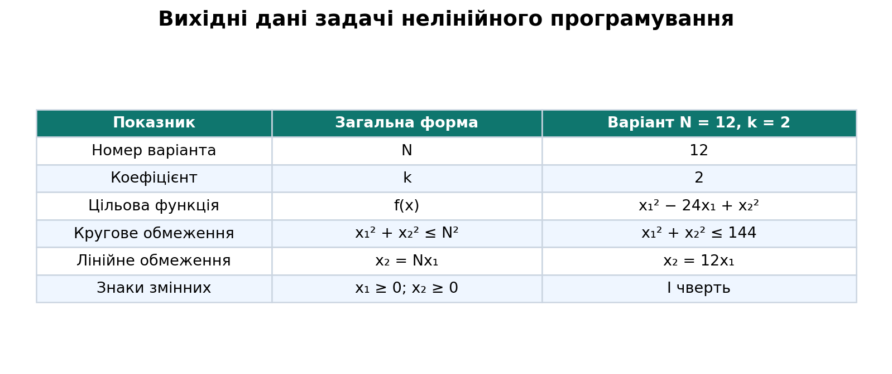
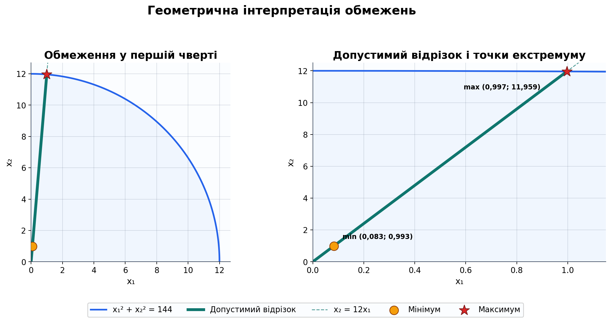
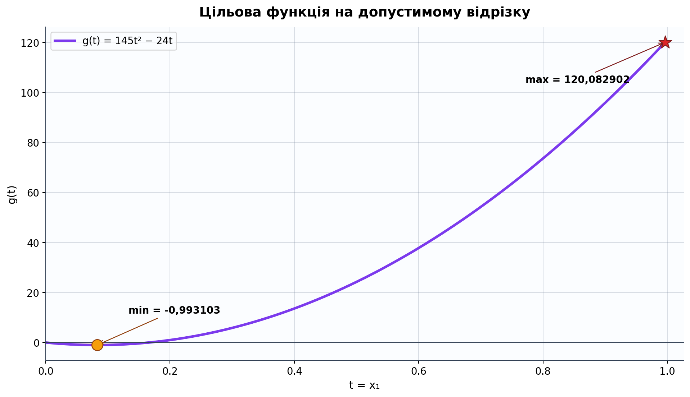
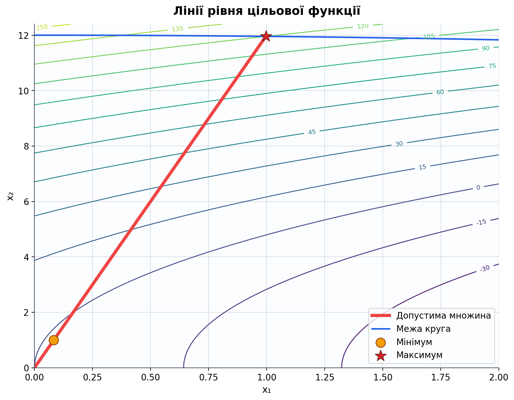
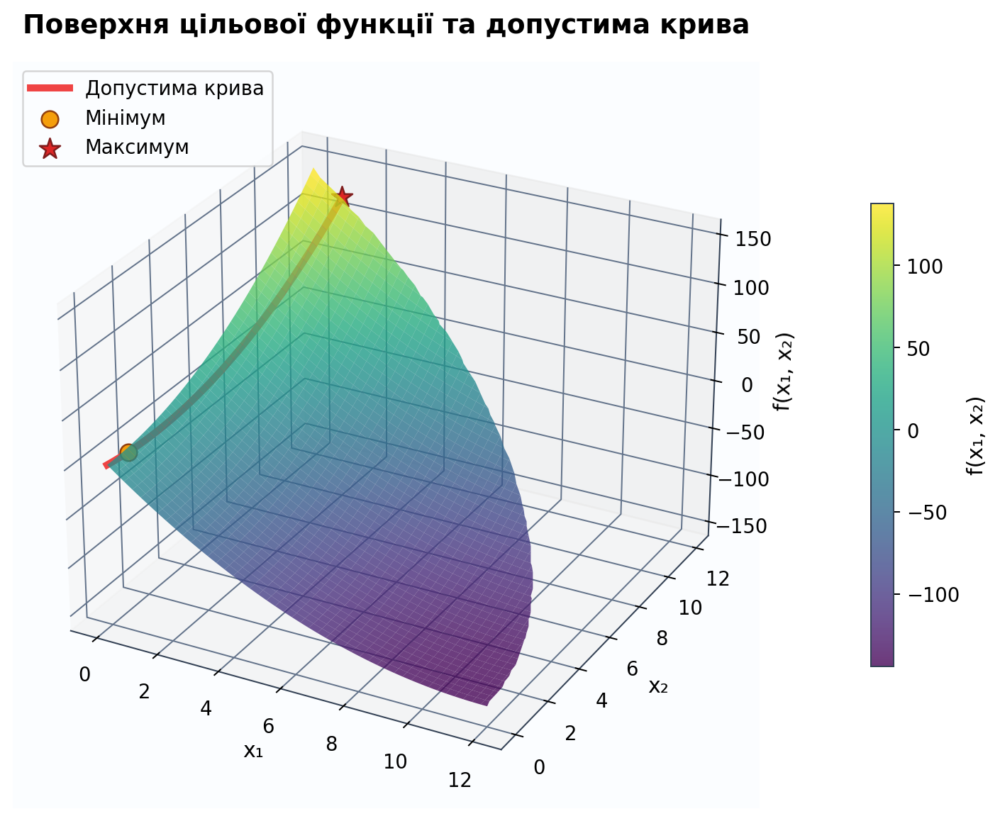
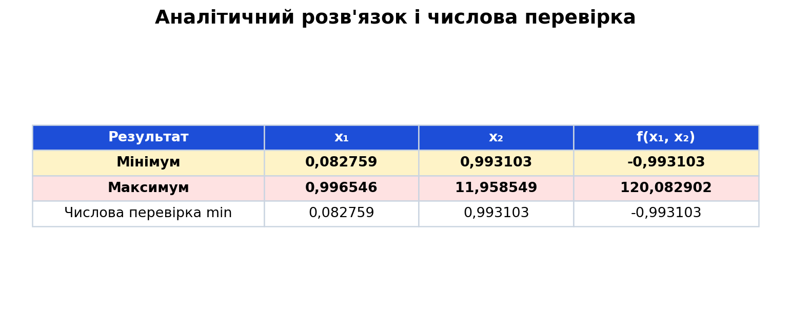
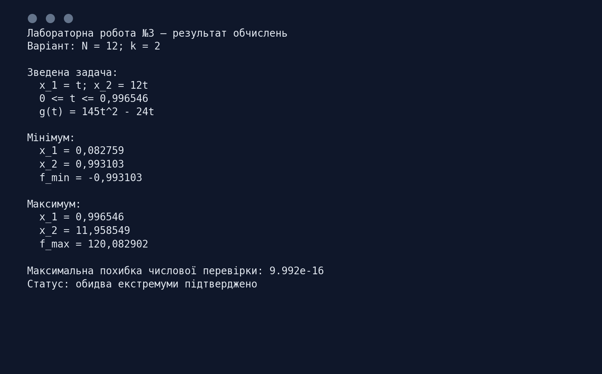

<div align="center">

МІНІСТЕРСТВО ОСВІТИ І НАУКИ УКРАЇНИ

КРЕМЕНЧУЦЬКИЙ НАЦІОНАЛЬНИЙ УНІВЕРСИТЕТ
ІМЕНІ МИХАЙЛА ОСТРОГРАДСЬКОГО

НАВЧАЛЬНО-НАУКОВИЙ ІНСТИТУТ ЕЛЕКТРИЧНОЇ ІНЖЕНЕРІЇ
ТА ІНФОРМАЦІЙНИХ ТЕХНОЛОГІЙ

КАФЕДРА АВТОМАТИЗАЦІЇ ТА ІНФОРМАЦІЙНИХ СИСТЕМ

<br>

ОСВІТНІЙ КОМПОНЕНТ

**«ДОСЛІДЖЕННЯ ОПЕРАЦІЙ»**

<br>

**ЗВІТ**
З ЛАБОРАТОРНОЇ РОБОТИ № 3

**«ЗАДАЧА НЕЛІНІЙНОГО ПРОГРАМУВАННЯ»**

</div>

<br>

<div align="right">

**Виконав:**
здобувач групи КН-24-1
Левченко Д. В.

**Перевірила:**
Бурдільна Є. В.

</div>

<br>

<p align="center">Кременчук 2026</p>

[← До переліку лабораторних](../README.md) · [Код програми](./src/solve_lab3.py) · [Автоматичні тести](./tests/test_solution.py) · [Усі ілюстрації](./assets/screenshots/)

## Зміст

1. [Тема та мета](#1-тема-та-мета)
2. [Постановка задачі](#2-постановка-задачі)
3. [Допустима множина](#3-допустима-множина)
4. [Зведення до функції однієї змінної](#4-зведення-до-функції-однієї-змінної)
5. [Визначення мінімуму](#5-визначення-мінімуму)
6. [Визначення максимуму](#6-визначення-максимуму)
7. [Графічна та числова перевірка](#7-графічна-та-числова-перевірка)
8. [Аналіз результатів](#8-аналіз-результатів)
9. [Контрольні питання](#9-контрольні-питання)
10. [Запуск програми](#10-запуск-програми)
11. [Структура проєкту](#11-структура-проєкту)

<a id="figures" name="figures"></a>

### Навігація за рисунками

| № | Ілюстрація |
|---:|---|
| 1 | [Вихідні дані](#figure-1) |
| 2 | [Допустима область та точки екстремуму](#figure-2) |
| 3 | [Зведена функція однієї змінної](#figure-3) |
| 4 | [Лінії рівня цільової функції](#figure-4) |
| 5 | [Тривимірна поверхня функції](#figure-5) |
| 6 | [Аналітичний розв'язок і числова перевірка](#figure-6) |
| 7 | [Результат виконання програми](#figure-7) |

## 1. Тема та мета

**Тема:** задача нелінійного програмування.

**Мета:** набути навичок розв'язування двовимірних задач нелінійного програмування аналітичним і графічним методами, знайти мінімум і максимум функції на допустимій множині та перевірити результати чисельно.

## 2. Постановка задачі

Для варіанта $N=12$, $k=2$ необхідно визначити мінімальне й максимальне значення функції

$$
f(x_1,x_2)=x_1^2-kNx_1+x_2^2
=x_1^2-24x_1+x_2^2
$$

за обмежень

$$
\begin{cases}
x_1^2+x_2^2\leq144,\\
x_2=12x_1,\\
x_1\geq0,\quad x_2\geq0.
\end{cases}
$$

Вихідні дані зведено у таблицю на [рисунку 1](#figure-1).

<a id="figure-1" name="figure-1"></a>
<p align="center">
  <a href="./assets/screenshots/01-вихідні-дані.png">
    
  </a>
</p>
<p align="center"><em>Рисунок 1 – Вихідні дані задачі для варіанта N = 12, k = 2</em></p>
<p align="center"><sub><a href="#figures">↑ До переліку рисунків</a></sub></p>

## 3. Допустима множина

Рівняння $x_2=12x_1$ задає пряму, що проходить через початок координат у першій чверті. Підставимо його до кругового обмеження:

$$
x_1^2+(12x_1)^2\leq144,
$$

$$
145x_1^2\leq144.
$$

З урахуванням $x_1\geq0$ маємо:

$$
0\leq x_1\leq\frac{12}{\sqrt{145}}\approx0,996546.
$$

Отже, допустима множина не є двовимірною областю: через обмеження-рівність вона перетворюється на відрізок

$$
D=\{(t;12t)\mid 0\leq t\leq12/\sqrt{145}\}.
$$

Геометричну побудову та положення точок екстремуму показано на [рисунку 2](#figure-2).

<a id="figure-2" name="figure-2"></a>
<p align="center">
  <a href="./assets/screenshots/02-допустима-область.png">
    
  </a>
</p>
<p align="center"><em>Рисунок 2 – Кругове обмеження, допустимий відрізок і точки екстремуму</em></p>
<p align="center"><sub><a href="#figures">↑ До переліку рисунків</a></sub></p>

## 4. Зведення до функції однієї змінної

Позначимо $x_1=t$. Тоді $x_2=12t$, а цільова функція на допустимому відрізку набуває вигляду

$$
g(t)=t^2-24t+(12t)^2=145t^2-24t,
$$

де

$$
0\leq t\leq\frac{12}{\sqrt{145}}.
$$

Це опукла квадратична функція, оскільки коефіцієнт при $t^2$ додатний. Її графік на допустимому відрізку наведено на [рисунку 3](#figure-3).

<a id="figure-3" name="figure-3"></a>
<p align="center">
  <a href="./assets/screenshots/03-зведена-функція.png">
    
  </a>
</p>
<p align="center"><em>Рисунок 3 – Значення цільової функції вздовж допустимого відрізка</em></p>
<p align="center"><sub><a href="#figures">↑ До переліку рисунків</a></sub></p>

## 5. Визначення мінімуму

Знайдемо стаціонарну точку:

$$
g'(t)=290t-24.
$$

З умови $g'(t)=0$ отримуємо

$$
t_{\min}=\frac{24}{290}=\frac{12}{145}\approx0,082759.
$$

Ця точка належить допустимому відрізку. Оскільки $g''(t)=290>0$, у ній досягається мінімум:

$$
x_1^{\min}=\frac{12}{145}\approx0,082759,
$$

$$
x_2^{\min}=12\cdot\frac{12}{145}=\frac{144}{145}\approx0,993103.
$$

Мінімальне значення функції:

$$
f_{\min}=145(\frac{12}{145})^2
-24\cdot\frac{12}{145}
=-\frac{144}{145}
\approx-0,993103.
$$

## 6. Визначення максимуму

Опукла функція на замкненому відрізку досягає максимуму в одній із його крайніх точок. Перевіримо обидві:

$$
g(0)=0,
$$

$$
g(\frac{12}{\sqrt{145}})
=144-\frac{288}{\sqrt{145}}
\approx120,082902.
$$

Отже,

$$
x_1^{\max}=\frac{12}{\sqrt{145}}\approx0,996546,
$$

$$
x_2^{\max}=\frac{144}{\sqrt{145}}\approx11,958549,
$$

$$
f_{\max}=144-\frac{288}{\sqrt{145}}\approx120,082902.
$$

## 7. Графічна та числова перевірка

Лінії рівня $f(x_1,x_2)=C$ показують, як значення функції змінюється відносно допустимого відрізка. Стаціонарна точка дає мінімум, а максимальне значення досягається на межі круга. Це проілюстровано на [рисунку 4](#figure-4).

<a id="figure-4" name="figure-4"></a>
<p align="center">
  <a href="./assets/screenshots/04-лінії-рівня.png">
    
  </a>
</p>
<p align="center"><em>Рисунок 4 – Лінії рівня цільової функції та допустима множина</em></p>
<p align="center"><sub><a href="#figures">↑ До переліку рисунків</a></sub></p>

Тривимірне подання поверхні $f(x_1,x_2)$ та допустимої кривої наведено на [рисунку 5](#figure-5).

<a id="figure-5" name="figure-5"></a>
<p align="center">
  <a href="./assets/screenshots/05-поверхня-функції.png">
    
  </a>
</p>
<p align="center"><em>Рисунок 5 – Поверхня цільової функції та допустима крива</em></p>
<p align="center"><sub><a href="#figures">↑ До переліку рисунків</a></sub></p>

Для незалежної перевірки мінімум знайдено числовим обмеженим методом `minimize_scalar`. Максимальна розбіжність між аналітичним і числовим результатами становить менше $10^{-14}$. Порівняння наведено на [рисунку 6](#figure-6).

<a id="figure-6" name="figure-6"></a>
<p align="center">
  <a href="./assets/screenshots/06-результати.png">
    
  </a>
</p>
<p align="center"><em>Рисунок 6 – Аналітичні значення екстремумів і числова перевірка</em></p>
<p align="center"><sub><a href="#figures">↑ До переліку рисунків</a></sub></p>

Підсумковий вивід програми показано на [рисунку 7](#figure-7).

<a id="figure-7" name="figure-7"></a>
<p align="center">
  <a href="./assets/screenshots/07-результат-програми.png">
    
  </a>
</p>
<p align="center"><em>Рисунок 7 – Підсумок аналітичного й числового розрахунків</em></p>
<p align="center"><sub><a href="#figures">↑ До переліку рисунків</a></sub></p>

## 8. Аналіз результатів

1. Обмеження-рівність $x_2=12x_1$ звужує допустиму множину до відрізка всередині круга радіуса 12.
2. Після підстановки задача зводиться до дослідження опуклої квадратичної функції $g(t)=145t^2-24t$ на замкненому відрізку.
3. Мінімум досягається у внутрішній стаціонарній точці допустимого відрізка та дорівнює приблизно $-0,993103$.
4. Максимум досягається у крайній точці, яка належить межі круга, та дорівнює приблизно $120,082902$.
5. Обидві точки задовольняють рівняння $x_2=12x_1$, умови невід'ємності та кругове обмеження.
6. Числова оптимізація підтвердила аналітичний мінімум із похибкою машинного рівня.

## 9. Контрольні питання

<details>
<summary><strong>1. Що таке нелінійне рівняння?</strong></summary>

Нелінійним називають рівняння, у якому змінні входять нелінійно: у степенях, добутках між собою, під знаком нелінійних функцій або в інших формах, що не зводяться до лінійної комбінації змінних.
</details>

<details>
<summary><strong>2. Як відрізнити задачу нелінійного програмування?</strong></summary>

Якщо цільова функція або хоча б одне обмеження є нелінійним, задача належить до нелінійного програмування.
</details>

<details>
<summary><strong>3. Що таке екстремум?</strong></summary>

Екстремум — це мінімальне або максимальне значення функції, яке вона набуває локально чи на всій допустимій множині.
</details>

<details>
<summary><strong>4. Що таке область існування розв'язку?</strong></summary>

Це множина всіх точок, які одночасно задовольняють усі обмеження задачі. Її також називають допустимою множиною.
</details>

<details>
<summary><strong>5. Поясніть суть аналітичного методу розв'язання задач нелінійного програмування.</strong></summary>

Аналітичний метод полягає у спрощенні обмежень, знаходженні стаціонарних точок за допомогою похідних або умов Лагранжа, перевірці характеру цих точок і порівнянні значень функції зі значеннями на межі допустимої множини.
</details>

<details>
<summary><strong>6. Поясніть суть графічного методу розв'язання задач нелінійного програмування.</strong></summary>

Будують допустиму множину та лінії рівня цільової функції. Переміщуючи лінії рівня у напрямі збільшення або зменшення значення функції, визначають точки першого чи останнього дотику з допустимою множиною.
</details>

<details>
<summary><strong>7. Коли задачу можна подати як перетин тривимірних поверхонь?</strong></summary>

Для функції двох змінних рівняння $z=f(x_1,x_2)$ задає поверхню у тривимірному просторі. Обмеження також можна подати поверхнями або вертикальними областями, а допустимі значення — як їх перетин чи проєкцію на площину змінних.
</details>

<details>
<summary><strong>8. Як перевірити отримані розв'язки на достовірність?</strong></summary>

Потрібно підставити координати до всіх обмежень, обчислити значення цільової функції, перевірити умови оптимальності та порівняти результат з крайніми точками, графічною побудовою або незалежним числовим методом.
</details>

## 10. Запуск програми

Потрібен Python 3.10 або новіший.

```bash
python -m pip install -r requirements.txt
python src/solve_lab3.py
python -m unittest discover -s tests -v
```

Програма виконує аналітичний і числовий розрахунки, перевіряє допустимість точок та створює всі PNG-ілюстрації у каталозі [`assets/screenshots`](./assets/screenshots/).

## 11. Структура проєкту

```text
Лабораторна робота 03/
├── README.md                  # повний звіт
├── requirements.txt           # залежності Python
├── assets/
│   └── screenshots/           # таблиці, графіки та результати
├── src/
│   └── solve_lab3.py          # аналітичний і числовий розрахунки
└── tests/
    └── test_solution.py       # перевірка екстремумів та обмежень
```

## Висновок

Для варіанта $N=12$, $k=2$ задачу нелінійного програмування зведено до дослідження функції $g(t)=145t^2-24t$ на відрізку $0\leq t\leq12/\sqrt{145}$. Знайдено мінімум $f_{\min}\approx-0,993103$ у точці $(0,082759;0,993103)$ та максимум $f_{\max}\approx120,082902$ у точці $(0,996546;11,958549)$. Результати підтверджено графічно, безпосередньою підстановкою та незалежною числовою оптимізацією.
