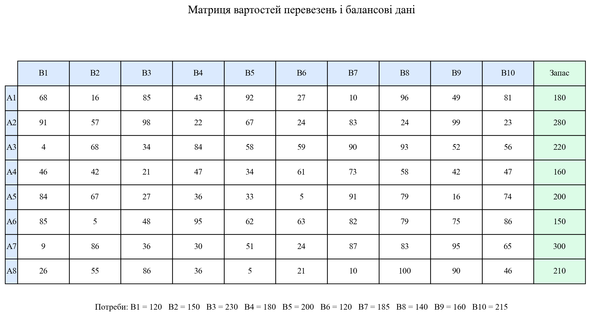
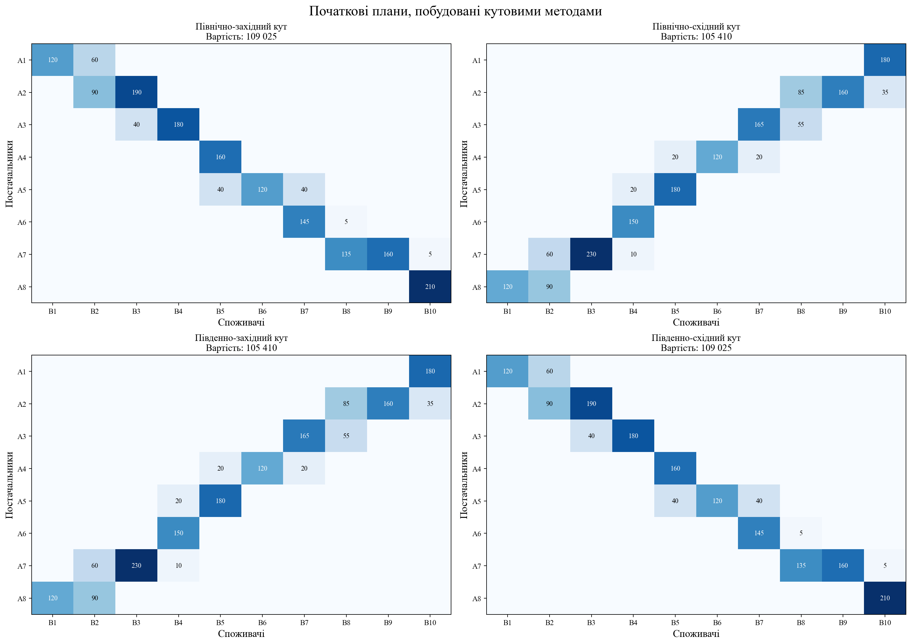
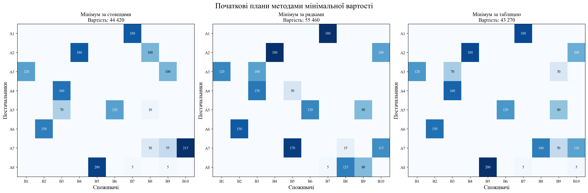
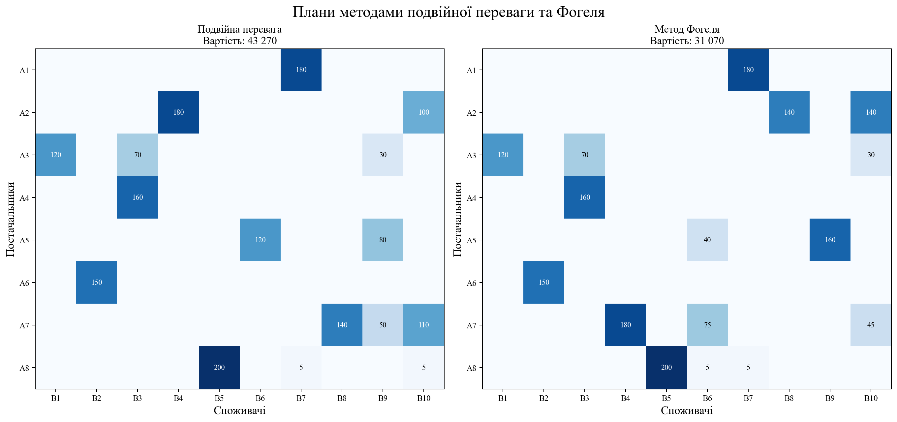
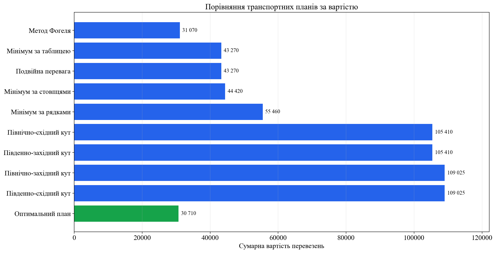
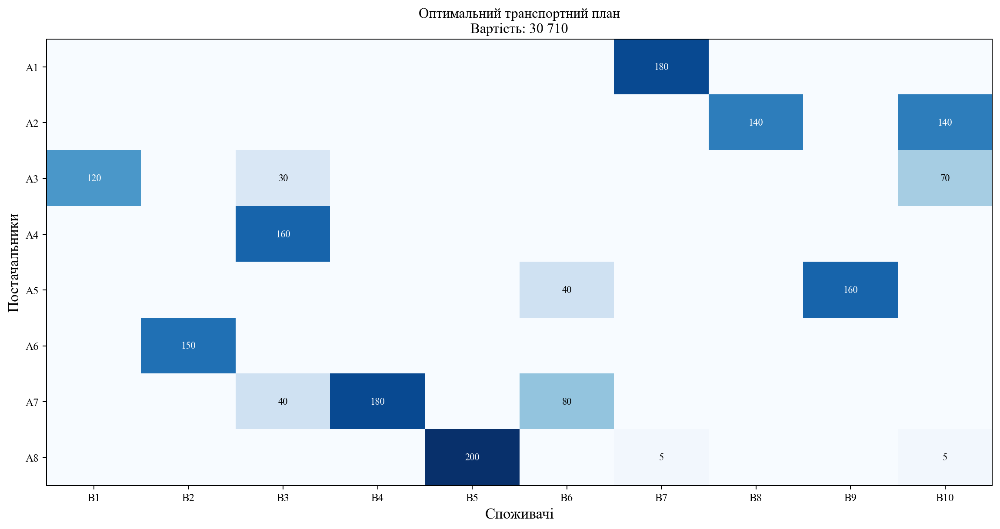
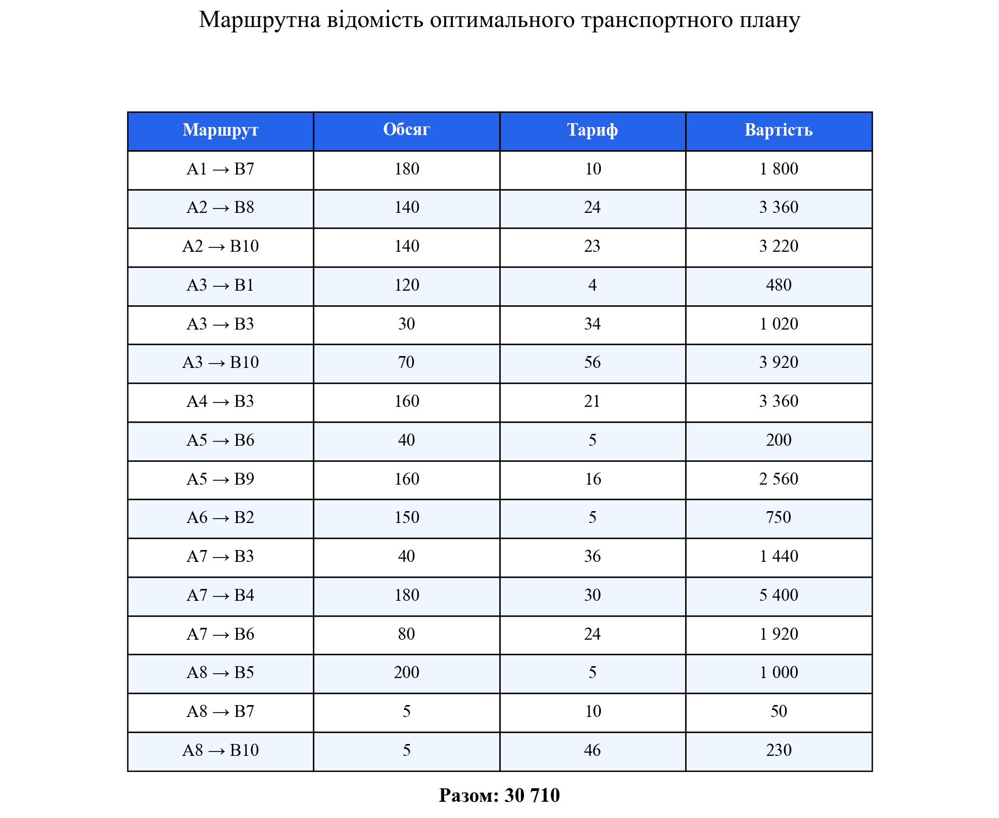
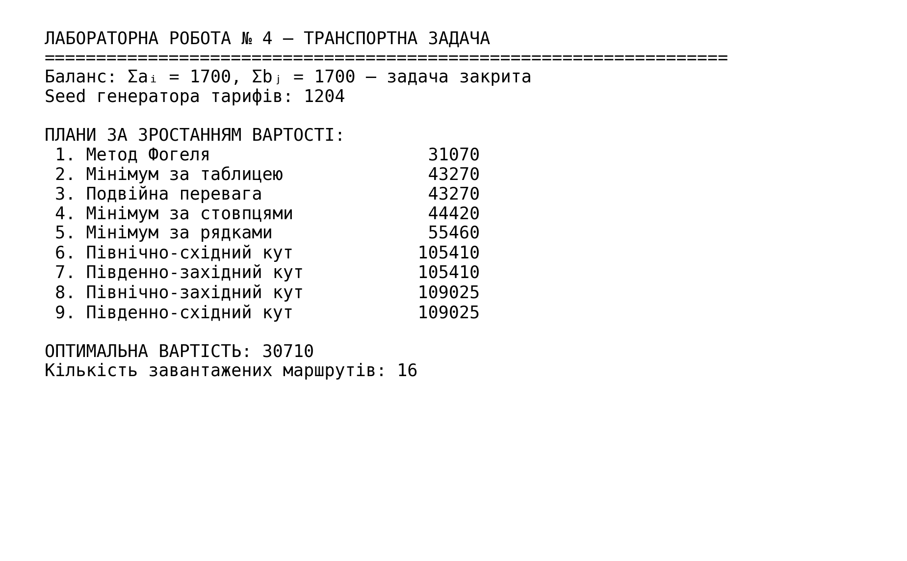

<div align="center">

МІНІСТЕРСТВО ОСВІТИ І НАУКИ УКРАЇНИ

КРЕМЕНЧУЦЬКИЙ НАЦІОНАЛЬНИЙ УНІВЕРСИТЕТ
ІМЕНІ МИХАЙЛА ОСТРОГРАДСЬКОГО

НАВЧАЛЬНО-НАУКОВИЙ ІНСТИТУТ ЕЛЕКТРИЧНОЇ ІНЖЕНЕРІЇ
ТА ІНФОРМАЦІЙНИХ ТЕХНОЛОГІЙ

КАФЕДРА АВТОМАТИЗАЦІЇ ТА ІНФОРМАЦІЙНИХ СИСТЕМ

<br>

ОСВІТНІЙ КОМПОНЕНТ

**«ДОСЛІДЖЕННЯ ОПЕРАЦІЙ»**

<br>

**ЗВІТ**
З ЛАБОРАТОРНОЇ РОБОТИ № 4

**«ТРАНСПОРТНА ЗАДАЧА ЗАКРІПЛЕННЯ ПОСТАЧАЛЬНИКІВ ЗА СПОЖИВАЧАМИ»**

</div>

<br>

<div align="right">

**Виконав:**
здобувач групи КН-24-1
Левченко Д. В.

**Перевірила:**
Бурдільна Є. В.

</div>

<br>

<p align="center">Кременчук 2026</p>

[← До переліку лабораторних](../README.md) · [Код програми](./src/solve_lab4.py) · [Автоматичні тести](./tests/test_solution.py) · [Усі ілюстрації](./assets/screenshots/)

## Зміст

1. [Тема та мета](#1-тема-та-мета)
2. [Постановка задачі](#2-постановка-задачі)
3. [Математична модель](#3-математична-модель)
4. [Формування початкових планів](#4-формування-початкових-планів)
5. [Порівняння методів](#5-порівняння-методів)
6. [Оптимальний транспортний план](#6-оптимальний-транспортний-план)
7. [Аналіз результатів](#7-аналіз-результатів)
8. [Контрольні питання](#8-контрольні-питання)
9. [Запуск програми](#9-запуск-програми)
10. [Структура проєкту](#10-структура-проєкту)

<a id="figures" name="figures"></a>

### Навігація за рисунками

| № | Ілюстрація |
|---:|---|
| 1 | [Матриця вартостей і балансові дані](#figure-1) |
| 2 | [Кутові методи](#figure-2) |
| 3 | [Методи мінімальної вартості](#figure-3) |
| 4 | [Методи подвійної переваги та Фогеля](#figure-4) |
| 5 | [Порівняння планів](#figure-5) |
| 6 | [Оптимальний план](#figure-6) |
| 7 | [Маршрути оптимального плану](#figure-7) |
| 8 | [Результат виконання програми](#figure-8) |

## 1. Тема та мета

**Тема:** транспортна задача закріплення постачальників за споживачами.

**Мета:** набути навичок побудови початкових опорних планів транспортної задачі різними методами, порівняти їх за сумарною вартістю та визначити оптимальний план перевезень.

## 2. Постановка задачі

Вісім постачальників $A_1,\ldots,A_8$ мають доставити однорідний вантаж десятьом споживачам $B_1,\ldots,B_{10}$. Запаси постачальників:

$$
a=(180;\ 280;\ 220;\ 160;\ 200;\ 150;\ 300;\ 210).
$$

Потреби споживачів:

$$
b=(120;\ 150;\ 230;\ 180;\ 200;\ 120;\ 185;\ 140;\ 160;\ 215).
$$

Перевіримо баланс:

$$
\sum_{i=1}^{8}a_i=1700,\qquad
\sum_{j=1}^{10}b_j=1700.
$$

Отже, задача є **закритою (насиченою)**. Матрицю питомих вартостей $C=(c_{ij})$ сформовано за правилом із методичних вказівок

$$
c_{ij}=\operatorname{ROUND}(100\cdot\operatorname{RAND}();0).
$$

Для повної відтворюваності в програмі використано фіксоване зерно генератора `seed = 1204`. Вихідні дані наведено на [рисунку 1](#figure-1).

<a id="figure-1" name="figure-1"></a>
<p align="center">
  <a href="./assets/screenshots/01-вихідні-дані.png">
    
  </a>
</p>
<p align="center"><em>Рисунок 1 – Матриця вартостей перевезень, запаси постачальників і потреби споживачів</em></p>
<p align="center"><sub><a href="#figures">↑ До переліку рисунків</a></sub></p>

## 3. Математична модель

Позначимо через $x_{ij}$ кількість вантажу, яку перевозять від постачальника $A_i$ до споживача $B_j$. Необхідно мінімізувати сумарну вартість:

$$
Z=\sum_{i=1}^{8}\sum_{j=1}^{10}c_{ij}x_{ij}\to\min.
$$

Обмеження за запасами кожного постачальника:

$$
\sum_{j=1}^{10}x_{ij}=a_i,\qquad i=1,\ldots,8.
$$

Обмеження за потребами кожного споживача:

$$
\sum_{i=1}^{8}x_{ij}=b_j,\qquad j=1,\ldots,10.
$$

Умова невід'ємності:

$$
x_{ij}\geq0.
$$

Таким чином, модель містить 80 змінних, 8 обмежень за запасами та 10 обмежень за потребами. Одне балансове рівняння є лінійно залежним від інших.

## 4. Формування початкових планів

### 4.1. Кутові методи

Для кожної кутової модифікації заповнення починається у відповідному куті таблиці. У поточну клітинку записують величину

$$
x_{ij}=\min(a_i^{\mathrm{зал}};b_j^{\mathrm{зал}}),
$$

після чого викреслюють вичерпаний рядок або стовпець і переходять до наступної клітинки в заданому напрямку. Отримані плани показано на [рисунку 2](#figure-2).

<a id="figure-2" name="figure-2"></a>
<p align="center">
  <a href="./assets/screenshots/02-кутові-методи.png">
    
  </a>
</p>
<p align="center"><em>Рисунок 2 – Початкові транспортні плани, побудовані чотирма кутовими методами</em></p>
<p align="center"><sub><a href="#figures">↑ До переліку рисунків</a></sub></p>

### 4.2. Методи мінімальної вартості

У методі мінімуму за рядками для кожного постачальника послідовно обирається найдешевший доступний споживач; у методі мінімуму за стовпцями — найдешевший доступний постачальник для кожного споживача. Метод мінімуму за таблицею на кожному кроці використовує клітинку з найменшим тарифом у всій активній частині матриці. Результати наведено на [рисунку 3](#figure-3).

<a id="figure-3" name="figure-3"></a>
<p align="center">
  <a href="./assets/screenshots/03-методи-мінімальної-вартості.png">
    
  </a>
</p>
<p align="center"><em>Рисунок 3 – Початкові плани методами мінімальної вартості за стовпцями, рядками та всією таблицею</em></p>
<p align="center"><sub><a href="#figures">↑ До переліку рисунків</a></sub></p>

### 4.3. Подвійна перевага та метод Фогеля

Метод подвійної переваги першочергово заповнює клітинки, тариф яких одночасно мінімальний у своєму активному рядку та стовпці. Метод Фогеля для кожного активного рядка і стовпця обчислює штраф — різницю двох найменших тарифів; далі обирає напрям із найбільшим штрафом і заповнює його найдешевшу клітинку. Плани показано на [рисунку 4](#figure-4).

<a id="figure-4" name="figure-4"></a>
<p align="center">
  <a href="./assets/screenshots/04-перевага-та-фогель.png">
    
  </a>
</p>
<p align="center"><em>Рисунок 4 – Початкові плани, побудовані методами подвійної переваги та Фогеля</em></p>
<p align="center"><sub><a href="#figures">↑ До переліку рисунків</a></sub></p>

## 5. Порівняння методів

Усі побудовані плани пройшли автоматичну перевірку балансу за кожним рядком і стовпцем. Результати впорядковано за зростанням сумарної вартості.

| Місце | Метод | Вартість | Відхилення від оптимуму |
|---:|---|---:|---:|
| 1 | Метод Фогеля | 31 070 | 360 (1,17 %) |
| 2 | Мінімум за таблицею | 43 270 | 12 560 (40,90 %) |
| 3 | Подвійна перевага | 43 270 | 12 560 (40,90 %) |
| 4 | Мінімум за стовпцями | 44 420 | 13 710 (44,64 %) |
| 5 | Мінімум за рядками | 55 460 | 24 750 (80,59 %) |
| 6 | Північно-східний кут | 105 410 | 74 700 (243,24 %) |
| 7 | Південно-західний кут | 105 410 | 74 700 (243,24 %) |
| 8 | Північно-західний кут | 109 025 | 78 315 (255,01 %) |
| 9 | Південно-східний кут | 109 025 | 78 315 (255,01 %) |

Графічне порівняння наведено на [рисунку 5](#figure-5).

<a id="figure-5" name="figure-5"></a>
<p align="center">
  <a href="./assets/screenshots/05-порівняння-планів.png">
    
  </a>
</p>
<p align="center"><em>Рисунок 5 – Порівняння початкових та оптимального транспортних планів за сумарною вартістю</em></p>
<p align="center"><sub><a href="#figures">↑ До переліку рисунків</a></sub></p>

## 6. Оптимальний транспортний план

Для точного пошуку мінімуму математичну модель розв'язано засобами `scipy.optimize.linprog` із високопродуктивним розв'язувачем HiGHS. Отримано такий план:

| Постачальник | $B_1$ | $B_2$ | $B_3$ | $B_4$ | $B_5$ | $B_6$ | $B_7$ | $B_8$ | $B_9$ | $B_{10}$ | Запас |
|---|---:|---:|---:|---:|---:|---:|---:|---:|---:|---:|---:|
| $A_1$ | 0 | 0 | 0 | 0 | 0 | 0 | 180 | 0 | 0 | 0 | 180 |
| $A_2$ | 0 | 0 | 0 | 0 | 0 | 0 | 0 | 140 | 0 | 140 | 280 |
| $A_3$ | 120 | 0 | 30 | 0 | 0 | 0 | 0 | 0 | 0 | 70 | 220 |
| $A_4$ | 0 | 0 | 160 | 0 | 0 | 0 | 0 | 0 | 0 | 0 | 160 |
| $A_5$ | 0 | 0 | 0 | 0 | 0 | 40 | 0 | 0 | 160 | 0 | 200 |
| $A_6$ | 0 | 150 | 0 | 0 | 0 | 0 | 0 | 0 | 0 | 0 | 150 |
| $A_7$ | 0 | 0 | 40 | 180 | 0 | 80 | 0 | 0 | 0 | 0 | 300 |
| $A_8$ | 0 | 0 | 0 | 0 | 200 | 0 | 5 | 0 | 0 | 5 | 210 |
| **Потреба** | **120** | **150** | **230** | **180** | **200** | **120** | **185** | **140** | **160** | **215** | **1700** |

Сумарна вартість оптимального плану:

$$
\begin{aligned}
Z_{\min}={}&180\cdot10+140\cdot24+140\cdot23+120\cdot4+30\cdot34+70\cdot56+{}\\
&160\cdot21+40\cdot5+160\cdot16+150\cdot5+40\cdot36+180\cdot30+{}\\
&80\cdot24+200\cdot5+5\cdot10+5\cdot46=30\,710.
\end{aligned}
$$

Матрицю ненульових перевезень показано на [рисунку 6](#figure-6), а маршрути — на [рисунку 7](#figure-7).

<a id="figure-6" name="figure-6"></a>
<p align="center">
  <a href="./assets/screenshots/06-оптимальний-план.png">
    
  </a>
</p>
<p align="center"><em>Рисунок 6 – Матриця оптимального транспортного плану із сумарною вартістю 30 710</em></p>
<p align="center"><sub><a href="#figures">↑ До переліку рисунків</a></sub></p>

<a id="figure-7" name="figure-7"></a>
<p align="center">
  <a href="./assets/screenshots/07-маршрути-оптимального-плану.png">
    
  </a>
</p>
<p align="center"><em>Рисунок 7 – Маршрутна відомість оптимального транспортного плану</em></p>
<p align="center"><sub><a href="#figures">↑ До переліку рисунків</a></sub></p>

## 7. Аналіз результатів

1. Баланс запасів і потреб виконується: обидві суми дорівнюють 1700, тому фіктивний постачальник або споживач не потрібен.
2. Усі дев'ять евристичних алгоритмів сформували допустимі плани: суми в рядках відповідають запасам, а суми в стовпцях — потребам.
3. Найкращим початковим планом став план Фогеля вартістю 31 070. Він перевищує точний оптимум лише на 360, або на 1,17 %.
4. Кутові методи не враховують тарифи, тому для цієї матриці дали найдорожчі плани — від 105 410 до 109 025.
5. Оптимальний план використовує 16 ненульових маршрутів і забезпечує мінімальну сумарну вартість 30 710.

Підсумковий консольний результат наведено на [рисунку 8](#figure-8).

<a id="figure-8" name="figure-8"></a>
<p align="center">
  <a href="./assets/screenshots/08-результат-програми.png">
    
  </a>
</p>
<p align="center"><em>Рисунок 8 – Результат виконання програми та ранжування початкових планів</em></p>
<p align="center"><sub><a href="#figures">↑ До переліку рисунків</a></sub></p>

## 8. Контрольні питання

<details>
<summary><strong>1. Надайте визначення поняття «транспортна задача».</strong></summary>

Транспортна задача — це задача лінійного програмування про визначення обсягів перевезень однорідного вантажу від постачальників до споживачів із виконанням балансових обмежень та оптимізацією сумарних витрат.
</details>

<details>
<summary><strong>2. Які існують різновиди транспортних задач?</strong></summary>

Розрізняють закриті й відкриті, однопродуктові й багатопродуктові, статичні й динамічні, одноетапні й багатоетапні транспортні задачі; за критерієм оптимальності — задачі мінімізації вартості, часу, відстані або втрат.
</details>

<details>
<summary><strong>3. У чому зміст задач закріплення постачальників за споживачами?</strong></summary>

Потрібно визначити, який постачальник, якому споживачеві та в якому обсязі доставлятиме вантаж, щоб повністю використати запаси, задовольнити потреби й мінімізувати витрати.
</details>

<details>
<summary><strong>4. Що таке опорний план?</strong></summary>

Опорний план — допустимий план, що відповідає базисному розв'язку системи балансових обмежень. Для невиродженої задачі розміру $m\times n$ він містить $m+n-1$ базисних клітинок.
</details>

<details>
<summary><strong>5. Що таке потенційний план?</strong></summary>

Потенційний план — опорний план, для якого можна визначити потенціали постачальників $u_i$ і споживачів $v_j$ за рівностями $u_i+v_j=c_{ij}$ у базисних клітинках; за оцінками небазисних клітинок перевіряють оптимальність і виконують поліпшення.
</details>

<details>
<summary><strong>6. Що таке оптимальний план?</strong></summary>

Оптимальний план — допустимий план, який забезпечує найкраще значення цільової функції; у цій роботі — найменшу сумарну вартість перевезень.
</details>

<details>
<summary><strong>7. Якою є цільова функція транспортної задачі?</strong></summary>

Для критерію вартості вона має вигляд $Z=\sum_i\sum_j c_{ij}x_{ij}\to\min$, де $c_{ij}$ — питома вартість, а $x_{ij}$ — обсяг перевезення.
</details>

<details>
<summary><strong>8. Як визначаються коефіцієнти матриці собівартості перевезень?</strong></summary>

Їх визначають за тарифами, відстанями, витратами пального, типом транспорту, умовами маршруту та іншими складниками витрат. У навчальній задачі вони сформовані випадково за заданою формулою.
</details>

<details>
<summary><strong>9. У яких одиницях вимірюються коефіцієнти матриці собівартості?</strong></summary>

У грошових одиницях на одиницю вантажу, наприклад грн/т або грн/шт. Якщо в тариф уже включено відстань маршруту, коефіцієнт є повною питомою вартістю доставки за відповідним напрямком.
</details>

<details>
<summary><strong>10. Що таке насичений опорний план?</strong></summary>

Це план закритої транспортної задачі, у якій сумарні запаси дорівнюють сумарним потребам: $\sum a_i=\sum b_j$. Усі запаси використано, а всі потреби задоволено.
</details>

<details>
<summary><strong>11. Що таке ненасичений опорний план?</strong></summary>

Це план відкритої транспортної задачі, де $\sum a_i\neq\sum b_j$. Для приведення до закритої моделі додають фіктивного постачальника або споживача з величиною дисбалансу.
</details>

<details>
<summary><strong>12. Чи можуть потреби споживачів перевищувати запаси постачальників?</strong></summary>

Так. Тоді задача відкрита й додається фіктивний постачальник із запасом $\sum b_j-\sum a_i$.
</details>

<details>
<summary><strong>13. Чи можуть запаси постачальників перевищувати потреби споживачів?</strong></summary>

Так. Тоді додається фіктивний споживач із потребою $\sum a_i-\sum b_j$.
</details>

<details>
<summary><strong>14. Які існують методи розв'язання транспортної задачі?</strong></summary>

Початковий план будують кутовими методами, методами мінімальної вартості, подвійної переваги або Фогеля. Для перевірки й поліпшення використовують метод потенціалів, метод циклів, транспортний симплекс-метод або універсальні алгоритми лінійного програмування.
</details>

<details>
<summary><strong>15. У чому зміст методу північно-західного кута та його варіацій?</strong></summary>

Заповнення починають із відповідного кута таблиці, записуючи максимум можливого вантажу, після чого переходять уздовж активних рядків і стовпців. Варіації відрізняються початковим кутом і напрямком руху; тарифи при виборі клітинки не враховуються.
</details>

<details>
<summary><strong>16. У чому суть методів мінімальної вартості за рядком і стовпцем?</strong></summary>

За рядком обирають мінімальний доступний тариф поточного постачальника, а за стовпцем — мінімальний тариф для поточного споживача. В обрану клітинку записують максимально можливий обсяг і повторюють процедуру до закриття балансу.
</details>

<details>
<summary><strong>17. У чому зміст методу подвійної переваги?</strong></summary>

Позначають тарифи, мінімальні у своїх рядках і стовпцях. Найвищий пріоритет мають клітинки з подвійною позначкою, потім з одинарною; після кожного розподілу активну таблицю переглядають знову.
</details>

<details>
<summary><strong>18. У чому зміст методу Фогеля?</strong></summary>

Для кожного активного рядка та стовпця обчислюють штраф як різницю двох найменших тарифів. Обирають рядок або стовпець із найбільшим штрафом, заповнюють у ньому клітинку з найменшим тарифом і повторюють розрахунок.
</details>

## 9. Запуск програми

Потрібен Python 3.10 або новіший.

```powershell
python -m pip install -r requirements.txt
python src/solve_lab4.py
python -m unittest discover -s tests -v
```

Програма повторно обчислить усі плани та збереже вісім ілюстрацій у каталозі `assets/screenshots`.

## 10. Структура проєкту

```text
Лабораторна робота 04/
├── README.md
├── requirements.txt
├── assets/
│   └── screenshots/
│       ├── 01-вихідні-дані.png
│       ├── 02-кутові-методи.png
│       ├── 03-методи-мінімальної-вартості.png
│       ├── 04-перевага-та-фогель.png
│       ├── 05-порівняння-планів.png
│       ├── 06-оптимальний-план.png
│       ├── 07-маршрути-оптимального-плану.png
│       └── 08-результат-програми.png
├── src/
│   └── solve_lab4.py
└── tests/
    └── test_solution.py
```

## Висновок

У роботі побудовано дев'ять допустимих початкових планів транспортної задачі для 8 постачальників і 10 споживачів. Найкращий евристичний результат забезпечив метод Фогеля — 31 070. Точний розв'язок методом лінійного програмування має вартість 30 710, повністю задовольняє всі потреби та не перевищує наявні запаси. Мету роботи досягнуто.
