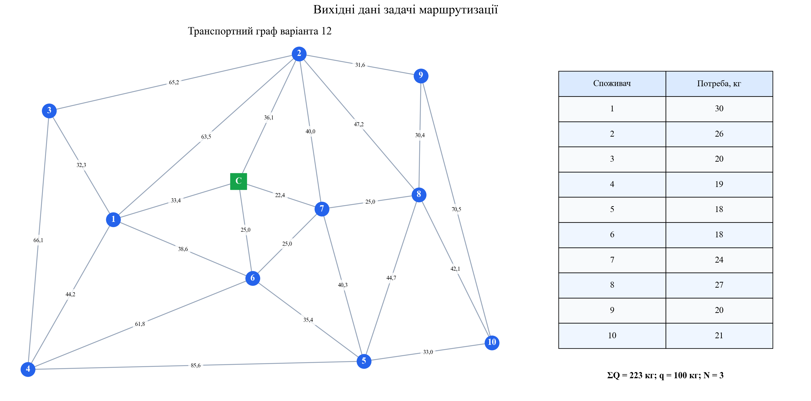
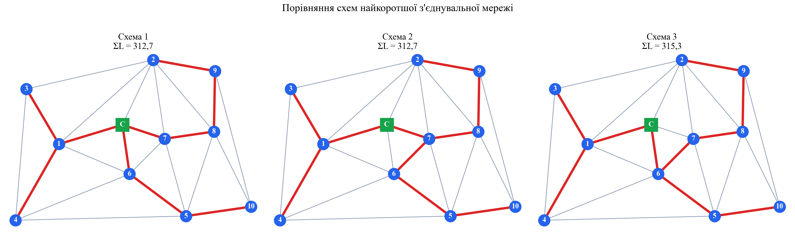
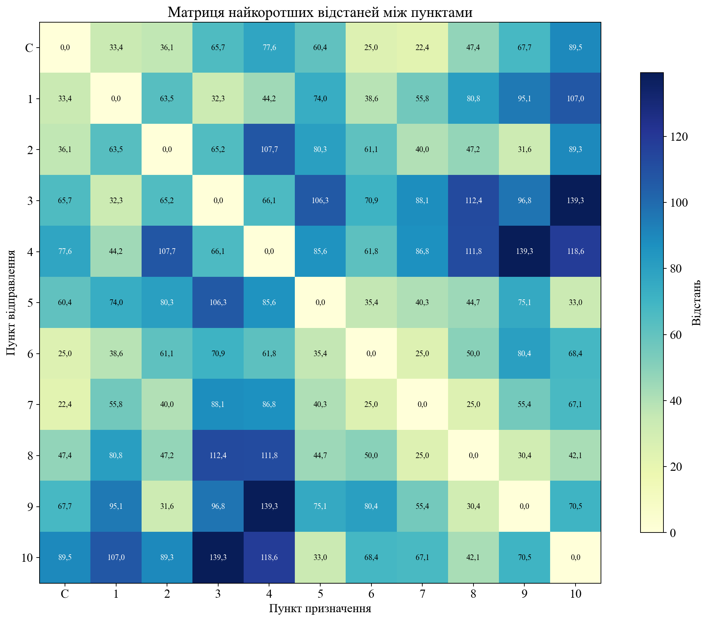
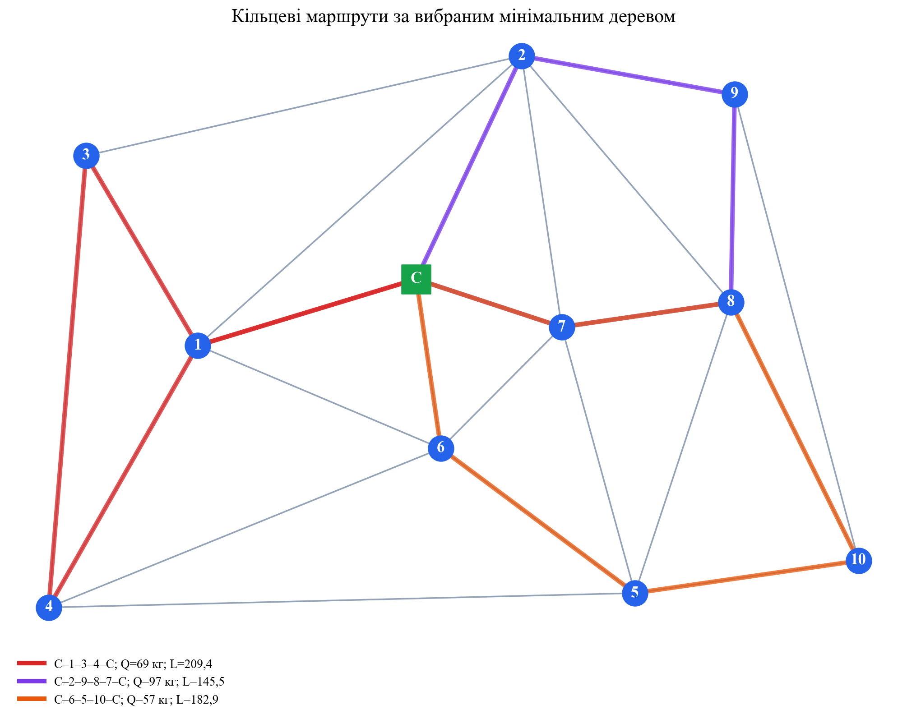
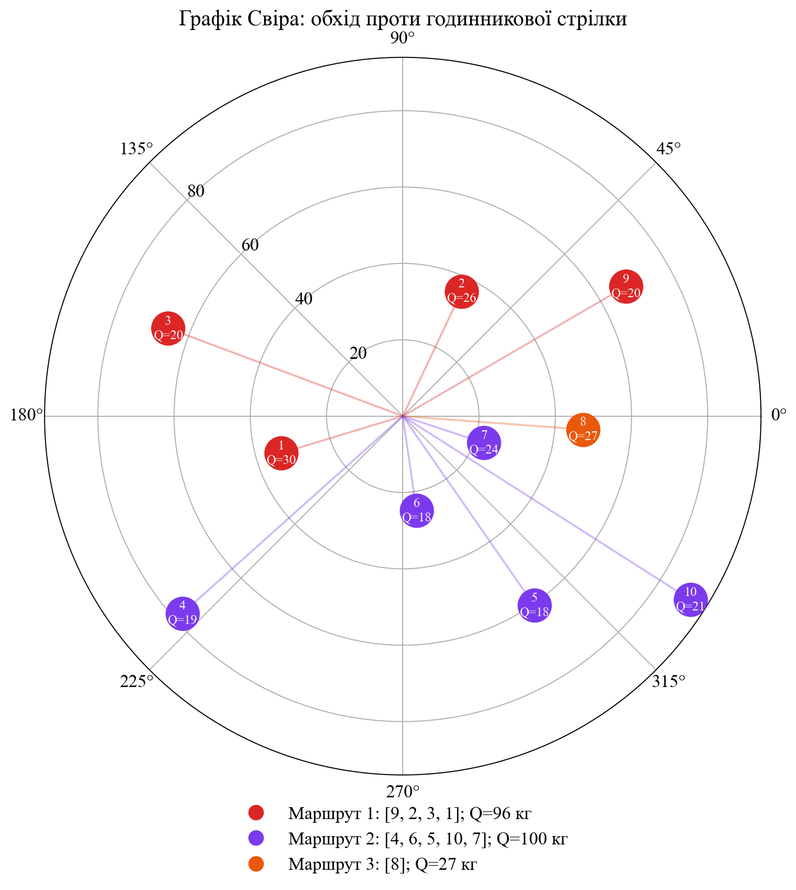
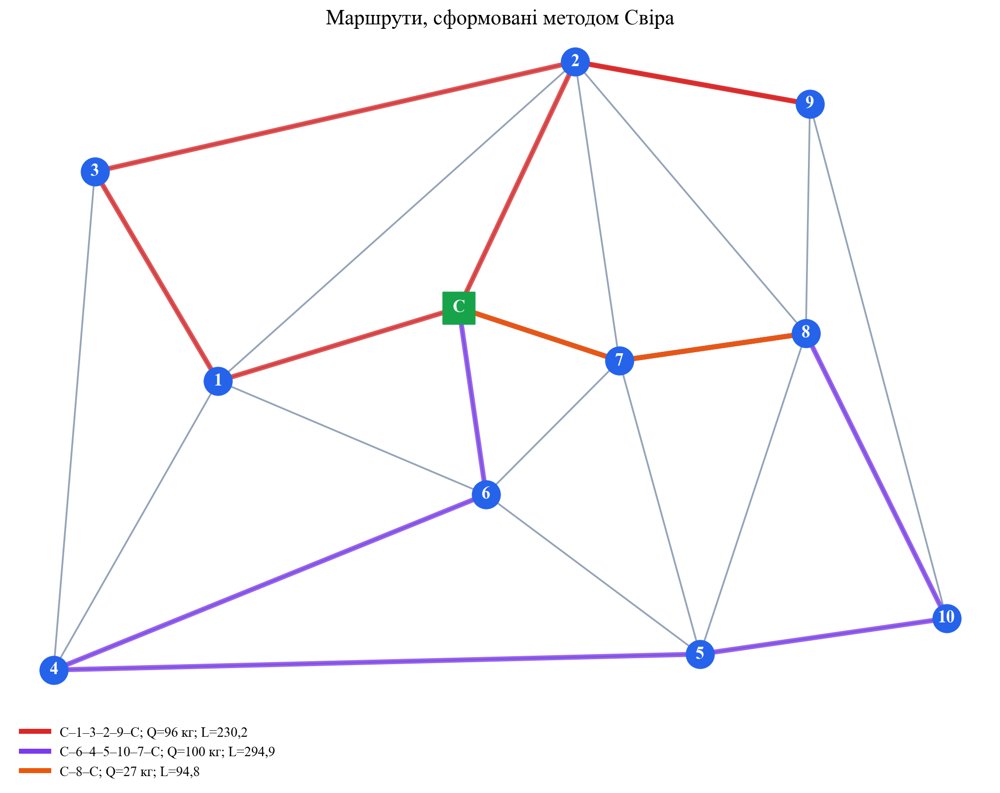
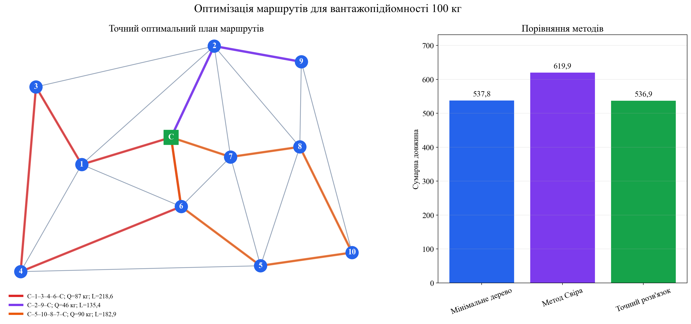
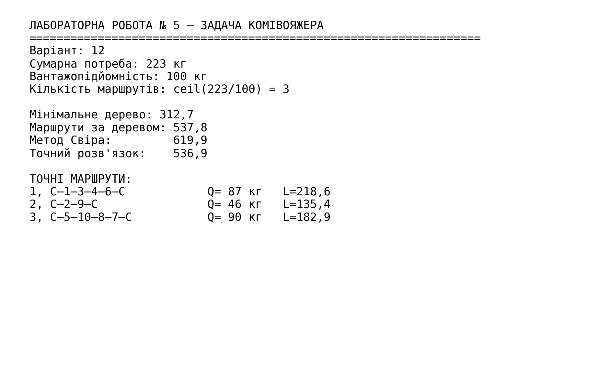

<div align="center">

МІНІСТЕРСТВО ОСВІТИ І НАУКИ УКРАЇНИ

КРЕМЕНЧУЦЬКИЙ НАЦІОНАЛЬНИЙ УНІВЕРСИТЕТ
ІМЕНІ МИХАЙЛА ОСТРОГРАДСЬКОГО

НАВЧАЛЬНО-НАУКОВИЙ ІНСТИТУТ ЕЛЕКТРИЧНОЇ ІНЖЕНЕРІЇ
ТА ІНФОРМАЦІЙНИХ ТЕХНОЛОГІЙ

КАФЕДРА АВТОМАТИЗАЦІЇ ТА ІНФОРМАЦІЙНИХ СИСТЕМ

<br>

ОСВІТНІЙ КОМПОНЕНТ

**«ДОСЛІДЖЕННЯ ОПЕРАЦІЙ»**

<br>

**ЗВІТ**
З ЛАБОРАТОРНОЇ РОБОТИ № 5

**«ЗАДАЧА КОМІВОЯЖЕРА»**

</div>

<br>

<div align="right">

**Виконав:**
здобувач групи КН-24-1
Левченко Д. В.

**Перевірила:**
Бурдільна Є. В.

</div>

<br>

<p align="center">Кременчук 2026</p>

[← До переліку лабораторних](../README.md) · [Код програми](./src/solve_lab5.py) · [Автоматичні тести](./tests/test_solution.py) · [Усі ілюстрації](./assets/screenshots/)

## Зміст

1. [Тема та мета](#1-тема-та-мета)
2. [Вихідні дані](#2-вихідні-дані)
3. [Визначення вантажопідйомності](#3-визначення-вантажопідйомності)
4. [Метод найкоротшої з'єднувальної мережі](#4-метод-найкоротшої-зєднувальної-мережі)
5. [Матриця відстаней](#5-матриця-відстаней)
6. [Метод Свіра](#6-метод-свіра)
7. [Точна оптимізація та порівняння](#7-точна-оптимізація-та-порівняння)
8. [Аналіз результатів](#8-аналіз-результатів)
9. [Контрольні питання](#9-контрольні-питання)
10. [Запуск програми](#10-запуск-програми)
11. [Структура проєкту](#11-структура-проєкту)

<a id="figures" name="figures"></a>

### Навігація за рисунками

| № | Ілюстрація |
|---:|---|
| 1 | [Вихідні дані та транспортний граф](#figure-1) |
| 2 | [Схеми мінімального дерева](#figure-2) |
| 3 | [Матриця найкоротших відстаней](#figure-3) |
| 4 | [Маршрути за мінімальним деревом](#figure-4) |
| 5 | [Графік Свіра](#figure-5) |
| 6 | [Маршрути за методом Свіра](#figure-6) |
| 7 | [Точний план і порівняння методів](#figure-7) |
| 8 | [Результат виконання програми](#figure-8) |

## 1. Тема та мета

**Тема:** задача комівояжера.

**Мета:** набути навичок створення оптимальних маршрутів за відомих потреб споживачів, їхнього розташування та обмеженої вантажопідйомності транспортного засобу; застосувати метод найкоротшої з'єднувальної мережі та метод Свіра.

## 2. Вихідні дані

Використано **варіант 12** та граф розташування споживачів **«2, 12»**. Склад позначено літерою $C$, споживачів — числами від 1 до 10.

| Споживач | 1 | 2 | 3 | 4 | 5 | 6 | 7 | 8 | 9 | 10 |
|---|---:|---:|---:|---:|---:|---:|---:|---:|---:|---:|
| Потреба $Q_i$, кг | 30 | 26 | 20 | 19 | 18 | 18 | 24 | 27 | 20 | 21 |

Сумарна потреба:

$$
Q_{\Sigma}=30+26+20+19+18+18+24+27+20+21=223\ \text{кг}.
$$

Усі 24 ребра транспортної мережі та їхні довжини перенесено до програми безпосередньо з графа методичних вказівок. Вихідні дані показано на [рисунку 1](#figure-1).

<a id="figure-1" name="figure-1"></a>
<p align="center">
  <a href="./assets/screenshots/01-вихідні-дані-та-граф.png">
    
  </a>
</p>
<p align="center"><em>Рисунок 1 – Транспортний граф варіанта 12 та потреби десяти споживачів</em></p>
<p align="center"><sub><a href="#figures">↑ До переліку рисунків</a></sub></p>

## 3. Визначення вантажопідйомності

Мінімальне дерево природно розділяє споживачів на три гілки:

| Гілка | Споживачі | Сумарна потреба, кг |
|---:|---|---:|
| 1 | 1, 3, 4 | 69 |
| 2 | 6, 5, 10 | 57 |
| 3 | 7, 8, 9, 2 | 97 |

Щоб кожну гілку можна було обслужити одним кільцевим рейсом, вантажопідйомність має бути не меншою за найбільше гілкове навантаження:

$$
q\geq\max(69;57;97)=97\ \text{кг}.
$$

Приймаємо стандартне округлене значення

$$
q=100\ \text{кг}.
$$

Необхідна кількість маршрутів:

$$
N=\lceil\frac{Q_{\Sigma}}{q}\rceil
=\lceil\frac{223}{100}\rceil=3.
$$

Отже, транспортний засіб вантажопідйомністю 100 кг виконає три кільцеві рейси.

## 4. Метод найкоротшої з'єднувальної мережі

### 4.1. Побудова мінімального дерева

Мінімальне дерево будується за алгоритмом Краскала: ребра впорядковуються за довжиною та послідовно додаються, якщо вони не створюють цикл. Для 11 пунктів дерево має

$$
11-1=10
$$

ребер.

Отримано дві рівноцінні схеми довжиною 312,7 та одну близьку альтернативу довжиною 315,3. Їх показано на [рисунку 2](#figure-2).

<a id="figure-2" name="figure-2"></a>
<p align="center">
  <a href="./assets/screenshots/02-схеми-мінімального-дерева.png">
    
  </a>
</p>
<p align="center"><em>Рисунок 2 – Порівняння схем найкоротшої з'єднувальної мережі</em></p>
<p align="center"><sub><a href="#figures">↑ До переліку рисунків</a></sub></p>

Для подальшої роботи обрано **схему 1**. Вона має мінімальну довжину 312,7 і, на відміну від другої рівноцінної схеми, утворює три зручні гілки з навантаженнями, що не перевищують 100 кг.

### 4.2. Формування кільцевих маршрутів

У межах кожної гілки порядок обслуговування оптимізовано повним перебором можливих перестановок за матрицею найкоротших відстаней.

| № | Маршрут | Навантаження, кг | Довжина |
|---:|---|---:|---:|
| 1 | $C-1-3-4-C$ | 69 | 209,4 |
| 2 | $C-2-9-8-7-C$ | 97 | 145,5 |
| 3 | $C-6-5-10-C$ | 57 | 182,9 |
|  | **Разом** | **223** | **537,8** |

Жоден маршрут не перевищує вантажопідйомність. Схему наведено на [рисунку 4](#figure-4).

## 5. Матриця відстаней

Базову матрицю сформовано з довжин безпосередніх ребер графа:

$$
d_{ii}=0,\qquad d_{ij}=d_{ji}.
$$

Для пар пунктів, не з'єднаних безпосередньо, знайдено найкоротший шлях алгоритмом Флойда–Воршелла:

$$
d_{ij}=\min_k(d_{ik}+d_{kj}).
$$

Наприклад, найкоротша відстань від складу до споживача 10 проходить через пункти 7, 8:

$$
d_{C,10}=d_{C,7}+d_{7,8}+d_{8,10}
=22,4+25,0+42,1=89,5.
$$

Повну симетричну матрицю наведено на [рисунку 3](#figure-3).

<a id="figure-3" name="figure-3"></a>
<p align="center">
  <a href="./assets/screenshots/03-матриця-відстаней.png">
    
  </a>
</p>
<p align="center"><em>Рисунок 3 – Матриця найкоротших відстаней між складом і споживачами</em></p>
<p align="center"><sub><a href="#figures">↑ До переліку рисунків</a></sub></p>

<a id="figure-4" name="figure-4"></a>
<p align="center">
  <a href="./assets/screenshots/04-маршрути-мінімального-дерева.png">
    
  </a>
</p>
<p align="center"><em>Рисунок 4 – Кільцеві маршрути, сформовані за вибраним мінімальним деревом</em></p>
<p align="center"><sub><a href="#figures">↑ До переліку рисунків</a></sub></p>

## 6. Метод Свіра

Склад $C$ прийнято за полюс. Початковий промінь спрямовано вздовж додатної півосі абсцис, обхід виконується проти годинникової стрілки. Для кожного споживача визначено полярний кут і найкоротшу відстань від складу. Споживачі впорядковуються за кутом, а їхні потреби накопичуються до досягнення вантажопідйомності $q=100$ кг.

| Порядок обходу | Кут, град. | $Q_i$, кг | Накопичено, кг | Маршрут |
|---:|---:|---:|---:|---:|
| 9 | 30,1 | 20 | 20 | 1 |
| 2 | 64,7 | 26 | 46 | 1 |
| 3 | 159,5 | 20 | 66 | 1 |
| 1 | 196,9 | 30 | 96 | 1 |
| 4 | 221,8 | 19 | 19 | 2 |
| 6 | 278,3 | 18 | 37 | 2 |
| 5 | 304,8 | 18 | 55 | 2 |
| 10 | 327,5 | 21 | 76 | 2 |
| 7 | 341,8 | 24 | 100 | 2 |
| 8 | 355,8 | 27 | 27 | 3 |

Графік розподілу показано на [рисунку 5](#figure-5).

<a id="figure-5" name="figure-5"></a>
<p align="center">
  <a href="./assets/screenshots/05-графік-свіра.png">
    
  </a>
</p>
<p align="center"><em>Рисунок 5 – Графік Свіра та розподіл споживачів між трьома маршрутами</em></p>
<p align="center"><sub><a href="#figures">↑ До переліку рисунків</a></sub></p>

Після оптимізації порядку відвідування всередині кожної групи отримано:

| № | Маршрут | Навантаження, кг | Довжина |
|---:|---|---:|---:|
| 1 | $C-1-3-2-9-C$ | 96 | 230,2 |
| 2 | $C-6-4-5-10-7-C$ | 100 | 294,9 |
| 3 | $C-8-C$ | 27 | 94,8 |
|  | **Разом** | **223** | **619,9** |

Маршрути показано на [рисунку 6](#figure-6).

<a id="figure-6" name="figure-6"></a>
<p align="center">
  <a href="./assets/screenshots/06-маршрути-свіра.png">
    
  </a>
</p>
<p align="center"><em>Рисунок 6 – Кільцеві маршрути, сформовані методом Свіра</em></p>
<p align="center"><sub><a href="#figures">↑ До переліку рисунків</a></sub></p>

## 7. Точна оптимізація та порівняння

Для перевірки евристичних результатів реалізовано точний алгоритм маршрутизації з обмеженням вантажопідйомності. Алгоритм перебирає всі підмножини споживачів із навантаженням не більше 100 кг, для кожної підмножини розв'язує задачу комівояжера, а потім динамічним програмуванням обирає найкраще розбиття на три маршрути.

| № | Точний маршрут | Навантаження, кг | Довжина |
|---:|---|---:|---:|
| 1 | $C-1-3-4-6-C$ | 87 | 218,6 |
| 2 | $C-2-9-C$ | 46 | 135,4 |
| 3 | $C-5-10-8-7-C$ | 90 | 182,9 |
|  | **Разом** | **223** | **536,9** |

| Метод | Сумарна довжина | Відхилення від оптимуму |
|---|---:|---:|
| Точний алгоритм | 536,9 | 0,0 |
| Мінімальне дерево | 537,8 | 0,9 (0,17 %) |
| Метод Свіра | 619,9 | 83,0 (15,46 %) |

Порівняння показано на [рисунку 7](#figure-7).

<a id="figure-7" name="figure-7"></a>
<p align="center">
  <a href="./assets/screenshots/07-оптимальний-план-та-порівняння.png">
    
  </a>
</p>
<p align="center"><em>Рисунок 7 – Точний план маршрутів та порівняння сумарних довжин</em></p>
<p align="center"><sub><a href="#figures">↑ До переліку рисунків</a></sub></p>

## 8. Аналіз результатів

1. Вантажопідйомність 100 кг достатня для обслуговування кожної гілки вибраного мінімального дерева одним рейсом.
2. Обмеження вантажопідйомності виконується в усіх побудованих маршрутах.
3. Метод мінімального дерева дав результат 537,8, який лише на 0,9, або 0,17 %, перевищує точний оптимум.
4. Метод Свіра забезпечує просте географічне групування, але для цього графа створює один короткий одиночний рейс до споживача 8, тому загальна довжина збільшується до 619,9.
5. Точний план має сумарну довжину 536,9 та є найкращим серед розглянутих варіантів.

Підсумковий результат програми наведено на [рисунку 8](#figure-8).

<a id="figure-8" name="figure-8"></a>
<p align="center">
  <a href="./assets/screenshots/08-результат-програми.png">
    
  </a>
</p>
<p align="center"><em>Рисунок 8 – Підсумкові характеристики та точні оптимальні маршрути</em></p>
<p align="center"><sub><a href="#figures">↑ До переліку рисунків</a></sub></p>

## 9. Контрольні питання

<details>
<summary><strong>1. Які типи маршрутів ви знаєте?</strong></summary>

Основні типи — маятниковий маршрут між двома пунктами та кільцевий маршрут, що проходить замкненим контуром через декілька пунктів.
</details>

<details>
<summary><strong>2. За якою ознакою маршрути поділяють на різні типи?</strong></summary>

За співвідношенням потреби споживача $Q_i$ і вантажопідйомності автомобіля $q$. Якщо $Q_i\approx q$, доцільний маятниковий маршрут; якщо потреба менша, декілька споживачів об'єднують у кільцевий маршрут.
</details>

<details>
<summary><strong>3. На що впливає вантажопідйомність під час побудови маршрутів?</strong></summary>

Вона визначає максимальне сумарне навантаження одного рейсу, кількість необхідних маршрутів та склад груп споживачів у кожному маршруті.
</details>

<details>
<summary><strong>4. Як визначити кількість маршрутів?</strong></summary>

Мінімальну кількість оцінюють як $N=\lceil\sum_i Q_i/q\rceil$. Додатково враховують географічне розташування і можливість допустимого групування.
</details>

<details>
<summary><strong>5. Які методи розв'язання задачі комівояжера ви знаєте?</strong></summary>

Метод найкоротшої з'єднувальної мережі, метод Свіра, метод найближчого сусіда, метод гілок і меж, динамічне програмування, генетичні та мурашині алгоритми.
</details>

<details>
<summary><strong>6. У чому суть методу найкоротшої з'єднувальної мережі?</strong></summary>

Послідовно додають найкоротші ребра, які з'єднують нові частини мережі та не створюють циклів. Після отримання мінімального дерева його гілки перетворюють на допустимі кільцеві маршрути.
</details>

<details>
<summary><strong>7. Яка друга назва методу найкоротшої з'єднувальної мережі?</strong></summary>

Метод мінімального кістякового дерева, або метод мінімального дерева.
</details>

<details>
<summary><strong>8. Який тип маршруту лежить в основі цього методу?</strong></summary>

Кільцевий маршрут, який починається та завершується на складі.
</details>

<details>
<summary><strong>9. Чи можливе використання маятникових маршрутів?</strong></summary>

Так. Якщо потреба окремого споживача наближається до вантажопідйомності, його доцільно обслуговувати окремим маятниковим рейсом, а решту мережі — кільцевими маршрутами.
</details>

<details>
<summary><strong>10. Яка друга назва методу Свіра?</strong></summary>

Sweep-алгоритм, або метод секторного (променевого) обходу.
</details>

<details>
<summary><strong>11. Що таке матриця відстаней?</strong></summary>

Це квадратна таблиця, елемент $d_{ij}$ якої дорівнює найкоротшій відстані між пунктами $i$ та $j$ транспортної мережі.
</details>

<details>
<summary><strong>12. Як складається базова матриця відстаней?</strong></summary>

На головній діагоналі записують нулі, для безпосередньо з'єднаних пунктів — довжини ребер графа, а симетричні клітинки заповнюють однаковими значеннями.
</details>

<details>
<summary><strong>13. Як заповнюються клітинки, що не належать до базової матриці?</strong></summary>

Для кожної пари нез'єднаних пунктів знаходять найкоротший ланцюг через проміжні вершини та записують суму довжин його ребер.
</details>

<details>
<summary><strong>14. Яка частина матриці використовується для графіка Свіра?</strong></summary>

Рядок або стовпець складу $C$, тобто найкоротші відстані від складу до кожного споживача.
</details>

<details>
<summary><strong>15. Що таке графік Свіра?</strong></summary>

Це полярне подання споживачів відносно складу, на якому кут визначає напрямок, радіус — відстань, а під час обертання променя накопичуються потреби.
</details>

<details>
<summary><strong>16. Яке початкове положення вектора обходу?</strong></summary>

Вектор починається в точці складу та спрямовується вздовж обраної початкової півосі; у цій роботі — вздовж додатної півосі абсцис.
</details>

<details>
<summary><strong>17. Як рухається вектор обходу?</strong></summary>

Він рівномірно обертається навколо складу за або проти годинникової стрілки й послідовно перетинає точки споживачів.
</details>

<details>
<summary><strong>18. Як складається оптимальний маршрут за методом Свіра?</strong></summary>

Споживачів додають до поточної групи в порядку проходження променя, поки їхня сумарна потреба не досягне вантажопідйомності. Потім відкривають наступний маршрут, а порядок відвідування всередині кожної групи оптимізують за матрицею відстаней.
</details>

## 10. Запуск програми

Потрібен Python 3.10 або новіший.

```powershell
python -m pip install -r requirements.txt
python src/solve_lab5.py
python -m unittest discover -s tests -v
```

Програма відтворить усі розрахунки й збереже вісім ілюстрацій у каталозі `assets/screenshots`.

## 11. Структура проєкту

```text
Лабораторна робота 05/
├── README.md
├── requirements.txt
├── assets/
│   └── screenshots/
│       ├── 01-вихідні-дані-та-граф.png
│       ├── 02-схеми-мінімального-дерева.png
│       ├── 03-матриця-відстаней.png
│       ├── 04-маршрути-мінімального-дерева.png
│       ├── 05-графік-свіра.png
│       ├── 06-маршрути-свіра.png
│       ├── 07-оптимальний-план-та-порівняння.png
│       └── 08-результат-програми.png
├── src/
│   └── solve_lab5.py
└── tests/
    └── test_solution.py
```

## Висновок

Для варіанта 12 обґрунтовано вибрано транспортний засіб вантажопідйомністю 100 кг та сформовано три рейси. Побудовано мінімальне дерево довжиною 312,7, повну матрицю найкоротших відстаней і графік Свіра. Маршрути за мінімальним деревом мають довжину 537,8, за методом Свіра — 619,9. Точний алгоритм підтвердив оптимальну сумарну довжину 536,9. Мету роботи досягнуто.
