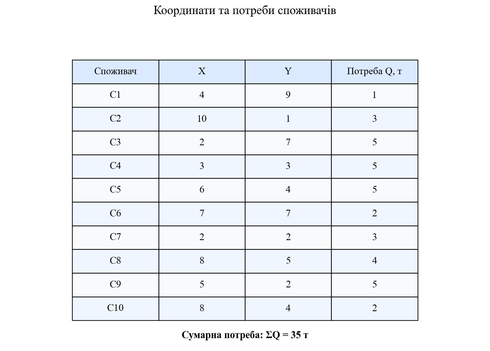
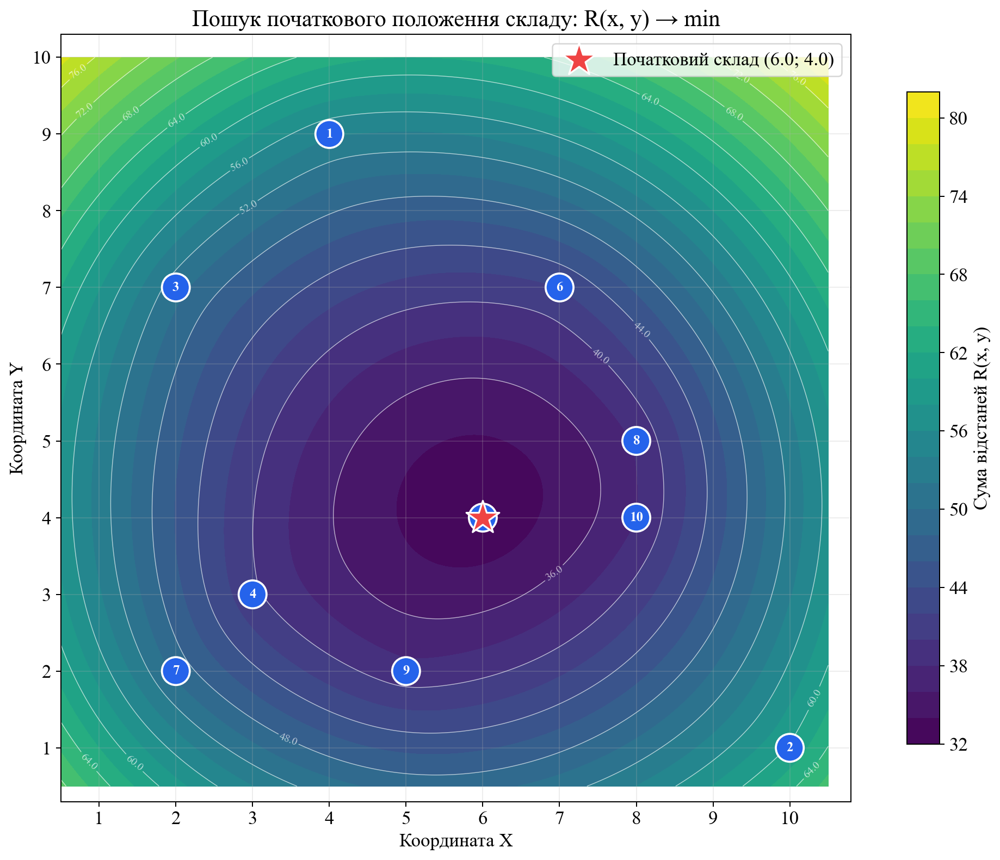
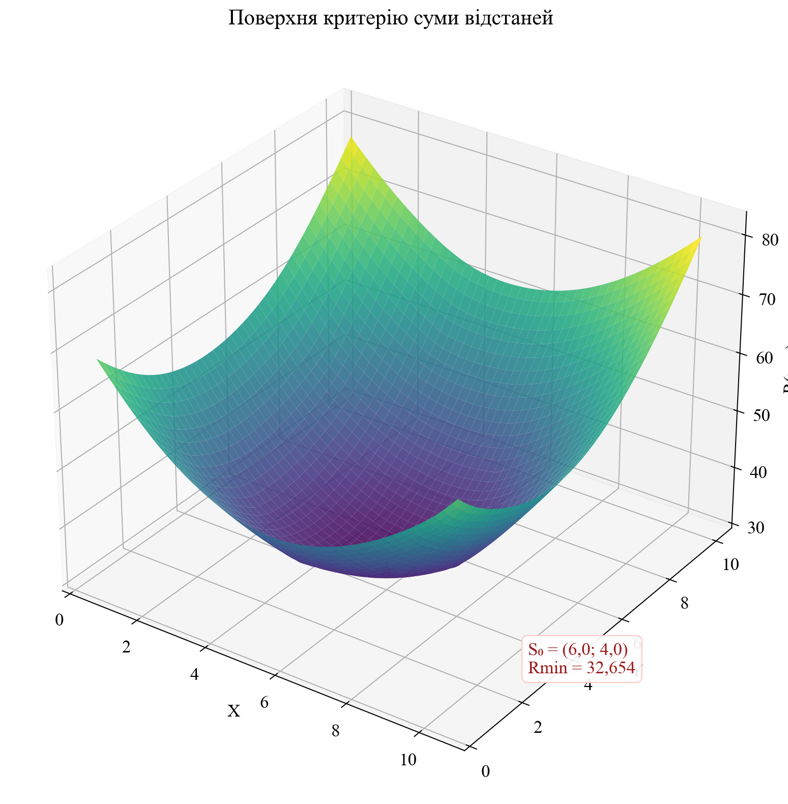
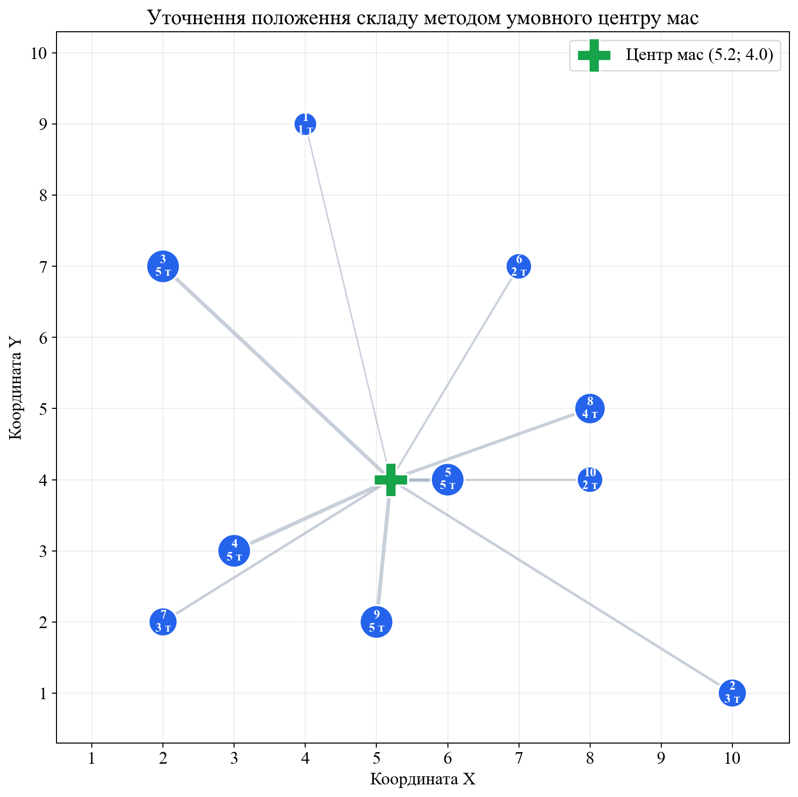
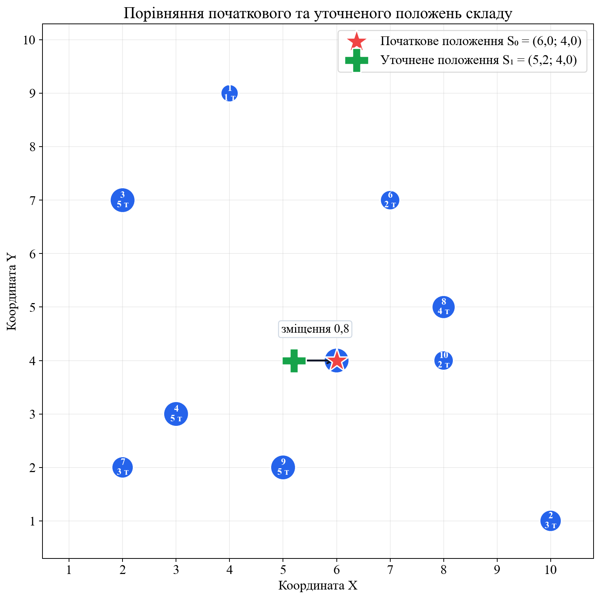
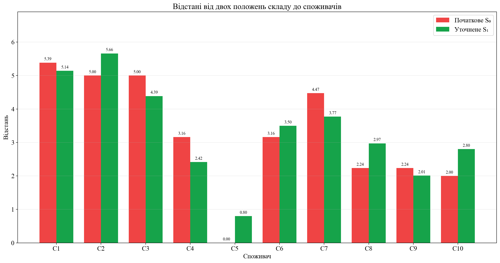
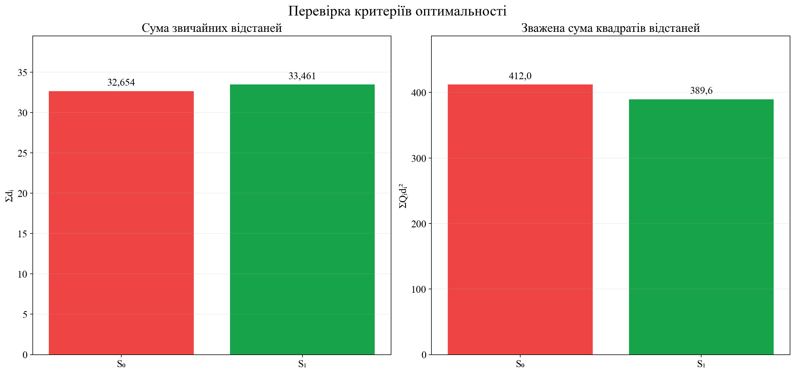
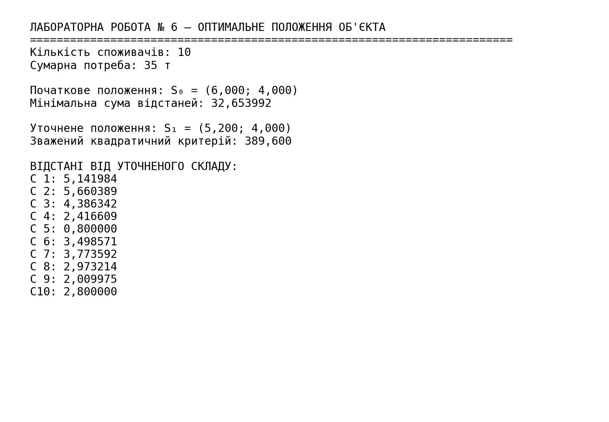

<div align="center">

МІНІСТЕРСТВО ОСВІТИ І НАУКИ УКРАЇНИ

КРЕМЕНЧУЦЬКИЙ НАЦІОНАЛЬНИЙ УНІВЕРСИТЕТ
ІМЕНІ МИХАЙЛА ОСТРОГРАДСЬКОГО

НАВЧАЛЬНО-НАУКОВИЙ ІНСТИТУТ ЕЛЕКТРИЧНОЇ ІНЖЕНЕРІЇ
ТА ІНФОРМАЦІЙНИХ ТЕХНОЛОГІЙ

КАФЕДРА АВТОМАТИЗАЦІЇ ТА ІНФОРМАЦІЙНИХ СИСТЕМ

<br>

ОСВІТНІЙ КОМПОНЕНТ

**«ДОСЛІДЖЕННЯ ОПЕРАЦІЙ»**

<br>

**ЗВІТ**
З ЛАБОРАТОРНОЇ РОБОТИ № 6

**«ОПТИМАЛЬНЕ ПОЛОЖЕННЯ ОБ'ЄКТА»**

</div>

<br>

<div align="right">

**Виконав:**
здобувач групи КН-24-1
Левченко Д. В.

**Перевірила:**
Бурдільна Є. В.

</div>

<br>

<p align="center">Кременчук 2026</p>

[← До переліку лабораторних](../README.md) · [Код програми](./src/solve_lab6.py) · [Автоматичні тести](./tests/test_solution.py) · [Усі ілюстрації](./assets/screenshots/)

## Зміст

1. [Тема та мета](#1-тема-та-мета)
2. [Вихідні дані](#2-вихідні-дані)
3. [Початкове положення складу](#3-початкове-положення-складу)
4. [Уточнення методом умовного центру мас](#4-уточнення-методом-умовного-центру-мас)
5. [Побудова на координатній площині](#5-побудова-на-координатній-площині)
6. [Обчислення відстаней](#6-обчислення-відстаней)
7. [Перевірка критеріїв](#7-перевірка-критеріїв)
8. [Аналіз результатів](#8-аналіз-результатів)
9. [Контрольні питання](#9-контрольні-питання)
10. [Запуск програми](#10-запуск-програми)
11. [Структура проєкту](#11-структура-проєкту)

<a id="figures" name="figures"></a>

### Навігація за рисунками

| № | Ілюстрація |
|---:|---|
| 1 | [Вихідні дані](#figure-1) |
| 2 | [Контури суми відстаней](#figure-2) |
| 3 | [Тривимірна поверхня критерію](#figure-3) |
| 4 | [Умовний центр мас](#figure-4) |
| 5 | [Порівняння положень складу](#figure-5) |
| 6 | [Відстані до споживачів](#figure-6) |
| 7 | [Перевірка критеріїв](#figure-7) |
| 8 | [Результат виконання програми](#figure-8) |

## 1. Тема та мета

**Тема:** оптимальне положення об'єкта.

**Мета:** оволодіти навичками визначення початкового положення складу за критерієм мінімальної суми відстаней та уточнення його координат методом умовного центру мас з урахуванням потреб споживачів.

## 2. Вихідні дані

У роботі задано десять споживачів із координатами $(X_i;Y_i)$ та потребами $Q_i$.

| Споживач | $X_i$ | $Y_i$ | $Q_i$, т |
|---:|---:|---:|---:|
| 1 | 4 | 9 | 1 |
| 2 | 10 | 1 | 3 |
| 3 | 2 | 7 | 5 |
| 4 | 3 | 3 | 5 |
| 5 | 6 | 4 | 5 |
| 6 | 7 | 7 | 2 |
| 7 | 2 | 2 | 3 |
| 8 | 8 | 5 | 4 |
| 9 | 5 | 2 | 5 |
| 10 | 8 | 4 | 2 |

Сумарна потреба:

$$
\sum_{i=1}^{10}Q_i=35\ \text{т}.
$$

Вихідні дані наведено на [рисунку 1](#figure-1).

<a id="figure-1" name="figure-1"></a>
<p align="center">
  <a href="./assets/screenshots/01-вихідні-дані.png">
    
  </a>
</p>
<p align="center"><em>Рисунок 1 – Координати та потреби десяти споживачів</em></p>
<p align="center"><sub><a href="#figures">↑ До переліку рисунків</a></sub></p>

## 3. Початкове положення складу

Коли потреби споживачів не враховуються, координати складу $S_0=(x;y)$ визначаються з умови мінімізації суми евклідових відстаней:

$$
R(x,y)=\sum_{i=1}^{10}\sqrt{(x-X_i)^2+(y-Y_i)^2}\to\min.
$$

Це задача пошуку **геометричної медіани** множини точок. Для числового розв'язання використано метод Вайсфельда:

$$
S^{(k+1)}=
\frac{\displaystyle\sum_{i=1}^{n}\frac{P_i}{\lVert P_i-S^{(k)}\rVert}}
{\displaystyle\sum_{i=1}^{n}\frac{1}{\lVert P_i-S^{(k)}\rVert}},
$$

де $P_i=(X_i;Y_i)$. Для вузлової точки додатково перевіряється субградієнтна умова оптимальності.

Отримано:

$$
S_0=(6,0;\ 4,0),
$$

$$
R(S_0)=32,653992.
$$

Початкове положення збігається з координатами споживача №5. Контурну карту критерію показано на [рисунку 2](#figure-2), а тривимірну поверхню — на [рисунку 3](#figure-3).

<a id="figure-2" name="figure-2"></a>
<p align="center">
  <a href="./assets/screenshots/02-контури-суми-відстаней.png">
    
  </a>
</p>
<p align="center"><em>Рисунок 2 – Лінії рівня суми відстаней і початкове положення складу</em></p>
<p align="center"><sub><a href="#figures">↑ До переліку рисунків</a></sub></p>

<a id="figure-3" name="figure-3"></a>
<p align="center">
  <a href="./assets/screenshots/03-поверхня-критерію.png">
    
  </a>
</p>
<p align="center"><em>Рисунок 3 – Тривимірна поверхня функції суми відстаней $R(x,y)$</em></p>
<p align="center"><sub><a href="#figures">↑ До переліку рисунків</a></sub></p>

## 4. Уточнення методом умовного центру мас

Якщо потреби $Q_i$ відомі, координати умовного центру мас обчислюються як зважені середні:

$$
x_1=\frac{\sum_{i=1}^{10}X_iQ_i}{\sum_{i=1}^{10}Q_i},
\qquad
y_1=\frac{\sum_{i=1}^{10}Y_iQ_i}{\sum_{i=1}^{10}Q_i}.
$$

Для заданих даних:

$$
\sum X_iQ_i=182,\qquad
\sum Y_iQ_i=140,\qquad
\sum Q_i=35.
$$

Тому

$$
x_1=\frac{182}{35}=5,2,
\qquad
y_1=\frac{140}{35}=4,0.
$$

Уточнене положення складу:

$$
S_1=(5,2;\ 4,0).
$$

Побудову умовного центру мас показано на [рисунку 4](#figure-4). Розміри маркерів і товщина сполучних ліній відповідають потребам споживачів.

<a id="figure-4" name="figure-4"></a>
<p align="center">
  <a href="./assets/screenshots/04-умовний-центр-мас.png">
    
  </a>
</p>
<p align="center"><em>Рисунок 4 – Уточнене положення складу з урахуванням потреб споживачів</em></p>
<p align="center"><sub><a href="#figures">↑ До переліку рисунків</a></sub></p>

## 5. Побудова на координатній площині

Обидва положення складу разом зі споживачами нанесено на одну координатну площину. Урахування потреб спричинило горизонтальне зміщення на

$$
\Delta S=\sqrt{(6,0-5,2)^2+(4,0-4,0)^2}=0,8.
$$

Склад змістився ліворуч, у напрямку групи споживачів із великими потребами: №3, №4, №7 та №9.

<a id="figure-5" name="figure-5"></a>
<p align="center">
  <a href="./assets/screenshots/05-порівняння-положень.png">
    
  </a>
</p>
<p align="center"><em>Рисунок 5 – Порівняння початкового та уточненого положень складу</em></p>
<p align="center"><sub><a href="#figures">↑ До переліку рисунків</a></sub></p>

## 6. Обчислення відстаней

Відстань від складу $S=(x;y)$ до споживача $i$ обчислюється за формулою

$$
d_i=\sqrt{(x-X_i)^2+(y-Y_i)^2}.
$$

| Споживач | $d_i(S_0)$ | $d_i(S_1)$ | Зміна $d_i(S_1)-d_i(S_0)$ |
|---:|---:|---:|---:|
| 1 | 5,385165 | 5,141984 | -0,243181 |
| 2 | 5,000000 | 5,660389 | +0,660389 |
| 3 | 5,000000 | 4,386342 | -0,613658 |
| 4 | 3,162278 | 2,416609 | -0,745669 |
| 5 | 0,000000 | 0,800000 | +0,800000 |
| 6 | 3,162278 | 3,498571 | +0,336293 |
| 7 | 4,472136 | 3,773592 | -0,698544 |
| 8 | 2,236068 | 2,973214 | +0,737146 |
| 9 | 2,236068 | 2,009975 | -0,226093 |
| 10 | 2,000000 | 2,800000 | +0,800000 |
| **Сума** | **32,653992** | **33,460677** | **+0,806685** |

Графічне порівняння відстаней наведено на [рисунку 6](#figure-6).

<a id="figure-6" name="figure-6"></a>
<p align="center">
  <a href="./assets/screenshots/06-відстані-до-споживачів.png">
    
  </a>
</p>
<p align="center"><em>Рисунок 6 – Відстані від початкового та уточненого складів до кожного споживача</em></p>
<p align="center"><sub><a href="#figures">↑ До переліку рисунків</a></sub></p>

## 7. Перевірка критеріїв

Два положення складу отримано за різними критеріями, тому їх необхідно перевіряти окремо.

### 7.1. Початкове положення

Точка $S_0$ мінімізує незважену суму звичайних відстаней:

$$
\sum d_i(S_0)=32,653992
<
\sum d_i(S_1)=33,460677.
$$

### 7.2. Уточнене положення

Умовний центр мас мінімізує зважену суму квадратів відстаней:

$$
J(x,y)=\sum_{i=1}^{10}Q_i\left((x-X_i)^2+(y-Y_i)^2\right).
$$

Для двох положень:

$$
J(S_0)=412,0,
\qquad
J(S_1)=389,6.
$$

Отже, уточнення зменшило відповідний критерій на

$$
412,0-389,6=22,4,
$$

або на 5,44 %. Порівняння показано на [рисунку 7](#figure-7).

<a id="figure-7" name="figure-7"></a>
<p align="center">
  <a href="./assets/screenshots/07-порівняння-критеріїв.png">
    
  </a>
</p>
<p align="center"><em>Рисунок 7 – Перевірка незваженого та зваженого критеріїв оптимальності</em></p>
<p align="center"><sub><a href="#figures">↑ До переліку рисунків</a></sub></p>

## 8. Аналіз результатів

1. Без урахування потреб геометрична медіана розташована в точці $S_0=(6,0;4,0)$ і збігається зі споживачем №5.
2. Мінімальна незважена сума відстаней становить 32,653992.
3. Урахування потреб переміщує склад на 0,8 одиниці ліворуч до точки $S_1=(5,2;4,0)$.
4. Зважена сума квадратів відстаней зменшується з 412,0 до 389,6.
5. Обидві точки є оптимальними, але кожна — для свого критерію.

Підсумковий результат програми наведено на [рисунку 8](#figure-8).

<a id="figure-8" name="figure-8"></a>
<p align="center">
  <a href="./assets/screenshots/08-результат-програми.png">
    
  </a>
</p>
<p align="center"><em>Рисунок 8 – Координати складу, значення критеріїв і відстані до споживачів</em></p>
<p align="center"><sub><a href="#figures">↑ До переліку рисунків</a></sub></p>

## 9. Контрольні питання

<details>
<summary><strong>1. За яких умов визначають початкове положення складу?</strong></summary>

Початкове положення визначають, коли потреби споживачів невідомі або вважаються однаковими. Мінімізується незважена сума відстаней від складу до всіх споживачів.
</details>

<details>
<summary><strong>2. За яких умов застосовують метод умовного центру мас?</strong></summary>

Метод застосовують, коли відомі координати споживачів і величини їхніх потреб. Потреби використовуються як ваги, тому споживачі з більшим вантажопотоком сильніше впливають на положення складу.
</details>

<details>
<summary><strong>3. Яка формула використовується для задачі першого типу?</strong></summary>

Координати визначають як аргумент мінімуму функції

$$
(x_0,y_0)=\operatorname*{arg\,min}_{x,y}
\sum_{i=1}^{n}\sqrt{(x-X_i)^2+(y-Y_i)^2}.
$$

Зазвичай геометричну медіану знаходять числовим методом Вайсфельда.
</details>

<details>
<summary><strong>4. Яка формула використовується для задачі другого типу?</strong></summary>

$$
x=\frac{\sum X_iQ_i}{\sum Q_i},
\qquad
y=\frac{\sum Y_iQ_i}{\sum Q_i}.
$$
</details>

<details>
<summary><strong>5. Скільки розв'язків має задача для двох споживачів?</strong></summary>

Якщо мінімізується сума відстаней до двох споживачів з однаковими вагами, оптимальною є будь-яка точка відрізка між ними. Отже, задача має нескінченно багато розв'язків.
</details>

<details>
<summary><strong>6. Яка мінімальна кількість споживачів потрібна для знаходження одного положення складу?</strong></summary>

У загальному випадку потрібні щонайменше три споживачі, що не лежать на одній прямій. Тоді геометрична медіана зазвичай є єдиною.
</details>

## 10. Запуск програми

Потрібен Python 3.10 або новіший.

```powershell
python -m pip install -r requirements.txt
python src/solve_lab6.py
python -m unittest discover -s tests -v
```

Програма виконає всі розрахунки та збереже вісім ілюстрацій у каталозі `assets/screenshots`.

## 11. Структура проєкту

```text
Лабораторна робота 06/
├── README.md
├── requirements.txt
├── assets/
│   └── screenshots/
│       ├── 01-вихідні-дані.png
│       ├── 02-контури-суми-відстаней.png
│       ├── 03-поверхня-критерію.png
│       ├── 04-умовний-центр-мас.png
│       ├── 05-порівняння-положень.png
│       ├── 06-відстані-до-споживачів.png
│       ├── 07-порівняння-критеріїв.png
│       └── 08-результат-програми.png
├── src/
│   └── solve_lab6.py
└── tests/
    └── test_solution.py
```

## Висновок

У роботі визначено початкове положення складу $S_0=(6,0;4,0)$ за критерієм мінімальної суми відстаней і уточнене положення $S_1=(5,2;4,0)$ методом умовного центру мас. Обчислено відстані до всіх десяти споживачів та підтверджено оптимальність обох точок за відповідними критеріями. Мету роботи досягнуто.
