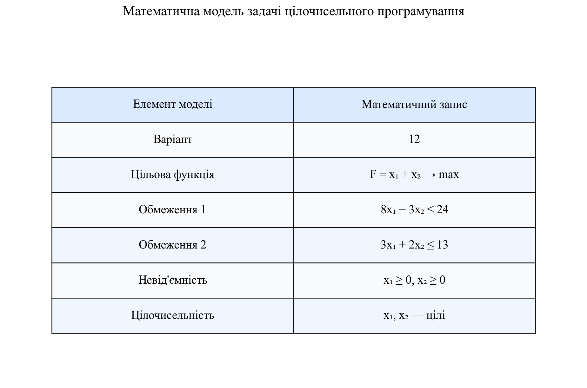
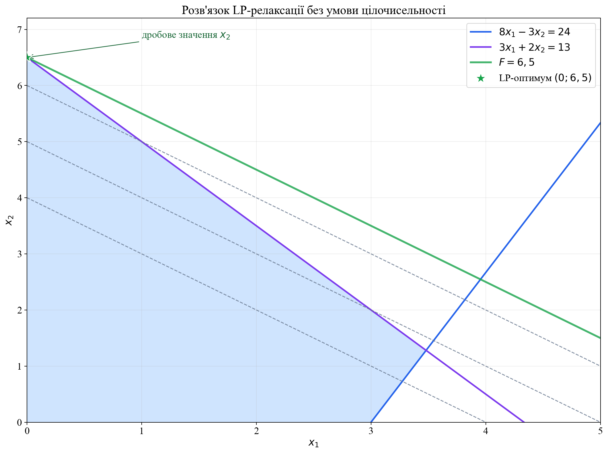
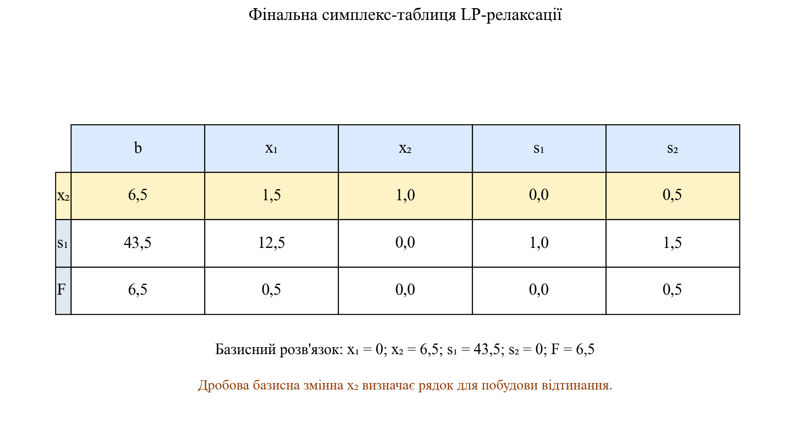
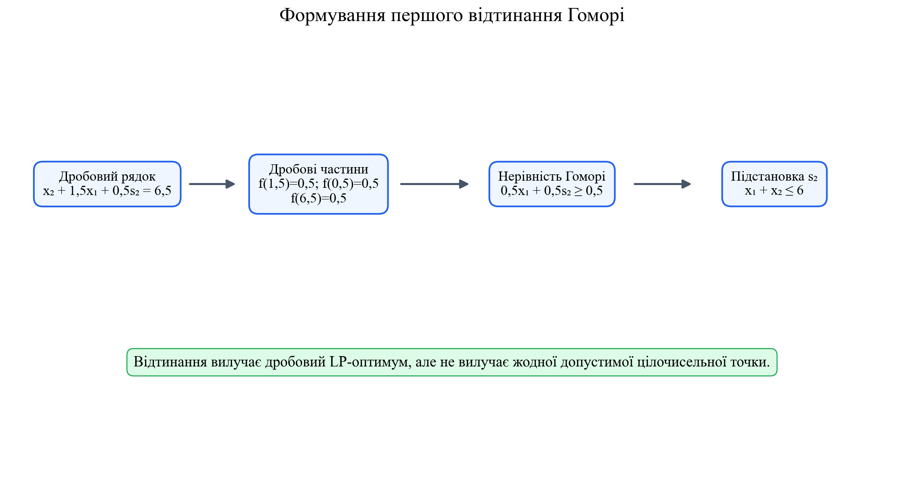
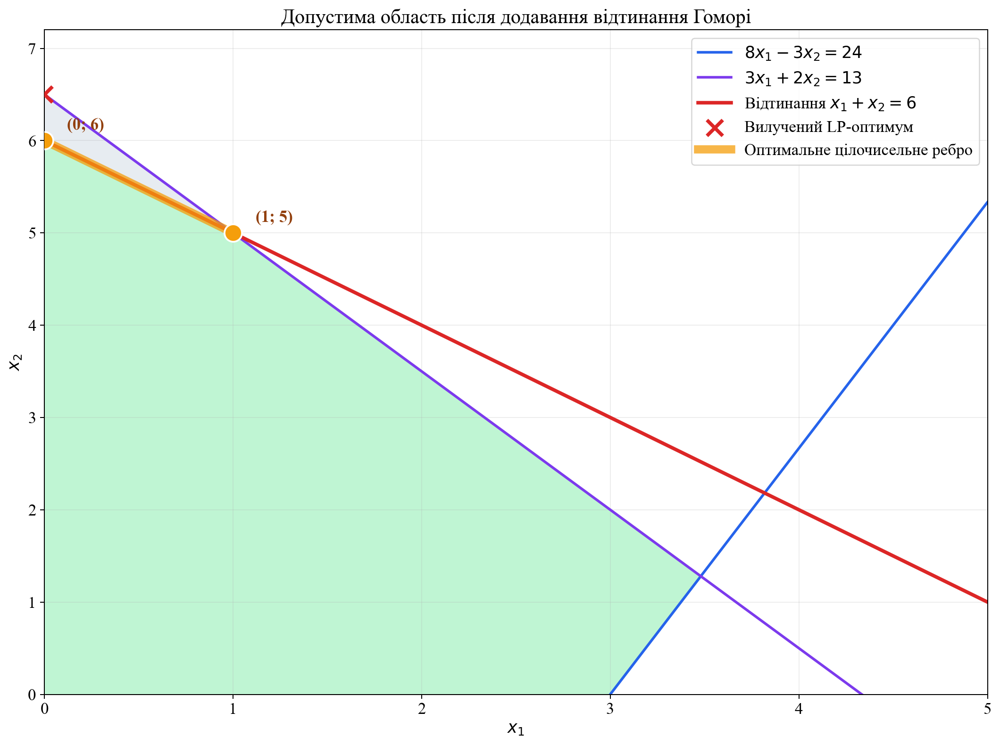
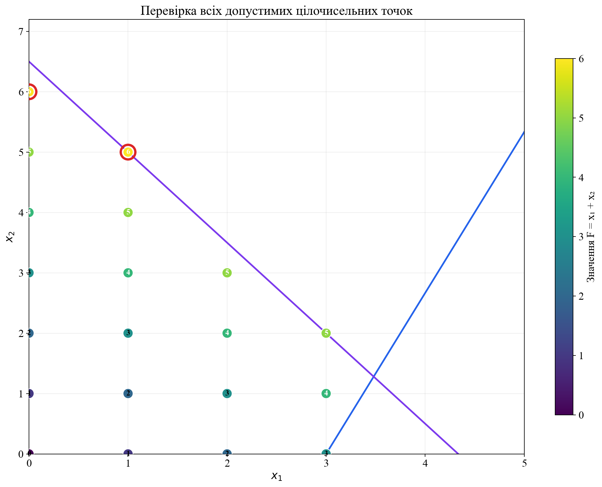
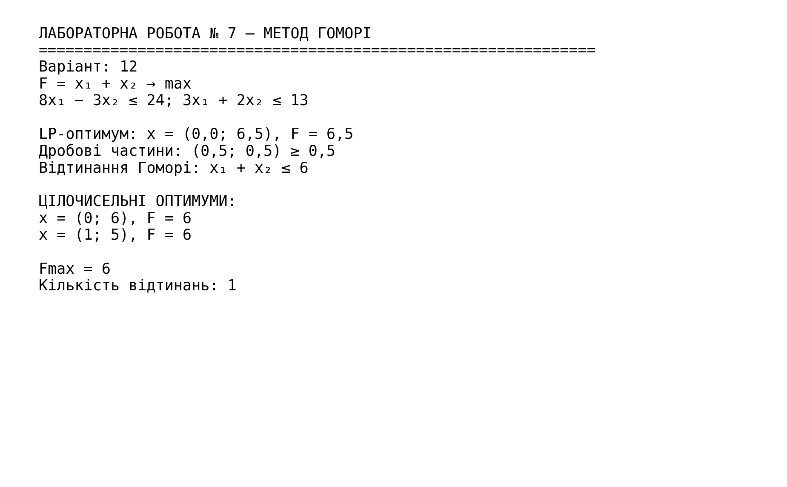

<div align="center">

МІНІСТЕРСТВО ОСВІТИ І НАУКИ УКРАЇНИ

КРЕМЕНЧУЦЬКИЙ НАЦІОНАЛЬНИЙ УНІВЕРСИТЕТ
ІМЕНІ МИХАЙЛА ОСТРОГРАДСЬКОГО

НАВЧАЛЬНО-НАУКОВИЙ ІНСТИТУТ ЕЛЕКТРИЧНОЇ ІНЖЕНЕРІЇ
ТА ІНФОРМАЦІЙНИХ ТЕХНОЛОГІЙ

КАФЕДРА АВТОМАТИЗАЦІЇ ТА ІНФОРМАЦІЙНИХ СИСТЕМ

<br>

ОСВІТНІЙ КОМПОНЕНТ

**«ДОСЛІДЖЕННЯ ОПЕРАЦІЙ»**

<br>

**ЗВІТ**
З ЛАБОРАТОРНОЇ РОБОТИ № 7

**«ЗАДАЧА ДИСКРЕТНОГО ПРОГРАМУВАННЯ»**

</div>

<br>

<div align="right">

**Виконав:**
здобувач групи КН-24-1
Левченко Д. В.

**Перевірила:**
Бурдільна Є. В.

</div>

<br>

<p align="center">Кременчук 2026</p>

[← До переліку лабораторних](../README.md) · [Код програми](./src/solve_lab7.py) · [Автоматичні тести](./tests/test_solution.py) · [Усі ілюстрації](./assets/screenshots/)

## Зміст

1. [Тема та мета](#1-тема-та-мета)
2. [Постановка задачі](#2-постановка-задачі)
3. [Розв'язання LP-релаксації](#3-розвязання-lp-релаксації)
4. [Фінальна симплекс-таблиця](#4-фінальна-симплекс-таблиця)
5. [Побудова відтинання Гоморі](#5-побудова-відтинання-гоморі)
6. [Цілочисельний розв'язок](#6-цілочисельний-розвязок)
7. [Перевірка результатів](#7-перевірка-результатів)
8. [Аналіз результатів](#8-аналіз-результатів)
9. [Контрольні питання](#9-контрольні-питання)
10. [Запуск програми](#10-запуск-програми)
11. [Структура проєкту](#11-структура-проєкту)

<a id="figures" name="figures"></a>

### Навігація за рисунками

| № | Ілюстрація |
|---:|---|
| 1 | [Математична модель задачі](#figure-1) |
| 2 | [Розв'язок LP-релаксації](#figure-2) |
| 3 | [Фінальна симплекс-таблиця](#figure-3) |
| 4 | [Побудова відтинання Гоморі](#figure-4) |
| 5 | [Область після додавання відтинання](#figure-5) |
| 6 | [Допустимі цілочисельні точки](#figure-6) |
| 7 | [Порівняння розв'язків](#figure-7) |
| 8 | [Результат виконання програми](#figure-8) |

## 1. Тема та мета

**Тема:** задача дискретного програмування.

**Мета:** опанувати метод відтинань Гоморі, навчитися розв'язувати LP-релаксацію цілочисельної задачі, будувати правильне відтинання та перевіряти отриманий оптимальний план.

## 2. Постановка задачі

Для **варіанта № 12** необхідно знайти максимум цільової функції

$$
F=x_1+x_2\to\max
$$

за умов

$$
\begin{cases}
8x_1-3x_2\leq 24,\\
3x_1+2x_2\leq 13,\\
x_1\geq 0,\quad x_2\geq 0,\\
x_1,x_2\in\mathbb Z.
\end{cases}
$$

Коефіцієнт $k$ у вихідних даних цієї лабораторної роботи не використовується. Математичну модель наведено на [рисунку 1](#figure-1).

<a id="figure-1" name="figure-1"></a>
<p align="center">
  <a href="./assets/screenshots/01-постановка-задачі.png">
    
  </a>
</p>
<p align="center"><em>Рисунок 1 – Математична модель задачі дискретного програмування</em></p>
<p align="center"><sub><a href="#figures">↑ До переліку рисунків</a></sub></p>

## 3. Розв'язання LP-релаксації

Спочатку умову цілочисельності відкидаємо та розв'язуємо неперервну задачу лінійного програмування. Вершинами допустимої області є точки

$$
(0;0),\qquad (3;0),\qquad (0;6,5),\qquad
(\frac{87}{25};\frac{32}{25}).
$$

Значення цільової функції у цих вершинах:

| Вершина | Значення $F=x_1+x_2$ |
|---:|---:|
| $(0;0)$ | 0 |
| $(3;0)$ | 3 |
| $(0;6,5)$ | 6,5 |
| $(3,48;1,28)$ | 4,76 |

Отже, оптимальний розв'язок LP-релаксації:

$$
x_1^{LP}=0,\qquad x_2^{LP}=6,5,\qquad F_{LP}=6,5.
$$

Змінна $x_2$ має дробове значення, тому цей план не є допустимим для початкової цілочисельної задачі. Графічний розв'язок показано на [рисунку 2](#figure-2).

<a id="figure-2" name="figure-2"></a>
<p align="center">
  <a href="./assets/screenshots/02-lp-релаксація.png">
    
  </a>
</p>
<p align="center"><em>Рисунок 2 – Допустима область та оптимум LP-релаксації</em></p>
<p align="center"><sub><a href="#figures">↑ До переліку рисунків</a></sub></p>

## 4. Фінальна симплекс-таблиця

Введемо додаткові змінні $s_1,s_2\geq0$:

$$
\begin{cases}
8x_1-3x_2+s_1=24,\\
3x_1+2x_2+s_2=13.
\end{cases}
$$

У фінальному базисі $(x_2;s_1)$ система має вигляд

$$
\begin{aligned}
x_2+1,5x_1+0,5s_2&=6,5,\\
s_1+12,5x_1+1,5s_2&=43,5,\\
F+0,5x_1+0,5s_2&=6,5.
\end{aligned}
$$

| Базис | $b$ | $x_1$ | $x_2$ | $s_1$ | $s_2$ |
|---:|---:|---:|---:|---:|---:|
| $x_2$ | 6,5 | 1,5 | 1 | 0 | 0,5 |
| $s_1$ | 43,5 | 12,5 | 0 | 1 | 1,5 |
| $F$ | 6,5 | 0,5 | 0 | 0 | 0,5 |

Рядок базисної змінної $x_2$ має дробову праву частину та використовується для побудови відтинання.

<a id="figure-3" name="figure-3"></a>
<p align="center">
  <a href="./assets/screenshots/03-фінальна-симплекс-таблиця.png">
    
  </a>
</p>
<p align="center"><em>Рисунок 3 – Фінальна симплекс-таблиця LP-релаксації</em></p>
<p align="center"><sub><a href="#figures">↑ До переліку рисунків</a></sub></p>

## 5. Побудова відтинання Гоморі

Для числа $a$ позначимо дробову частину як $\{a\}=a-\lfloor a\rfloor$. Із рядка

$$
x_2+1,5x_1+0,5s_2=6,5
$$

отримуємо

$$
\{1,5\}x_1+\{0,5\}s_2\geq\{6,5\},
$$

тобто

$$
0,5x_1+0,5s_2\geq0,5.
$$

Оскільки $s_2=13-3x_1-2x_2$, після підстановки маємо

$$
0,5x_1+0,5(13-3x_1-2x_2)\geq0,5,
$$

звідки випливає перше відтинання Гоморі:

$$
\boxed{x_1+x_2\leq6}.
$$

Послідовність перетворень показано на [рисунку 4](#figure-4). Відтинання вилучає точку $(0;6,5)$, але зберігає всі допустимі цілочисельні точки.

<a id="figure-4" name="figure-4"></a>
<p align="center">
  <a href="./assets/screenshots/04-побудова-відтинання.png">
    
  </a>
</p>
<p align="center"><em>Рисунок 4 – Побудова першого відтинання Гоморі</em></p>
<p align="center"><sub><a href="#figures">↑ До переліку рисунків</a></sub></p>

Допустиму область після додавання нерівності $x_1+x_2\leq6$ наведено на [рисунку 5](#figure-5).

<a id="figure-5" name="figure-5"></a>
<p align="center">
  <a href="./assets/screenshots/05-область-після-відтинання.png">
    
  </a>
</p>
<p align="center"><em>Рисунок 5 – Допустима область після додавання відтинання Гоморі</em></p>
<p align="center"><sub><a href="#figures">↑ До переліку рисунків</a></sub></p>

## 6. Цілочисельний розв'язок

Після додавання відтинання максимальне можливе значення $x_1+x_2$ дорівнює 6. На оптимальному ребрі лежать дві допустимі цілочисельні точки:

$$
X_1^*=(0;6),\qquad X_2^*=(1;5).
$$

Для обох планів

$$
F_{\max}=x_1+x_2=6.
$$

Програмою повністю перебрано всі допустимі невід'ємні цілочисельні точки; їх кількість дорівнює 20. Значення цільової функції в кожній точці показано на [рисунку 6](#figure-6).

<a id="figure-6" name="figure-6"></a>
<p align="center">
  <a href="./assets/screenshots/06-цілочисельні-точки.png">
    
  </a>
</p>
<p align="center"><em>Рисунок 6 – Допустимі цілочисельні точки та значення цільової функції</em></p>
<p align="center"><sub><a href="#figures">↑ До переліку рисунків</a></sub></p>

## 7. Перевірка результатів

Перевіримо обидва оптимальні плани у вихідних обмеженнях.

| План | $8x_1-3x_2\leq24$ | $3x_1+2x_2\leq13$ | $F$ |
|---:|---:|---:|---:|
| $(0;6)$ | $-18\leq24$ | $12\leq13$ | 6 |
| $(1;5)$ | $-7\leq24$ | $13\leq13$ | 6 |

Обидва плани допустимі та забезпечують однакове максимальне значення. Розрив цілочисельності становить

$$
\Delta F=F_{LP}-F_{\max}=6,5-6=0,5,
$$

або відносно оцінки LP-релаксації

$$
\delta=\frac{0,5}{6,5}\cdot100\%=7,69\%.
$$

<a id="figure-7" name="figure-7"></a>
<p align="center">
  <a href="./assets/screenshots/07-порівняння-розв'язків.png">
    
  </a>
</p>
<p align="center"><em>Рисунок 7 – Порівняння LP-релаксації та оптимальних цілочисельних планів</em></p>
<p align="center"><sub><a href="#figures">↑ До переліку рисунків</a></sub></p>

## 8. Аналіз результатів

1. LP-релаксація має дробовий оптимум $(0;6,5)$ зі значенням $F=6,5$.
2. Для отримання цілочисельного розв'язку достатньо одного відтинання Гоморі $x_1+x_2\leq6$.
3. Задача має два рівноцінні оптимальні цілочисельні плани: $(0;6)$ та $(1;5)$.
4. Максимальне значення початкової цілочисельної задачі дорівнює 6.
5. Результат підтверджено повним перебором 20 допустимих цілочисельних точок і шістьма автоматичними тестами.

Підсумковий вивід програми наведено на [рисунку 8](#figure-8).

<a id="figure-8" name="figure-8"></a>
<p align="center">
  <a href="./assets/screenshots/08-результат-програми.png">
    
  </a>
</p>
<p align="center"><em>Рисунок 8 – Результат виконання програми для варіанта № 12</em></p>
<p align="center"><sub><a href="#figures">↑ До переліку рисунків</a></sub></p>

## 9. Контрольні питання

<details>
<summary><strong>1. Чим зумовлена необхідність розв'язання задач цілочисельного програмування? Наведіть приклади.</strong></summary>

Цілочисельність потрібна, коли змінні описують неподільні об'єкти або дискретні рішення: кількість верстатів, автомобілів, працівників, партій продукції, відкриття чи закриття підприємства. Дробовий план у таких задачах фізично неможливий, тому оптимум LP-релаксації може бути лише верхньою оцінкою для задачі максимізації.
</details>

<details>
<summary><strong>2. У чому полягає метод відтинальних площин?</strong></summary>

Спочатку розв'язують LP-релаксацію. Якщо оптимальний план дробовий, за одним із дробових рядків фінальної симплекс-таблиці будують додаткову лінійну нерівність — відтинання. Вона вилучає поточний дробовий оптимум, але не вилучає жодного допустимого цілочисельного плану. Процес повторюють до отримання цілочисельного оптимуму або встановлення відсутності розв'язку.
</details>

<details>
<summary><strong>3. У чому полягає метод гілок і меж?</strong></summary>

Множину допустимих розв'язків послідовно розбивають на підзадачі, тобто гілки. Для кожної підзадачі розв'язують LP-релаксацію та отримують межу цільової функції. Гілку відкидають, якщо вона не має допустимих розв'язків, уже дала цілочисельний план або її межа не краща за поточний рекорд. Так скорочується перебір без втрати глобального оптимуму.
</details>

## 10. Запуск програми

Потрібен Python 3.10 або новіший.

```powershell
python -m pip install -r requirements.txt
python src/solve_lab7.py
python -m unittest discover -s tests -v
```

Програма розв'язує LP-релаксацію, будує відтинання, перевіряє цілочисельні точки та зберігає вісім ілюстрацій у каталозі `assets/screenshots`.

## 11. Структура проєкту

```text
Лабораторна робота 07/
├── README.md
├── requirements.txt
├── assets/
│   └── screenshots/
│       ├── 01-постановка-задачі.png
│       ├── 02-lp-релаксація.png
│       ├── 03-фінальна-симплекс-таблиця.png
│       ├── 04-побудова-відтинання.png
│       ├── 05-область-після-відтинання.png
│       ├── 06-цілочисельні-точки.png
│       ├── 07-порівняння-розв'язків.png
│       └── 08-результат-програми.png
├── src/
│   └── solve_lab7.py
└── tests/
    └── test_solution.py
```

## Висновок

У лабораторній роботі розв'язано задачу дискретного програмування для варіанта № 12. LP-релаксація дала дробовий план $(0;6,5)$ зі значенням $F=6,5$. За дробовим рядком фінальної симплекс-таблиці побудовано відтинання Гоморі $x_1+x_2\leq6$. Після його додавання отримано два оптимальні цілочисельні плани $(0;6)$ та $(1;5)$, для яких $F_{\max}=6$. Розрахунки підтверджено програмно, повним перебором і автоматичними тестами. Мету роботи досягнуто.
