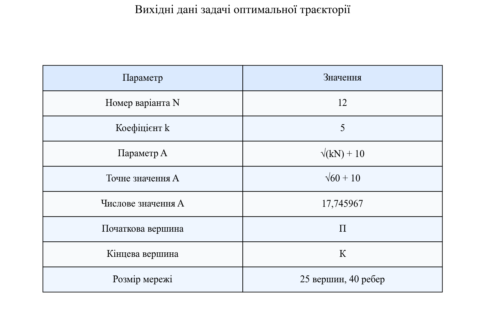
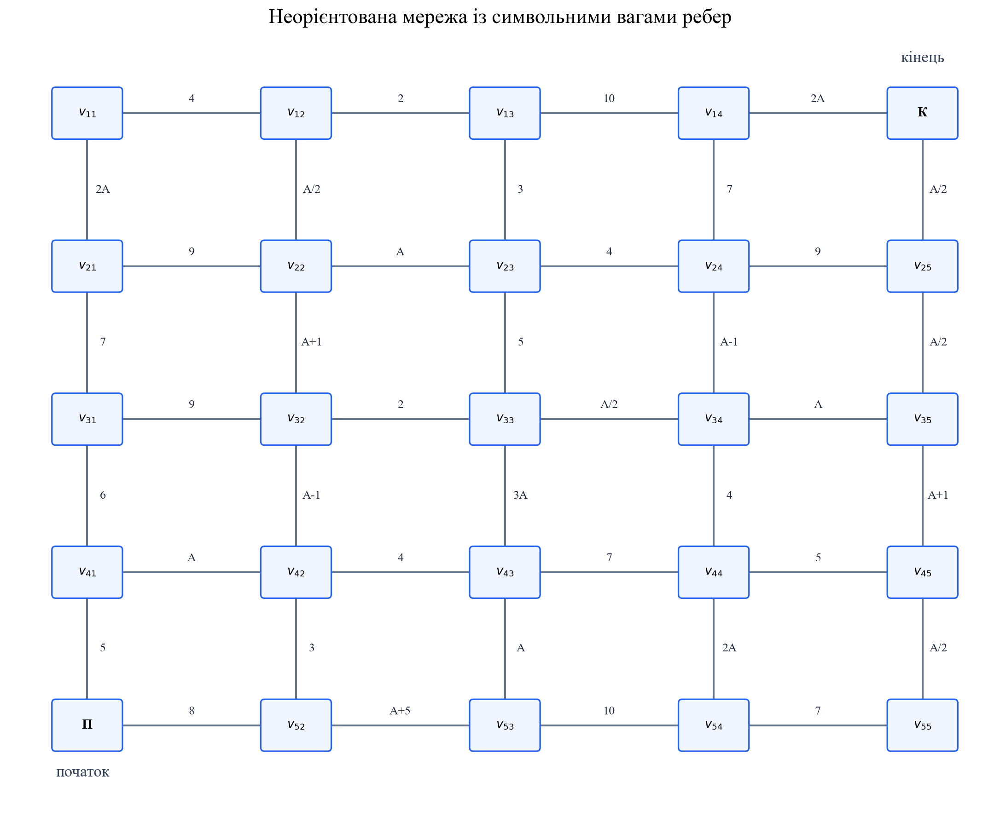
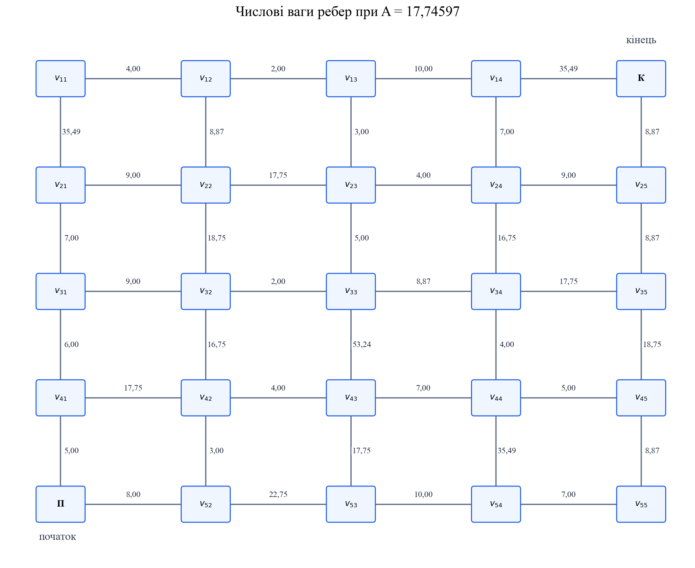
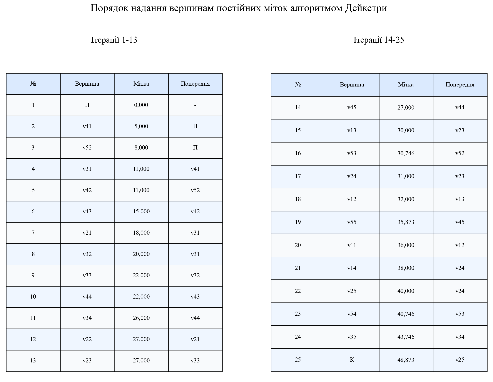
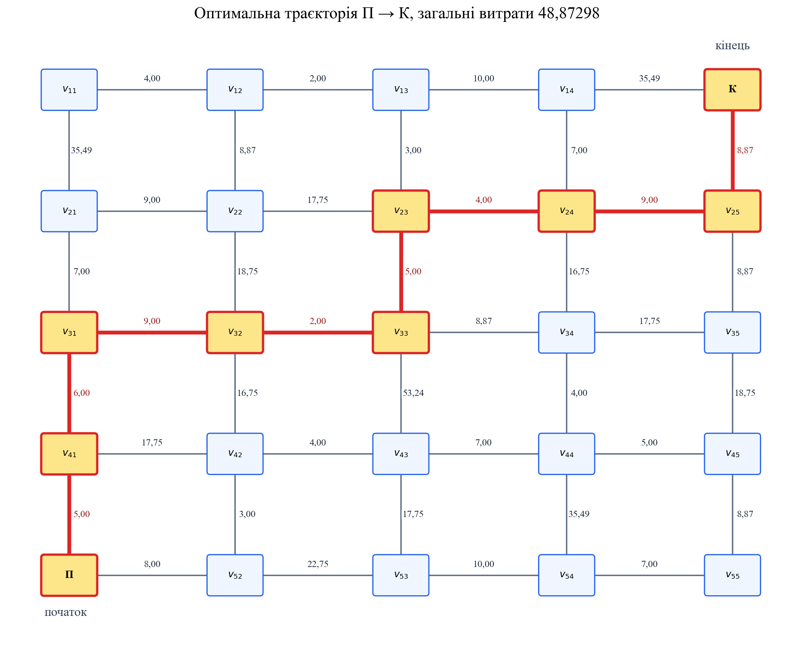
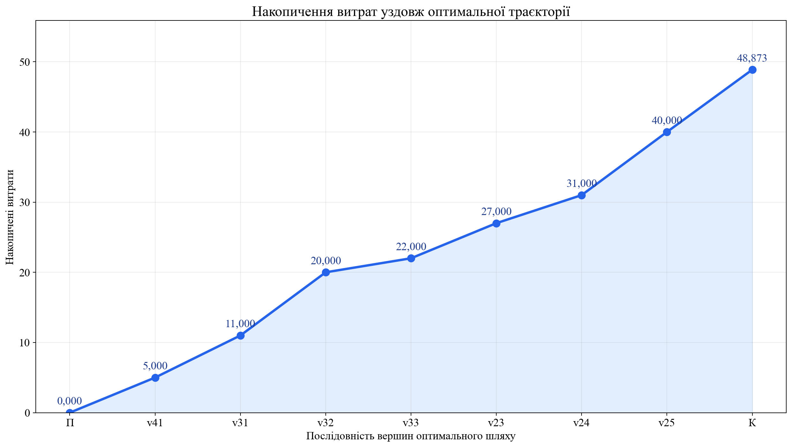
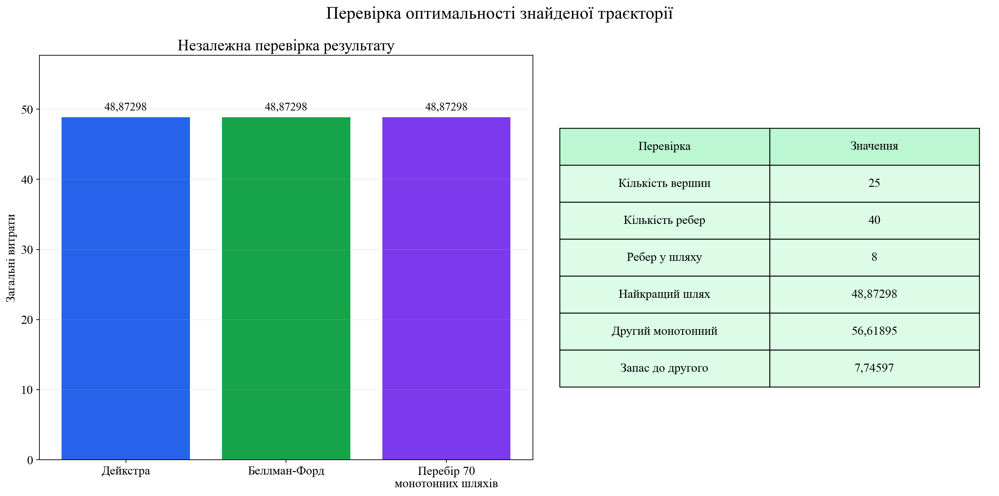
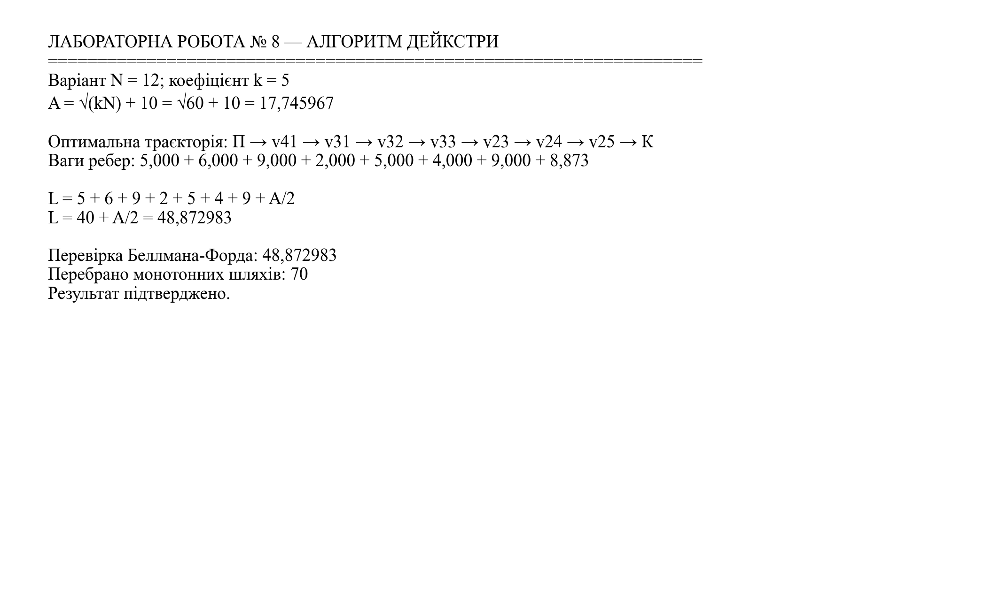

<div align="center">

МІНІСТЕРСТВО ОСВІТИ І НАУКИ УКРАЇНИ

КРЕМЕНЧУЦЬКИЙ НАЦІОНАЛЬНИЙ УНІВЕРСИТЕТ
ІМЕНІ МИХАЙЛА ОСТРОГРАДСЬКОГО

НАВЧАЛЬНО-НАУКОВИЙ ІНСТИТУТ ЕЛЕКТРИЧНОЇ ІНЖЕНЕРІЇ
ТА ІНФОРМАЦІЙНИХ ТЕХНОЛОГІЙ

КАФЕДРА АВТОМАТИЗАЦІЇ ТА ІНФОРМАЦІЙНИХ СИСТЕМ

<br>

ОСВІТНІЙ КОМПОНЕНТ

**«ДОСЛІДЖЕННЯ ОПЕРАЦІЙ»**

<br>

**ЗВІТ**
З ЛАБОРАТОРНОЇ РОБОТИ № 8

**«ОПТИМАЛЬНА ТРАЄКТОРІЯ В МЕРЕЖІ»**

</div>

<br>

<div align="right">

**Виконав:**
здобувач групи КН-24-1
Левченко Д. В.

**Перевірила:**
Бурдільна Є. В.

</div>

<br>

<p align="center">Кременчук 2026</p>

[← До переліку лабораторних](../README.md) · [Код програми](./src/solve_lab8.py) · [Автоматичні тести](./tests/test_solution.py) · [Усі ілюстрації](./assets/screenshots/)

## Зміст

1. [Тема та мета](#1-тема-та-мета)
2. [Вихідні дані](#2-вихідні-дані)
3. [Побудова математичної моделі мережі](#3-побудова-математичної-моделі-мережі)
4. [Розв'язання алгоритмом Дейкстри](#4-розвязання-алгоритмом-дейкстри)
5. [Відновлення оптимальної траєкторії](#5-відновлення-оптимальної-траєкторії)
6. [Обчислення загальних витрат](#6-обчислення-загальних-витрат)
7. [Перевірка оптимальності](#7-перевірка-оптимальності)
8. [Аналіз результатів](#8-аналіз-результатів)
9. [Контрольні питання](#9-контрольні-питання)
10. [Запуск програми](#10-запуск-програми)
11. [Структура проєкту](#11-структура-проєкту)

<a id="figures" name="figures"></a>

### Навігація за рисунками

| № | Ілюстрація |
|---:|---|
| 1 | [Вихідні дані](#figure-1) |
| 2 | [Мережа із символьними вагами](#figure-2) |
| 3 | [Мережа із числовими вагами](#figure-3) |
| 4 | [Ітерації алгоритму Дейкстри](#figure-4) |
| 5 | [Оптимальна траєкторія](#figure-5) |
| 6 | [Накопичені витрати](#figure-6) |
| 7 | [Перевірка результату](#figure-7) |
| 8 | [Результат виконання програми](#figure-8) |

## 1. Тема та мета

**Тема:** оптимальна траєкторія в мережі.

**Мета:** набути навичок визначення оптимальної траєкторії в неорієнтованій мережі за допомогою алгоритму Дейкстри, відновити послідовність вершин найкоротшого шляху та обчислити його загальні витрати.

## 2. Вихідні дані

Згідно із завданням параметр ваг ребер визначається за формулою

$$
A=\sqrt{kN}+10,
$$

де $N=12$ — номер варіанта, $k=5$ — заданий коефіцієнт. Тоді

$$
A=\sqrt{5\cdot12}+10=\sqrt{60}+10=17,7459666924.
$$

Половина параметра:

$$
\frac{A}{2}=\frac{\sqrt{60}+10}{2}=5+\sqrt{15}=8,8729833462.
$$

Необхідно знайти найкоротший шлях від початкової вершини **П** до кінцевої вершини **К** і визначити загальні витрати на цю траєкторію. Вихідні параметри наведено на [рисунку 1](#figure-1).

<a id="figure-1" name="figure-1"></a>
<p align="center">
  <a href="./assets/screenshots/01-вихідні-дані.png">
    
  </a>
</p>
<p align="center"><em>Рисунок 1 – Вихідні дані для варіанта № 12 при коефіцієнті k=5</em></p>
<p align="center"><sub><a href="#figures">↑ До переліку рисунків</a></sub></p>

## 3. Побудова математичної моделі мережі

Мережу представлено неорієнтованим зваженим графом

$$
G=(V,E),
$$

де $V$ — множина з 25 вершин, а $E$ — множина з 40 ребер. Проміжні вершини позначено як $v_{ij}$, де $i$ — номер рядка, $j$ — номер стовпця. Для кожного ребра $e\in E$ задано невід'ємну вагу $w(e)$.

Використані у схемі символьні значення ваг:

| Вираз | Числове значення |
|---:|---:|
| $A/2$ | 8,872983 |
| $A-1$ | 16,745967 |
| $A$ | 17,745967 |
| $A+1$ | 18,745967 |
| $A+5$ | 22,745967 |
| $2A$ | 35,491933 |
| $3A$ | 53,237900 |

Відновлену за методичними вказівками схему із символьними вагами показано на [рисунку 2](#figure-2).

<a id="figure-2" name="figure-2"></a>
<p align="center">
  <a href="./assets/screenshots/02-символьна-мережа.png">
    
  </a>
</p>
<p align="center"><em>Рисунок 2 – Неорієнтована мережа із символьними вагами ребер</em></p>
<p align="center"><sub><a href="#figures">↑ До переліку рисунків</a></sub></p>

Після підстановки $A=17,7459666924$ отримано числову модель, наведену на [рисунку 3](#figure-3). Усі ваги додатні, тому для пошуку найкоротшого шляху можна коректно застосувати алгоритм Дейкстри.

<a id="figure-3" name="figure-3"></a>
<p align="center">
  <a href="./assets/screenshots/03-числова-мережа.png">
    
  </a>
</p>
<p align="center"><em>Рисунок 3 – Числові ваги ребер при A=17,74597</em></p>
<p align="center"><sub><a href="#figures">↑ До переліку рисунків</a></sub></p>

## 4. Розв'язання алгоритмом Дейкстри

Для кожної вершини $v$ вводиться мітка $d(v)$ — поточна найкраща відома відстань від вершини **П**. Початкова ініціалізація:

$$
d(\text{П})=0,
\qquad
d(v)=\infty\quad\text{для всіх }v\ne\text{П}.
$$

На кожній ітерації обирається невідвідана вершина $u$ з найменшою міткою. Для всіх її сусідів виконується релаксація:

$$
d(v)=\min\bigl(d(v),\ d(u)+w(u,v)\bigr).
$$

Після цього мітка вершини $u$ стає постійною. Процес завершується, коли постійну мітку отримує вершина **К**.

Повний порядок надання постійних міток усім 25 вершинам наведено на [рисунку 4](#figure-4). Ключові мітки вершин майбутнього оптимального шляху:

| Вершина | Постійна мітка | Попередня вершина |
|---:|---:|---:|
| П | 0 | — |
| $v_{41}$ | 5 | П |
| $v_{31}$ | 11 | $v_{41}$ |
| $v_{32}$ | 20 | $v_{31}$ |
| $v_{33}$ | 22 | $v_{32}$ |
| $v_{23}$ | 27 | $v_{33}$ |
| $v_{24}$ | 31 | $v_{23}$ |
| $v_{25}$ | 40 | $v_{24}$ |
| К | 48,872983 | $v_{25}$ |

<a id="figure-4" name="figure-4"></a>
<p align="center">
  <a href="./assets/screenshots/04-ітерації-дейкстри.png">
    
  </a>
</p>
<p align="center"><em>Рисунок 4 – Порядок надання вершинам постійних міток алгоритмом Дейкстри</em></p>
<p align="center"><sub><a href="#figures">↑ До переліку рисунків</a></sub></p>

## 5. Відновлення оптимальної траєкторії

Від кінцевої вершини **К** послідовно переходимо до збережених попередніх вершин:

$$
\text{К}\leftarrow v_{25}\leftarrow v_{24}\leftarrow v_{23}
\leftarrow v_{33}\leftarrow v_{32}\leftarrow v_{31}
\leftarrow v_{41}\leftarrow\text{П}.
$$

Після зміни порядку отримуємо оптимальну траєкторію

$$
\boxed{
\text{П}\to v_{41}\to v_{31}\to v_{32}\to v_{33}
\to v_{23}\to v_{24}\to v_{25}\to\text{К}
}.
$$

Шлях складається з дев'яти вершин і восьми ребер. На [рисунку 5](#figure-5) оптимальну траєкторію виділено червоним кольором.

<a id="figure-5" name="figure-5"></a>
<p align="center">
  <a href="./assets/screenshots/05-оптимальна-траєкторія.png">
    
  </a>
</p>
<p align="center"><em>Рисунок 5 – Оптимальна траєкторія від початкової вершини П до кінцевої вершини К</em></p>
<p align="center"><sub><a href="#figures">↑ До переліку рисунків</a></sub></p>

## 6. Обчислення загальних витрат

Послідовність ваг ребер оптимальної траєкторії:

| Перехід | Вага | Накопичені витрати |
|---|---:|---:|
| П → $v_{41}$ | 5 | 5 |
| $v_{41}$ → $v_{31}$ | 6 | 11 |
| $v_{31}$ → $v_{32}$ | 9 | 20 |
| $v_{32}$ → $v_{33}$ | 2 | 22 |
| $v_{33}$ → $v_{23}$ | 5 | 27 |
| $v_{23}$ → $v_{24}$ | 4 | 31 |
| $v_{24}$ → $v_{25}$ | 9 | 40 |
| $v_{25}$ → К | $A/2$ | 48,872983 |

Загальні витрати:

$$
\begin{aligned}
L_{\min}
&=5+6+9+2+5+4+9+\frac{A}{2}\\
&=40+\frac{\sqrt{60}+10}{2}\\
&=45+\sqrt{15}\\
&=48,8729833462.
\end{aligned}
$$

Динаміку накопичення витрат уздовж знайденого шляху показано на [рисунку 6](#figure-6).

<a id="figure-6" name="figure-6"></a>
<p align="center">
  <a href="./assets/screenshots/06-накопичені-витрати.png">
    
  </a>
</p>
<p align="center"><em>Рисунок 6 – Накопичені витрати у вершинах оптимального шляху</em></p>
<p align="center"><sub><a href="#figures">↑ До переліку рисунків</a></sub></p>

## 7. Перевірка оптимальності

Отриманий результат перевірено двома незалежними способами.

1. **Алгоритм Беллмана-Форда** на повній неорієнтованій мережі також дав відстань 48,8729833462.
2. **Повний перебір 70 монотонних шляхів**, які рухаються лише вгору або праворуч, підтвердив той самий мінімум.

Другий за вартістю монотонний шлях:

$$
\text{П}\to v_{52}\to v_{42}\to v_{32}\to v_{33}
\to v_{23}\to v_{24}\to v_{25}\to\text{К},
$$

його вартість дорівнює 56,6189500386. Запас оптимальності відносно цього шляху:

$$
56,6189500386-48,8729833462=7,7459666924.
$$

Порівняння результатів усіх перевірок наведено на [рисунку 7](#figure-7).

<a id="figure-7" name="figure-7"></a>
<p align="center">
  <a href="./assets/screenshots/07-перевірка-методів.png">
    
  </a>
</p>
<p align="center"><em>Рисунок 7 – Незалежна перевірка оптимальної вартості трьома способами</em></p>
<p align="center"><sub><a href="#figures">↑ До переліку рисунків</a></sub></p>

## 8. Аналіз результатів

1. Для варіанта № 12 при $k=5$ параметр мережі становить $A=17,7459666924$.
2. Алгоритм Дейкстри опрацював 25 вершин і 40 неорієнтованих ребер.
3. Оптимальний шлях проходить через дев'ять вершин та містить вісім ребер.
4. Сім ребер шляху мають сталі ваги, останнє ребро $v_{25}\to\text{К}$ має вагу $A/2$.
5. Мінімальні загальні витрати становлять $L_{\min}=45+\sqrt{15}=48,8729833462$.
6. Результат збігається з алгоритмом Беллмана-Форда та повним перебором монотонних маршрутів.

Підсумковий вивід програми наведено на [рисунку 8](#figure-8).

<a id="figure-8" name="figure-8"></a>
<p align="center">
  <a href="./assets/screenshots/08-результат-програми.png">
    
  </a>
</p>
<p align="center"><em>Рисунок 8 – Оптимальна траєкторія, її вартість та результати перевірки</em></p>
<p align="center"><sub><a href="#figures">↑ До переліку рисунків</a></sub></p>

## 9. Контрольні питання

<details>
<summary><strong>1. Надайте визначення поняття «динамічне програмування».</strong></summary>

Динамічне програмування — метод розв'язання багатокрокових оптимізаційних задач шляхом їх декомпозиції на простіші взаємопов'язані підзадачі. Результати вже розв'язаних підзадач зберігаються та повторно використовуються, що усуває дублювання обчислень.
</details>

<details>
<summary><strong>2. Наведіть приклади задач динамічного програмування.</strong></summary>

До типових задач належать пошук найкоротшого шляху в мережі, розподіл обмежених ресурсів, заміна обладнання, керування запасами, завантаження транспортного засобу, планування інвестицій та визначення оптимальної послідовності рішень.
</details>

<details>
<summary><strong>3. У чому переваги динамічного програмування?</strong></summary>

Метод дає змогу замінити складну багатовимірну задачу послідовністю простіших етапів, уникнути повторного розв'язання однакових підзадач, урахувати вплив поточного рішення на майбутні стани та отримати глобально оптимальний результат за виконання принципу оптимальності Беллмана.
</details>

<details>
<summary><strong>4. У чому недоліки динамічного програмування?</strong></summary>

Основні недоліки — швидке зростання кількості станів зі збільшенням розмірності, значні витрати пам'яті для збереження проміжних результатів, необхідність правильно визначити стани й переходи та складність застосування до задач із безперервними або дуже великими просторами станів.
</details>

<details>
<summary><strong>5. Поясніть суть алгоритму Дейкстри.</strong></summary>

Алгоритм знаходить найкоротші відстані від однієї початкової вершини до решти вершин графа з невід'ємними вагами. На кожному кроці обирається невідвідана вершина з найменшою тимчасовою міткою, її мітка фіксується, а відстані до сусідів уточнюються операцією релаксації. Для відновлення маршруту зберігається попередня вершина кожного поліпшеного шляху.
</details>

## 10. Запуск програми

Потрібен Python 3.10 або новіший.

```powershell
python -m pip install -r requirements.txt
python src/solve_lab8.py
python -m unittest discover -s tests -v
```

Програма відновлює мережу, виконує алгоритми Дейкстри та Беллмана-Форда, перебирає 70 монотонних шляхів і зберігає вісім ілюстрацій у каталозі `assets/screenshots`. Текст і формули на ілюстраціях оформлено шрифтом Times New Roman розміром 14 pt.

## 11. Структура проєкту

```text
Лабораторна робота 08/
├── README.md
├── requirements.txt
├── assets/
│   └── screenshots/
│       ├── 01-вихідні-дані.png
│       ├── 02-символьна-мережа.png
│       ├── 03-числова-мережа.png
│       ├── 04-ітерації-дейкстри.png
│       ├── 05-оптимальна-траєкторія.png
│       ├── 06-накопичені-витрати.png
│       ├── 07-перевірка-методів.png
│       └── 08-результат-програми.png
├── src/
│   └── solve_lab8.py
└── tests/
    └── test_solution.py
```

## Висновок

У лабораторній роботі для варіанта № 12 при коефіцієнті $k=5$ відновлено неорієнтовану мережу з 25 вершинами та 40 ребрами. За алгоритмом Дейкстри знайдено оптимальну траєкторію $\text{П}\to v_{41}\to v_{31}\to v_{32}\to v_{33}\to v_{23}\to v_{24}\to v_{25}\to\text{К}$. Її мінімальна вартість дорівнює $L_{\min}=45+\sqrt{15}=48,8729833462$. Результат підтверджено алгоритмом Беллмана-Форда, перебором 70 монотонних шляхів і вісьмома автоматичними тестами. Мету роботи досягнуто.
