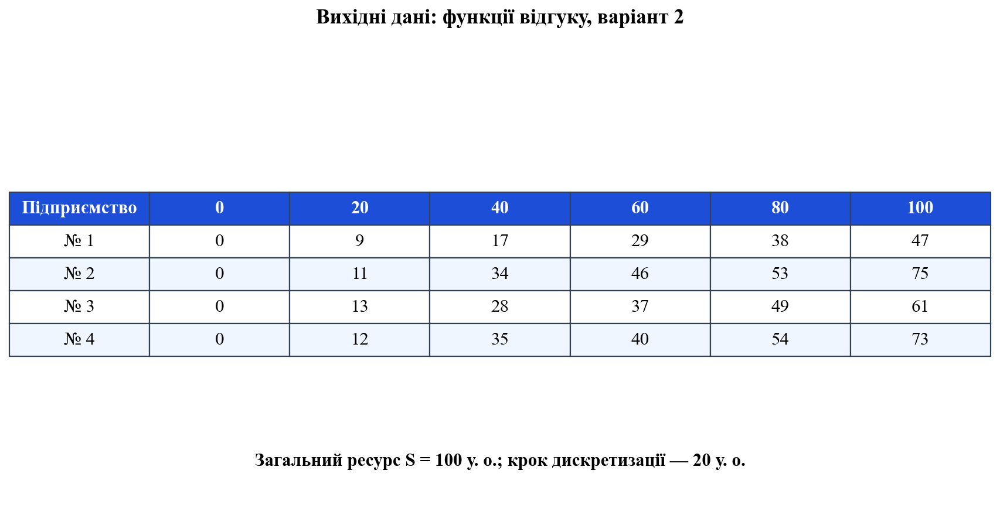
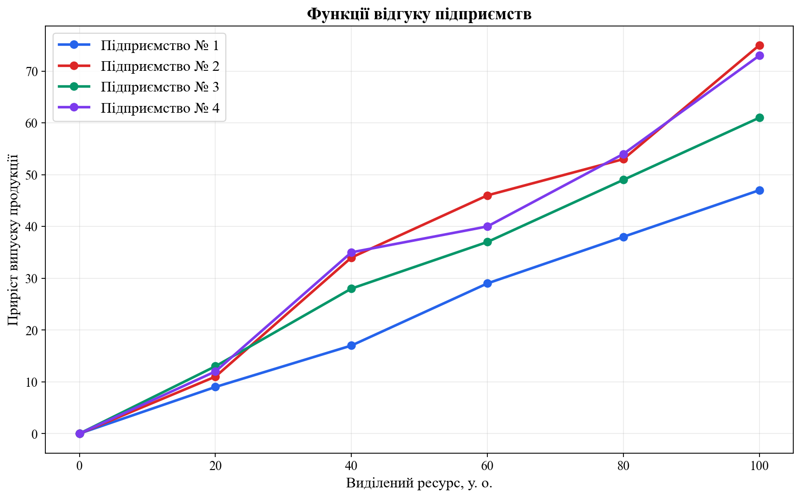
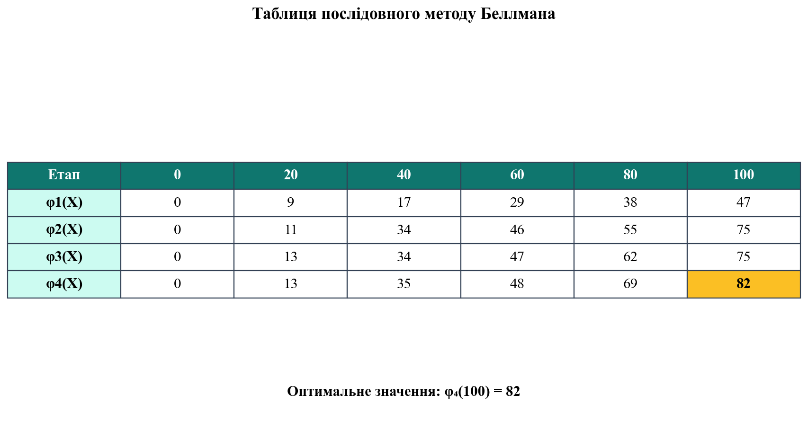
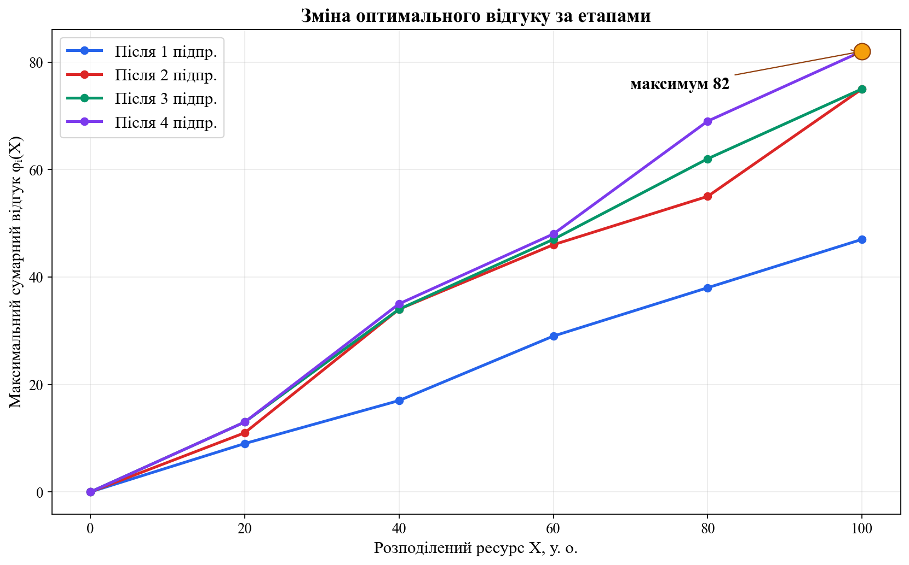
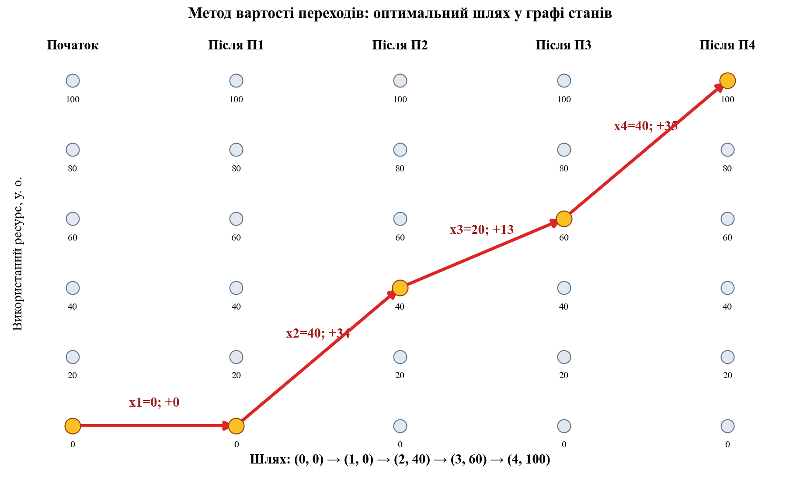
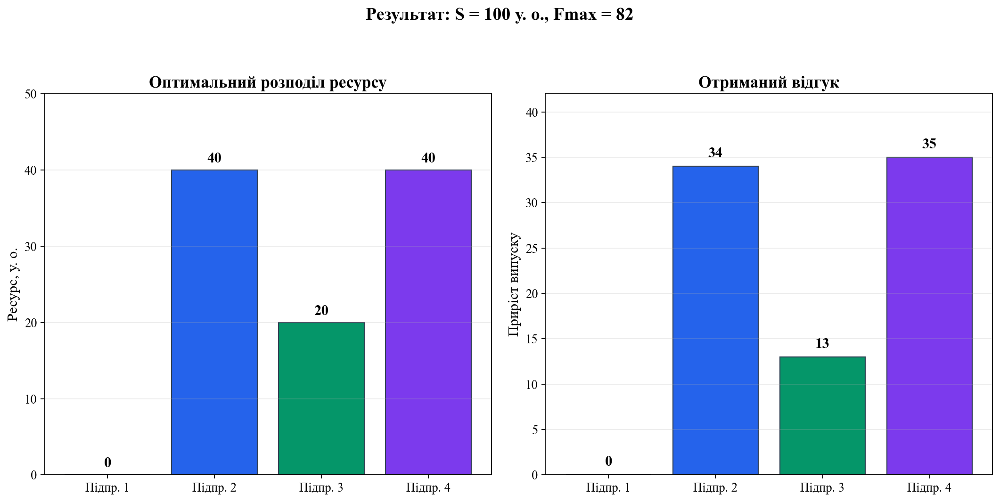
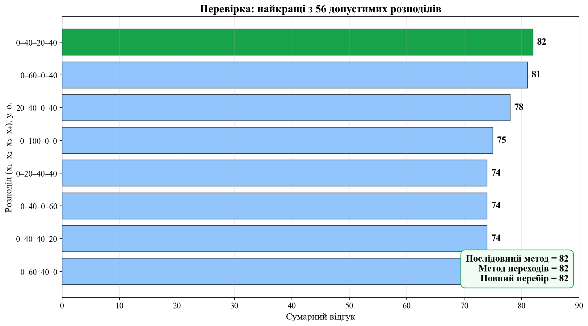
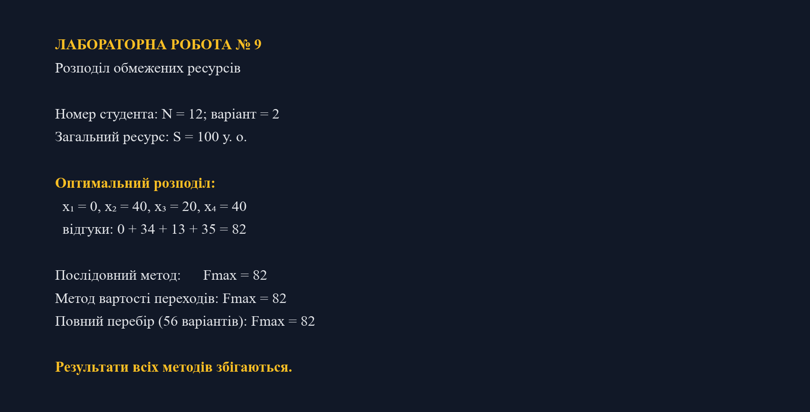

<div align="center">

МІНІСТЕРСТВО ОСВІТИ І НАУКИ УКРАЇНИ

КРЕМЕНЧУЦЬКИЙ НАЦІОНАЛЬНИЙ УНІВЕРСИТЕТ
ІМЕНІ МИХАЙЛА ОСТРОГРАДСЬКОГО

НАВЧАЛЬНО-НАУКОВИЙ ІНСТИТУТ ЕЛЕКТРИЧНОЇ ІНЖЕНЕРІЇ
ТА ІНФОРМАЦІЙНИХ ТЕХНОЛОГІЙ

КАФЕДРА АВТОМАТИЗАЦІЇ ТА ІНФОРМАЦІЙНИХ СИСТЕМ

<br>

ОСВІТНІЙ КОМПОНЕНТ

**«ДОСЛІДЖЕННЯ ОПЕРАЦІЙ»**

<br>

**ЗВІТ**
З ЛАБОРАТОРНОЇ РОБОТИ № 9

**«РОЗПОДІЛ ОБМЕЖЕНИХ РЕСУРСІВ»**

</div>

<br>

<div align="right">

**Виконав:**
здобувач групи КН-24-1
Левченко Д. В.

**Перевірила:**
Бурдільна Є. В.

</div>

<br>

<p align="center">Кременчук 2026</p>

[← До переліку лабораторних](../README.md) · [Код програми](./src/solve_lab9.py) · [Автоматичні тести](./tests/test_solution.py) · [Усі ілюстрації](./assets/screenshots/)

## Зміст

1. [Тема та мета](#1-тема-та-мета)
2. [Вихідні дані](#2-вихідні-дані)
3. [Математична модель](#3-математична-модель)
4. [Послідовний метод](#4-послідовний-метод)
5. [Метод вартості переходів](#5-метод-вартості-переходів)
6. [Відновлення оптимального розподілу](#6-відновлення-оптимального-розподілу)
7. [Перевірка результату](#7-перевірка-результату)
8. [Аналіз результатів](#8-аналіз-результатів)
9. [Контрольні питання](#9-контрольні-питання)
10. [Запуск програми](#10-запуск-програми)
11. [Структура проєкту](#11-структура-проєкту)

<a id="figures" name="figures"></a>

### Навігація за рисунками

| № | Ілюстрація |
|---:|---|
| 1 | [Вихідні функції відгуку](#figure-1) |
| 2 | [Графіки функцій відгуку](#figure-2) |
| 3 | [Таблиця Беллмана](#figure-3) |
| 4 | [Зміна оптимального відгуку за етапами](#figure-4) |
| 5 | [Оптимальний шлях у графі станів](#figure-5) |
| 6 | [Оптимальний розподіл та відгуки](#figure-6) |
| 7 | [Незалежна перевірка результату](#figure-7) |
| 8 | [Результат виконання програми](#figure-8) |

## 1. Тема та мета

**Тема:** розподіл обмежених ресурсів.

**Мета:** набути навичок розв'язування задач розподілу обмежених ресурсів за допомогою динамічного програмування, визначити оптимальний розподіл інвестицій послідовним методом і методом вартості переходів та перевірити отриманий результат.

## 2. Вихідні дані

У таблиці завдань передбачено варіанти від 1 до 10. Для номера студента $N=12$ використано останню цифру номера:

$$
v=N\bmod 10=12\bmod 10=2.
$$

Отже, розрахунки виконано для **варіанта № 2**. Загальний обсяг ресурсу дорівнює $S=100$ у. о.; ресурс розподіляється дискретно з кроком 20 у. о. між чотирма підприємствами.

Значення функцій відгуку з доповненням природної умови $f_i(0)=0$:

| $x$, у. о. | 0 | 20 | 40 | 60 | 80 | 100 |
|---:|---:|---:|---:|---:|---:|---:|
| $f_1(x)$ | 0 | 9 | 17 | 29 | 38 | 47 |
| $f_2(x)$ | 0 | 11 | 34 | 46 | 53 | 75 |
| $f_3(x)$ | 0 | 13 | 28 | 37 | 49 | 61 |
| $f_4(x)$ | 0 | 12 | 35 | 40 | 54 | 73 |

Табличні вихідні дані показано на [рисунку 1](#figure-1).

<a id="figure-1" name="figure-1"></a>
<p align="center">
  <a href="./assets/screenshots/01-вихідні-дані.png">
    
  </a>
</p>
<p align="center"><em>Рисунок 1 - Вихідні функції відгуку для варіанта № 2</em></p>
<p align="center"><sub><a href="#figures">↑ До переліку рисунків</a></sub></p>

Характер зміни відгуків залежно від обсягу виділеного ресурсу наведено на [рисунку 2](#figure-2). Функції є нелінійними: однакове збільшення ресурсу на різних ділянках дає різний приріст випуску.

<a id="figure-2" name="figure-2"></a>
<p align="center">
  <a href="./assets/screenshots/02-функції-відгуку.png">
    
  </a>
</p>
<p align="center"><em>Рисунок 2 - Функції відгуку чотирьох підприємств</em></p>
<p align="center"><sub><a href="#figures">↑ До переліку рисунків</a></sub></p>

## 3. Математична модель

Позначимо через $x_i$ обсяг ресурсу, виділений $i$-му підприємству. Необхідно максимізувати сумарний приріст випуску продукції:

$$
F(x_1,x_2,x_3,x_4)=\sum_{i=1}^{4}f_i(x_i)\to\max.
$$

Обмеження задачі:

$$
\sum_{i=1}^{4}x_i=100,
$$

$$
x_i\in\{0,20,40,60,80,100\},\qquad i=1,2,3,4.
$$

Таким чином, стан системи визначається кількістю вже розподіленого ресурсу, а керуванням на етапі $i$ є значення $x_i$.

Для послідовного методу введемо функцію Беллмана

$$
\varphi_i(X)=
\max_{0\le x_i\le X}
\left\{f_i(x_i)+\varphi_{i-1}(X-x_i)\right\},
$$

де $arphi_i(X)$ - максимальний відгук, який можна отримати, розподіливши ресурс $X$ між першими $i$ підприємствами. Початкова умова:

$$
\varphi_0(0)=0.
$$

## 4. Послідовний метод

Обчислення виконується поетапно. На першому етапі ресурс надається лише першому підприємству. На кожному наступному етапі перевіряються всі допустимі способи розподілити поточний ресурс між новим підприємством і вже опрацьованими підприємствами.

Отримана таблиця значень функцій Беллмана:

| Етап | 0 | 20 | 40 | 60 | 80 | 100 |
|---:|---:|---:|---:|---:|---:|---:|
| $\varphi_1(X)$ | 0 | 9 | 17 | 29 | 38 | 47 |
| $\varphi_2(X)$ | 0 | 11 | 34 | 46 | 55 | 75 |
| $\varphi_3(X)$ | 0 | 13 | 34 | 47 | 62 | 75 |
| $\varphi_4(X)$ | 0 | 13 | 35 | 48 | 69 | **82** |

Таблицю в графічному вигляді наведено на [рисунку 3](#figure-3). Її правий нижній елемент дає шукане значення:

$$
F_{\max}=\varphi_4(100)=82.
$$

<a id="figure-3" name="figure-3"></a>
<p align="center">
  <a href="./assets/screenshots/03-таблиця-беллмана.png">
    
  </a>
</p>
<p align="center"><em>Рисунок 3 - Таблиця послідовного методу Беллмана</em></p>
<p align="center"><sub><a href="#figures">↑ До переліку рисунків</a></sub></p>

Зміна найкращого можливого відгуку при додаванні підприємств показана на [рисунку 4](#figure-4).

<a id="figure-4" name="figure-4"></a>
<p align="center">
  <a href="./assets/screenshots/04-етапи-оптимізації.png">
    
  </a>
</p>
<p align="center"><em>Рисунок 4 - Зміна оптимального відгуку за етапами динамічного програмування</em></p>
<p align="center"><sub><a href="#figures">↑ До переліку рисунків</a></sub></p>

## 5. Метод вартості переходів

Для незалежного подання задачі побудовано шаруватий орієнтований ациклічний граф. Вершина $(i,X)$ означає, що розглянуто $i$ підприємств і використано $X$ у. о. ресурсу. Перехід

$$
(i-1,X)\longrightarrow(i,X+x_i)
$$

відповідає виділенню $x_i$ одиниць ресурсу підприємству $i$, а вартість переходу дорівнює $f_i(x_i)$. Пошук шляху з найбільшою сумою вартостей від $(0,0)$ до $(4,100)$ дає оптимальний розподіл.

Знайдений шлях:

$$
(0,0)\to(1,0)\to(2,40)\to(3,60)\to(4,100).
$$

Його переходи мають вартості $0$, $34$, $13$ і $35$. Оптимальний шлях у графі станів виділено червоним кольором на [рисунку 5](#figure-5).

<a id="figure-5" name="figure-5"></a>
<p align="center">
  <a href="./assets/screenshots/05-граф-переходів.png">
    
  </a>
</p>
<p align="center"><em>Рисунок 5 - Оптимальний шлях за методом вартості переходів</em></p>
<p align="center"><sub><a href="#figures">↑ До переліку рисунків</a></sub></p>

## 6. Відновлення оптимального розподілу

Зворотний хід за збереженими оптимальними рішеннями:

1. Для четвертого підприємства при $X=100$ обирається $x_4=40$:

   **f₄(40) + φ₃(60) = 35 + 47 = 82.**

2. Для третього підприємства при залишку $X=60$ обирається $x_3=20$:

   **f₃(20) + φ₂(40) = 13 + 34 = 47.**

3. Для другого підприємства при залишку $X=40$ обирається $x_2=40$:

   **f₂(40) + φ₁(0) = 34 + 0 = 34.**

4. Першому підприємству залишається $x_1=0$.

Отже, оптимальний план:

$$
\boxed{x^*=(x_1,x_2,x_3,x_4)=(0,40,20,40)}.
$$

Перевірка обмеження:

$$
0+40+20+40=100.
$$

Значення цільової функції:

$$
F(x^*)=f_1(0)+f_2(40)+f_3(20)+f_4(40)
=0+34+13+35=82.
$$

Розподіл ресурсу та внесок кожного підприємства показано на [рисунку 6](#figure-6).

<a id="figure-6" name="figure-6"></a>
<p align="center">
  <a href="./assets/screenshots/06-оптимальний-розподіл.png">
    
  </a>
</p>
<p align="center"><em>Рисунок 6 - Оптимальний розподіл ресурсу та отримані відгуки підприємств</em></p>
<p align="center"><sub><a href="#figures">↑ До переліку рисунків</a></sub></p>

## 7. Перевірка результату

Кількість невід'ємних цілочислових розподілів п'яти дискретних одиниць ресурсу між чотирма підприємствами становить

$$
C_{5+4-1}^{4-1}=C_8^3=56.
$$

Усі 56 варіантів було перебрано програмно. Найкращі результати:

| Місце | Розподіл $(x_1,x_2,x_3,x_4)$ | Сумарний відгук |
|---:|---:|---:|
| 1 | $(0,40,20,40)$ | **82** |
| 2 | $(0,60,0,40)$ | 81 |
| 3 | $(20,40,0,40)$ | 78 |
| 4 | $(0,100,0,0)$ | 75 |

Результати трьох способів повністю збігаються:

| Спосіб | Оптимальний план | $F_{\max}$ |
|---|---:|---:|
| Послідовний метод Беллмана | $(0,40,20,40)$ | 82 |
| Метод вартості переходів | $(0,40,20,40)$ | 82 |
| Повний перебір | $(0,40,20,40)$ | 82 |

Найкращі варіанти та підсумок перевірки наведено на [рисунку 7](#figure-7).

<a id="figure-7" name="figure-7"></a>
<p align="center">
  <a href="./assets/screenshots/07-перевірка-методів.png">
    
  </a>
</p>
<p align="center"><em>Рисунок 7 - Незалежна перевірка оптимального розподілу трьома способами</em></p>
<p align="center"><sub><a href="#figures">↑ До переліку рисунків</a></sub></p>

## 8. Аналіз результатів

1. Найвигідніше не виділяти ресурс першому підприємству, оскільки в межах доступного обсягу кращі комбінації відгуків дають інші підприємства.
2. Другому та четвертому підприємствам слід виділити по 40 у. о., третьому - 20 у. о.
3. Найбільший сумарний приріст випуску дорівнює 82.
4. Другий за ефективністю план має значення 81, тому запас оптимальності становить одну одиницю відгуку.
5. Знайдений максимум є унікальним серед 56 допустимих розподілів.
6. Послідовний метод, графовий метод вартості переходів та повний перебір дали однаковий результат.

Підсумковий вивід програми наведено на [рисунку 8](#figure-8).

<a id="figure-8" name="figure-8"></a>
<p align="center">
  <a href="./assets/screenshots/08-результат-програми.png">
    
  </a>
</p>
<p align="center"><em>Рисунок 8 - Результат виконання програми для лабораторної роботи № 9</em></p>
<p align="center"><sub><a href="#figures">↑ До переліку рисунків</a></sub></p>

## 9. Контрольні питання

<details>
<summary><strong>1. Сформулюйте задачу динамічного програмування.</strong></summary>

Задача динамічного програмування полягає у визначенні послідовності керувань багатокроковим процесом, яка переводить систему між станами та забезпечує екстремальне значення заданого критерію. Початкова задача розбивається на взаємопов'язані підзадачі, кожна з яких характеризується етапом, станом, допустимими керуваннями та функцією виграшу або витрат.
</details>

<details>
<summary><strong>2. Типи задач і моделей динамічного програмування.</strong></summary>

Задачі поділяють на детерміновані та стохастичні, дискретні та неперервні, з кінцевим або нескінченним горизонтом, задачі максимізації та мінімізації. Типовими моделями є розподіл ресурсів, керування запасами, заміна обладнання, пошук оптимального маршруту, інвестиційне планування та календарне планування.
</details>

<details>
<summary><strong>3. Метод рекурентних співвідношень.</strong></summary>

Метод передбачає введення функції оптимального результату для кожного стану та етапу. Її значення виражається через оптимальні значення попереднього або наступного етапу. У цій роботі використано співвідношення $\varphi_i(X)=\max\{f_i(x_i)+\varphi_{i-1}(X-x_i)\}$, яке послідовно заповнює таблицю від простіших підзадач до повної задачі.
</details>

<details>
<summary><strong>4. Принцип оптимальності Беллмана.</strong></summary>

Якими б не були початковий стан і перше рішення, наступні рішення повинні утворювати оптимальну стратегію відносно стану, що виник після першого рішення. Отже, кожна частина оптимальної траєкторії сама є оптимальною для відповідної підзадачі.
</details>

<details>
<summary><strong>5. Як реалізувати принцип оптимальності Беллмана для розв'язування задач динамічного програмування?</strong></summary>

Потрібно визначити етапи, стани системи, допустимі керування, функцію переходу та локальний виграш; задати граничні умови; скласти рекурентне співвідношення; обчислити оптимальні значення для всіх потрібних станів; зберегти керування, що дали екстремум; виконати зворотний хід і відновити повну оптимальну стратегію.
</details>

## 10. Запуск програми

Потрібен Python 3.10 або новіший.

```powershell
python -m pip install -r requirements.txt
python src/solve_lab9.py
python -m unittest discover -s tests -v
```

Програма виконує послідовне динамічне програмування, знаходить найдорожчий шлях у шаруватому графі, перебирає всі 56 допустимих розподілів і зберігає вісім ілюстрацій у каталозі `assets/screenshots`. Текст і формули на ілюстраціях оформлено шрифтом Times New Roman розміром 14 pt.

## 11. Структура проєкту

```text
Лабораторна робота 09/
├── README.md
├── requirements.txt
├── assets/
│   └── screenshots/
│       ├── 01-вихідні-дані.png
│       ├── 02-функції-відгуку.png
│       ├── 03-таблиця-беллмана.png
│       ├── 04-етапи-оптимізації.png
│       ├── 05-граф-переходів.png
│       ├── 06-оптимальний-розподіл.png
│       ├── 07-перевірка-методів.png
│       └── 08-результат-програми.png
├── src/
│   └── solve_lab9.py
└── tests/
    └── test_solution.py
```

## Висновок

У лабораторній роботі для номера студента $N=12$ обрано варіант № 2 та розв'язано задачу розподілу 100 у. о. ресурсу між чотирма підприємствами. Послідовним методом динамічного програмування отримано оптимальний план $(0,40,20,40)$ із максимальним сумарним відгуком $F_{\max}=82$. Той самий результат одержано методом вартості переходів у шаруватому графі та підтверджено повним перебором усіх 56 допустимих розподілів. Мету роботи досягнуто.
