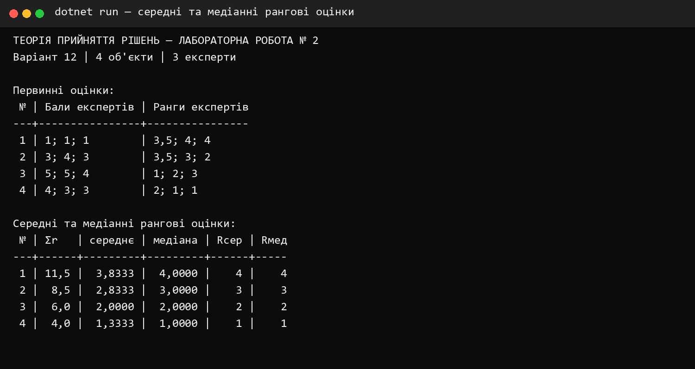
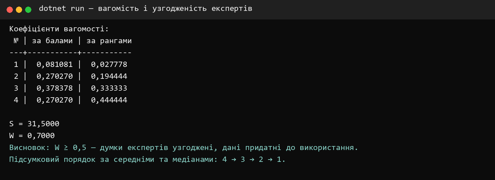
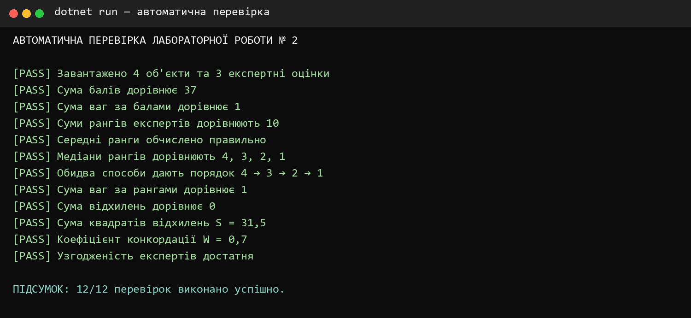

<div align="center">

**КРЕМЕНЧУЦЬКИЙ НАЦІОНАЛЬНИЙ УНІВЕРСИТЕТ<br>
ІМЕНІ МИХАЙЛА ОСТРОГРАДСЬКОГО**

**КАФЕДРА АВТОМАТИЗАЦІЇ ТА ІНФОРМАЦІЙНИХ СИСТЕМ**

# ЗВІТ З ЛАБОРАТОРНОЇ РОБОТИ № 2

з навчальної дисципліни **«Теорія прийняття рішень»**

**Варіант 12**

</div>

| Відомості | Дані |
|---|---|
| Виконав | студент групи КН-24-1 Левченко Д. В. |
| Перевірила | доцент кафедри Рилова Н. В. |
| Місце та рік | Кременчук, 2026 |

## ТЕМА

Обчислення середньої та медіанної оцінок на шкалі рангів.

## МЕТА

Вивчити методику обчислення середньої та медіанної оцінок на шкалі рангів, визначення коефіцієнтів вагомості за бальними й ранговими оцінками та перевірки узгодженості думок експертів.

## ПОСТАНОВКА ЗАВДАННЯ

За даними варіанта № 12 необхідно:

1. обчислити середні та медіанні рангові оцінки чотирьох об'єктів;
2. порівняти підсумкове ранжування за двома методами;
3. визначити коефіцієнти вагомості методом бальних оцінок;
4. визначити коефіцієнти вагомості ранговим методом;
5. розрахувати коефіцієнт конкордації та оцінити узгодженість трьох експертів.

## КОРОТКІ ТЕОРЕТИЧНІ ВІДОМОСТІ

Ранг 1 надається найкращій альтернативі. Якщо декілька альтернатив поділяють позиції, їм присвоюють середнє значення відповідних рангів. Середня рангова оцінка для об'єкта обчислюється як середнє арифметичне оцінок усіх експертів. Медіанна оцінка є центральним значенням упорядкованого набору рангів.

Коефіцієнт вагомості за балами визначається відношенням суми балів об'єкта до загальної суми балів:

```text
Kбi = ΣБij / ΣΣБij.
```

Для рангового методу менший сумарний ранг означає більшу вагомість. Нормований коефіцієнт обчислюється за формулою:

```text
Kрi = (m·n − Ri) / (0,5·m·n·(n − 1)),
```

де `m = 3` — кількість експертів, `n = 4` — кількість об'єктів, `Ri` — сума рангів об'єкта.

Узгодженість експертів оцінюється коефіцієнтом конкордації:

```text
W = 12·S / (m²·(n³ − n)),
```

де `S` — сума квадратів відхилень сум рангів від їх середнього значення. Якщо `W ≥ 0,5`, дані вважаються придатними до використання.

## ПОРЯДОК ВИКОНАННЯ РОБОТИ

1. До програми внесено бальні та рангові оцінки варіанта 12.
2. Для кожного об'єкта обчислено суму, середнє арифметичне та медіану рангів.
3. Сформовано підсумкові ранги за середніми й медіанними оцінками.
4. Розраховано коефіцієнти вагомості за балами та рангами.
5. Обчислено відхилення, суму квадратів відхилень і коефіцієнт конкордації.
6. Результати перевірено окремим набором автоматичних тестів.

## ПОЧАТКОВІ ДАНІ ВАРІАНТА 12

| № об'єкта | Бали експ. 1 | Бали експ. 2 | Бали експ. 3 | Ранг експ. 1 | Ранг експ. 2 | Ранг експ. 3 |
|---:|---:|---:|---:|---:|---:|---:|
| 1 | 1 | 1 | 1 | 3,5 | 4 | 4 |
| 2 | 3 | 4 | 3 | 3,5 | 3 | 2 |
| 3 | 5 | 5 | 4 | 1 | 2 | 3 |
| 4 | 4 | 3 | 3 | 2 | 1 | 1 |

## СЕРЕДНІ ТА МЕДІАННІ РАНГОВІ ОЦІНКИ

| № | Сума рангів | Середнє | Підсумковий ранг за середнім | Медіана | Підсумковий ранг за медіаною |
|---:|---:|---:|---:|---:|---:|
| 1 | 11,5 | 3,8333 | 4 | 4,0000 | 4 |
| 2 | 8,5 | 2,8333 | 3 | 3,0000 | 3 |
| 3 | 6,0 | 2,0000 | 2 | 2,0000 | 2 |
| 4 | 4,0 | 1,3333 | 1 | 1,0000 | 1 |

Обидва методи дали однаковий порядок альтернатив: **4 → 3 → 2 → 1**. Отже, результат експертного ранжування є стійким відносно вибору середньої або медіанної оцінки.



<p align="center"><em>Рисунок 1 — Обчислення середніх і медіанних рангових оцінок</em></p>

## КОЕФІЦІЄНТИ ВАГОМОСТІ

| № | Сума балів | Вага за балами | Сума рангів | Вага за рангами |
|---:|---:|---:|---:|---:|
| 1 | 3 | 0,081081 | 11,5 | 0,027778 |
| 2 | 10 | 0,270270 | 8,5 | 0,194444 |
| 3 | 14 | 0,378378 | 6,0 | 0,333333 |
| 4 | 10 | 0,270270 | 4,0 | 0,444444 |

За бальними оцінками найбільшу вагомість має об'єкт № 3. За ранговим методом найбільшу вагомість має об'єкт № 4. Відмінність пояснюється тим, що бали відображають інтенсивність оцінки, а ранги — лише порядок переваг.

## КОЕФІЦІЄНТ КОНКОРДАЦІЇ

| № | Ri | Δi = Ri − 7,5 | Δi² |
|---:|---:|---:|---:|
| 1 | 11,5 | 4,0 | 16,00 |
| 2 | 8,5 | 1,0 | 1,00 |
| 3 | 6,0 | −1,5 | 2,25 |
| 4 | 4,0 | −3,5 | 12,25 |
| **Разом** | **30,0** | **0,0** | **31,50** |

Середня сума рангів `T = 30 / 4 = 7,5`. Сума квадратів відхилень `S = 31,5`. Коефіцієнт конкордації:

```text
W = 12·31,5 / (3²·(4³ − 4)) = 378 / 540 = 0,7.
```

Оскільки `W = 0,7 ≥ 0,5`, думки експертів достатньо узгоджені, а отримані результати придатні до використання.



<p align="center"><em>Рисунок 2 — Розрахунок вагомості та узгодженості експертів</em></p>

## ПЕРЕВІРКА ПРОГРАМИ

Перевірено початкові дані, суми балів і рангів, середні та медіанні оцінки, обидва підсумкові порядки, нормування коефіцієнтів вагомості, суму відхилень, значення `S` і коефіцієнт `W`. Усі 12 перевірок завершилися успішно.



<p align="center"><em>Рисунок 3 — Результат автоматичної перевірки програми</em></p>

## ВІДПОВІДІ НА КОНТРОЛЬНІ ПИТАННЯ

### 1 Пояснити принцип експертного оцінювання

Експертне оцінювання полягає у формалізованому збиранні суджень фахівців щодо альтернатив або показників та подальшій математичній обробці цих суджень для отримання групового рішення.

### 2 Які шкали застосовують для експертного оцінювання

Застосовують номінальні, порядкові, інтервальні та шкали відношень. У цій роботі використано бальну шкалу та порядкову шкалу рангів.

### 3 Пояснити алгоритми обчислення середніх і медіанних рангових оцінок

Для середньої оцінки ранги об'єкта підсумовують і ділять на кількість експертів, після чого середні впорядковують за зростанням. Для медіанної оцінки ранги впорядковують і вибирають центральне значення; за парної кількості експертів беруть середнє двох центральних значень.

### 4 Чому застосовуються одразу декілька способів оцінювання альтернатив

Порівняння результатів різних методів дає змогу оцінити стійкість висновку. Збіг порядків свідчить, що результат мало залежить від способу агрегування, а значна розбіжність вимагає додаткового аналізу.

### 5 Пояснити методику обчислення бальних і рангових оцінок та їх усереднення

Бали відображають ступінь переваги за заданою шкалою, тому їх підсумовують або усереднюють. Ранги відображають порядок: найкращому об'єкту надають ранг 1, а рівноцінним об'єктам — середній ранг зайнятих позицій. Групову рангову оцінку отримують за середнім або медіаною.

### 6 Пояснити методику визначення вагових коефіцієнтів на підставі бальних і рангових оцінок

За бальним методом суму балів кожного об'єкта ділять на загальну суму балів. За ранговим методом сумарні ранги перетворюють так, щоб менший ранг відповідав більшій вазі, після чого нормують; сума коефіцієнтів в обох випадках дорівнює 1.

### 7 Пояснити методику визначення коефіцієнта конкордації та його значення

Спочатку визначають суми рангів, їх середнє, відхилення та суму квадратів відхилень `S`. Потім обчислюють `W = 12S / (m²(n³ − n))`. Значення близьке до 1 означає високу узгодженість, близьке до 0 — відсутність узгодженості. У роботі `W = 0,7`, що свідчить про достатню узгодженість.

## ВИСНОВКИ

У лабораторній роботі мовою C# реалізовано обчислення середніх і медіанних рангових оцінок для даних варіанта № 12. Обидва методи сформували однаковий порядок альтернатив `4 → 3 → 2 → 1`, тому результат є стійким.

За бальним методом найбільшу вагомість отримав об'єкт № 3 з коефіцієнтом `0,378378`, а за ранговим методом — об'єкт № 4 з коефіцієнтом `0,444444`. Коефіцієнт конкордації `W = 0,7` підтвердив достатню узгодженість експертів. Коректність усіх розрахунків підтверджено дванадцятьма автоматичними перевірками.
