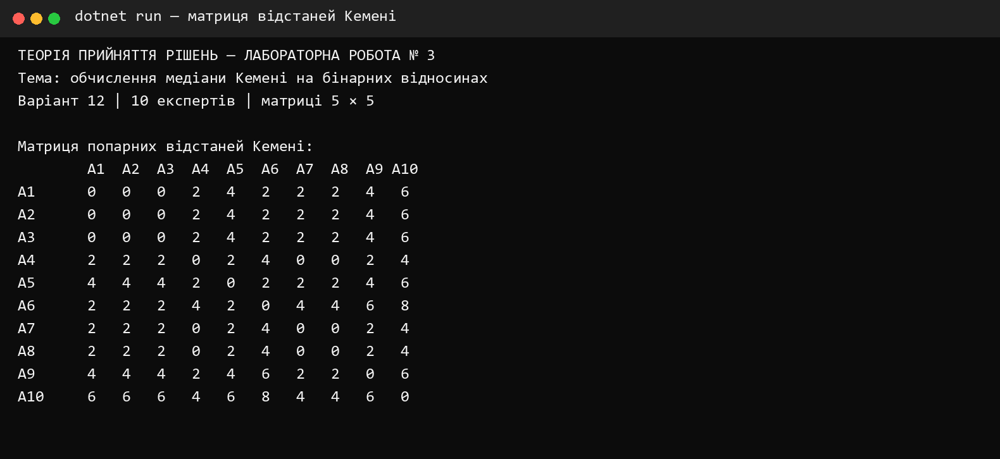
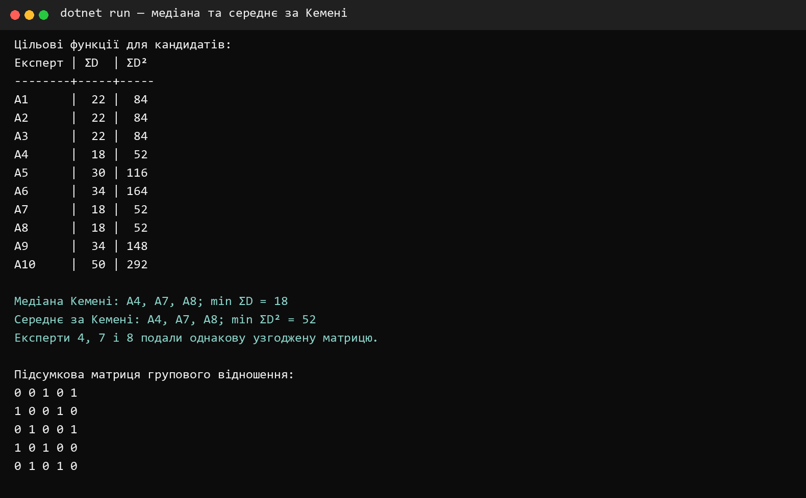
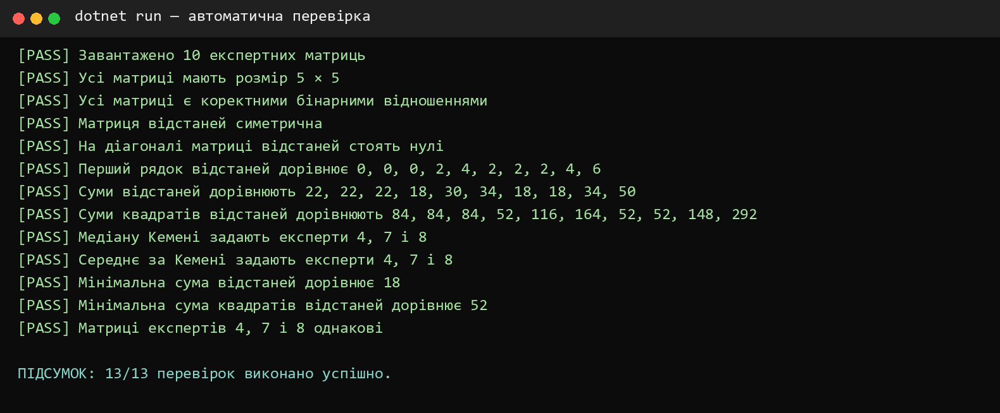

<div align="center">

**КРЕМЕНЧУЦЬКИЙ НАЦІОНАЛЬНИЙ УНІВЕРСИТЕТ<br>
ІМЕНІ МИХАЙЛА ОСТРОГРАДСЬКОГО**

**КАФЕДРА АВТОМАТИЗАЦІЇ ТА ІНФОРМАЦІЙНИХ СИСТЕМ**

# ЗВІТ З ЛАБОРАТОРНОЇ РОБОТИ № 3

з навчальної дисципліни **«Теорія прийняття рішень»**

**Варіант 12**

</div>

**Виконав:** студент групи КН-24-1 Левченко Д. В.

**Перевірила:** доцент кафедри Рилова Н. В.

## Тема

Обчислення медіани Кемені на бінарних відносинах.

## Мета

Отримати навички розрахунку медіани Кемені для визначення узгодженої думки групи експертів, а також порівняти її із середнім за Кемені.

## Постановка завдання

Для варіанта № 12 задано десять матриць бінарних відношень розміром 5 × 5. Потрібно перевірити їх правильність, розрахувати відстані Кемені між усіма матрицями, знайти медіану й середнє за Кемені та визначити експертів, думка яких збігається з груповим рішенням.

## Короткі теоретичні відомості

Матриця бінарного відношення містить нулі та одиниці. На головній діагоналі розташовані нулі, а для кожної пари різних альтернатив виконується умова `x(i,j) + x(j,i) = 1`.

Відстань Кемені між відношеннями `A` і `B` визначається сумою модулів різниць відповідних елементів:

`D(A,B) = Σᵢ Σⱼ |a(i,j) − b(i,j)|`.

Медіана Кемені мінімізує суму відстаней до думок усіх експертів:

`A* = arg min Σᵢ D(Aᵢ,A)`.

Середнє за Кемені визначається аналогічно, але мінімізується сума квадратів відстаней:

`Ā = arg min Σᵢ D²(Aᵢ,A)`.

## Початкові дані варіанта 12

Кожна матриця подана п’ятьма рядками; символи в рядку відповідають її елементам зліва направо.

| Експерт | Рядки матриці |
|---:|---|
| 1 | `00111; 10010; 01001; 00100; 01010` |
| 2 | `00111; 10010; 01001; 00100; 01010` |
| 3 | `00111; 10010; 01001; 00100; 01010` |
| 4 | `00101; 10010; 01001; 10100; 01010` |
| 5 | `00101; 10010; 01000; 10100; 01110` |
| 6 | `00111; 10010; 01000; 00100; 01110` |
| 7 | `00101; 10010; 01001; 10100; 01010` |
| 8 | `00101; 10010; 01001; 10100; 01010` |
| 9 | `00101; 10010; 01011; 10000; 01010` |
| 10 | `00000; 10010; 11001; 10100; 11010` |

## Хід роботи

1. У програму внесено десять експертних матриць варіанта № 12.
2. Перевірено квадратність, бінарність, нульову головну діагональ і взаємну доповнюваність елементів.
3. Для кожної пари матриць обчислено відстань Кемені.
4. Для кожного кандидата обчислено `ΣD` та `ΣD²`.
5. За мінімальними значеннями цільових функцій визначено медіану та середнє за Кемені.

## Матриця попарних відстаней

| | A1 | A2 | A3 | A4 | A5 | A6 | A7 | A8 | A9 | A10 |
|---:|---:|---:|---:|---:|---:|---:|---:|---:|---:|---:|
| A1 | 0 | 0 | 0 | 2 | 4 | 2 | 2 | 2 | 4 | 6 |
| A2 | 0 | 0 | 0 | 2 | 4 | 2 | 2 | 2 | 4 | 6 |
| A3 | 0 | 0 | 0 | 2 | 4 | 2 | 2 | 2 | 4 | 6 |
| A4 | 2 | 2 | 2 | 0 | 2 | 4 | 0 | 0 | 2 | 4 |
| A5 | 4 | 4 | 4 | 2 | 0 | 2 | 2 | 2 | 4 | 6 |
| A6 | 2 | 2 | 2 | 4 | 2 | 0 | 4 | 4 | 6 | 8 |
| A7 | 2 | 2 | 2 | 0 | 2 | 4 | 0 | 0 | 2 | 4 |
| A8 | 2 | 2 | 2 | 0 | 2 | 4 | 0 | 0 | 2 | 4 |
| A9 | 4 | 4 | 4 | 2 | 4 | 6 | 2 | 2 | 0 | 6 |
| A10 | 6 | 6 | 6 | 4 | 6 | 8 | 4 | 4 | 6 | 0 |



## Значення цільових функцій

| Кандидат | ΣD | ΣD² | Медіана | Середнє |
|---:|---:|---:|:---:|:---:|
| A1 | 22 | 84 |  |  |
| A2 | 22 | 84 |  |  |
| A3 | 22 | 84 |  |  |
| A4 | **18** | **52** | так | так |
| A5 | 30 | 116 |  |  |
| A6 | 34 | 164 |  |  |
| A7 | **18** | **52** | так | так |
| A8 | **18** | **52** | так | так |
| A9 | 34 | 148 |  |  |
| A10 | 50 | 292 |  |  |

Мінімальна сума відстаней дорівнює `18`, а мінімальна сума квадратів відстаней — `52`. Отже, медіану і середнє за Кемені задають кандидати `A4`, `A7`, `A8`. Їхні матриці однакові, тому групове відношення єдине:

```text
0 0 1 0 1
1 0 0 1 0
0 1 0 0 1
1 0 1 0 0
0 1 0 1 0
```



## Перевірка програми

Автоматично перевірено початкові матриці, властивості матриці відстаней, усі значення цільових функцій, склад множини медіан і середніх, а також збіг матриць експертів № 4, № 7 і № 8.



Усі 13 перевірок виконано успішно. Рішення збирається в конфігурації Release без попереджень і помилок.

## Відповіді на контрольні питання

### 1. Скільки експертів і альтернатив беруть участь у наведеному прикладі

У прикладі з теоретичної частини беруть участь 9 експертів, які порівнюють 5 альтернатив. У варіанті № 12 використано 10 експертних матриць для 5 альтернатив.

### 2. Які правила заповнення матриці бінарних відношень

Матриця має бути квадратною та містити лише нулі й одиниці. Якщо альтернатива `i` краща за `j`, то `x(i,j) = 1`, інакше `x(i,j) = 0`. На головній діагоналі ставлять нулі. Для різних альтернатив один з елементів `x(i,j)` та `x(j,i)` дорівнює 1, а інший — 0. Транзитивність не є обов’язковою.

### 3. Як заповнюється матриця попарних відстаней

Кожну експертну матрицю порівнюють з кожною іншою. У клітинку `(i,j)` записують кількість елементів, що не збігаються у матрицях `Aᵢ` та `Aⱼ`. Матриця відстаней симетрична, а на її головній діагоналі стоять нулі.

### 4. Як визначити медіану Кемені та який висновок можна зробити

Для кожного кандидата підсумовують відстані до всіх експертних матриць. Кандидати з найменшою сумою утворюють множину медіан Кемені. У варіанті № 12 мінімум `ΣD = 18` мають `A4`, `A7`, `A8`; вони однакові, тому саме експерти № 4, № 7 і № 8 висловили думку, що збігається з груповою.

### 5. Як визначити середнє за Кемені та який висновок можна зробити

Для кожного кандидата підсумовують квадрати відстаней до всіх експертних матриць. Мінімум цієї суми визначає середнє за Кемені. У варіанті № 12 `min ΣD² = 52`, і його також досягають `A4`, `A7`, `A8`. Отже, обидва способи агрегування дали однакове групове рішення.

## Висновки

У лабораторній роботі мовою C# реалізовано розрахунок відстаней Кемені для десяти бінарних відношень варіанта № 12. Медіана та середнє за Кемені збіглися. Групове рішення подано однаковою матрицею експертів № 4, № 7 і № 8; мінімальні значення цільових функцій становлять відповідно `18` і `52`. Коректність розрахунків підтверджено тринадцятьма автоматичними перевірками.
