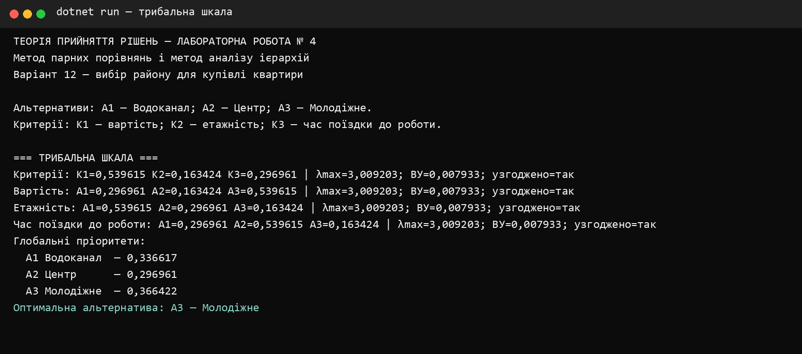
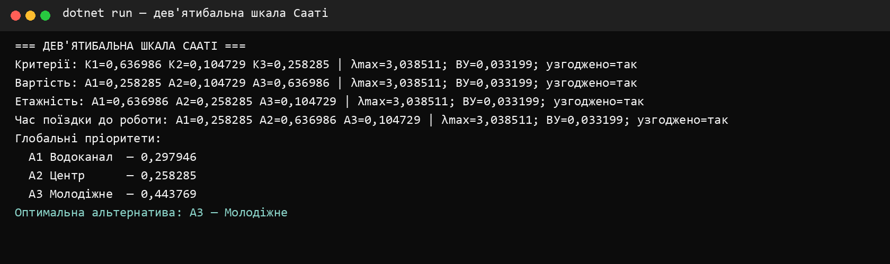
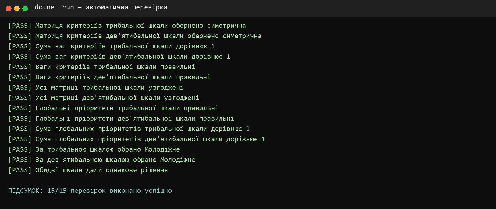

**КРЕМЕНЧУЦЬКИЙ НАЦІОНАЛЬНИЙ УНІВЕРСИТЕТ 
ІМЕНІ МИХАЙЛА ОСТРОГРАДСЬКОГО**

**КАФЕДРА АВТОМАТИЗАЦІЇ ТА ІНФОРМАЦІЙНИХ СИСТЕМ**

# ЗВІТ З ЛАБОРАТОРНОЇ РОБОТИ № 4

з навчальної дисципліни **«Теорія прийняття рішень»**

**Варіант 12**

**Виконав:** студент групи КН-24-1 Левченко Д. В.

**Перевірила:** доцент кафедри Рилова Н. В.

## Тема

Використання методу парних порівнянь. Метод аналізу ієрархій.

## Мета

Вивчити правила застосування методу парних порівнянь і методу аналізу ієрархій, навчитися обчислювати локальні та глобальні пріоритети й перевіряти узгодженість експертних оцінок.

## Постановка завдання

Для варіанта № 12 потрібно вибрати район для купівлі квартири. Розглядаються альтернативи:

- `A1` — Водоканал;
- `A2` — Центр;
- `A3` — Молодіжне.

Критерії оцінювання:

- `K1` — вартість;
- `K2` — етажність;
- `K3` — час поїздки до місця роботи.

Оцінювання виконано окремо за трибальною та дев'ятибальною шкалами. Потрібно перевірити узгодженість усіх матриць і визначити оптимальну альтернативу.

## Короткі теоретичні відомості

Матриця парних порівнянь є додатною та обернено симетричною: `aᵢⱼ = 1/aⱼᵢ`, а на головній діагоналі розміщені одиниці. Вектор пріоритетів визначається методом середнього геометричного:

`gᵢ = ⁿ√(∏ⱼ aᵢⱼ)`, `wᵢ = gᵢ / Σgᵢ`.

Максимальне власне значення обчислюється через суми стовпців і нормований вектор:

`λmax = Σⱼ wⱼ · bⱼ`, де `bⱼ = Σᵢ aᵢⱼ`.

Індекс узгодженості та відношення узгодженості:

`ІУ = (λmax − n)/(n − 1)`, `ВУ = ІУ/ВІ`.

Для матриці розміром `3 × 3` середнє значення випадкового індексу `ВІ = 0,58`. Матриця вважається достатньо узгодженою, якщо `ВУ < 0,1`.

Глобальний пріоритет альтернативи визначається зваженою сумою її локальних пріоритетів:

`Rᵢ = Σⱼ pⱼ · Sᵢʲ`.

## Матриці трибальної шкали

### Порівняння критеріїв

| | K1 | K2 | K3 |
|---:|---:|---:|---:|
| K1 | 1 | 3 | 2 |
| K2 | 1/3 | 1 | 1/2 |
| K3 | 1/2 | 2 | 1 |

### Порівняння альтернатив

| Критерій | Матриця за рядками A1, A2, A3 |
|---|---|
| K1 — вартість | `1, 2, 1/2`; `1/2, 1, 1/3`; `2, 3, 1` |
| K2 — етажність | `1, 2, 3`; `1/2, 1, 2`; `1/3, 1/2, 1` |
| K3 — час поїздки | `1, 1/2, 2`; `2, 1, 3`; `1/2, 1/3, 1` |

## Результати трибальної шкали

| Матриця | Перший пріоритет | Другий пріоритет | Третій пріоритет | λmax | ВУ |
|---|---:|---:|---:|---:|---:|
| Критерії | 0,539615 | 0,163424 | 0,296961 | 3,009203 | 0,007933 |
| K1 | 0,296961 | 0,163424 | 0,539615 | 3,009203 | 0,007933 |
| K2 | 0,539615 | 0,296961 | 0,163424 | 3,009203 | 0,007933 |
| K3 | 0,296961 | 0,539615 | 0,163424 | 3,009203 | 0,007933 |

Глобальні пріоритети:

| Альтернатива | Пріоритет | Місце |
|---|---:|---:|
| A1 — Водоканал | 0,336617 | 2 |
| A2 — Центр | 0,296961 | 3 |
| A3 — Молодіжне | **0,366422** | **1** |

## Матриці дев'ятибальної шкали Сааті

### Порівняння критеріїв

| | K1 | K2 | K3 |
|---:|---:|---:|---:|
| K1 | 1 | 5 | 3 |
| K2 | 1/5 | 1 | 1/3 |
| K3 | 1/3 | 3 | 1 |

### Порівняння альтернатив

| Критерій | Матриця за рядками A1, A2, A3 |
|---|---|
| K1 — вартість | `1, 3, 1/3`; `1/3, 1, 1/5`; `3, 5, 1` |
| K2 — етажність | `1, 3, 5`; `1/3, 1, 3`; `1/5, 1/3, 1` |
| K3 — час поїздки | `1, 1/3, 3`; `3, 1, 5`; `1/3, 1/5, 1` |

## Результати дев'ятибальної шкали

| Матриця | Перший пріоритет | Другий пріоритет | Третій пріоритет | λmax | ВУ |
|---|---:|---:|---:|---:|---:|
| Критерії | 0,636986 | 0,104729 | 0,258285 | 3,038511 | 0,033199 |
| K1 | 0,258285 | 0,104729 | 0,636986 | 3,038511 | 0,033199 |
| K2 | 0,636986 | 0,258285 | 0,104729 | 3,038511 | 0,033199 |
| K3 | 0,258285 | 0,636986 | 0,104729 | 3,038511 | 0,033199 |

Глобальні пріоритети:

| Альтернатива | Пріоритет | Місце |
|---|---:|---:|
| A1 — Водоканал | 0,297946 | 2 |
| A2 — Центр | 0,258285 | 3 |
| A3 — Молодіжне | **0,443769** | **1** |

## Порівняння результатів

Обидві шкали сформували однаковий порядок альтернатив: **Молодіжне → Водоканал → Центр**. Дев'ятибальна шкала сильніше відокремила Молодіжне від інших районів: його глобальний пріоритет збільшився з `0,366422` до `0,443769`. Усі значення `ВУ` менші за `0,1`, тому експертні оцінки достатньо узгоджені.

## Перевірка програми

Автоматично перевірено обернену симетричність матриць, нормування векторів, значення локальних і глобальних пріоритетів, узгодженість оцінок та збіг оптимального рішення для двох шкал.

Усі 15 перевірок виконано успішно. Рішення збирається в конфігурації Release без попереджень і помилок.

## Відповіді на контрольні питання

### 1. У чому відмінність і схожість методу парних порівнянь і методу аналізу ієрархій

Обидва методи використовують матриці попарних порівнянь для отримання числових пріоритетів. Метод парних порівнянь може застосовуватися самостійно до одного набору об'єктів. Метод аналізу ієрархій розширює його на декілька рівнів: мету, критерії та альтернативи, після чого локальні пріоритети агрегуються у глобальний результат.

### 2. Послідовність застосування методів

Спочатку формулюють мету, визначають альтернативи та критерії. Потім будують матрицю порівняння критеріїв і матриці порівняння альтернатив за кожним критерієм. Для кожної матриці обчислюють нормований вектор пріоритетів, `λmax`, `ІУ` і `ВУ`. Після підтвердження узгодженості локальні пріоритети множать на ваги критеріїв і підсумовують. Альтернатива з найбільшим глобальним пріоритетом є оптимальною.

### 3. Навіщо перевіряти узгодженість і коли ймовірність помилки більша

Перевірка потрібна для виявлення суперечливих суджень експерта. Наприклад, якщо `A1` значно краща за `A2`, а `A2` краща за `A3`, оцінка, за якою `A3` краща за `A1`, створює суперечність. Ризик помилки зростає зі збільшенням кількості альтернатив і критеріїв, використанням ширшої шкали та недостатньою обізнаністю експерта. Якщо `ВУ ≥ 0,1`, матрицю слід переглянути.

## Висновки

У лабораторній роботі мовою C# реалізовано метод аналізу ієрархій для варіанта № 12. За трибальною та дев'ятибальною шкалами найкращою альтернативою стало Молодіжне. Його глобальні пріоритети дорівнюють відповідно `0,366422` і `0,443769`. Всі матриці пройшли перевірку узгодженості, а правильність розрахунків підтверджено п'ятнадцятьма автоматичними перевірками.
