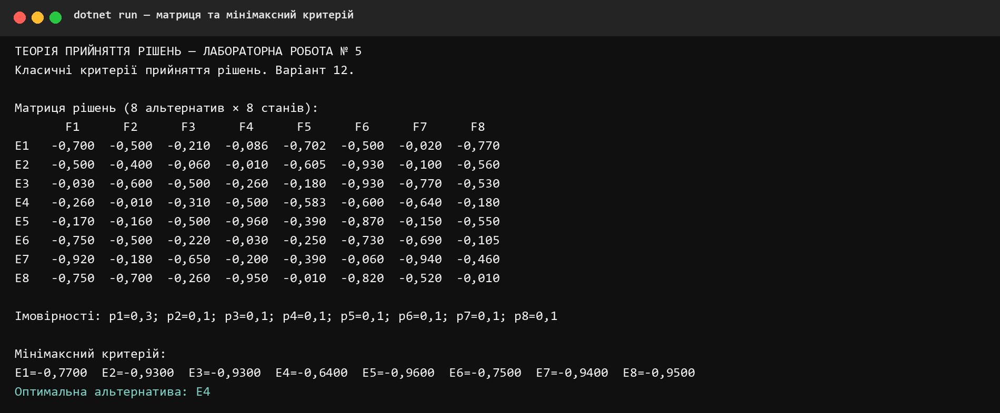
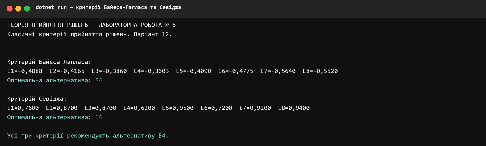
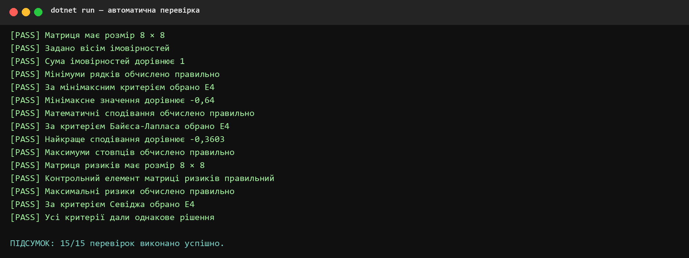

**КРЕМЕНЧУЦЬКИЙ НАЦІОНАЛЬНИЙ УНІВЕРСИТЕТ 
ІМЕНІ МИХАЙЛА ОСТРОГРАДСЬКОГО**

**КАФЕДРА АВТОМАТИЗАЦІЇ ТА ІНФОРМАЦІЙНИХ СИСТЕМ**

# ЗВІТ З ЛАБОРАТОРНОЇ РОБОТИ № 5

з навчальної дисципліни **«Теорія прийняття рішень»**

**Варіант 12**

**Виконав:** студент групи КН-24-1 Левченко Д. В.

**Перевірила:** доцент кафедри Рилова Н. В.

## Тема

Класичні критерії прийняття рішень.

## Мета

Вивчити класичні критерії прийняття рішень та їх застосування у практичних задачах управління.

## Постановка завдання

Для матриці рішень варіанта № 12 потрібно визначити оптимальну альтернативу за мінімаксним критерієм, критерієм Байєса-Лапласа та критерієм Севіджа. Імовірності зовнішніх станів: `p₁ = 0,3`, `p₂ = … = p₈ = 0,1`.

## Короткі теоретичні відомості

Мінімаксний критерій використовує найгірший результат кожної альтернативи й обирає найбільший із них:

`ZMM = maxᵢ minⱼ eᵢⱼ`.

Критерій Байєса-Лапласа враховує відомі ймовірності зовнішніх станів. Для кожної альтернативи обчислюється математичне сподівання:

`ZBL = maxᵢ Σⱼ eᵢⱼpⱼ`.

Для критерію Севіджа спочатку будується матриця ризиків:

`aᵢⱼ = maxᵢ eᵢⱼ − eᵢⱼ`.

Потім обирається альтернатива з найменшим максимальним ризиком:

`ZS = minᵢ maxⱼ aᵢⱼ`.

## Вихідні дані варіанта 12

| Альтернатива | F1 | F2 | F3 | F4 | F5 | F6 | F7 | F8 |
|---|---:|---:|---:|---:|---:|---:|---:|---:|
| E1 | -0,700 | -0,500 | -0,210 | -0,086 | -0,702 | -0,500 | -0,020 | -0,770 |
| E2 | -0,500 | -0,400 | -0,060 | -0,010 | -0,605 | -0,930 | -0,100 | -0,560 |
| E3 | -0,030 | -0,600 | -0,500 | -0,260 | -0,180 | -0,930 | -0,770 | -0,530 |
| E4 | -0,260 | -0,010 | -0,310 | -0,500 | -0,583 | -0,600 | -0,640 | -0,180 |
| E5 | -0,170 | -0,160 | -0,500 | -0,960 | -0,390 | -0,870 | -0,150 | -0,550 |
| E6 | -0,750 | -0,500 | -0,220 | -0,030 | -0,250 | -0,730 | -0,690 | -0,105 |
| E7 | -0,920 | -0,180 | -0,650 | -0,200 | -0,390 | -0,060 | -0,940 | -0,460 |
| E8 | -0,750 | -0,700 | -0,260 | -0,950 | -0,010 | -0,820 | -0,520 | -0,010 |

## Мінімаксний критерій

| Альтернатива | min eᵢⱼ |
|---|---:|
| E1 | -0,770 |
| E2 | -0,930 |
| E3 | -0,930 |
| E4 | **-0,640** |
| E5 | -0,960 |
| E6 | -0,750 |
| E7 | -0,940 |
| E8 | -0,950 |

Найбільший із мінімальних результатів дорівнює `-0,640`, тому оптимальною є альтернатива **E4**.

## Критерій Байєса-Лапласа

| Альтернатива | Математичне сподівання |
|---|---:|
| E1 | -0,4888 |
| E2 | -0,4165 |
| E3 | -0,3860 |
| E4 | **-0,3603** |
| E5 | -0,4090 |
| E6 | -0,4775 |
| E7 | -0,5640 |
| E8 | -0,5520 |

Найбільше математичне сподівання `-0,3603` має альтернатива **E4**.

## Критерій Севіджа

Матриця ризиків:

| | F1 | F2 | F3 | F4 | F5 | F6 | F7 | F8 | max aᵢⱼ |
|---|---:|---:|---:|---:|---:|---:|---:|---:|---:|
| E1 | 0,670 | 0,490 | 0,150 | 0,076 | 0,692 | 0,440 | 0,000 | 0,760 | 0,760 |
| E2 | 0,470 | 0,390 | 0,000 | 0,000 | 0,595 | 0,870 | 0,080 | 0,550 | 0,870 |
| E3 | 0,000 | 0,590 | 0,440 | 0,250 | 0,170 | 0,870 | 0,750 | 0,520 | 0,870 |
| E4 | 0,230 | 0,000 | 0,250 | 0,490 | 0,573 | 0,540 | 0,620 | 0,170 | **0,620** |
| E5 | 0,140 | 0,150 | 0,440 | 0,950 | 0,380 | 0,810 | 0,130 | 0,540 | 0,950 |
| E6 | 0,720 | 0,490 | 0,160 | 0,020 | 0,240 | 0,670 | 0,670 | 0,095 | 0,720 |
| E7 | 0,890 | 0,170 | 0,590 | 0,190 | 0,380 | 0,000 | 0,920 | 0,450 | 0,920 |
| E8 | 0,720 | 0,690 | 0,200 | 0,940 | 0,000 | 0,760 | 0,500 | 0,000 | 0,940 |

Найменший максимальний ризик дорівнює `0,620`, тому критерій Севіджа також обирає **E4**.

## Порівняння результатів

| Критерій | Значення оптимуму | Альтернатива |
|---|---:|---:|
| Мінімаксний | -0,6400 | E4 |
| Байєса-Лапласа | -0,3603 | E4 |
| Севіджа | 0,6200 | E4 |

Усі три критерії дали однакове рішення. Альтернатива `E4` має найкращий гарантований результат, найбільше математичне сподівання та найменший максимальний ризик.

## Перевірка програми

Автоматично перевірено розмірність матриці, розподіл імовірностей, проміжні вектори, матрицю ризиків та оптимальні альтернативи.

Усі 15 перевірок виконано успішно. Рішення збирається в конфігурації Release без попереджень і помилок.

## Відповіді на контрольні питання

### 1. Як задається множина варіантів рішень

Множина варіантів задається переліком альтернатив `E = {E₁, E₂, …, Eₘ}`. Кожній альтернативі відповідає рядок матриці рішень, а кожному можливому зовнішньому стану `Fⱼ` — її стовпець. Елемент `eᵢⱼ` описує результат вибору альтернативи `Eᵢ` за умови реалізації стану `Fⱼ`.

### 2. Як оцінюють ризик під час вибору рішення за мінімаксним критерієм

Для кожної альтернативи визначають її найгірший результат, тобто мінімальний елемент рядка. Потім вибирають альтернативу з найбільшим серед цих мінімумів. Такий підхід орієнтується на гарантований результат і повністю виключає ризик отримати результат гірший за обрану нижню межу.

### 3. Які критерії беруть до уваги ймовірності появи зовнішніх станів

У цій роботі ймовірності зовнішніх станів безпосередньо враховує критерій Байєса-Лапласа. Він обчислює математичне сподівання результату кожної альтернативи як зважену суму, де вагами є ймовірності станів.

### 4. Які умови використання критерію Севіджа

Критерій Севіджа застосовують, коли точний майбутній стан невідомий, а особа, що приймає рішення, прагне мінімізувати можливий жаль від невдалого вибору. Для цього потрібна матриця результатів; знати ймовірності станів не обов'язково. Критерій орієнтується на найменший максимальний ризик.

## Висновки

У лабораторній роботі мовою C# реалізовано мінімаксний критерій, критерій Байєса-Лапласа та критерій Севіджа для матриці варіанта № 12. За всіма трьома критеріями оптимальною є альтернатива **E4**. Значення цільових функцій становлять відповідно `-0,6400`, `-0,3603` і `0,6200`. Правильність розрахунків підтверджено п'ятнадцятьма автоматичними перевірками.
