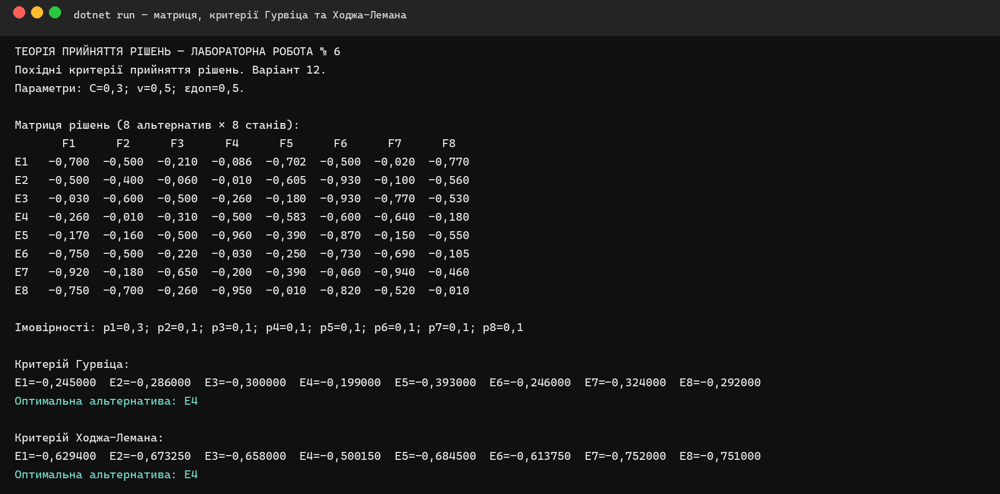
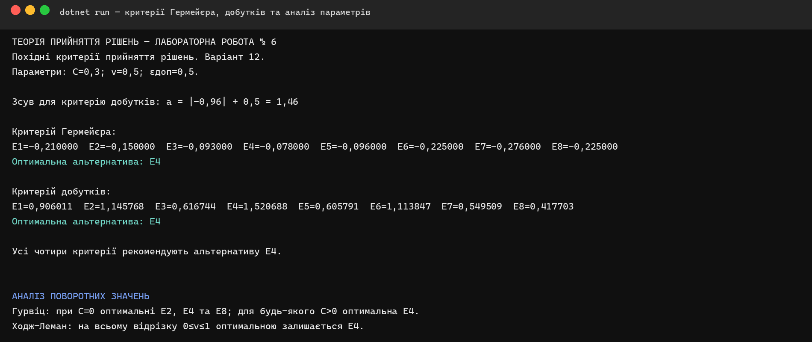
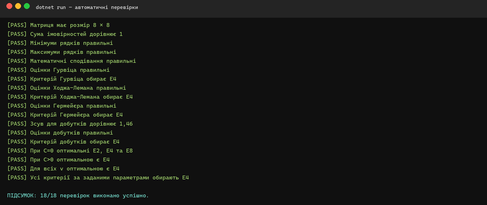

**КРЕМЕНЧУЦЬКИЙ НАЦІОНАЛЬНИЙ УНІВЕРСИТЕТ 
ІМЕНІ МИХАЙЛА ОСТРОГРАДСЬКОГО**

**КАФЕДРА АВТОМАТИЗАЦІЇ ТА ІНФОРМАЦІЙНИХ СИСТЕМ**

# ЗВІТ З ЛАБОРАТОРНОЇ РОБОТИ № 6

з навчальної дисципліни **«Теорія прийняття рішень»**

**Варіант 12**

**Виконав:** студент групи КН-24-1 Левченко Д. В.

**Перевірила:** доцент кафедри Рилова Н. В.

## Тема

Прийняття рішень за похідними критеріями.

## Мета

Вивчити похідні критерії прийняття рішень та їх застосування у практичних задачах управління: критерій Гурвіца, критерій Ходжа-Лемана, критерій Гермейєра та критерій добутків.

## Постановка завдання

Для матриці рішень варіанта № 12 потрібно визначити оптимальні альтернативи за чотирма похідними критеріями. Імовірності зовнішніх станів: `p₁ = 0,3`, `p₂ = … = p₈ = 0,1`. Параметри варіанта: `C = 0,3`, `v = 0,5`, `εдоп = 0,5`. Також потрібно встановити значення `C` і `v`, за яких змінюється вибір за критеріями Гурвіца та Ходжа-Лемана.

## Вихідні дані варіанта 12

| Альтернатива | F1 | F2 | F3 | F4 | F5 | F6 | F7 | F8 |
|---|---:|---:|---:|---:|---:|---:|---:|---:|
| E1 | -0,700 | -0,500 | -0,210 | -0,086 | -0,702 | -0,500 | -0,020 | -0,770 |
| E2 | -0,500 | -0,400 | -0,060 | -0,010 | -0,605 | -0,930 | -0,100 | -0,560 |
| E3 | -0,030 | -0,600 | -0,500 | -0,260 | -0,180 | -0,930 | -0,770 | -0,530 |
| E4 | -0,260 | -0,010 | -0,310 | -0,500 | -0,583 | -0,600 | -0,640 | -0,180 |
| E5 | -0,170 | -0,160 | -0,500 | -0,960 | -0,390 | -0,870 | -0,150 | -0,550 |
| E6 | -0,750 | -0,500 | -0,220 | -0,030 | -0,250 | -0,730 | -0,690 | -0,105 |
| E7 | -0,920 | -0,180 | -0,650 | -0,200 | -0,390 | -0,060 | -0,940 | -0,460 |
| E8 | -0,750 | -0,700 | -0,260 | -0,950 | -0,010 | -0,820 | -0,520 | -0,010 |

## Порядок виконання роботи

1. У C# задано матрицю `8 × 8`, імовірності станів і параметри варіанта.
2. Для кожного рядка визначено мінімальний і максимальний результати та математичне сподівання.
3. Обчислено оцінки критеріїв Гурвіца й Ходжа-Лемана.
4. Для критерію Гермейєра знайдено найменші добутки `eᵢⱼpⱼ` у кожному рядку.
5. Для критерію добутків виконано зсув матриці на `a = 1,46`, після чого обчислено добутки рядків.
6. Перевірено зміну оптимальної альтернативи на всьому діапазоні `C, v ∈ [0; 1]`.
7. Результати збережено в CSV та перевірено автоматичними тестами.

## Критерій Гурвіца

Оцінки обчислено за формулою `HWᵢ = C·min(eᵢⱼ) + (1−C)·max(eᵢⱼ)` при `C = 0,3`.

| Альтернатива | min eᵢⱼ | max eᵢⱼ | HWᵢ |
|---|---:|---:|---:|
| E1 | -0,770 | -0,020 | -0,245 |
| E2 | -0,930 | -0,010 | -0,286 |
| E3 | -0,930 | -0,030 | -0,300 |
| E4 | -0,640 | -0,010 | **-0,199** |
| E5 | -0,960 | -0,150 | -0,393 |
| E6 | -0,750 | -0,030 | -0,246 |
| E7 | -0,940 | -0,060 | -0,324 |
| E8 | -0,950 | -0,010 | -0,292 |

Найбільшу оцінку `-0,199` отримала альтернатива **E4**.

## Критерій Ходжа-Лемана

Оцінки обчислено за формулою `HLᵢ = v·Σ(eᵢⱼpⱼ) + (1−v)·min(eᵢⱼ)` при `v = 0,5`.

| Альтернатива | Математичне сподівання | min eᵢⱼ | HLᵢ |
|---|---:|---:|---:|
| E1 | -0,4888 | -0,770 | -0,629400 |
| E2 | -0,4165 | -0,930 | -0,673250 |
| E3 | -0,3860 | -0,930 | -0,658000 |
| E4 | -0,3603 | -0,640 | **-0,500150** |
| E5 | -0,4090 | -0,960 | -0,684500 |
| E6 | -0,4775 | -0,750 | -0,613750 |
| E7 | -0,5640 | -0,940 | -0,752000 |
| E8 | -0,5520 | -0,950 | -0,751000 |

Найбільшу оцінку `-0,500150` отримала альтернатива **E4**.

## Критерій Гермейєра

Матриця містить недодатні результати, тому додаткове перетворення не потрібне. Для кожного рядка визначено `Gᵢ = min(eᵢⱼpⱼ)`.

| Альтернатива | Gᵢ |
|---|---:|
| E1 | -0,210 |
| E2 | -0,150 |
| E3 | -0,093 |
| E4 | **-0,078** |
| E5 | -0,096 |
| E6 | -0,225 |
| E7 | -0,276 |
| E8 | -0,225 |

Максимальне значення `-0,078` відповідає альтернативі **E4**.

## Критерій добутків

Оскільки початкова матриця містить від'ємні значення, виконано зсув `a = |−0,96| + 0,5 = 1,46`. Після цього для кожного рядка обчислено добуток перетворених значень.

| Альтернатива | Добуток |
|---|---:|
| E1 | 0,906011 |
| E2 | 1,145768 |
| E3 | 0,616744 |
| E4 | **1,520688** |
| E5 | 0,605791 |
| E6 | 1,113847 |
| E7 | 0,549509 |
| E8 | 0,417703 |

Найбільший добуток `1,520688` отримала альтернатива **E4**.

## Аналіз поворотних значень

Для критерію Гурвіца при `C = 0` максимальний результат мають одразу **E2, E4 та E8**. Для будь-якого `C > 0` єдиною оптимальною альтернативою стає **E4**. Отже, граничне значення — `C = 0`.

Для критерію Ходжа-Лемана на всьому відрізку `0 ≤ v ≤ 1` оптимальною залишається **E4**, тому поворотного значення `v` для цієї матриці немає.

## Порівняння результатів

| Критерій | Значення оптимуму | Альтернатива |
|---|---:|:---:|
| Гурвіца | -0,199000 | E4 |
| Ходжа-Лемана | -0,500150 | E4 |
| Гермейєра | -0,078000 | E4 |
| Добутків | 1,520688 | E4 |

Усі чотири похідні критерії дали однаковий результат — альтернативу **E4**.

## Перевірка програми

Автоматично перевірено розмірність матриці, імовірності, проміжні значення, оцінки чотирьох критеріїв, зсув для критерію добутків і поведінку критеріїв при зміні `C` та `v`.

Усі 18 перевірок виконано успішно. Рішення збирається в конфігурації Release без попереджень і помилок.

## Відповіді на контрольні питання

### 1. Яку позицію займає ОПР з використанням критерію Гурвіца

Критерій Гурвіца займає проміжну позицію між крайнім песимізмом і крайнім оптимізмом. Параметр `C` визначає частку песимізму: при `C = 1` використовується найгірший результат, а при `C = 0` — найкращий.

### 2. Як задається ступінь довіри до розподілу ймовірностей у критерії Ходжа-Лемана

Ступінь довіри задається коефіцієнтом `v ∈ [0; 1]`. При `v = 1` критерій повністю спирається на математичне сподівання, а при `v = 0` — на найгірший результат альтернативи.

### 3. Які умови використання критерію добутків і критерію Гермейєра

Критерій добутків потребує строго додатних значень. Якщо ця умова не виконується, матрицю зсувають у додатну область. Критерій Гермейєра орієнтований на недодатні значення збитків; за потреби матрицю переводять у від'ємну область.

### 4. Для чого застосовують похідні критерії прийняття рішень

Похідні критерії поєднують різні підходи до невизначеності та дають змогу врахувати ставлення особи до ризику, довіру до відомих імовірностей і характер початкових результатів.

## Висновки

У лабораторній роботі мовою C# реалізовано критерії Гурвіца, Ходжа-Лемана, Гермейєра та добутків для матриці варіанта № 12. За параметрів `C = 0,3`, `v = 0,5`, `εдоп = 0,5` усі критерії обрали альтернативу **E4**. Для критерію Гурвіца граничним є `C = 0`, а за критерієм Ходжа-Лемана вибір не змінюється на всьому відрізку `v ∈ [0; 1]`. Коректність результатів підтверджено 18 автоматичними перевірками.
