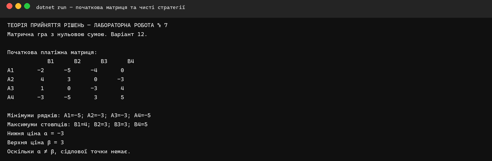
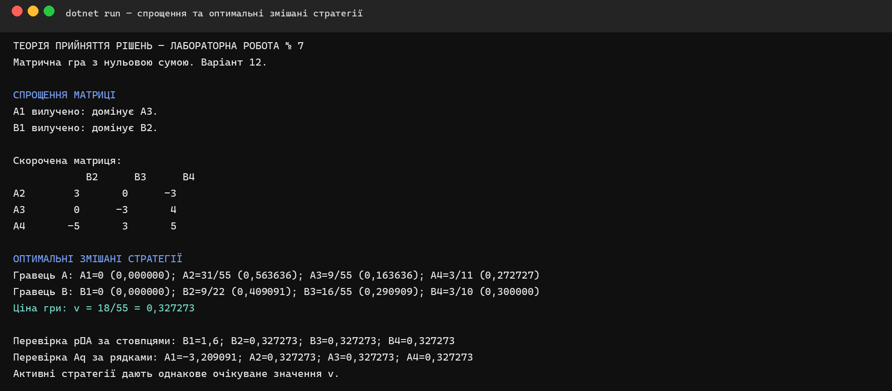
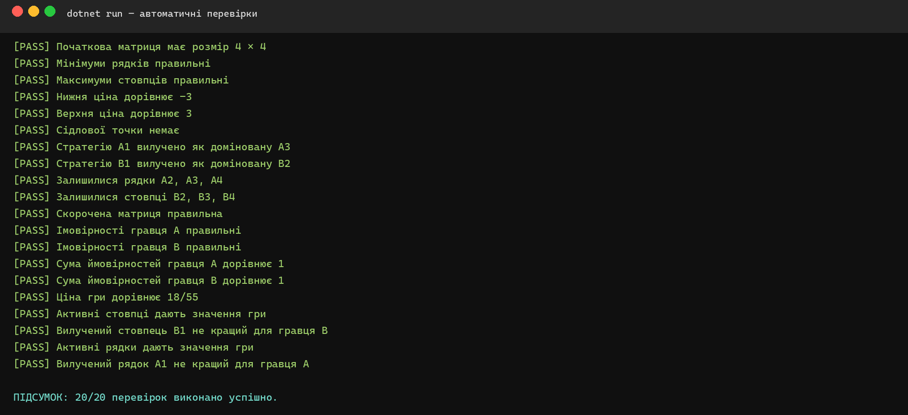

<div align="center">

**КРЕМЕНЧУЦЬКИЙ НАЦІОНАЛЬНИЙ УНІВЕРСИТЕТ<br>
ІМЕНІ МИХАЙЛА ОСТРОГРАДСЬКОГО**

**КАФЕДРА АВТОМАТИЗАЦІЇ ТА ІНФОРМАЦІЙНИХ СИСТЕМ**

# ЗВІТ З ЛАБОРАТОРНОЇ РОБОТИ № 7

з навчальної дисципліни **«Теорія прийняття рішень»**

**Варіант 12**

</div>

**Виконав:** студент групи КН-24-1 Левченко Д. В.

**Перевірила:** доцент кафедри Рилова Н. В.

## Тема

Розв'язання задачі теорії ігор. Матричні ігри.

## Мета

Опанувати методи спрощення й розв'язання матричних ігор.

## Постановка завдання

Для платіжної матриці варіанта № 12 потрібно вилучити доміновані стратегії, знайти нижню та верхню ціни гри й перевірити наявність сідлової точки. Якщо сідлової точки немає, необхідно поставити та розв'язати задачу знаходження оптимальних змішаних стратегій.

## Вихідні дані варіанта 12

| Стратегія | B1 | B2 | B3 | B4 | min |
|:---:|---:|---:|---:|---:|---:|
| A1 | -2 | -5 | -4 | 0 | -5 |
| A2 | 4 | 3 | 0 | -3 | **-3** |
| A3 | 1 | 0 | -3 | 4 | **-3** |
| A4 | -3 | -5 | 3 | 5 | -5 |
| max | 4 | **3** | **3** | 5 | |

## Порядок виконання роботи

1. У програмі C# задано початкову платіжну матрицю `4 × 4`.
2. Знайдено та вилучено доміновані стратегії обох гравців.
3. Обчислено нижню та верхню ціни гри.
4. Перевірено наявність сідлової точки.
5. Для скороченої матриці поставлено задачі пошуку змішаних стратегій.
6. Розв'язано системи рівнянь, знайдено ймовірності стратегій і ціну гри.
7. Результат перевірено підстановкою та автоматичними тестами.

## Аналіз гри в чистих стратегіях

Мінімуми рядків дорівнюють `{-5; -3; -3; -5}`, тому нижня ціна гри:

`α = max{-5; -3; -3; -5} = -3`.

Максимуми стовпців дорівнюють `{4; 3; 3; 5}`, тому верхня ціна гри:

`β = min{4; 3; 3; 5} = 3`.

Оскільки `α ≠ β`, сідлової точки немає і гру потрібно розв'язувати у змішаних стратегіях.



## Спрощення платіжної матриці

Рядок `A1 = {-2; -5; -4; 0}` домінується рядком `A3 = {1; 0; -3; 4}`, оскільки кожен елемент `A3` не менший за відповідний елемент `A1`. Тому стратегію **A1** вилучено.

Після цього стовпець `B1 = {4; 1; -3}` домінується стовпцем `B2 = {3; 0; -5}`, оскільки гравець B мінімізує програш і кожен елемент `B2` не більший за відповідний елемент `B1`. Тому стратегію **B1** вилучено.

Скорочена матриця має вигляд:

| | B2 | B3 | B4 |
|:---:|---:|---:|---:|
| A2 | 3 | 0 | -3 |
| A3 | 0 | -3 | 4 |
| A4 | -5 | 3 | 5 |

У скороченій матриці додаткових домінованих рядків або стовпців немає.

## Постановка задач у змішаних стратегіях

Нехай `p₂`, `p₃`, `p₄` — імовірності стратегій гравця A. Гравець A максимізує `v` за умов:

```text
3p₂        - 5p₄ ≥ v
      - 3p₃ + 3p₄ ≥ v
-3p₂ + 4p₃ + 5p₄ ≥ v
p₂ + p₃ + p₄ = 1,  pᵢ ≥ 0.
```

Нехай `q₂`, `q₃`, `q₄` — імовірності стратегій гравця B. Гравець B мінімізує `v` за умов:

```text
3q₂        - 3q₄ ≤ v
      - 3q₃ + 4q₄ ≤ v
-5q₂ + 3q₃ + 5q₄ ≤ v
q₂ + q₃ + q₄ = 1,  qⱼ ≥ 0.
```

У точці рівноваги всі активні чисті стратегії дають однаковий очікуваний результат. Розв'язання відповідних систем рівнянь дає оптимальні змішані стратегії.

## Оптимальні змішані стратегії

Для гравця A:

| Стратегія | Точна ймовірність | Десяткове значення |
|:---:|:---:|---:|
| A1 | 0 | 0,000000 |
| A2 | 31/55 | 0,563636 |
| A3 | 9/55 | 0,163636 |
| A4 | 3/11 | 0,272727 |

Для гравця B:

| Стратегія | Точна ймовірність | Десяткове значення |
|:---:|:---:|---:|
| B1 | 0 | 0,000000 |
| B2 | 9/22 | 0,409091 |
| B3 | 16/55 | 0,290909 |
| B4 | 3/10 | 0,300000 |

Ціна гри:

`v = 18/55 ≈ 0,327273`.



## Перевірка результату

Для стратегії гравця A очікувані виграші проти стовпців `B1–B4` дорівнюють:

`pᵀA = {1,600000; 0,327273; 0,327273; 0,327273}`.

Гравець B використовує `B2`, `B3`, `B4`, для яких очікуваний виграш A однаковий і дорівнює ціні гри. Невикористаний стовпець `B1` дає A більший виграш, тому B не обирає його.

Для стратегії гравця B очікувані виграші рядків `A1–A4` дорівнюють:

`Aq = {-3,209091; 0,327273; 0,327273; 0,327273}`.

Гравець A використовує `A2`, `A3`, `A4`, які дають ціну гри. Невикористаний рядок `A1` має менший результат, тому A не обирає його.

## Перевірка програми

Автоматично перевірено початкову та скорочену матриці, доміновані стратегії, нижню й верхню ціни, відсутність сідлової точки, імовірності змішаних стратегій та ціну гри.



Усі 20 перевірок виконано успішно. Рішення збирається в конфігурації Release без попереджень і помилок.

## Відповіді на контрольні питання

### 1. У чому сенс конфліктної ситуації

Конфліктна ситуація виникає, коли учасники мають протилежні інтереси, а результат кожного залежить не лише від його власного вибору, а й від дій іншого учасника.

### 2. Пояснити правила спрощення матриці гри

Однакові рядки або стовпці можна об'єднати. Для гравця A, який максимізує виграш, вилучають рядок, значення якого не більші за значення іншого рядка. Для гравця B, який мінімізує програш, вилучають стовпець, значення якого не менші за значення іншого стовпця.

### 3. У чому сутність змішаних стратегій

Змішана стратегія — це розподіл імовірностей між чистими стратегіями. Гравець випадково обирає чисту стратегію відповідно до знайдених імовірностей, не дозволяючи супернику використати передбачуваність його дій.

### 4. Пояснити постановку задачі лінійного програмування для вирішення матричної гри

Для гравця A вводять імовірності рядків і максимізують гарантований виграш `v` за умов, що очікуваний результат проти кожного стовпця не менший за `v`. Для гравця B вводять імовірності стовпців і мінімізують `v` за умов, що очікуваний виграш A для кожного рядка не більший за `v`. Суми ймовірностей дорівнюють одиниці, усі ймовірності невід'ємні.

## Висновки

У лабораторній роботі мовою C# розв'язано матричну гру варіанта № 12. Стратегії `A1` і `B1` вилучено як доміновані. Нижня ціна гри дорівнює `-3`, верхня — `3`, тому сідлової точки немає. Знайдено оптимальні змішані стратегії: `p = (0; 31/55; 9/55; 3/11)` для гравця A та `q = (0; 9/22; 16/55; 3/10)` для гравця B. Ціна гри становить `v = 18/55 ≈ 0,327273`. Коректність результатів підтверджено 20 автоматичними перевірками.
