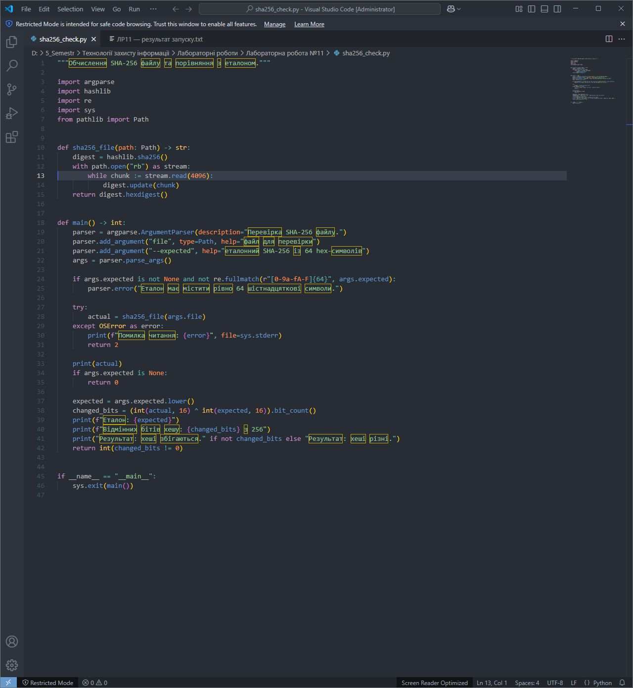
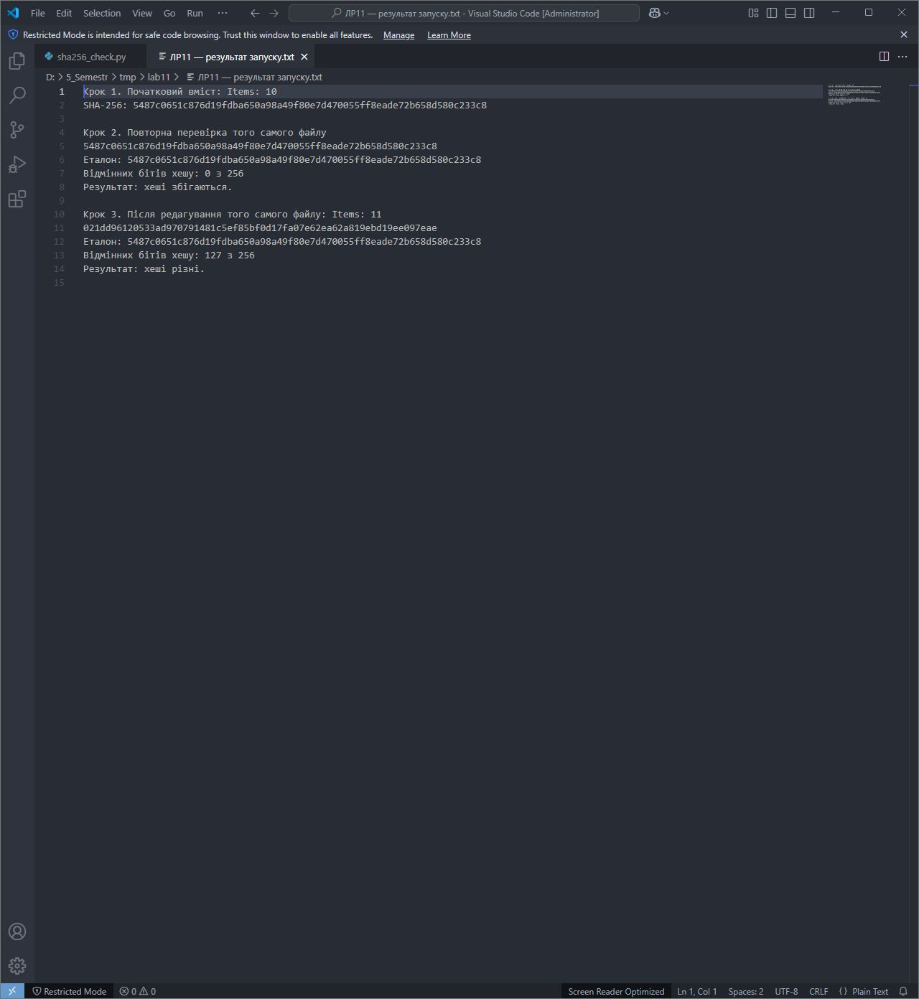

# Звіт до лабораторної роботи №11

**Дисципліна** «Технології захисту інформації»

**Тема** «Забезпечення цілісності файлів за допомогою алгоритму хешування SHA-256»

| Відомості | Дані |
|---|---|
| Виконав | Левченко Д. В., група КН-24-1 |
| Перевірив | Андреєв П. І. |
| Завдання | Спільне для групи, без поділу на варіанти |
| Рік | 2026 |

## Мета

Навчитися обчислювати SHA-256 для файла, зберігати початковий хеш як еталон і перевіряти цілісність повторним обчисленням. У досліді спочатку перевіряємо незмінений файл, а потім змінюємо в ньому один біт.

## 1. Готуємо вхідні дані

Початковий файл містить `Items: 10`. Це дев’ять байтів ASCII без BOM і перенесення рядка в кінці. Копіюємо [before.txt](./samples/before.txt) у робочий файл `items.txt`. Після першої перевірки перезаписуємо вміст цього самого файла байтами з [after.txt](./samples/after.txt). Точні версії збережені окремо для повторення досліду.

| Стан файла | Вміст | Останній байт |
|---|---|---|
| До зміни | `Items: 10` | `0` = `0x30` = `00110000` |
| Після зміни | `Items: 11` | `1` = `0x31` = `00110001` |

Розмір обох версій однаковий. Змінився лише останній біт останнього байта. Це видно з операції `0x30 XOR 0x31 = 0x01`.

## 2. Обчислюємо еталонний SHA-256

1. У [sha256_check.py](./sha256_check.py#L10-L15) викликаємо `hashlib.sha256()` і створюємо об’єкт для нового обчислення.
2. Відкриваємо файл у режимі `rb`. Програма отримує точні байти, зокрема будь-які пробіли та перенесення рядків, які є у файлі.
3. Викликаємо `read(4096)` і передаємо кожну непорожню порцію байтів у `digest.update(chunk)`. Наступна ітерація продовжує обчислення на тому самому об’єкті. Коли `read()` повертає порожнє `b""`, цикл завершується.
4. Викликаємо `hexdigest()`. SHA-256 має довжину 256 бітів, або 32 байти. Один шістнадцятковий символ подає 4 біти, тож у виводі рівно 64 символи. [Документація Python про hashlib](https://docs.python.org/3/library/hashlib.html)



На рис. 1 функція `sha256_file()` розташована в рядках 10–15. Наші дев’ять байтів потрапляють у перший виклик `update()`. Для великого файла той самий цикл поступово обробить усі порції.

## 3. Перевіряємо файл до і після зміни

Повторюємо дослід у PowerShell із папки лабораторної:

```powershell
$work = Join-Path ([System.IO.Path]::GetTempPath()) ([System.IO.Path]::GetRandomFileName())
Copy-Item ./samples/before.txt $work
$expected = python sha256_check.py $work
python sha256_check.py $work --expected $expected
Copy-Item ./samples/after.txt $work -Force
python sha256_check.py $work --expected $expected
```

1. Перший запуск повертає еталон. Зберігаємо його у змінній `$expected`.
2. Знову читаємо той самий файл. Поточний хеш порівнюємо з еталоном, отримуємо збіг і 0 відмінних бітів.
3. Перезаписуємо файл зміненим вмістом. Еталон лишається в тій самій змінній. Наступне обчислення повертає інший хеш і 127 відмінних бітів.

## 4. Розбираємо порівняння хешів

Кожен шістнадцятковий рядок перетворюємо на число за допомогою `int(..., 16)`. XOR дає одиницю в кожній позиції, де два біти відрізняються. Метод `bit_count()` рахує ці одиниці.

Наприклад, перший байт еталона — `54`, а перший байт нового хешу — `02`. Обчислюємо `0x54 XOR 0x02 = 0x56`. Двійковий запис `01010110` має чотири одиниці, отже в першому байті відрізняються чотири біти. Якщо порахувати всі 32 байти, отримуємо `127 / 256 ≈ 49,6 %`. Така велика зміна хешу після малої зміни входу ілюструє лавинний ефект.

## 5. Перевіряємо результат



| Перевірка | Поточний SHA-256 | Відмінних бітів |
|---|---|---:|
| Початковий файл | `5487c0651c876d19fdba650a98a49f80e7d470055ff8eade72b658d580c233c8` | 0 |
| Файл після редагування | `021dd96120533ad970791481c5ef85bf0d17fa07e62ea62a819ebd19ee097eae` | 127 |

На рис. 2 спочатку видно отримання еталона. У другому блоці рядок «Відмінних бітів хешу» показує 0, у третьому — 127. Окремо обидва значення перевірено через `Get-FileHash -Algorithm SHA256` у PowerShell. Результати збіглися з Python.

Для перевірки завантаженого файла еталон потрібно отримати з довіреного джерела. Якщо доступна тільки поточна версія файла, можна обчислити її хеш для майбутніх перевірок.

## Контрольні питання

1. **Що таке цілісність даних і для чого вона потрібна?** Це збереження вмісту даних без небажаних змін. Перевірка допомагає помітити пошкодження або підміну файла.
2. **Яка довжина хешу SHA-256 у байтах?** 32 байти, тобто 256 бітів або 64 шістнадцяткові символи.
3. **Як створити об’єкт SHA-256 у Python?** Викликати конструктор `hashlib.sha256()`.
4. **Який метод повертає шістнадцятковий рядок?** `hexdigest()`.
5. **Як передати хеш-об’єкту нові дані?** Викликати `update(дані)`. Передаємо байти, наприклад порцію з відкритого в режимі `rb` файла.

## Висновок

Повторне читання початкового файла дало той самий SHA-256. Після зміни одного вхідного біта змінилися 127 із 256 бітів хешу. Обчислення порціями дозволяє так само перевіряти файли, які завеликі, щоб читати їх цілком у пам’ять.
