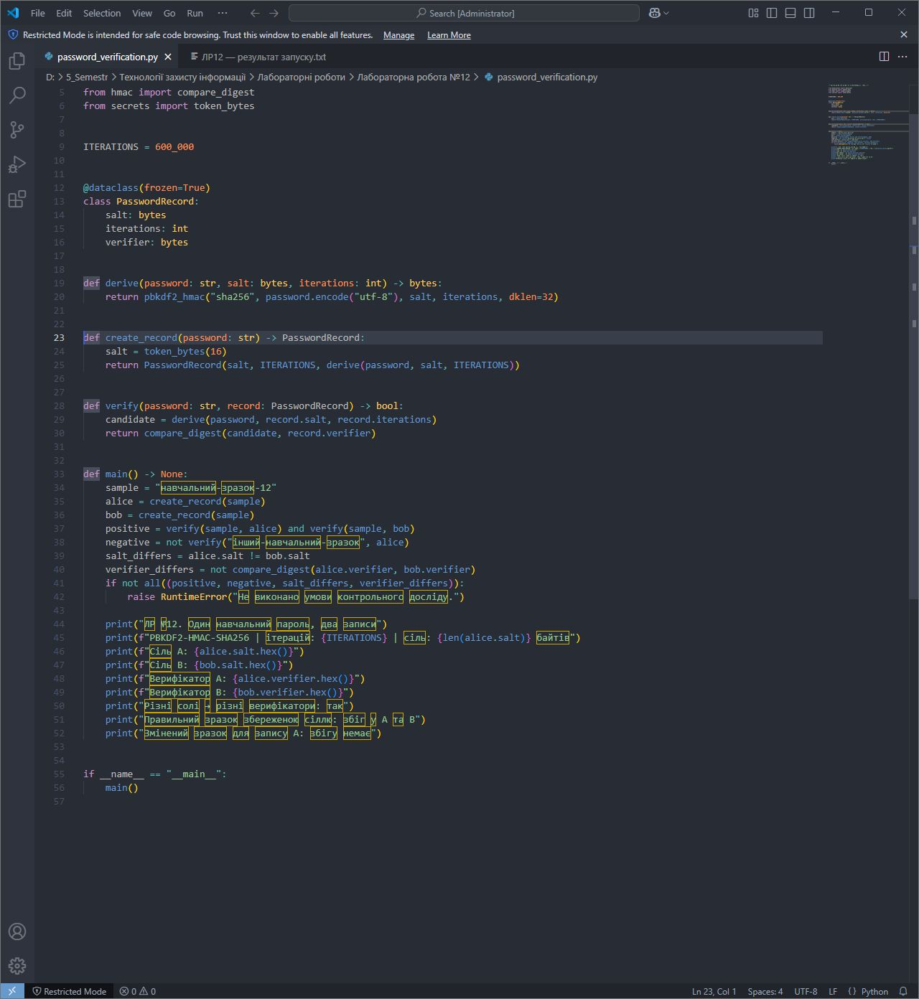
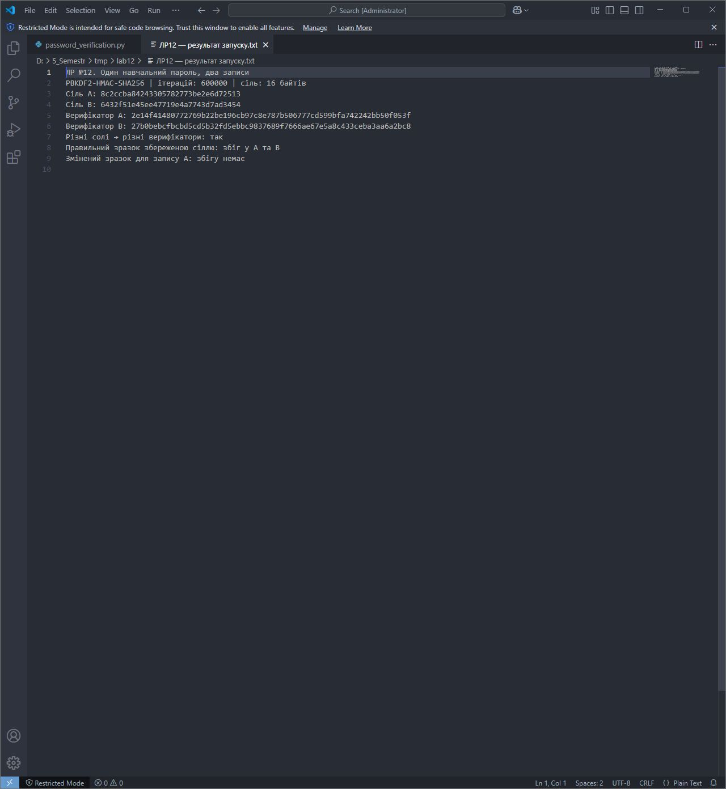

# Звіт до лабораторної роботи №12

**Дисципліна** «Технології захисту інформації»

**Тема** «Перевірка стійкості паролів до атак із використанням райдужних таблиць»

| Відомості | Дані |
|---|---|
| Виконав | Левченко Д. В., група КН-24-1 |
| Перевірив | Андреєв П. І. |
| Завдання | Спільне для групи, без поділу на варіанти |
| Рік | 2026 |

## Мета

Пояснити, як попереднє обчислення та збереження кінців ланцюжків скорочує обсяг таблиці. Перевірити на двох навчальних записах, як випадкова сіль впливає на результат обчислення і як програма перевіряє введений пароль.

## 1. Готуємо вхідні дані

Для схеми беремо три умовні картки **А**, **Б** і **В**. Числа **2** та **7** на схемі відіграють роль умовних результатів хешування. Для запуску програми беремо один відомий текст `навчальний-зразок-12` і створюємо для нього два записи, A та B. Однаковий вхід і однакова кількість ітерацій дають змогу виділити вплив солі.

## 2. Розбираємо ланцюжок райдужної таблиці

У райдужній таблиці зберігаються початкові та кінцеві значення ланцюжків. Хеш-функція дає значення фіксованої довжини, а функція редукції ставить цьому значенню у відповідність новий умовний вхід. У різних стовпцях ланцюжка використовуються різні редукції. Проміжні значення можна відтворити з початку, тому їх не потрібно зберігати окремо. [Праця Філіппа Ехслана про райдужні таблиці](https://infoscience.epfl.ch/record/99512/files/Oech03.pdf)

| Крок | Що робимо з карткою | Що отримуємо |
|---:|---|---|
| 1 | Беремо початкову картку | А |
| 2 | Підставляємо А в умовну хеш-функцію | 2 |
| 3 | За правилом першого стовпця замінюємо 2 | Б |
| 4 | Підставляємо Б в умовну хеш-функцію | 7 |
| 5 | За правилом другого стовпця замінюємо 7 | В |

У таблиці лишається пара **А → В**. Якщо на схемі задано умовний результат **7** і він стоїть у другому стовпці, редукція другої позиції дає кінцеву картку **В**. Починаємо з **А**, послідовно відтворюємо рядки таблиці й бачимо, що результат **7** виник після **Б**. Перевірка проміжного значення важлива, бо сам збіг кінцевої точки ще нічого не доводить.

## 3. Створюємо два записи з випадковою сіллю

1. У [password_verification.py](./password_verification.py#L19-L30) `create_record()` викликає `token_bytes(16)` окремо для кожного запису.
2. `derive()` перетворює пароль на байти UTF-8 й передає його разом із сіллю у **PBKDF2-HMAC-SHA256**. Для досліду задано **600 000 ітерацій** і вихід **32 байти**. Ітерації збільшують вартість кожного обчислення. [Документація Python про PBKDF2](https://docs.python.org/3/library/hashlib.html#hashlib.pbkdf2_hmac)
3. У записі зберігаємо сіль, кількість ітерацій і верифікатор. При перевірці повторюємо PBKDF2 з тими самими параметрами та звіряємо результат із верифікатором.

На рис. 1 у рядках 23–25 для кожного нового запису створюється випадкова сіль. У рядках 28–30 `verify()` бере сіль саме з того запису, який перевіряє.

## 4. Перевіряємо три випадки

1. **Той самий пароль, різні солі.** Для A і B вводимо однаковий навчальний текст. Сіль різна, тож два обчислення дають різні верифікатори.
2. **Той самий пароль, своя збережена сіль.** Щоб перевірити A, повторюємо обчислення із сіллю A. Для B повторюємо із сіллю B. `compare_digest()` підтверджує збіг у кожному записі.
3. **Інший пароль, сіль запису A.** Беремо ту саму сіль A, але інший навчальний рядок. Новий верифікатор відрізняється від збереженого, перевірка його відхиляє.

Спільну таблицю, обчислену без індивідуальних солей, не можна повторно застосувати до цих записів. Для кожної солі знадобилися б окремі обчислення. Сіль можна зберігати разом із верифікатором. Вона ускладнює повторне використання попередніх обчислень, а ітерації збільшують вартість окремої спроби. [Настанови NIST із захисту паролів](https://pages.nist.gov/800-63-4/sp800-63b.html)

## 5. Перевіряємо результат

| Що порівняли | Результат |
|---|---|
| Випадкові солі A та B | Різні, по 16 байтів |
| Верифікатори для одного пароля | Різні, по 32 байти |
| Початковий пароль і сіль відповідного запису | Збіг для A та B |
| Змінений пароль і сіль A | Збігу немає |

На рис. 2 у рядках «Сіль A» та «Сіль B» наведено випадкові значення одного запуску. Нижче видно два різні верифікатори. Останні два рядки показують, що правильний зразок пройшов перевірку, а змінений — ні. У наступному запуску числа будуть іншими через нові солі.

## Контрольні питання

1. **Що таке райдужна таблиця і для чого вона використовується?** Це структура попередньо обчислених ланцюжків, яка дозволяє шукати можливі вхідні значення за хешем із меншою витратою пам’яті.
2. **Як працює ланцюжок?** Чергуються хешування і редукція. Хешування обчислює значення для поточного входу, а редукція обирає вхід для наступного кроку.
3. **Яка роль бібліотеки `rainbowtables` у прикладі методички?** Вона готує набір попередньо обчислених даних для заданого алгоритму й підтримує пошук у цьому наборі. У звіті принцип зберігання пояснено на схемі з трьома картками.
4. **Як перевіряють умовний збіг у ланцюжку?** Кінцева точка вказує на можливий ланцюжок. Його відтворюють від початку й звіряють саме проміжне значення.
5. **Як сіль захищає пароль?** Індивідуальна сіль дає різні верифікатори навіть для однакового пароля. Попередні обчислення для однієї солі не переносяться на іншу.

## Висновок

Схема з картками показала, як відтворити проміжні кроки, зберігаючи лише початок і кінець. У досліді один пароль із різними солями дав різні верифікатори. Для перевірки пароля програма застосувала збережену сіль відповідного запису й правильно розрізнила початковий і змінений зразки.
