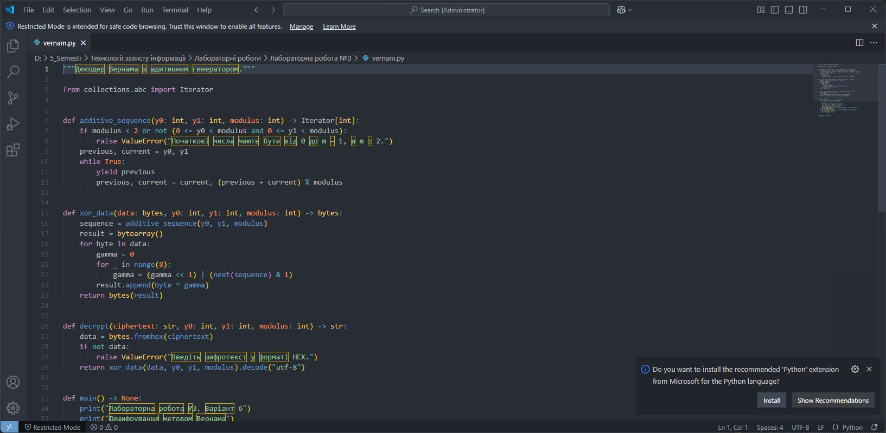

# Лабораторна робота №3

**Дисципліна** «Технології захисту інформації»

**Тема** «Шифрування методом Вернама»

| Відомості | Дані |
|---|---|
| Виконав | Левченко Д. В., КН-24-1 |
| Перевірив | Андреєв П. І. |
| Варіант | 6 (номер за списком 12) |
| Рік | 2026 |

## Мета і завдання

Реалізувати декодер Вернама, у якому ключова послідовність формується адитивним генератором. У методичних вказівках наведено шість пунктів. За циклічною нумерацією номер 12 відповідає шостому пункту.

## Хід роботи

1. Програма отримує шифротекст у HEX та параметри генератора `y0`, `y1`, `m`.
2. Функція `additive_sequence()` починає з `4003` і `59`. Далі додає два останні числа й бере остачу за модулем 4096. Перші кроки дають `4003 + 59 = 4062`, `59 + 4062 = 4121 → 25`, `4062 + 25 = 4087`, `25 + 4087 = 4112 → 16`, `4087 + 16 = 4103 → 7`, `16 + 7 = 23`.
3. Беремо молодший біт кожного числа. Непарне число дає 1, парне — 0. Для `4003, 59, 4062, 25, 4087, 16, 7, 23` отримуємо перший байт гами `11011011` (HEX `DB`).
4. Функція `xor_data()` виконує XOR кожного байта шифротексту з відповідним байтом ключової послідовності. Функція `decrypt()` декодує результат як UTF-8.

Операція XOR оборотна. Якщо `y = x ⊕ k`, то `y ⊕ k = x`. Наприклад, перший байт шифротексту `0B` після XOR із `DB` дає `D0`, перший байт літери «З» у UTF-8.

## Результати



Контрольний приклад запускається з файла [demo.py](./demo.py).

```text
Параметри: y0 = 4003, y1 = 59, m = 4096
Шифротекст (HEX): 0B FA 66 6B BC 33 0B D5 67 5A BC 34 FB BC 20 0B D0 67 5F BD 08 0A ED 66 67 BD 06 0A EB 67 4D BC 21 FA
Відновлений текст: Захист інформації!
```

П’ять тестів перевіряють числа генератора, перший байт ключової послідовності, відновлення українського тексту та обробку неправильних даних.

## Контрольні питання

1. **Що таке шифрування і дешифрування?** Шифрування перетворює відкритий текст на шифротекст. Дешифрування відновлює початковий текст.
2. **Що таке алфавіт і текст?** Алфавіт — набір допустимих символів. Текст — послідовність цих символів.
3. **Що таке ключ?** Це значення, яке визначає конкретне перетворення даних. У цій програмі параметри генератора задають ключову послідовність.
4. **У чому полягає метод Вернама?** Біти повідомлення та ключової послідовності поєднуються операцією XOR. Повторний XOR із тими самими бітами відновлює повідомлення.
5. **Як реалізувати нескінченну послідовність ключів?** Генератор може видавати нові числа за рекурентною формулою стільки разів, скільки потрібно. Для скінченного модуля послідовність зрештою повторюється.
6. **Яким має бути текст перед шифруванням?** Його треба подати у двійковій формі. У програмі рядок кодується в байти UTF-8.

## Висновок

Декодер відновив повідомлення «Захист інформації!» із шифротексту та параметрів генератора. Адитивний генератор використано як навчальний приклад. Його повторювана послідовність молодших бітів непридатна для захисту реальних даних.
