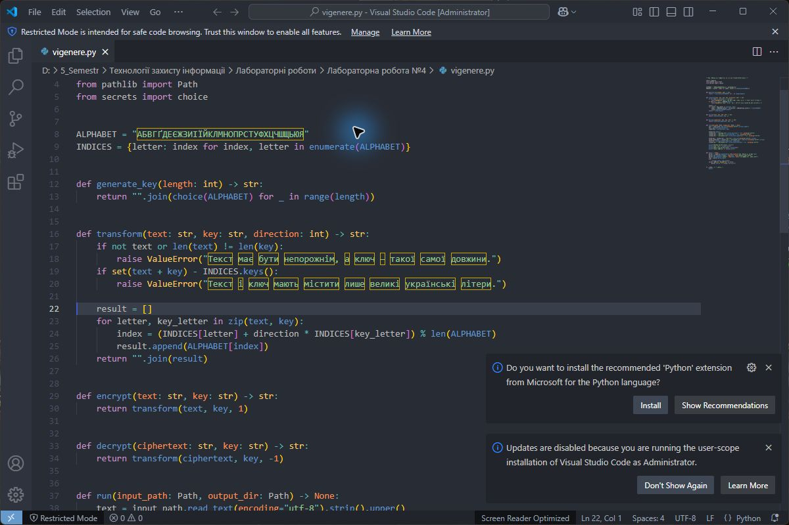

# Звіт до лабораторної роботи №4

**Дисципліна** «Технології захисту інформації»

**Тема** «Симетричні криптосистеми: шифри складної заміни»

| Відомості | Дані |
|---|---|
| Виконав | Левченко Д. В., група КН-24-1 |
| Перевірив | Андреєв П. І. |
| Варіант | 12 |
| Рік | 2026 |

## Мета роботи

Застосувати шифр складної заміни до тексту українською мовою, згенерувати ключ, розшифрувати отримане повідомлення та перевірити відновлення за даними з файлів.

## Постановка завдання та вибір методу

За таблицею 4.1 методичних вказівок для варіантів 11–12 задано повідомлення «ПОВІДОМЛЕННЯ». Для варіантів 11–20 використовується український алфавіт. Отже, для варіанта 12 беремо саме це слово і 33 літери української абетки. У завданні також вимагається згенерувати випадковий ключ і зберегти вихідне повідомлення, ключ, шифротекст та відновлене повідомлення в окремих файлах.

Зі списку методів у лабораторній обрано шифр Віженера. Він узагальнює шифр Цезаря. У Цезаря зсув фіксований, а у Віженера його значення визначає літера ключа в поточній позиції. Наприклад, дві сусідні літери «Н» у слові мають однаковий номер 17, але отримують різні зсуви, якщо відповідні літери ключа різні.

## Алфавіт і формули

У програмі літери розміщено у звичайному порядку. Нумерація починається з нуля, як і індекси рядка в Python.

```text
Літера: А  Б  В  Г  Ґ  Д  Е  Є  Ж  З  И  І  Ї  Й  К  Л  М
Номер:  0  1  2  3  4  5  6  7  8  9 10 11 12 13 14 15 16

Літера: Н  О  П  Р  С  Т  У  Ф  Х  Ц  Ч  Ш  Щ  Ь  Ю  Я
Номер: 17 18 19 20 21 22 23 24 25 26 27 28 29 30 31 32
```

Позначимо номер літери повідомлення як `pᵢ`, номер літери ключа як `kᵢ`, а номер літери шифротексту як `cᵢ`. Зсув уперед відповідає додаванню номера ключової літери. Після «Я» знову йде «А», тому від суми беремо остачу за модулем 33.

- Шифрування. `cᵢ = (pᵢ + kᵢ) mod 33`.
- Дешифрування. `pᵢ = (cᵢ − kᵢ) mod 33`.

Віднімання повертає той самий номер, бо `((pᵢ + kᵢ) − kᵢ) mod 33 = pᵢ mod 33`, а номер `pᵢ` уже належить діапазону 0–32. У Python вираз `(4 - 18) % 33` дає 19, тому для переходу через початок алфавіту достатньо оператора `%`.

## Як формується ключ

Слово має 12 літер. Для кожної позиції функція `generate_key()` незалежно вибирає одну з 33 літер через `secrets.choice(ALPHABET)`. Отже, ключ теж складається з 12 літер. Повторення окремих літер, наприклад «О» у контрольному ключі, допустиме. Під час нового запуску програма знову генерує весь ключ.

Методичка вимагає випадковий ключ і відсилає до лекції «Шифри аналітичних перетворень». Окремого тексту лекції серед доступних матеріалів немає. Вибір однієї випадкової літери на позицію та використання `secrets.choice()` є рішеннями цієї реалізації. Ключ у каталозі `example` збережено як відкритий контрольний зразок, щоб можна було перевірити розрахунок.

## Як працює програма

1. `run()` читає вхідний файл UTF-8, прибирає крайові пробільні символи та переводить літери у верхній регістр.
2. `generate_key()` створює ключ на довжину підготовленого повідомлення.
3. `encrypt()` передає текст і ключ у `transform()` зі знаком `+1`. Функція перевіряє довжину та алфавіт, потім обробляє пари літер за формулою шифрування.
4. Програма записує повідомлення, ключ і шифротекст до нової папки.
5. Програма читає ключ і шифротекст із записаних файлів. `decrypt()` викликає `transform()` зі знаком `−1`. Результат записується в четвертий файл.

Читання файлів перед дешифруванням дає змогу перевірити весь шлях даних. Для відновлення достатньо саме збережених шифротексту і ключа. Вхідне слово використовується для звіряння результату.



*Рисунок 1. Функції генерації ключа, шифрування та дешифрування.*

## Контрольний запуск і ручний розрахунок

Команда `python vigenere.py message.txt example` створила наведений нижче комплект файлів. При повторному запуску слід указати нову папку, наприклад `result`.

| Файл | Вміст контрольного запуску |
|---|---|
| [message.txt](./example/message.txt) | `ПОВІДОМЛЕННЯ` |
| [key.txt](./example/key.txt) | `ОКОЧДШЩВПРНТ` |
| [encrypted.txt](./example/encrypted.txt) | `ҐЯРДИЙЇНХҐБС` |
| [decrypted.txt](./example/decrypted.txt) | `ПОВІДОМЛЕННЯ` |

У таблиці наведено окремий розрахунок для кожної пари літер із контрольних файлів. Наприклад, у першій позиції «П» має номер 19, «О» має номер 18, а `(19 + 18) mod 33 = 4`. Номеру 4 відповідає «Ґ».

| Позиція | Літера тексту | Номер | Літера ключа | Зсув | Сума | Остача mod 33 | Літера шифру |
|---:|:---:|---:|:---:|---:|---:|---:|:---:|
| 1 | П | 19 | О | 18 | 37 | 4 | Ґ |
| 2 | О | 18 | К | 14 | 32 | 32 | Я |
| 3 | В | 2 | О | 18 | 20 | 20 | Р |
| 4 | І | 11 | Ч | 27 | 38 | 5 | Д |
| 5 | Д | 5 | Д | 5 | 10 | 10 | И |
| 6 | О | 18 | Ш | 28 | 46 | 13 | Й |
| 7 | М | 16 | Щ | 29 | 45 | 12 | Ї |
| 8 | Л | 15 | В | 2 | 17 | 17 | Н |
| 9 | Е | 6 | П | 19 | 25 | 25 | Х |
| 10 | Н | 17 | Р | 20 | 37 | 4 | Ґ |
| 11 | Н | 17 | Н | 17 | 34 | 1 | Б |
| 12 | Я | 32 | Т | 22 | 54 | 21 | С |

Для зворотної перевірки беремо номер «Ґ» і віднімаємо номер літери ключа «О». Виходить `4 − 18 = −14`. Додаємо 33, отримуємо `19`, тобто «П». Так само в останній позиції `21 − 22 = −1`, а після додавання 33 виходить `32`, тобто «Я». У позиціях 10 і 11 однакові літери «Н» зашифрувалися як «Ґ» та «Б» через різні зсуви.

## Перевірка

Команда `python -m unittest -v` виконала шість тестів. Перевірено перехід через край алфавіту в обох напрямках, різні зсуви для однакових літер, генерацію ключа потрібної довжини, відхилення ключа неправильної довжини та символу поза алфавітом. Окремий тест запускає повний цикл в тимчасовій папці, перевіряє наявність чотирьох файлів і порівнює відновлений текст із вихідним. Усі тести пройшли.

## Відповіді на контрольні питання

1. **Що характерно для симетричних систем?** Для шифрування і дешифрування потрібен той самий секретний ключ. Перетворення є взаємно оберненими.
2. **Що таке ключ?** Це дані, що визначають конкретний спосіб перетворення повідомлення. У цій роботі ключ задає зсув для кожної літери.
3. **У чому суть шифрування підстановкою?** Кожну літеру чи групу літер замінюють іншою за правилом, визначеним ключем.
4. **Що спрощує алгебраїчні дії?** Літерам надають числові індекси, після чого заміну виконують додаванням або відніманням за модулем розміру алфавіту.
5. **Чим складна заміна відрізняється від простої?** За простої підстановки одна літера завжди має ту саму заміну в межах заданого ключа. За складної заміна може залежати від позиції.
6. **Чому систему називають одноразовою?** Випадковий ключ на довжину повідомлення використовують лише для одного повідомлення. Для наступного формують незалежний ключ.
7. **На підставі яких перетворень здійснюється кодування?** У цій програмі до номера літери додається номер ключової літери за модулем 33. Для відновлення цей номер віднімається.
8. **Які переваги й недоліки одноразової системи?** За рівномірного випадкового, секретного й одноразового ключа, довжина якого дорівнює довжині повідомлення, система має теоретичну досконалу секретність. На практиці потрібно безпечно передати та зберегти ключ, а його довжина зростає разом із повідомленням.

## Висновок

Для варіанта 12 реалізовано шифр Віженера над українським алфавітом. За контрольним ключем слово «ПОВІДОМЛЕННЯ» перетворилося на «ҐЯРДИЙЇНХҐБС». Результат збігся з ручним розрахунком. Дешифрування зі збережених файлів відновило вихідне слово.

## Джерело завдання

«Методичні вказівки щодо виконання лабораторних робіт з навчальної дисципліни “Технології захисту інформації”», лабораторна робота №4, таблиця 4.1, с. 20–22.
