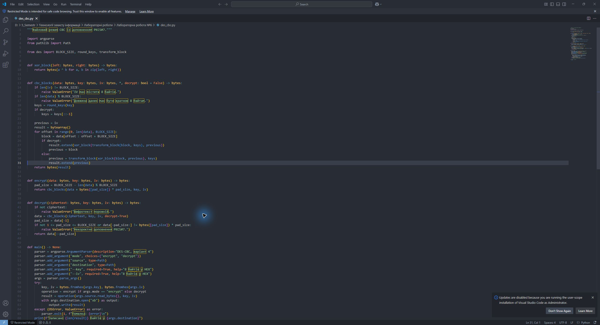

# Звіт до лабораторної роботи №6

**Дисципліна** «Технології захисту інформації»

**Тема** «Шифрування алгоритмом DES»

| Відомості | Дані |
|---|---|
| Виконав | Левченко Д. В., група КН-24-1 |
| Перевірив | Андреєв П. І. |
| Варіант | 4 (номер за списком 12) |
| Рік | 2026 |

## Мета та постановка завдання

Реалізувати шифрування і дешифрування файлів алгоритмом DES у режимі зчеплення блоків (CBC). У методичці вісім варіантів. За циклічним правилом `((12 − 1) mod 8) + 1 = 4`. Варіанти 3–4 відповідають CBC.

Методичка задає структуру DES і містить перестановки IP та IP⁻¹ у таблицях 6.1–6.2. Таблиці добору підключів PC-1 і PC-2, розширення E, перестановку P, S-блоки та порядок зсувів узято з [FIPS 46-3](https://csrc.nist.gov/files/pubs/fips/46-3/final/docs/fips46-3.pdf). Формули CBC та еталонний приклад узято з [FIPS 81, додаток B](https://csrc.nist.gov/files/pubs/fips/81/final/docs/fips81.pdf). Доповнення PKCS#7 потрібне для роботи з файлами довільної довжини і є рішенням цієї реалізації.

## Від байтів до раундів DES

1. Файл читається як послідовність байтів. Один блок DES має 64 біти, тобто 8 байтів. Біти нумеруються від старшого, тому, наприклад, перший елемент IP зі значенням 58 переносить 58-й біт на перше місце.
2. Після IP блок ділиться на дві 32-бітові половини `L₀` та `R₀`. Кожен із 16 раундів обчислює `Lᵢ = Rᵢ₋₁` і `Rᵢ = Lᵢ₋₁ ⊕ F(Rᵢ₋₁, Kᵢ)`.
3. У функції `F` таблиця E розширює праву половину з 32 до 48 бітів, повторюючи частину бітів. Результат поєднується за XOR із 48-бітовим підключем.
4. Отримані 48 бітів діляться на вісім 6-бітових груп. Крайні біти кожної групи задають рядок S-блоку, а чотири середні — стовпець. Кожен S-блок повертає 4 біти. Після об'єднання і перестановки P отримуємо 32-бітове значення `F`.
5. Після раундів половини збираються в порядку `R₁₆ ‖ L₁₆`. Перестановка IP⁻¹ формує вихідний блок. Для дешифрування блок проходить ту саму процедуру з підключами `K₁₆ … K₁`. На вході в обох напрямках застосовується IP, на виході — IP⁻¹, як визначено у FIPS 46-3.

## Як отримано підключі

Ключ задається як 8 байтів. PC-1 відкидає вісім бітів парності й переставляє 56 робочих бітів. Далі ключ ділиться на дві половини по 28 бітів. У кожному раунді обидві половини циклічно зсуваються ліворуч за таблицею зсувів. PC-2 вибирає 48 бітів із їх об'єднання. Так утворюються 16 підключів. У програмі цю послідовність реалізує `round_keys()`.

## Перевірка першого раунду

Для окремої перевірки ядра DES взято блок `0123456789ABCDEF` і ключ `133457799BBCDFF1`. У цьому прикладі показано один блок DES. Для перевірки CBC нижче використано інший контрольний ключ та IV.

| Етап | Значення HEX |
|---|---|
| PC-1 від ключа | `F0CCAAF556678F` |
| Перший підключ після зсуву та PC-2 | `1B02EFFC7072` |
| Половини після IP | `L₀ = CC00CCFF`, `R₀ = F0AAF0AA` |
| Розширення E від `R₀` | `7A15557A1555` |
| XOR із першим підключем | `6117BA866527` |
| Вихід функції F після S-блоків і P | `234AA9BB` |
| Половини після першого раунду | `L₁ = F0AAF0AA`, `R₁ = EF4A6544` |
| Вихід після 16 раундів та IP⁻¹ | `85E813540F0AB405` |

Перші шість бітів значення `6117BA866527` — `011000`. З крайніх бітів `00` отримуємо рядок 0, а з середніх `1100` — стовпець 12. За таблицею S₁ це число 5, тобто `0101`. Після обробки всіх груп і перестановки обчислюємо `R₁ = CC00CCFF ⊕ 234AA9BB = EF4A6544`.

## Як CBC зчіплює блоки

Позначимо відкритий блок як `Pᵢ`, шифрований — як `Cᵢ`, а початковий вектор — як `IV`. Для першого блока попереднє значення `C₀` дорівнює IV. Перед кожним шифруванням виконується `Cᵢ = DESₖ(Pᵢ ⊕ Cᵢ₋₁)`. Під час відновлення порядок операцій зворотний, тому `Pᵢ = DESₖ⁻¹(Cᵢ) ⊕ Cᵢ₋₁`. Значення у змінній `previous` у коді завжди є IV або попереднім блоком шифротексту.

У прикладі FIPS 81 ключ має значення `0123456789ABCDEF`, а IV — `1234567890ABCDEF`. Для першого блока підстановка дає `4E6F772069732074 ⊕ 1234567890ABCDEF = 5C5B2158F9D8ED9B`. Після DES отримуємо `E5C7CDDE872BF27C`. Саме цей шифрований блок використовуємо для XOR із другим відкритим блоком.

| Блок | Відкритий блок | Вхід DES після XOR | Шифрований блок |
|---:|---|---|---|
| 1 | `4E6F772069732074` | `5C5B2158F9D8ED9B` | `E5C7CDDE872BF27C` |
| 2 | `68652074696D6520` | `8DA2EDAAEE46975C` | `43E934008C389C0F` |
| 3 | `666F7220616C6C20` | `25864620ED54F02F` | `683788499A7C05F6` |



*Рисунок 1. Оновлення попереднього блока при шифруванні та дешифруванні.*

## Контрольний запуск із файлом UTF-8

Для перевірки файлового режиму взято текст «Захист інформації!» з переведенням рядка. [Вхідний файл](./example/Source.txt) має 35 байтів. До останнього блока додаються п'ять байтів `05`, тому [шифротекст](./example/Coded.bin) має 40 байтів. Якщо довжина вже кратна 8, PKCS#7 додає цілий блок із восьми байтів `08`. Після дешифрування програма перевіряє значення та кількість байтів доповнення і вилучає їх.

```text
28 F7 61 2B 32 AB 19 A1
96 CB 9C D5 97 41 A0 C6
01 65 84 B8 48 B5 13 E0
57 BA D9 49 F1 EF 80 0E
4F E5 AD 15 74 A9 5E 68
```

[Відновлений файл](./example/DeCoded.txt) побайтово збігається з вихідним, включно з переведенням рядка. Шість тестів перевіряють еталонний блок DES, оберненість IP, три блоки CBC із FIPS 81 у двох напрямках, доповнення, обробку пошкодженого доповнення та перевірку розмірів. Усі тести пройшли.

## Відповіді на контрольні питання

1. **Яка структура DES?** Початкова перестановка, 16 раундів Фейстеля, перестановка половин і завершальна IP⁻¹. Дешифрування використовує зворотний порядок підключів.
2. **Як працює F?** Розширює праву половину до 48 бітів, виконує XOR із підключем, стискає результат вісьмома S-блоками до 32 бітів і застосовує P.
3. **Як отримують підключі?** PC-1 вибирає 56 робочих бітів. Половини зсуваються за графіком, а PC-2 вибирає 48 бітів для кожного раунду.
4. **Як пов'язані IP та IP⁻¹?** Вони обернені. IP⁻¹ повертає кожен біт на позицію, яку він мав до IP.
5. **Як працює ECB?** Кожен блок шифрується окремо тим самим ключем. Однакові відкриті блоки дають однаковий шифротекст.
6. **Як працює CBC?** Перед DES відкритий блок поєднують через XOR із попереднім шифрованим блоком або з IV. При дешифруванні цей XOR виконується після оберненого DES.
7. **Як працює CFB?** DES перетворює IV або регістр з попереднім шифротекстом на гамму. Гамму поєднують з даними через XOR, а шифротекст повертають у регістр зворотного зв'язку.
8. **Як працює OFB?** Перший блок гами одержують шифруванням IV, а наступні — шифруванням попереднього виходу DES. Та сама послідовність дає змогу відновити дані через XOR. У контрольному питанні методички написано «OBC», а в переліку режимів наведено OFB.

## Висновок

Реалізовано DES із 16 раундами та обидва напрями файлового CBC. Результати трьох блоків збіглися з еталоном FIPS 81. Контрольний файл з українським текстом відновлено побайтово. DES використано для навчального відтворення стандарту, який NIST зняв з дії у 2005 році.

## Джерело завдання

«Методичні вказівки щодо виконання лабораторних робіт з навчальної дисципліни “Технології захисту інформації”», лабораторна робота №6, с. 25–29.
