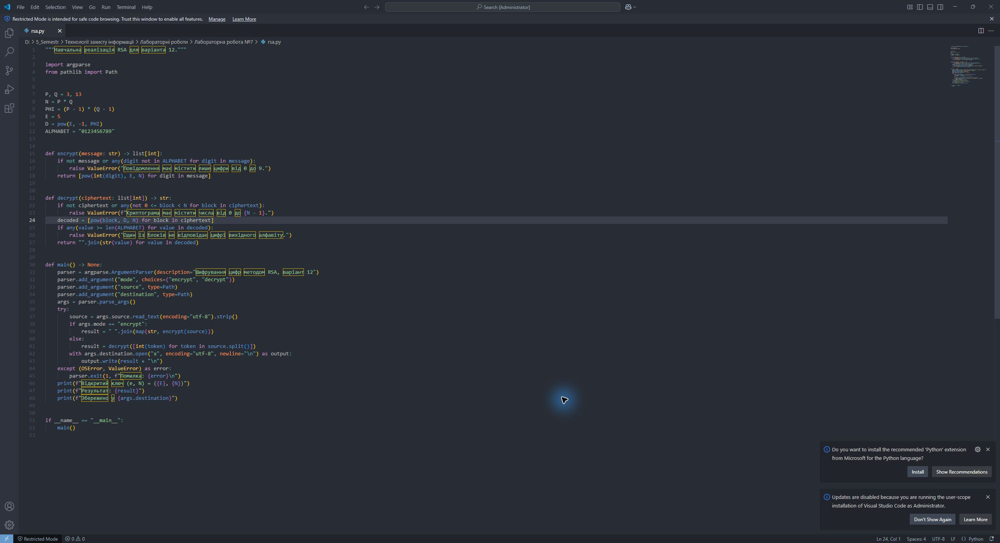

# Звіт до лабораторної роботи №7

**Дисципліна** «Технології захисту інформації»

**Тема** «Системи з відкритим ключем. Алгоритм RSA»

| Відомості | Дані |
|---|---|
| Виконав | Левченко Д. В., група КН-24-1 |
| Перевірив | Андреєв П. І. |
| Варіант | 12 |
| Рік | 2026 |

## Мета і завдання

Реалізувати шифрування й дешифрування RSA. У таблиці 7.3 методички є двадцять варіантів, тому номер 12 залишається без зміни. Для рядка 11–12 задано прості числа `P = 3`, `Q = 13`, показники `e = 5`, `d = 5` та алфавіт `1234567890`. Вихідне повідомлення, криптограму та відновлене повідомлення потрібно зберегти в окремих файлах.

## Від параметрів до ключів

За методичкою модуль є добутком простих чисел. Отже, `N = P·Q = 3·13 = 39`. Для різних простих `P` і `Q` функція Ейлера дорівнює `φ(N) = (P−1)(Q−1) = 2·12 = 24`. Відкритий показник `e = 5` взаємно простий із 24. Закритий показник задовольняє `e·d ≡ 1 (mod 24)`. Оскільки `5·5 = 25 = 1 + 24`, маємо `d = 5`, що збігається з таблицею. Програма обчислює його через `pow(E, -1, PHI)`.

Відкритий ключ має вигляд `(e, N) = (5, 39)`, а закритий — `(d, N) = (5, 39)`. У цьому навчальному варіанті показники збігаються, бо 5 є оберненим до самого себе за модулем 24. Через це той самий показник відкритого ключа також відновлює повідомлення. Параметри підходять для ручної арифметики.

## Подання даних і алгоритм

У повідомленні кожна цифра є окремим блоком із числовим значенням від 0 до 9. Кожне таке значення задовольняє умову `0 ≤ Mᵢ < N`. Рядок `0123456789` не перетворюється на одне число, тому початковий нуль зберігається. Криптограма записується десятковими числами через пробіл. Це дозволяє однозначно прочитати двозначні блоки `32` і `37`.

- Шифрування за формулою (7.12) дає `Cᵢ = Mᵢ^e mod N`.
- Дешифрування за формулою (7.13) дає `Mᵢ = Cᵢ^d mod N`.

У методичці для степенів запропоновано тип LongInt. У Python цілі числа `int` мають довільну точність. Вираз `pow(число, показник, модуль)` обчислює модульний степінь без створення повного степеня. Для ручної перевірки застосуємо той самий принцип, беручи остачу після кожного множення.

Функція `encrypt()` перевіряє алфавіт, обчислює окремий блок для кожної цифри та повертає список. Перед дешифруванням програма читає список із файла. Функція `decrypt()` перевіряє межі `0…38`, обчислює відкриті блоки та перевіряє, що кожен із них відповідає цифрі. Далі цифри з'єднуються у рядок і записуються у вихідний файл.

*Рисунок 1. Реалізація модульного піднесення до степеня та роботи з файлами.*

## Ручний розрахунок і контрольний запуск

Вибрано рядок `0123456789`, щоб за один запуск перевірити весь алфавіт. Для цифри 2 маємо `2⁵ = 32`, отже `C = 32`. При дешифруванні `32² ≡ 10 (mod 39)`, `32⁴ ≡ 10² ≡ 22 (mod 39)`, а `32⁵ ≡ 22·32 = 704 ≡ 2 (mod 39)`. Для цифри 7 маємо `7² ≡ 10`, `7⁴ ≡ 22` і `7⁵ ≡ 154 ≡ 37 (mod 39)`. У зворотному напрямку `37 ≡ −2 (mod 39)`, тому `37⁵ ≡ (−2)⁵ = −32 ≡ 7 (mod 39)`.

| Вхідна цифра M | Шифроблок M⁵ mod 39 | Відновлена цифра C⁵ mod 39 |
|---:|---:|---:|
| 0 | 0 | 0 |
| 1 | 1 | 1 |
| 2 | 32 | 2 |
| 3 | 9 | 3 |
| 4 | 10 | 4 |
| 5 | 5 | 5 |
| 6 | 15 | 6 |
| 7 | 37 | 7 |
| 8 | 8 | 8 |
| 9 | 3 | 9 |

Деякі блоки, наприклад 5 та 8, мають той самий вигляд до й після шифрування. Це випливає із заданого модуля та показника. Таблиця також охоплює цифри 3, 6 та 9, які мають спільний дільник із модулем. Відновлення для них пояснюється окремими обчисленнями за модулями 3 і 13. Якщо блок ділиться на один із простих множників, за цим модулем результат залишається нулем. Для ненульових остач виконується мала теорема Ферма. Китайська теорема про остачі поєднує обидва результати за модулем 39.

| Файл | Вміст |
|---|---|
| [Source.txt](./example/Source.txt) | `0123456789` |
| [Coded.txt](./example/Coded.txt) | `0 1 32 9 10 5 15 37 8 3` |
| [DeCoded.txt](./example/DeCoded.txt) | `0123456789` |

Програму запущено окремо для шифрування та дешифрування. П'ять тестів перевіряють параметри варіанта, таблицю для всіх цифр, збереження нулів і повторів та обробку некоректних повідомлень і криптограм.

## Контрольні питання

1. **Який сенс систем із відкритим ключем?** Власник розповсюджує відкритий ключ, зберігаючи закритий у себе. Відправникові достатньо отримати справжній відкритий ключ одержувача.
2. **Якими ключами шифрують і розшифровують?** Шифрують відкритим ключем одержувача, розшифровують його закритим ключем.
3. **Що таке необоротна функція?** Прямий результат обчислити легко, а обернення без додаткових відомостей обчислювально складне. Приклади складних обернених задач пов'язані з факторизацією та дискретним логарифмом. У функції з лазівкою секретна інформація спрощує обернення.
4. **Які основні вимоги до таких систем?** Законні операції мають бути ефективними. За відкритим ключем має бути обчислювально складно відновити закритий ключ або повідомлення.
5. **Де застосовують криптографію з відкритим ключем?** Для шифрування, цифрового підпису та встановлення спільних ключів, залежно від алгоритму і протоколу.
6. **На чому ґрунтується RSA?** На модульному піднесенні до степеня, оберненому показнику, теоремі Ейлера та китайській теоремі про остачі. Знання множників модуля дозволяє обчислити закритий показник.
7. **Як вибирають P і Q?** Вибирають два різні прості числа. Для практичних ключів потрібні великі випадково згенеровані прості числа.
8. **Що публікують і що зберігають у таємниці?** Публікують `e` та `N`. Закритий показник `d`, множники `P`, `Q` і `φ(N)` зберігають у таємниці.
9. **Чи можна розшифрувати відкритим ключем?** За звичайних параметрів відкритий показник призначений для прямого перетворення. У варіанті 12 випадок особливий, оскільки `e = d`, тому відкритий показник також виконує зворотне перетворення.
10. **Як обчислюють функцію Ейлера?** Для добутку різних простих чисел `φ(N) = (P−1)(Q−1)`. Значення використовують для перевірки взаємної простоти `e` та знаходження `d`.
11. **Які формули шифрування й дешифрування?** `C = M^e mod N` та `M = C^d mod N`.
12. **Що станеться, якщо поміняти P і Q місцями?** Модуль і функція Ейлера не зміняться. За того самого `e` криптограма залишиться тією самою.
13. **Які з 2, 3, 5, 9, 29 підходять як e для P = 3 і Q = 13?** За умовою (7.8) `1 < e ≤ φ(N) = 24` і вимогою `НСД(e, 24) = 1` підходить 5. Числа 2, 3 і 9 мають спільний дільник із 24. Число 29 взаємно просте з 24, але поза заданим діапазоном. Його остача за модулем 24 дорівнює 5.
14. **Як провести RSA для P = 3, Q = 5, e = 3 і M = (3, 2)?** Маємо `N = 15` і `φ(N) = 8`. Оскільки `3·3 ≡ 1 (mod 8)`, то `d = 3`. Шифруємо `3³ mod 15 = 12` та `2³ mod 15 = 8`, отже `C = (12, 8)`. Дешифруємо `12³ mod 15 = 3` та `8³ mod 15 = 2`. Отримуємо `(3, 2)`.

## Висновок

За параметрами варіанта 12 обчислено модуль 39 і закритий показник 5. Ручні розрахунки збіглися з криптограмою. Програма відновила всі десять цифр, зокрема початковий нуль, і зберегла результат в окремому файлі.

## Джерело

«Методичні вказівки щодо виконання лабораторних робіт з навчальної дисципліни “Технології захисту інформації”», лабораторна робота №7, таблиця 7.3 і формули (7.11)–(7.13).
