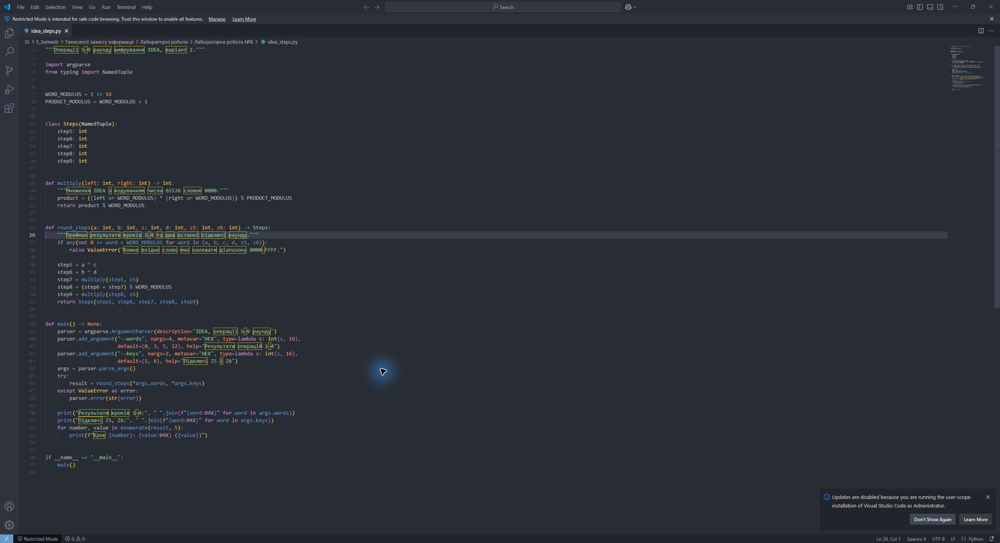

# Звіт до лабораторної роботи №8

**Дисципліна** «Технології захисту інформації»

**Тема** «Алгоритм шифрування даних IDEA»

| Відомості | Дані |
|---|---|
| Виконав | Левченко Д. В., група КН-24-1 |
| Перевірив | Андреєв П. І. |
| Варіант | 2 (номер за списком 12) |
| Рік | 2026 |

## Мета і завдання

Вивчити арифметичні операції IDEA та реалізувати кроки 5–9 одного раунду шифрування у вигляді функцій. У методичці десять завдань. За циклічним правилом `((12 − 1) mod 10) + 1 = 2`. Пункт 2 задає реалізацію кроків 5–9, а повний цикл шифрування винесено в пункт 5.

IDEA обробляє 64-бітовий блок як чотири 16-бітові слова. З 128-бітового ключа отримують 52 підключі. По шість підключів використовує кожен із восьми раундів, ще чотири потрібні для вихідного перетворення. У цій роботі вхідними даними є результати кроків 1–4 одного раунду (`A, B, C, D`) і підключі `Z₅, Z₆` цього раунду.

## Від правил до алгоритму

IDEA використовує три різні операції над 16-бітовими словами.

| Операція | Правило |
|---|---|
| XOR | Біти поєднуються попарно без переносу. Наприклад, `0003 ⊕ 000C = 000F`. |
| Додавання | Сума береться за модулем `2¹⁶ = 65536`. Результат знову займає 16 бітів. |
| Множення IDEA | Модуль дорівнює `2¹⁶ + 1 = 65537`. Перед множенням слово `0000` означає 65536. Якщо результат дорівнює 65536, він знову записується словом `0000`. |

Число 65536 дорівнює `−1 mod 65537`. Завдяки такому кодуванню всі 65536 можливих слів відповідають ненульовим остачам для множення. Наприклад, `0000 ⊙ 0000` дає `(−1)·(−1) ≡ 1 (mod 65537)`, тобто `0001`. Для XOR і додавання `0000` має звичайне значення нуля.

| Крок | Вираз | Звідки беруться дані |
|---:|---|---|
| 5 | `T₅ = A ⊕ C` | Результати кроків 1 і 3 |
| 6 | `T₆ = B ⊕ D` | Результати кроків 2 і 4 |
| 7 | `T₇ = T₅ ⊙ Z₅` | Крок 5 і п'ятий підключ |
| 8 | `T₈ = (T₆ + T₇) mod 65536` | Кроки 6 і 7 |
| 9 | `T₉ = T₈ ⊙ Z₆` | Крок 8 і шостий підключ |

Функція `round_steps()` перевіряє, чи всі шість слів належать діапазону `0000…FFFF`, і виконує формули в цьому порядку. Функція `multiply()` реалізує спеціальне подання нуля. Результати повертаються разом, щоб їх було зручно звірити з ручним розрахунком. У повному раунді `T₇` і `T₉` далі використовуються у кроках 10–14.

*Рисунок 1. Функція множення IDEA та реалізація кроків 5–9.*

## Контрольний приклад і ручна перевірка

Для прикладу обрано 64-бітовий блок `0000 0001 0002 0003` та 128-бітовий ключ `0001 0002 0003 0004 0005 0006 0007 0008`. Ці значення обрано для простого ручного розрахунку. Перші шість 16-бітових слів ключа є підключами першого раунду. За кроками 1–4 отримуємо `A = 0000 ⊙ 0001 = 0000`, `B = 0001 + 0002 = 0003`, `C = 0002 + 0003 = 0005`, `D = 0003 ⊙ 0004 = 000C`. Для решти розрахунку використовуємо `Z₅ = 0005` та `Z₆ = 0006`.

| Крок | Ручний розрахунок | HEX | Десяткове значення |
|---:|---|---|---:|
| 5 | `0000 ⊕ 0005` | `0005` | 5 |
| 6 | `0003 ⊕ 000C` | `000F` | 15 |
| 7 | `5·5 mod 65537` | `0019` | 25 |
| 8 | `(15 + 25) mod 65536` | `0028` | 40 |
| 9 | `40·6 mod 65537` | `00F0` | 240 |

Програма без аргументів видає ці самі п'ять значень. Другий запуск перевіряє граничні випадки. Для слів `FFFE FFFF 0000 0000` та ключів `0001 0000` маємо `T₅ = FFFE`, `T₆ = FFFF`, `T₇ = FFFE`. На кроці 8 сума `65535 + 65534 = 131069` після взяття остачі за модулем 65536 дає `65533 = FFFD`. На кроці 9 нульовий підключ означає 65536, тому `65533·(−1) mod 65537 = 4`. Вивід програми в цьому випадку закінчується словом `0004`.

Успішно виконано п'ять тестів. Вони перевіряють обидва розрахунки, множення нульових слів, випадок нуля після XOR і відхилення значень поза діапазоном.

## Відповіді на контрольні питання

1. **Для чого призначений IDEA і як він працює?** Це симетричний блоковий шифр із блоком 64 біти та ключем 128 бітів. Він використовує вісім раундів і вихідне перетворення. У раундах поєднуються XOR, модульне додавання та множення.
2. **Для чого призначений ДСТУ ГОСТ 28147:2009?** Це симетричний блоковий шифр із блоком 64 біти та ключем 256 бітів. Перетворення блока складається з 32 раундів і використовує додавання за модулем `2³²`, підстановки, циклічний зсув та XOR. [Опис алгоритму, додаток Б](https://kzmi.mil.gov.ua/images/stories/24_03_21/%D0%9C%D0%B5%D1%82%D0%BE%D0%B4%D0%B8%D1%87%D0%BD%D1%96%20%D1%80%D0%B5%D0%BA%D0%BE%D0%BC%D0%B5%D0%BD%D0%B4%D0%B0%D1%86%D1%96%D1%97%20%D0%B7%20%D0%BD%D0%B0%D0%BF%D0%B8%D1%81%D0%B0%D0%BD%D0%BD%D1%8F%20%D0%BC%D0%B0%D0%B3%D1%96%D1%81%D1%82%D0%B5%D1%80%D1%81%D1%8C%D0%BA%D0%BE%D0%B3%D0%BE%20%D0%BF%D1%80%D0%BE%D0%B5%D0%BA%D1%82%D1%83.pdf)
3. **Як створюються псевдовипадкові числа?** Генератор починає з початкового стану і змінює його за визначеним алгоритмом. Частина стану або результат його перетворення видається як наступне число. Однаковий початковий стан дає однакову послідовність.
4. **Які режими можна використовувати з Blowfish?** Типові приклади — ECB, CBC, CFB та OFB. Режим визначає спосіб застосування блокового перетворення до послідовності даних. [Опис Blowfish автора](https://www.schneier.com/academic/blowfish/)
5. **Які режими можна використовувати з IDEA?** Так само можна застосовувати ECB, CBC, CFB та OFB. Застосування IDEA в режимі CBC для CMS описано в [RFC 3058](https://www.rfc-editor.org/rfc/rfc3058).

## Висновок

Реалізовано операції 5–9 раунду шифрування IDEA. Контрольний приклад дав значення `0005 000F 0019 0028 00F0`. Ручний розрахунок і тести підтвердили порядок операцій та правильну обробку нульового підключа і переходу через межу 16-бітового слова.

## Джерело завдання

«Методичні вказівки щодо виконання лабораторних робіт з навчальної дисципліни “Технології захисту інформації”», лабораторна робота №8, пункт 2, с. 39–44.
