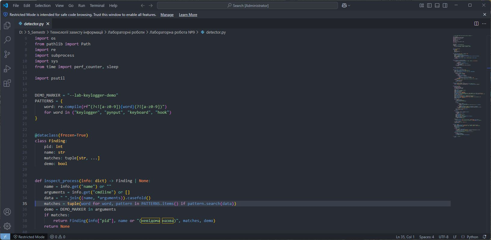
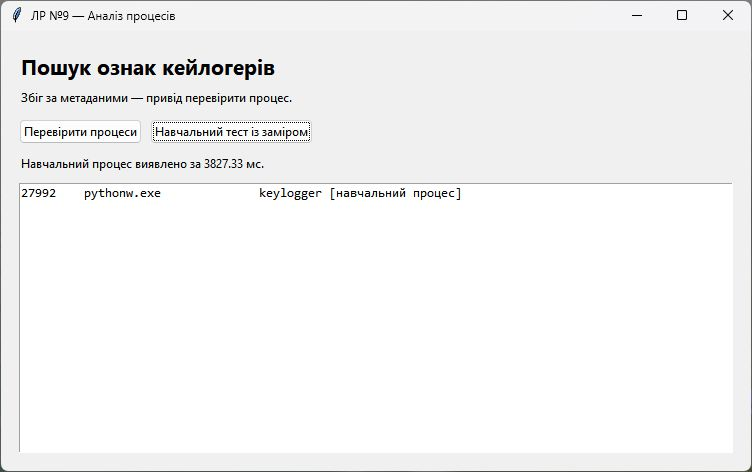

# Звіт до лабораторної роботи №9

**Дисципліна** «Технології захисту інформації»

**Тема** «Протидія кейлогерам засобами Python»

| Відомості | Дані |
|---|---|
| Виконав | Левченко Д. В., група КН-24-1 |
| Перевірив | Андреєв П. І. |
| Завдання | Спільне для групи, без поділу на варіанти |
| Рік | 2026 |

## Мета і завдання

Навчитися знаходити процеси з ознаками, які можуть вказувати на перехоплення клавіатурного введення. Для цього потрібно отримати список процесів, перевірити їхні назви та аргументи запуску, виміряти час виявлення контрольного процесу й вивести результат у графічному вікні.

Кейлогер приховано збирає інформацію про натискання клавіш. Детектор цієї роботи аналізує **метадані процесу**. Це відомості, які операційна система може повідомити про програму, що працює. Для навчального експерименту використано безпечний імітатор із маркером у командному рядку. Він кілька секунд залишається в списку процесів, щоб сканер встиг його знайти. Натискання клавіш у цьому експерименті не збираються.

## Хід роботи

### 1. Готуємо процес, для якого знаємо правильну відповідь

Файл [demo_process.py](./demo_process.py) запускається з аргументом `--lab-keylogger-demo`. Цей аргумент існує спеціально для досліду. Коли скрипт запускає Python, операційна система надає новому процесу PID, тобто числовий ідентифікатор. Запис із назвою процесу та аргументами доступний для читання через `psutil`.

| Що бачить сканер | Приклад | Навіщо це потрібно |
|---|---|---|
| PID | Значення, яке повернув запуск процесу | Дає змогу відрізнити тестовий процес від решти програм |
| Назва процесу | `python.exe` | Може бути джерелом ключового слова |
| Аргументи командного рядка | Серед аргументів є `--lab-keylogger-demo` | Пояснюють, чому знайдено збіг, хоча назва процесу звичайна |

### 2. Зіставляємо поля процесу з правилами пошуку

У [detector.py](./detector.py) виклик `psutil.process_iter()` запитує поля `pid`, `name` і `cmdline`. Детектор пропускає власний процес. Якщо якийсь процес завершився під час обходу або його властивості недоступні, перевірка продовжується для інших записів. Недоступне поле обробляється як порожнє. [Документація psutil](https://psutil.readthedocs.io/stable/index.html#psutil.process_iter)

1. Функція `inspect_process()` об’єднує назву та аргументи в рядок і вирівнює регістр через `casefold()`. Тому `KeyLogger.exe` і `keylogger.exe` дають однаковий збіг.
2. Сканер шукає слова `keylogger`, `pynput`, `keyboard` та `hook`. У регулярних виразах біля слова не повинно бути латинської літери або цифри. Через це `webhook.exe` не дає збігу за `hook`, а в аргументі `--lab-keylogger-demo` слово `keylogger` виділяється дефісами й дає збіг.
3. Сканер використовує аргументи запуску для пошуку збігів. У результаті він виводить лише PID, назву процесу й знайдені слова.

Розберімо контрольний випадок. Функція отримує назву `python.exe`. У ній жодного ключового слова немає. Далі функція бачить аргумент `--lab-keylogger-demo`, у якому є слово `keylogger`. Тож у результаті з’являються `python.exe`, його PID та причина збігу `keylogger`. Програма додає позначку «навчальний процес», бо маркер є окремим аргументом запуску.



На рис. 1 рядки 16–20 задають навчальний маркер і список слів. У рядках 32–35 програма читає назву та аргументи процесу, зводить текст до одного регістру й шукає збіги. У рядках 36–39 вона перевіряє навчальний маркер і повертає результат лише за наявності збігу.

### 3. Заміряємо час до знаходження саме нашого процесу

1. `measure_demo()` записує час через `perf_counter()` безпосередньо перед запуском імітатора.
2. Після запуску вона запам’ятовує PID дочірнього процесу й починає обхід списку процесів.
3. Успішний результат вимагає одночасно двох умов. PID збігається з PID запущеного дочірнього процесу, і серед його аргументів є точний маркер `--lab-keylogger-demo`.
4. У момент збігу програма знову читає таймер. Різницю в секундах множить на 1000, щоб отримати мілісекунди. Після експерименту дочірній процес завершується.

Заміри охоплюють запуск Python та обхід процесів до збігу. Це час виявлення в цьому експерименті, а не тривалість одного порівняння рядків. Якщо потрібного процесу немає серед результатів, програма має повторити обхід у межах відведених п’яти секунд або повідомити про тайм-аут.

## Результати перевірки

На Windows зроблено п’ять окремих запусків навчального процесу. У кожному випадку сканер виявив контрольний PID за словом `keylogger`.

| Запуск | Час, мс |
|---:|---:|
| 1 | 3822,92 |
| 2 | 3843,93 |
| 3 | 3840,34 |
| 4 | 3837,08 |
| 5 | 3838,24 |

Сортуємо п’ять значень за зростанням. Третє значення, тобто медіана, становить **3838,24 мс** (близько **3,84 с**). Час залежить від комп’ютера та списку запущених процесів.

Ось вивід окремого контрольного запуску команди `python detector.py demo`.

```text
27196    python.exe               keylogger [навчальний процес]
Час від початку запуску до виявлення: 2574.86 мс
```

Читаємо цей результат зліва направо. `27196` — PID, який Windows видала саме цьому запуску. `python.exe` — назва процесу. `keylogger` — слово, яке сканер знайшов у маркері `--lab-keylogger-demo`. Позначка в дужках вказує, що знайдено навчальний процес. Другий рядок показує час цього окремого запуску. Він не входить до таблиці п’яти замірів вище.

П’ять автоматичних тестів перевіряють збіг у назві, збіг в аргументах, відсутні метадані, відсікання часткового слова та одночасний збіг двох ознак. Усі тести пройшли. Окремо перевірено, що кнопка навчального тесту в Tkinter запускає реальний імітатор, а результат з’являється в текстовому полі.

## Як показати роботу програми

1. Відкрий вікно командою `python detector.py gui`. Кнопка **«Перевірити процеси»** показує поточні збіги.
2. Натисни **«Навчальний тест із заміром»**. Програма запустить дочірній процес із маркером і перевірить його PID.
3. Прочитай рядок результату зліва направо. На рис. 2 видно PID `27992`, назву `pythonw.exe`, слово `keylogger` і позначку «навчальний процес». У цьому запуску вікно відкрили через `pythonw.exe`, тому імітатор також запустився через `pythonw.exe`.
4. Подивись на рядок над результатом. Він показує **3827,33 мс** від запуску імітатора до його виявлення. Це окремий замір через графічне вікно. Команда `python detector.py demo` запускає такий самий експеримент у консолі.



Сканування виконується в окремому потоці, тому вікно продовжує реагувати на дії. Під час перевірки кнопки тимчасово вимкнені. Коли дані готові, основний потік вікна отримує їх із черги й оновлює текст.

## Що можна стверджувати за результатами

Збіг `keyboard` у назві може належати звичайній утиліті клавіатури. Так само в процесу, який збирає введення, у назві та аргументах може не бути жодного слова зі списку. Отже, збіг є сигналом для додаткової перевірки, а відсутність збігу означає лише, що сканер не знайшов заданих слів у доступних йому полях.

## Контрольні питання

1. **Що таке кейлогер?** Програма або пристрій, що фіксує натискання клавіш без відома користувача.
2. **Як працює кейлогер?** Він отримує події введення й накопичує відомості про натиснуті клавіші. Наприклад, програмний кейлогер може спостерігати за подіями введення в операційній системі.
3. **Яку інформацію дає `psutil.process_iter()`?** У цій програмі запитуються PID, назва та аргументи запуску. Бібліотека також дозволяє запитувати час створення процесу, стан та інші доступні властивості.
4. **Що таке аналіз процесів?** Це перегляд запущених програм за їхніми властивостями. Тут назва й аргументи порівнюються зі списком слів, щоб знайти записи для подальшої перевірки.
5. **Чим можна отримати відомості про процеси?** У Python для цього підходить `psutil`. У Windows також можна отримати відомості через WMI, наприклад про екземпляри класу `Win32_Process`.

## Висновок

Детектор знайшов контрольний процес за словом у його аргументах. Усі п’ять запусків дали очікуваний збіг, медіанний час становив 3,84 с. Графічне вікно показує причину збігу й час, щоб можна було пояснити кожен етап перевірки.
